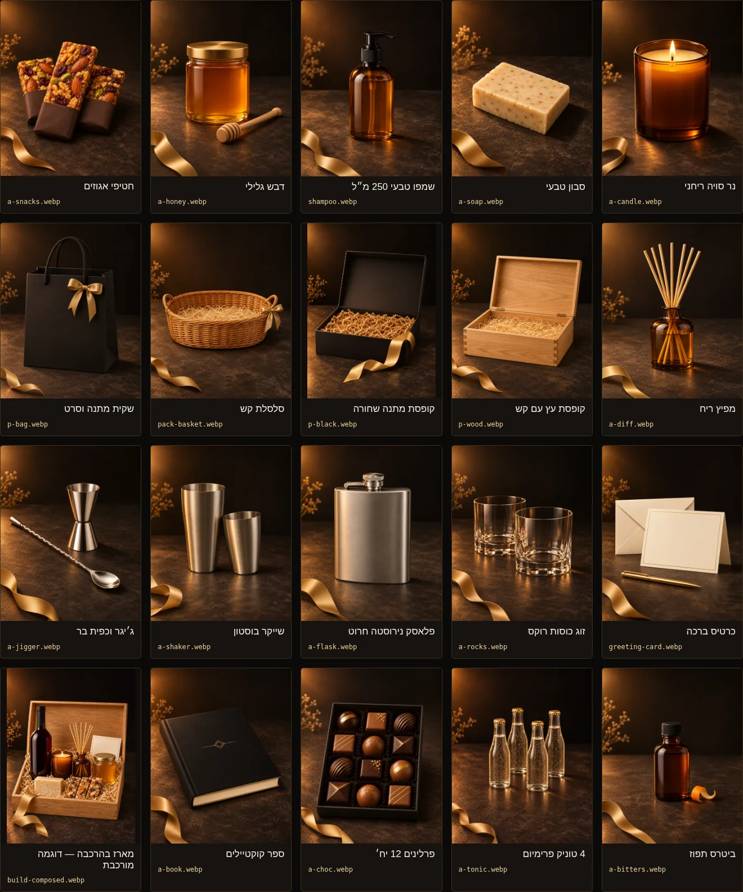

# הרוח הצפונית — תוספות ואריזה v3

20 תמונות WebP שנוצרו ב־AI למארז בהרכבה: כל 13 התוספות ו־3 האריזות שב־BUILD, שמפו וסלסלה לפי הבקשה, כרטיס ברכה ודוגמת מארז מורכב. הסגנון מבוסס ישירות על `north/img/v2/spa-product.webp`: רקע שחור חם, אור ענברי וסרט זהב בגוון `#c8a45a`.

[גלריה עם הגדלה ל־100% והעתקת נתיבים](index.html) · [מיפוי CSV](mapping.csv) · [מיפוי ומפרט JSON](manifest.json)

## מפרט

- כל תמונת מוצר קטנה מ־200,000 בתים (200KB עשרוניים). גודל מרבי: **193,982 בתים**. משקל כולל של 20 התמונות: **3,614,346 בתים**.
- 18 תמונות במידות 1120×1400; הקופסה השחורה ודוגמת המארז במידות 1025×1400. יחס המקור נשמר ללא חיתוך או מתיחה, עד לעיגול לפיקסל.
- כל תמונה כוללת תיאור חלופי, מיפוי לקטלוג, מידות, משקל, SHA-256, איכות קידוד והנחיית יצירה ב־manifest.json.
- הבקבוקים ללא תוויות, הפלאסק חלק להכנת חריטה, וכרטיס הברכה ריק לכתיבה אישית. הספר כולל עיטור קווי זהב כללי ללא כותרת או כיתוב.
- אלו הדמיות להמחשה; מקור מפרט הפריטים הוא `north/js/products.js` בתאריך 04.11.2026.

## קובץ ← פריט

| קובץ | פריט | מזהה / מקור בקטלוג | מידות | KB עשרוני |
|---|---|---|---|---:|
| [a-candle.webp](a-candle.webp) | נר סויה ריחני | `a-candle` | 1120×1400 | 162.1 |
| [a-soap.webp](a-soap.webp) | סבון טבעי | `a-soap` | 1120×1400 | 192.0 |
| [shampoo.webp](shampoo.webp) | שמפו טבעי 250 מ״ל | `PRODUCTS.spa.contents` · לפי הבקשה | 1120×1400 | 172.5 |
| [a-honey.webp](a-honey.webp) | דבש גלילי | `a-honey` | 1120×1400 | 182.5 |
| [a-snacks.webp](a-snacks.webp) | חטיפי אגוזים | `a-snacks` | 1120×1400 | 187.4 |
| [a-diff.webp](a-diff.webp) | מפיץ ריח | `a-diff` | 1120×1400 | 183.0 |
| [p-wood.webp](p-wood.webp) | קופסת עץ עם קש | `p-wood` | 1120×1400 | 188.8 |
| [p-black.webp](p-black.webp) | קופסת מתנה שחורה | `p-black` | 1025×1400 | 170.5 |
| [pack-basket.webp](pack-basket.webp) | סלסלת קש | `PRODUCTS.honey.contents` · לפי הבקשה | 1120×1400 | 193.0 |
| [p-bag.webp](p-bag.webp) | שקית מתנה וסרט | `p-bag` | 1120×1400 | 191.5 |
| [greeting-card.webp](greeting-card.webp) | כרטיס ברכה | ברכה הכלולה במארז | 1120×1400 | 169.8 |
| [a-rocks.webp](a-rocks.webp) | זוג כוסות רוקס | `a-rocks` | 1120×1400 | 187.5 |
| [a-flask.webp](a-flask.webp) | פלאסק נירוסטה חרוט | `a-flask` | 1120×1400 | 163.5 |
| [a-shaker.webp](a-shaker.webp) | שייקר בוסטון | `a-shaker` | 1120×1400 | 168.8 |
| [a-jigger.webp](a-jigger.webp) | ג׳יגר וכפית בר | `a-jigger` | 1120×1400 | 173.2 |
| [a-bitters.webp](a-bitters.webp) | ביטרס תפוז | `a-bitters` | 1120×1400 | 194.0 |
| [a-tonic.webp](a-tonic.webp) | 4 טוניק פרימיום | `a-tonic` | 1120×1400 | 181.6 |
| [a-choc.webp](a-choc.webp) | פרלינים 12 יח׳ | `a-choc` | 1120×1400 | 192.4 |
| [a-book.webp](a-book.webp) | ספר קוקטיילים | `a-book` | 1120×1400 | 174.8 |
| [build-composed.webp](build-composed.webp) | מארז בהרכבה — דוגמה מורכבת | דוגמת הרכבה תקינה לפי BUILD | 1025×1400 | 185.7 |

## התאמה ל־BUILD

כל 13 מזהי `BUILD.addons` וכל 3 מזהי `BUILD.packs` מכוסים פעם אחת. שמפו מופיע בתכולת מארז הספא וסלסלה בתכולת מארז הדבש; שניהם הוכנו לפי הבקשה ומסומנים במיפוי עם `catalogId: null`, משום שאינם מוגדרים בבונה הנוכחי.

דוגמת המארז (`build-composed.webp`) מציגה בסיס אחד (`b-red`), חמש תוספות (`a-candle`, `a-soap`, `a-diff`, `a-honey`, `a-snacks`), קופסת עץ (`p-wood`) וברכה. שלושת חטיפי האגוזים נספרים כתוספת אחת. זו דוגמת הרכבה סטטית.

בתמונות נבדקו במיוחד: שתי כוסות רוקס, שני חלקי שייקר בוסטון, ארבעה בקבוקי טוניק ללא קופסה, 12 פרלינים ברשת 3×4 ושבעה מקלות במפיצי הריח. האריזות מצולמות ריקות עם מילוי טבעי.

## בדיקות

- כל 20 קובצי ה־WebP הסופיים נפתחו ונבדקו חזותית במידות המקור: תכולה, כמויות, מסגור והיעדר מותג קריא על גוף המוצר, פקקים, השתקפויות ורקע.
- פענוח מלא של הקבצים, פורמט WebP, מגבלת 200,000 בתים, מידות ו־SHA-256 עברו. טבלת CSV מכילה 20 שורות והמיפוי תואם ל־BUILD, כולל מגבלת חמש תוספות בדוגמת המארז.
- גלריית הבדיקה עברה ב־Chromium במחשב 1440×1080 ובנייד 390×844: טעינת כל התמונות, יחסי התמונות המוקטנות, סינון, חיפוש, העתקה ללוח, הגדלה ל־100%, ניווט מקלדת וסגירה. ללא שגיאות JavaScript, בקשות שנכשלו או גלילה אופקית של העמוד.
- [תוצאות הבדיקה](review/checks.json) · [צילום מחשב](review/desktop.webp) · [צילום נייד](review/mobile.webp). שלושת קובצי התצוגה בתיקיית review הם צילומי גלריה; גם הם WebP קטנים מ־200KB.

- `npm test` עבר: 3,170 בדיקות עברו, 0 נכשלו ו־47 מסומנות לדילוג לפי תצורת הפרויקט.

## שימוש

1. פותחים את [הגלריה](index.html), בוחרים תמונה ולוחצים על ״100%״ לבדיקת הפרטים.
2. לוחצים ״העתקת נתיב״ בכרטיס לקבלת הנתיב מהחנות, למשל `img/v3/a-candle.webp`.
3. משתמשים ב־[מיפוי JSON](manifest.json) או ב־[טבלת CSV](mapping.csv) לשיוך למזהי BUILD. להצגת הפריט בשלמותו מומלץ לשמור על יחס התמונה ולהשתמש ב־`object-fit: contain` כשנדרש מסגור אחיד.
