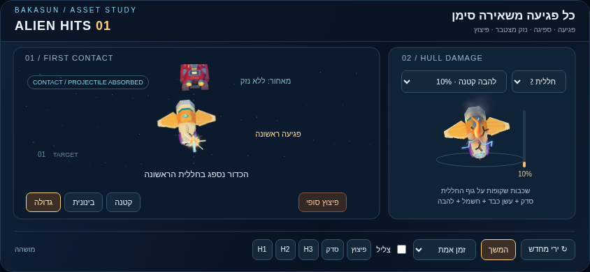

# Alien Hits v1 — דוח מסירה

תאריך: 17/11/2026. ריפו: `roynaor-work/Bakasun`. ענף: `codex/alien-hits-v1`.
בסיס: `f5f2b40814fc0e2186daed1ac100a8d806dd3a7d`.

החבילה מוכנה לחיבור: פגיעה עם גל הלם, ניצוצות והבזק בשלוש עוצמות; ספיגת קליע והתפשטות חום; חמש שכבות נזק; פיצוץ סופי; חמישה צלילים מקוריים בשני פורמטים. ההדגמה מציגה קליע שנעצר בחללית הראשונה, ואת שכבות הנזק על חמש חלליות המקור בתנועה.

כל הקבצים נוספו **בתוך `workout/island/design/alien-hits-v1/` בלבד**. המשחק הקיים לא חובר לחבילה ולוגיקת החדירה שלו לא שונתה. `ops/CONTROL.md` נקרא; רישום המסירה וקריטריון הסיום נמצאים כאן בהתאם להנחיה המפורשת להגביל את השינויים לתיקייה החדשה. לא שונו קובצי גרסה, service worker, תצורה או קבצים קיימים.

קריטריון סיום: נכסים במסגרת התקציב, פריימים ושקיפות תקינים, הדגמה עובדת ב־844×390, סינתזה ניתנת לשחזור, תיעוד חיבור, בדיקות, commit ו־push לענף המבוקש.

## תוצרים ותקציב

התקציבים נבדקו לפי הפירוש המחמיר: 600,000 בתים לאטלס ו־40,000 בתים לכל קובץ צליל. גם זוג OGG+MP3 של כל צליל קטן מ־40,000 בתים.

| אטלס | מידות | פריימים | משקל בבתים |
|---|---|---|---|
| `impacts.png` | 768×512 | 24 | 59,595 |
| `damage.png` | 1024×512 | 31 | 128,891 |
| `explosion.png` | 960×384 | 10 | 172,857 |

שלושת אטלסי האפקטים ועשרת קובצי הצליל יחד: **407,988 בתים**. אטלס החלליות וצילומי התצוגה מיועדים לסקירה ואינם חלק מתקציב הטעינה המוצע למשחק.

שלושתם PNG מסוג RGBA8 עם alpha ישר, ללא רקע, ללא matte, ובשוליים שקופים של 3 פיקסלים בכל תא. כל הפריימים בעלי תוכן, שונים זה מזה וממופים ב־`manifest.json`. אין trimming או סיבוב פריימים באטלס. הרינדור הוא `source-over`, כך שגם עשן, סדק ולהבה עובדים ללא מצב חיבור מיוחד.

| אפקט | פריימים | קצב | התנהגות |
|---|---|---|---|
| פגיעה קטנה / בינונית / גדולה | 6 לכל עוצמה | 24 fps | 250 מ״ש, גל הלם טורקיז, ניצוצות ענבריים והבזק בהיר |
| ספיגה `absorb` | 6 | 24 fps | 250 מ״ש, קליע מתקצר לתוך נקודת המגע, חום מתפשט ודועך |
| סדק `crack` | 1 | סטטי | ענפים כהים, שפת מתכת ושארית חום |
| עשן קל / עשן כבד | 8 לכל שכבה | 12 fps | לולאה; כבד מחליף קל |
| ניצוצות חשמל `electric` | 6 | 18 fps | לולאה, ענפים משתנים בציאן וכחול |
| להבה קטנה `flame` | 8 | 12 fps | לולאה, בסיס מקומי קבוע וניצוצות עולים |
| פיצוץ סופי `explosion` | 10 | 20 fps | 500 מ״ש, הבזק, אש, גל לחץ, רסיסים ועשן דועך |

סה״כ: **65 פריימים, 10 קליפים, 3 אטלסים**. הפגיעה והספיגה מוצמדות לנקודת המגע בגוף; שכבות הנזק אינן מכילות ציור של חללית ולכן אפשר להצמיד אותן לכל ספרייט. הספים ב־manifest הם הצעת עיצוב: סדק ב־80%, עשן קל ב־60%, כבד ב־40%, חשמל ב־25%, להבה ב־10%, פיצוץ ב־0% חיים. הם אינם שינוי באיזון המשחק.

| צליל | משך PCM | OGG בבתים | MP3 בבתים |
|---|---|---|---|
| `hit-01` | 180 מ״ש | 4,964 | 1,923 |
| `hit-02` | 210 מ״ש | 5,192 | 2,341 |
| `hit-03` | 240 מ״ש | 5,398 | 2,550 |
| `crack` | 260 מ״ש | 5,528 | 2,550 |
| `explosion` | 720 מ״ש | 9,887 | 6,312 |

כל הצלילים mono ב־44.1kHz; OGG/Vorbis ו־MP3 ב־64kbps. סינתזה מקורית של מתנדים, תהודות לא הרמוניות ורעש מסונן, עם seed קבוע ומעטפת כניסה/יציאה. אין דגימות, הקלטות או מוזיקה. עשרת הקבצים פוענחו ב־FFmpeg וב־Chromium; לא נמצא clipping, offset משמעותי או זנב שנקטע בחדות. שיא הקובץ הגבוה ביותר אחרי פענוח הוא ‎−2.27 dBFS. מדידות מפורטות ו־SHA-256 נמצאים ב־`verification.json`, `audio-metadata.json` ו־`manifest.json`.

## צפייה ובדיקה

1. משורש הריפו מפעילים שרת מקומי:

   ```sh
   python3 -m http.server 8765 --bind 127.0.0.1
   ```

2. פותחים [את התצוגה בשרת המקומי](http://127.0.0.1:8765/workout/island/design/alien-hits-v1/preview.html).
3. בוחרים עוצמה ולוחצים ״ירי מחדש״. התוצאה: פגיעה אחת בחללית הקדמית, ספיגה במקום המגע, ו־0 פגיעות בחללית שמאחוריה. ״הילוך איטי״ מאפשר לראות את ששת הפריימים. ״השהיה״ עוצר את הזמן.
4. בוחרים אחת מחמש החלליות ואת מצב הנזק. התוצאה: הסדק ושאר השכבות נשארים מחוברים לגוף בזמן תנועה וסיבוב; עשן ולהבה מתפשטים מעבר לשוליו.
5. ״פיצוץ סופי״ מעלים את גוף המטרה והשכבות שלו ומפעיל את עשרת פריימי הפיצוץ. ״ירי מחדש״ מחזיר את המטרה.
6. מסמנים ״צליל״ להשמעת הפגיעות בהדגמה; כפתורי H1/H2/H3/סדק/פיצוץ מאפשרים האזנה נפרדת. ההשמעה מתחילה רק בפעולת משתמש; קיימת חלופת MP3 ל־OGG.

הבמה היא 844×390 פיקסלים לוגיים. מסך צר מציג אותה מוקטנת תוך שמירת יחס הממדים. `prefers-reduced-motion` מתחיל במצב מושהה. אין תלות ב־CDN או בשירות חיצוני; הקבצים נטענים מקומית. פתיחה ישירה ב־`file://` אינה נתמכת בגלל טעינת ה־manifest.



## הנחיות חיבור ללוגיקת המשחק

ב־`workout/island/minigames/alien-flight-model.mjs`, לולאת הירי כבר מחשבת מגע סחוף באמצעות `segmentContact` וממיינת מגעים לפי `t`. כיום הסרת קליע אחרי פגיעה רגילה מותנית ב־`--s.hp <= 0`; כשמונה החדירות גדול מ־1, אותה ירייה יכולה לפגוע גם בחלליות נוספות.

לחיבור ההתנהגות המבוקשת:

1. בוחרים רק את המגע הראשון התקף בעל `t` הנמוך ביותר, לרבות מגן. מיקום הפגיעה הוא `previousShot + t * (nextShot - previousShot)`, ולא מרכז החללית או מיקום הקליע בסוף הצעד.
2. שומרים את מיקום הפגיעה במערכת הצירים המקומית של החללית. מפעילים פגיעה לפי הנזק שנגרם בפועל יחד עם `absorb`; מסירים את הקליע ממאגר היריות **בפגיעה הראשונה, בלי תלות ב־`s.hp`**, ויוצאים מלולאת המגעים. הקליע שבאנימציית הספיגה הוא ציור בלבד ואינו ישות שיכולה לגרום נזק נוסף.
3. במגע עם מגן מסירים את הקליע באותה דרך ומציגים הבזק/גל הלם. ספיגת גוף וסדק מתאימים רק לפגיעה בגוף שנגרם לה נזק.
4. מעדכנים שכבות נזק לפי יחס `hp/maxHp`. סדק וצליל סדק מופעלים פעם אחת במעבר למצב סדוק. עשן כבד מחליף עשן קל; חשמל ולהבה מצטרפים לפי הספים. מגבילים את מספר נקודות הנזק לכל חללית ומאפסים אותן בעת שימוש חוזר בישות מהמאגר.
5. בכל ציור מחשבים `ship.position + rotate(ship.angle, localContact * ship.scale)`. את `pivot` של כל קליפ מחסרים בעת ציור הפריים. ל־smoke/flame ציר הפליטה הוא `(64,96)`; לשאר שכבות הנזק `(64,64)`. צריך להמיר את מיקום המגע לפי הסקייל והיחס המדויק של הספרייט המוצג. בתצוגת Three.js יש להקרין את נקודת הגוף לעולם המסך או להשתמש ב־billboard מתאים; ספרייט מסך קבוע לא יספיק לחללית שמשנה קנה מידה.
6. בהשמדה מסתירים מיד את הגוף ואת שכבות הנזק. מפעילים `explosion` במיקום העולם האחרון ואת צליל הפיצוץ פעם אחת. מסירים את האפקט אחרי 500 מ״ש; זנב הצליל מסתיים בעצמו אחרי 720 מ״ש.

הצעת תקציב: עד 24 זוגות פגיעה/ספיגה, 5 שכבות נזק לחללית ו־4 פיצוצים במקביל. באודיו: OGG תחילה, MP3 כחלופה, gain ראשי מוצע 0.55 ועד 6 קולות; אין להשמיע סדק בכל פריים. אין לחתוך את כל שכבות הנזק לפי alpha של החללית, כי כך העשן והלהבה ייחתכו בשולי הגוף.

הוראות אלה הן חוזה חיבור. תיקון לוגיקת החדירה, הפעלת הנכסים במשחק ובדיקת טלפון אחרי חיבור נשארים לשלב האינטגרציה.

## שחזור ואימות

דרישות הבנייה: Python 3, Pillow, NumPy, FFmpeg עם libvorbis/libmp3lame. אפיית תצוגת החלליות ובדיקות הדפדפן דורשות גם Playwright ו־Chromium ב־`/usr/bin/chromium`. ה־Three.js והדגמים נקראים מתוך הריפו, ללא שינוי בהם.

```sh
python3 workout/island/design/alien-hits-v1/bake_preview.py
python3 workout/island/design/alien-hits-v1/synthesize.py
python3 workout/island/design/alien-hits-v1/build_assets.py
python3 workout/island/design/alien-hits-v1/verify.py
```

הבנייה נבדקה ב־Python 3.12.14, Pillow 12.3.0, NumPy 2.3.5 ו־FFmpeg 7.1.5. קובצי WAV זמניים נבנים מחוץ לריפו ונמחקים בסיום. כל תוצרי הקבע נשארים בתיקייה זו. משחזור הסינתזה והאטלסים התקבלו אותם SHA-256 לכל המדיה ול־manifest באותה סביבת כלים; גרסאות encoder אחרות עשויות לשנות בתים דחוסים.

תוצאות `verify.py`:

- 14 קובצי מדיה עם גודל ו־SHA-256 תואמים; 65 פריימים תקינים, בלי תא ריק, בלי פריים כפול בתוך קליפ ובלי גלישה לשולי התא.
- שלוש עוצמות הפגיעה גדלות בשטח הנראה; כל האטלסים RGBA שקופים וכל הקבצים עומדים בתקציב.
- פענוח עשרת קובצי האודיו ובדיקת codec, mono, קצב דגימה, משך, DC, שיא וזנב.
- 8 בדיקות דפדפן: עצירה במטרה הראשונה בשלוש עוצמות, צעד זמן גדול של 0.8 שניות, היצמדות לנקודה מקומית בגוף נע, 25 צירופי חללית/נזק, השמעת כל הצלילים ופענוח שני הפורמטים, ניקוי פיצוץ אחרי 500 מ״ש, מסגור בשתי מידות והעדפת תנועה מופחתת.
- אפס שגיאות JavaScript ואפס תגובות HTTP שנכשלו. צילומים ב־`preview-844x390.png` וב־`preview-390x844.png`; התצוגה המצולמת נבדקה גם בעין.
- `node --check preview.js` ו־`git diff --cached --check` תקינים.
- בדיקות הריפו המלאות, `PLAYWRIGHT_BROWSERS_PATH=/tmp/alien-hits-system-browser npm test`: **3,278 עברו, 0 נכשלו, 56 דולגו**, מתוך 3,334 בדיקות; זמן 181 שניות. אין שינוי בקובצי הבדיקות. ההרצה הראשונה נתקעה בגלל Chromium שחסר במיקום ברירת המחדל של Playwright; ההרצה המוצלחת השתמשה במיפוי זמני ל־`/usr/bin/chromium`. גם בדיקת הדפדפן של האימון, שאינה קשורה לחבילה, עברה בהרצה נפרדת. המיפוי והלוגים נשארו ב־`/tmp` ולא צורפו לחבילה.

לא בוצעה בדיקה בטלפון פיזי או במשחק המחובר; ההדגמה אינה מדידת ביצועים של מנוע המשחק.

## מקור ורישוי

האפקטים, האודיו והקוד החדשים מקוריים ומשוחררים ב־CC0-1.0; ראו [LICENSE.txt](LICENSE.txt). חמש החלליות ב־`preview-ships.png` הן רינדורים של מודלי Meshy הקיימים של בעל הריפו, לפי `assets/ultra-alien/provenance.json`. לא יוחס להן CC0 ולא שונו המודלים או חומריהם. גם תוכן החלליות בצילומי המסך נשאר כפוף לתנאי המקור. תוצרי המשחק המיועדים לחיבור הם שלושת אטלסי האפקטים ועשרת קובצי הצליל; אטלס החלליות מיועד להדגמה בלבד.
