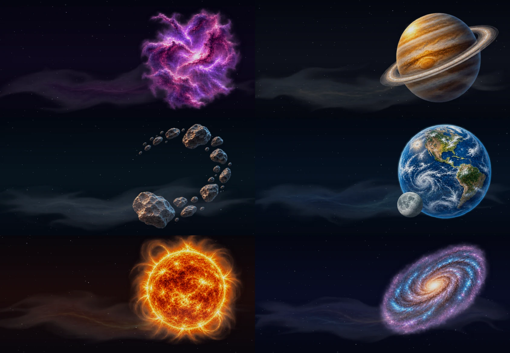

# רקעי חלל · alien-space-v1

נוצר ב־14.11.2026 עבור `roynaor-work/Bakasun`, בענף `codex/alien-space-v1`.
בסיס העבודה: `11fef2fb98eec4173381346caee94f2930f9cffa` מתוך `origin/main`.

החבילה כוללת שישה נושאים ל־30 שלבים: שלוש שכבות PNG לכל נושא, ענני גז בשכבה הקרובה, שני צבעי כוכבים נופלים ופיצוץ רקע בן ארבעה פריימים. מדובר בשש ערכות גרפיקה וב־30 הגדרות תצוגה; בכל חמישיית שלבים משתנים נקודת המבט, מופע התנועה, מהירות הסחיפה, עוצמת הגז ותדירות האפקטים. כל איורי ה־PNG ללא כיתוב, מותגים או סימני מים.



## תוצרים ומשקל

התקציב נמדד בבתים עשרוניים: עד **800,000 בתים לנושא**, כולל שלוש השכבות ושני אטלסי האפקטים המשותפים במלואם. קובצי תצוגה, בדיקות, תיעוד וצילומי אימות אינם נכסי ריצה ואינם חלק מתקציב ה־PNG.

| שלבים | נושא | תיקיית PNG | סך בתים כולל אפקטים | KB |
|---|---|---|---:|---:|
| 1–5 | נבולה סגולה | `themes/purple-nebula/` | 336,517 | 336.517 |
| 6–10 | כוכב לכת טבעות | `themes/ringed-planet/` | 321,588 | 321.588 |
| 11–15 | שדה אסטרואידים | `themes/asteroid-field/` | 313,050 | 313.050 |
| 16–20 | ירח וכדור הארץ | `themes/earth-moon/` | 328,433 | 328.433 |
| 21–25 | שמש וקורונה | `themes/sun-corona/` | 374,285 | 374.285 |
| 26–30 | גלקסיה | `themes/galaxy/` | 329,444 | 329.444 |

20 קובצי PNG בסך **1,825,132 בתים ייחודיים**. שני אטלסי האפקטים יחד: 35,637 בתים; הם נספרו שוב במלואם בתקציב של כל נושא. הנושא הכבד ביותר מנצל 46.8% מהמגבלה.

| נכס | גודל | שימוש |
|---|---|---|
| `far.png` בכל נושא | 1024×512 | שדה כוכבים אטום, אריח אופקי עם התאמה מדויקת בין עמודת הקצה הראשונה והאחרונה |
| `mid.png` בכל נושא | 1024×512 | איור הנושא על רקע שקוף, מוקד חזותי בצד ימין |
| `near.png` בכל נושא | 1024×512 | ענני גז שקופים, סחיפה נפרדת ושוליים לתנועת מצלמה |
| `effects/shooting-stars.png` | 512×128 | שני תאים בגודל 256×128; וריאציות צבע עצמאיות, כחול וסגול |
| `effects/explosion.png` | 512×128 | ארבעה תאים רציפים בגודל 128×128: הצתה, התרחבות, גל הדף, דעיכה |

משך הפיצוץ 720ms: ‏100 / 140 / 200 / 280ms. האטלס נשאר באותו קנה מידה ובאותו מרכז בכל ארבעת הפריימים, עם שוליים שקופים בין התאים. הפיצוץ מוצג מאחורי שכבת הנושא, בגודל 82×82 ובעוצמה מתונה. תדירות ברירת המחדל היא אירוע בכל 12–18 שניות; אין הבזק מסך מלא.

## צפייה

1. מתוך תיקיית הריפו, הפעילו שרת מקומי:

   ```sh
   python3 -m http.server 8765 --bind 127.0.0.1
   ```

2. פתחו את [התצוגה המקומית](http://127.0.0.1:8765/workout/island/design/alien-space-v1/preview.html). בחרו נושא בסרגל התחתון, או שלב מסוים דרך **כלים**. אזור הציור הוא 844×390 ומותאם לחלון ללא שינוי יחס הממדים.
3. ב־**כלים** ניתן להשהות, לכבות כל שכבה, לבודד את האפקטים ולבחור כל אחד מארבעת פריימי הפיצוץ. הזזת העכבר משנה עומק. מקש **H** מסתיר או מחזיר את הממשק; **Escape** סוגר את חלונית הכלים.
4. לתצוגה נקייה של שלב מסוים, הוסיפו לפרטי הכתובת `?level=16&clean=1`. התוצאה הרצויה היא רקע מלא ללא ממשק, עם מוקד הנושא בימין ומרחב משחק כהה יותר משמאל ובמרכז.

התצוגה משתמשת רק בקבצים מקומיים. `manifest-data.js` הוא עותק אוטומטי של `manifest.json` כדי להימנע מ־fetch של JSON בפתיחה ישירה. זהות העותק נבדקת. בסביבת הבדיקה פתיחת `file://` נחסמה במדיניות הדפדפן; לכן פתיחה ישירה לא אומתה. כל בדיקות הדפדפן בוצעו באמצעות HTTP מקומי.

## חוזה לחיבור למשחק

- [manifest.json](manifest.json) מכיל מפת `levels` מלאה ל־1–30, שש רשומות `themes`, סדר שכבות, מסלולים יחסיים, גדלים, SHA-256, משקל, עומק, שקיפות, טווחי תנועה, מלבני חיתוך וזמני פריימים.
- נקודת האפס של שכבה: `(viewport - textureSize) / 2`, כלומר ‎−90,−61 בתצוגה המבוקשת. השכבות האמצעית והקרובה נעות בטווח מוגבל; רק הרחוקה חוזרת אופקית. אין לגלול את שכבות האיור והגז כאריחים חוזרים.
- סדר הציור: רחוק → פיצוץ → אמצע → ענני גז → כוכבים נופלים. אלפא ישרה, sRGB, סינון ליניארי; ללא mipmaps. כל ממדי המרקמים הם חזקות של שתיים.
- לטעון רק את שלוש שכבות הנושא הפעיל ואת שני האטלסים המשותפים. אומדן זיכרון RGBA לא דחוס: 6.5MiB לנושא פעיל כולל האפקטים, לעומת 36.5MiB אם כל ששת הנושאים נטענים יחד. התצוגה טוענת את כולם לצורך מעבר מיידי בביקורת.
- העדפת תנועה מופחתת מקפיאה את השכבות ומבטלת אפקטים אוטומטיים. השהיה מקפיאה גם את שעון האפקטים. פקדי בדיקה ידניים מאפשרים לבחון פריים סטטי גם כשהתנועה מופחתת.

החבילה עצמאית. החיבור למנוע המשחק, טעינה עצלה ושחרור מרקמים יבוצעו בעת האינטגרציה. לא נמדדו FPS או זיכרון GPU בטלפון פיזי.

## מקור ורישיון

איורי גרמי השמים, ענני הגז והאפקטים נוצרו עבור המשימה באמצעות OpenAI image generation. בוצע סבב עידון לאטלס גרמי השמים כדי להשאיר את כל ההילות בתוך התאים ללא חיתוך מלבני. הכוכבים הרחוקים הם שדה נקודות מקורי עם גרדיאנט ודיתרינג עדין למניעת פסי צבע כהים.

אריזת האטלסים בוצעה ב־Sharp: חיתוך תאים, שינוי גודל, מיקום, שוליים שקופים וקידוד PNG. שלוש תמונות המקור נשמרו מחוץ לריפו, בתיקיית התמונות שנוצרו בצ'אט; הן אינן חלק מהמשקל הנמסר. [provenance.json](provenance.json) שומר את SHA-256 של המקורות ואת פרטי העיבוד. סקריפט הבנייה מקבל את שלושת המקורות האלה כפרמטרים; אין כאן טענה שניתן ליצור מחדש פיקסלים זהים מפרומפט בלבד.

הרישיון לכל קובצי החבילה: [CC0-1.0](LICENSE.txt), לרבות שימוש מסחרי ושינוי. אין בחבילה תמונות stock, תמונות NASA, גופנים חיצוניים או נכסים ממותגים.

## אימות

סביבה: Node 24.19.0, ‏Sharp 0.35.4, ‏Playwright 1.57.0, ‏Chromium 151.0.7922.173.

- [בדיקות נכסים](verification/assets.json): 20 PNG, ממדים וחתימות, שקיפות בפיקסלים, שוליים שקופים, התאמת קצוות האריח, מפת שלבים ותקציב מלא לכל נושא — עברו.
- [בדיקות דפדפן](verification/browser.json): כל 30 השלבים רונדרו ב־844×390 ונמצאו 30 חתימות פיקסלים שונות; סחיפה, בחירת שלב, כיבוי שכבות, ארבעת פריימי הפיצוץ, זמני המעבר, השהיה וחידוש, תנועה מופחתת, דיווח על PNG חסר ו־390×844 ללא גלילה אופקית — עברו. אין שגיאות JavaScript, בקשות חיצוניות או תשובות HTTP שנכשלו במסלול התקין.
- נבדקו חזותית [ששת הרקעים](verification/overview.webp), [התצוגה עם הפקדים](verification/preview-ui.webp) ו־[ארבעת פריימי הפיצוץ](verification/explosion-frames.webp).
- [בדיקות המאגר](verification/repository-tests.json): בהרצת `npm test` עברו **4,135**, דולגו **64**, ונכשלה **1** מתוך 4,200. הכשל היחיד: בדיקת הדפדפן הקיימת `tests/workout-royiki.test.mjs`, שניסתה להפעיל `chromium_headless_shell-1234` שאינו מותקן בסביבה. הבדיקה השאירה שרת HTTP פתוח לאחר הכשל; תהליך הבדיקה הזה בלבד הופסק לאחר אבחון. אותה בדיקה שוחזרה בנפרד, ללא שינוי בקובץ, עם Chromium המותקן דרך משתנה `ISLAND_PLAYWRIGHT` ושימת הפעלה זמנית מחוץ לריפו: **5 מתוך 5 עברו**, אפס כישלונות, כ־23.7 שניות. בהרצה הנפרדת הוגדר `--test-force-exit` כדי למנוע השארת שרת פתוח. אין כאן טענה שהרצת `npm test` הרגילה הסתיימה בקוד יציאה 0.

להרצה חוזרת, עם Sharp ו־Playwright מותקנים וזמינים לפתרון מודולים:

```sh
node workout/island/design/alien-space-v1/tools/validate-assets.mjs
node workout/island/design/alien-space-v1/tools/check-preview.mjs
```

אפשר להגדיר `SHARP_MODULE`, ‏`PLAYWRIGHT_MODULE` ו־`CHROMIUM_PATH` למסלולי ההתקנות בסביבה. הבדיקה מפעילה וסוגרת שרת HTTP פרטי לתיקייה הזאת בלבד.

## גבולות השינוי

כל הקבצים חדשים ונמצאים בתוך `workout/island/design/alien-space-v1/` בלבד. לא שונו קובצי משחק, נכסי ריצה קיימים, גרסה, service worker או הגדרות פריסה. `ops/CONTROL.md` לא עודכן בהתאם להגבלת המשימה לקבצים חדשים בתיקייה הזאת בלבד. הדחיפה מיועדת לענף `codex/alien-space-v1`.
