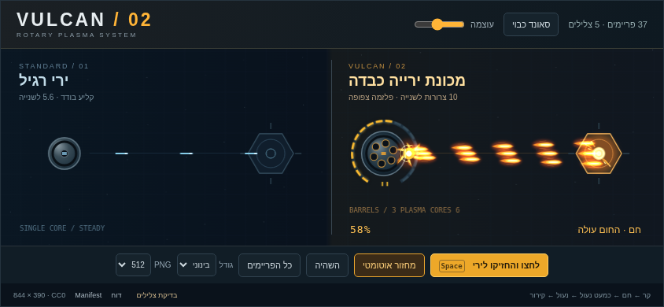
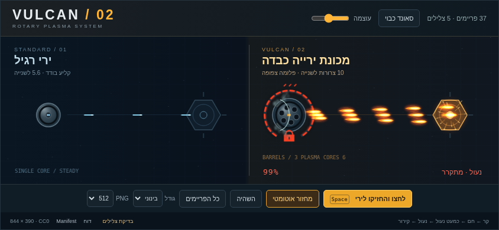
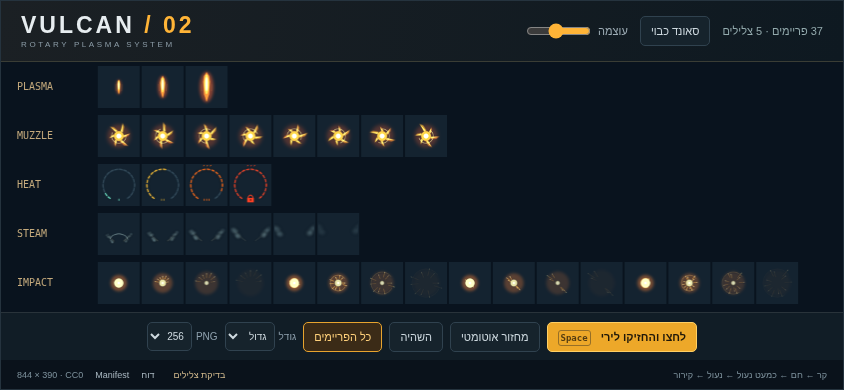

# וולקן v2 — חבילת נכסים למסירה

תאריך: 14.11.2026. ריפו: `roynaor-work/Bakasun`. ענף: `codex/aliens-vulcan-v2`.
בסיס: `19d9cdc5e3718236df5a2fc4d8b8c26c72007575` — גרסת v23 עם כפתורים נפרדים לירי רגיל ולוולקן.

הושלמה חבילת וולקן עם פלזמה עבה בצהוב־כתום, שישה קנים מסתובבים בהדגמה,
צרורות צפופים, קשת חום עם סימון נעילה וקיטור. הירי הרגיל מופיע לידה להשוואה.
כל השינויים הם קבצים חדשים בתיקייה זו. החבילה מוכנה לביקורת ולחיבור למשחק;
לא בוצע חיבור לקוד המשחק.

| משימה | ענף | מוכן כש… | תוצאה |
|---|---|---|---|
| נכסי וולקן v2 | `codex/aliens-vulcan-v2` | 37 פריימים, PNG שקוף 256/512, חמשת הצלילים בשני פורמטים, תצוגת 844×390, שחזור, דוח ו־push | הנכסים והתצוגה הושלמו ונבדקו |

## תכולה ומשקל

37 פריימים בכל רזולוציה, 74 בסך הכול. כל PNG הוא RGBA שקוף, במידות 256×256
או 512×512. המלבנים, ציר הסיבוב, זמן הפריים ומצב השילוב מתועדים ב־[manifest.json](manifest.json).

| אטלס | פריימים | PNG 256, בתים | PNG 512, בתים |
|---|---:|---:|---:|
| `plasma` — קטן, בינוני, גדול | 3 | 22,862 | 67,168 |
| `muzzle` — הבזק מסתובב | 8 | 30,633 | 90,402 |
| `heat` — קר, חם, כמעט נעול, נעול | 4 | 36,133 | 103,971 |
| `steam` — התרחבות ודעיכת קיטור | 6 | 11,871 | 38,866 |
| `impact` — מניפה, כתר, שבר אלכסוני, התנפצות; ארבעה פריימים לכל וריאציה | 16 | 53,420 | 156,082 |
| סך הכול | 37 | 154,919 | 456,489 |

האטלס הגדול ביותר: **156,082 בתים**, מתחת למגבלת 600,000 בתים.
כל חמשת אטלסי 512 יחד: **456,489 בתים**. טוענים רזולוציה אחת לפי המכשיר.
שוליים שקופים של שני פיקסלים בכל תא מונעים זליגת שכנים; אין מט רקע שחור.

| צליל | משך | OGG+MP3 יחד, בתים | התנהגות |
|---|---:|---:|---|
| `fire-loop` | 1.5 שניות | 28,114 | 15 פעימות ירי ו־45 פעימות קנה, לולאה רציפה |
| `spin-up` | 0.4 שניות | 10,584 | סל״ד עולה |
| `spin-down` | 0.4 שניות | 10,629 | סל״ד יורד |
| `overheat` | 0.48 שניות | 12,118 | נקישת מצמד עמומה המציינת נעילה |
| `cooldown` | 0.72 שניות | 16,299 | פסיקה מכנית ואז שחרור אוויר |
| סך הכול | | **77,744** | כל עשרת קובצי הסאונד יחד מתחת ל־80,000 בתים |

האודיו מונו, 44,100Hz. OGG/Vorbis quality 4, MP3 ב־96kbps עם מידע לתיקון השהיית
המקודד. כל קובצי המדיה יחד: **689,152 בתים**. אין WAV נוספים בטעינה או במסירה.

## הדגמה

[preview.html](preview.html) מציג מסך מלא של 844×390, ללא תלות חיצונית:

1. מפעילים שרת HTTP משורש הריפו: `python3 -m http.server 8765`.
2. פותחים `http://127.0.0.1:8765/workout/island/design/aliens-vulcan-v2/preview.html`.
3. צופים במחזור האוטומטי: ירי, התחממות, נעילה, קיטור, התקררות ופתיחה מחדש.
4. מפעילים סאונד, ומחזיקים את כפתור הירי או Space כדי לבדוק התחלה ושחרור.
5. בוחרים גודל פלזמה ורזולוציה. ״כל הפריימים״ מציג את כל 37 הפריימים.
6. ב״בדיקת צלילים״ אפשר לשמוע כל צליל לחוד; בדיקת הלופ מנגנת שלוש חזרות.

התצוגה נפתחת ללא סאונד. הפעלה מחייבת מחוות משתמש, עם בקרת עוצמה.
השהיה, מעבר לרקע ושחרור מחוץ לכפתור מפסיקים ירי. מצב reduced motion נפתח מושהה.
החלליות והחייזרים לא משוכפלים בהדגמה: המתקנים והמטרות הם משטחי בדיקה לאפקטים.

## חיבור לגרסת v23

המספרים נלקחו בקריאה בלבד מ־`minigames/alien-v23.mjs` ומ־`alien-flight-model.mjs`:
10 פעימות וולקן בשנייה, 12 פעימות עד נעילה, שתי שניות נעילה, השהיית מנוחה של
0.5 שניות וקירור מלא בשתי שניות. הנפשה והדגמת הסאונד נמצאות רק בחבילה.

| אירוע/ערך קיים | נכס או התנהגות לחיבור |
|---|---|
| `shot.vulcan` | מציגים שלושה רכיבי פלזמה לכל פעימת ירי, בזוויות ‎−2°, 0°, ‎+2°. זהו ריבוי ויזואלי; הנזק וההתנגשות נשארים של הירייה המקורית |
| `model.vulcanOn` | אנימציית `muzzle` ב־25fps, שמונה פריימים במחזור 320ms; recoil קצר בהדגמה |
| `model.vulcanHeat` | אטלס `heat`: קר מתחת ל־50%, חם מ־50%, כמעט נעול מ־80% |
| `model.vulcanLocked` | מצב `locked` קודם לכל סף חום, גם כאשר המד מתרוקן; סמל מנעול וקשת מלאה |
| תחילת נעילה | `overheat` פעם אחת, `cooldown` אחרי 120ms ו־`steam` פעם אחת ב־12fps |
| פגיעה בחייזר | וריאציה מתוך `fan/crown/fracture/shatter`, ארבעה פריימים ב־45ms לפריים; משך 180ms |
| תחילת ירי | `spin-up`; לופ מתחיל ב־360ms ונכנס ברמפה של 40ms |
| שחרור | רמפת יציאה של 40ms מהלופ ו־`spin-down`; מבטלים גם מקור לופ שטרם התחיל |
| pause/hidden/dispose | משחררים טריגר, מפסיקים מקורות ומשהים את AudioContext |

הפריימים מצוירים בכיוון ‎−Y; Canvas משתמש בסיבוב ברדיאנים בכיוון השעון. בהדגמה
הם מסובבים ב־π/2 לירי ימינה. ה־pivot במרכז. תצוגת הפלזמה משתמשת בריבועים
44/53/62px ושומרת על צורת הליבה המאורכת שנמצאת בתוך התא.

`plasma`, `muzzle`, `impact` מיועדים ל־`lighter`; קיטור וקשת חום ל־`source-over`.
ה־alpha ישר, הסינון ליניארי, wrap הוא clamp-to-edge, ללא mipmaps לאטלסים אלה.
אפשר להשאיר את הירי הרגיל פעיל גם בזמן נעילת הוולקן, כפי שגרסת v23 מאפשרת.

לסאונד: מפענחים פורמט אחד ל־AudioBuffer ומנגנים ב־AudioBufferSourceNode.
OGG מועדף, עם ניסיון MP3 אם הפענוח נכשל. `loopStart=0`, ‏`loopEnd=buffer.duration`.
`preview.js` כולל מימוש מלא של הרמפות, המעברים וניקוי המקורות.
מידע ה־delay/padding של MP3 חייב להישמר; ניגון חזרתי של HTMLAudio אינו מסלול ההדגמה.

## איכות סאונד שנמדדה

הסינתזה המקורית משלבת גוף נמוך, סל״ד, רעש מסונן ופעימות קנים. מסנן הספקטרום
מתחיל ב־2.4kHz ומסיים ב־3.2kHz; אין שריקה או אזעקה חדה. ללופ יש קצוות עם
כתפי cosine של 10ms ושולי שקט של 128 דגימות, בתוך המשך הנתון, להפחתת תוצרי דחיסה בחיבור.

| מדידה לאחר פענוח | OGG לופ | MP3 לופ |
|---|---:|---:|
| דגימות | 66,150 | 66,150 |
| משך | 1.500000 שניות | 1.500000 שניות |
| RMS | ‎−12.065dBFS | ‎−12.490dBFS |
| True peak, בדגימת יתר פי ארבעה | ‎−2.851dBFS | ‎−3.484dBFS |
| קפיצת דגימה בגבול הלופ | 0.0000896 FS | 0.0001314 FS |
| אותה קפיצה בדציבלים | ‎−80.95dBFS | ‎−77.63dBFS |
| אנרגיה מעל 4kHz ביחס לכלל האנרגיה | ‎−91.58dB | ‎−92.87dB |

כל עשרת קובצי האודיו עברו בדיקות משך מדויק, DC, היעדר clipping וקצוות מרוככים.
בכולם האנרגיה מעל 4kHz נמוכה מ־‎−81dB ביחס לכלל האנרגיה. זו בדיקה חישובית;
התרשמות באוזניות וברמקול טלפון נשארת לבדיקה מתוך התצוגה.

## אימות ושחזור

- `python3 synthesize.py`: יוצר את עשרת האטלסים, עשרת קובצי האודיו, המניפסט והמדידות. משתמש בזרע `231114` ובדגלי bitexact למקודדים. שתי הרצות רצופות הפיקו מניפסט ו־SHA-256 זהים לכל קובצי המדיה.
- `python3 synthesize.py --verify-only`: **369 עברו, 0 נכשלו**. פירוט ב־[verification.json](verification.json): משקלים, שקיפות, gutters, גבולות כל פריים, משכים, ספקטרום, true peak ו־SHA-256.
- `python3 verify_preview.py`, כאשר השרת פועל: **62 עברו, 0 נכשלו**, ללא שגיאות JavaScript או בקשות רשת חיצוניות. פירוט ב־[browser-verification.json](browser-verification.json).
- בדיקות הדפדפן מפענחות בנפרד OGG ו־MP3 ומרנדרות שלוש חזרות ב־OfflineAudioContext, כך ששני חיבורי הלופ נבדקים בפועל. נבדקו גם מחזור חי, מגע, מקלדת, שחרור מחוץ לכפתור, הקשות מהירות, ניקוי מקורות, pause, pagehide ו־reduced motion.
- `node --check preview.js`: עבר.
- `npm test`: **4,017 עברו, 64 דולגו, כישלון סביבתי אחד** — בדיקת `tests/workout-royiki.test.mjs` ניסתה להפעיל Chromium שאינו מותקן במסלול ברירת המחדל, והשאירה שרת פתוח. לאחר שכל הקבצים האחרים הסתיימו נעצר רק תהליך הבדיקה התקוע, כדי לקבל את סיכום הריצה.
- הבדיקה החוזרת של אותו קובץ, עם `PLAYWRIGHT_BROWSERS_PATH` שמפנה מתיקייה זמנית ל־`/usr/bin/chromium`: **5 עברו, 0 נכשלו**, כולל בדיקת הדפדפן. בסך הבדיקות הייחודיות משתי ההרצות: **4,018 עברו, 0 כישלונות שנותרו, 64 דולגו**. זו הרצה מלאה ובדיקה חוזרת ממוקדת, ולא הרצת `npm test` מלאה שנייה. התוצאות והפתרון הסביבתי ב־[repository-tests.json](repository-tests.json); לא שונה קובץ ריפו לטובת הבדיקה.

דרישות שחזור: Python 3.10+, ‏Pillow, ‏NumPy, ‏SciPy ו־FFmpeg עם libvorbis/libmp3lame.
בדיקת התצוגה דורשת Playwright ו־Chromium. גרסאות כלים שונות עשויות לשנות את הבתים
המקודדים; המניפסט מתעד את קובצי המסירה עצמם.

כל הנכסים, הקוד והמדידות מקוריים ומסופקים ב־CC0-1.0; מקור כל רכיב מפורט ב־[LICENSE.txt](LICENSE.txt).
לא נוספו דגימות חיצוניות, נתונים אישיים, שינויים בגרסה או שינויים בקבצים קיימים.
רישום המשימה וקריטריון הסיום מובאים בדוח זה כדי לשמור על הגבלת התיקייה היחידה.
