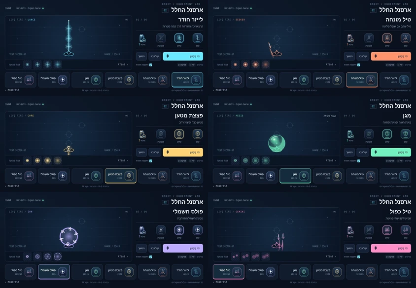

# נשקי חלל — חבילת נכסים 2

תאריך: 16 בנובמבר 2026. הושלמו שישה נשקים, עם גרפיקה וצלילים מקוריים ותצוגת ניסוי בגודל המבוקש.

ענף:

`codex/aliens-weapons-v2`

נקודת בסיס, אחרי עדכון מהענף הראשי:

`43b27dc235387e3cb737aee9558cdf9d5fd5a262`

כל התוספות נמצאות תחת התיקייה החדשה הזו. ההנחיות בשורש וחדר הבקרה נקראו; בהתאם לבקשה לקבצים חדשים בתיקייה זו בלבד, חדר הבקרה לא נערך. קריטריון הסיום: שישה סטים מלאים, עמידה במגבלות, תצוגה ובדיקות, דוח ודחיפת הענף. החבילה מיועדת למסירה וחיבור למשחק בשלב הבא.



## תכולה

| נשק | סימן זיהוי | מאפיין | אטלס, בתים |
|---|---|---|---:|
| לייזר חודר | קרן תכלת ארוכה | קרן באורך 464 פיקסלים, עם עיגון בבסיס והבזק חודר | 149,491 |
| טיל מונחה | טיל כתום עם כוונת | להבת הנעה ושובל נפרד; בתצוגה הטיל פונה לאורך המסלול | 63,267 |
| פצצת מטען | ליבת זהב משושה | אפקט טעינה ופיצוץ רחב, עם טבעת היקפית | 86,304 |
| מגן | בועה ירוקה | בועת זכוכית עם רשת משושים וגל ספיגה | 122,385 |
| פולס חשמלי | טבעת סגולה | ארבעה רדיוסים עוקבים וברקים על ההיקף | 99,270 |
| טיל כפול | זוג טילים ורודים | שני טילים, שתי להבות, שובל כפול ושתי נקודות פגיעה | 64,217 |

לכל נשק: אטלס שקוף עם 16 פריימים (ארבעה לקליע/בועה/טבעת, ארבעה לירי/הפעלה, ארבעה לפגיעה וארבעה לשובל/שארית); שלושה מצבי כפתור — זמין, לחוץ ומושבת; אייקון מחסנית מילוי ייעודי; צליל ירי וצליל פגיעה; מקור וקטורי ומחולל ניתן לשחזור. כל מצב כפתור ואייקון מילוי מגיע בווקטור ובתמונה שקופה בגודל 128×128. כל צליל מגיע בשני הפורמטים המבוקשים.

בסך הכול: 6 אטלסים, 96 פריימים, 18 מצבי כפתור, 6 אייקוני מילוי, 12 צלילים מקוריים ב־24 קובצי שמע, 84 קובצי נכסים כולל מקורות.

## מגבלות ורישיון

| מדד | תוצאה | תקרה |
|---|---:|---:|
| האטלס הגדול ביותר | 149,491 בתים | 600,000 |
| קובץ השמע הגדול ביותר | 9,538 בתים | 60,000 |
| כל נכסי הריצה, בשני הפורמטים | 895,078 בתים | — |
| כל הנכסים, כולל מקורות וקטוריים | 1,127,075 בתים | — |
| כפתורים ומילוי | 128×128 | 128×128 |
| אטלס לייזר | 1024×512 | — |
| חמשת האטלסים האחרים | 512×512 | — |

המגבלות נבדקו לפי קילובייט עשרוני. התמונה משתמשת בארבעה ערוצים ובאלפא רציפה, עם שני פיקסלים שקופים בשולי כל פריים. הצבע של פיקסלים שקופים אופס למניעת הילות בסינון.

הגרפיקה נוצרה מצורות וקטוריות מקוריות. השמע סונתז מגלי סינוס משתני תדר, הרמוניות ורעש מסונן עם זרעים קבועים; ללא הקלטות או דגימות חיצוניות. הצלילים מונו, בתדר דגימה 44.1 קילו־הרץ, באורך 0.30–1.00 שניות, עם דעיכות כניסה ויציאה למניעת קליקים. הקידוד משתמש בפלט דטרמיניסטי; שתי בניות רצופות הפיקו אותם גיבובים בכל 84 קובצי הנכסים, באותה סביבת כלים.

הנכסים משוחררים לנחלת הכלל; הקוד והתיעוד ברישיון מתירני. הנוסחים והקישור לנוסח המשפטי נמצאים ב־[קובץ הרישיון](LICENSE.txt). כלי הבנייה אינם נארזים כתלויות ריצה.

## תצוגה

מגישים את שורש הריפו באמצעות שרת מקומי:

```sh
python -m http.server 8765 --bind 127.0.0.1
```

1. פותחים [את זירת הניסוי המקומית](http://127.0.0.1:8765/workout/island/design/aliens-weapons-v2/preview.html).
2. בוחרים נשק בשורה התחתונה; ארבע תמונות הפגיעה מופיעות בפס הזירה. הקישור לאטלס פותח את התמונה המלאה.
3. מפעילים קול או לוחצים על דוגמת ירי/פגיעה. השמע מתחיל אחרי פעולה יזומה.
4. לוחצים שלוש פעמים על ירי הניסיון: המחסנית מתרוקנת והכפתור מושבת. לחיצה על המילוי מחזירה שלוש יחידות.
5. בודקים שהנשק שנבחר מוצג ושהממשק כולו נכנס למסך 844×390. אפשר לעצור, להמשיך או לבטל את ההדגמה החוזרת.

הדגמה חוזרת היא תצוגת נכסים ללא צריכת תחמושת. ירי יזום צורך תחמושת. קיצורי מקשים: 1–6 לבחירה, רווח לירי ואות ההשתקה שמופיעה בתחתית להפעלת קול. התצוגה תומכת בתנועה מופחתת, נעצרת ברקע ואינה שולחת בקשות לרשת חיצונית. רוחב קטן יותר מקטין את הזירה בפרופורציה.

פתיחה ישירה מהדיסק אינה נתמכת, מפני שקריאת המניפסט דורשת שרת מקומי. זו תצוגת נכסים עצמאית; הנחיית טיל, חדירת לייזר, נזק אזורי, הגנה ומלאי אמיתי דורשים חיבור ללוגיקת המשחק.

## חוזה חיבור

המניפסט הוא מקור המיפוי: מזהה, צבע, נתיבי קבצים, גודל אטלס, מלבני פריימים, נקודות עיגון, גדלי ציור מוצעים, זמני אנימציה, לולאות, כפתורים ושמע. כל קובץ נכסים כלול במלאי עם מספר בתים וגיבוב.

- המקור שמאל־למעלה, כיוון הקליע מעלה, סיבוב בכיוון השעון סביב נקודת העיגון. המלבנים אינם חתוכים או מסובבים באריזה.
- אלפא ישרה, מיזוג רגיל וסינון ליניארי. מכבים מפות הקטנה ומהדקים את גבולות הטקסטורה. לפני יצירת מפות הקטנה מוסיפים הרחבת שוליים בתהליך האריזה.
- פגיעה: ארבעה פריימים של 80 מילישניות, ללא חזרה; מסירים אותה לאחר 320 מילישניות. ירי: ארבעה פריימים של 40 מילישניות. קליעים: 90 מילישניות לפריים. שובל: 70 מילישניות לפריים, בלולאה. בוחרים פריים לפי זמן.
- הבועה נשארת על החללית; הפולס הוא התרחבות חד־פעמית. הלייזר מעוגן בבסיס הקרן, כך שאפשר לשנות את אורכו סביב אותה נקודה.
- גודל הפגיעה המוצע לפצצת המטען הוא 224×224 לעומת 96×96 לפגיעה רגילה. אלה גדלי ציור, ולא רדיוס נזק.
- טיל כפול נארז כזוג בפריים אחד. שני המסלולים ובדיקות ההתנגשות הם באחריות המשחק.
- אפשר לטעון רק את אטלס הנשק הפעיל והשמע שלו. המקורות, הכלים והאימות אינם נדרשים במשחק.

דוגמת ציור לפגיעה, אחרי טעינת המניפסט ותמונת האטלס:

```js
const weapon = manifest.weapons.find(w => w.id === 'charge-bomb');
const clip = weapon.animations.impact;
if (ageMs < clip.frameMs * clip.frames.length) {
  const frame = weapon.frames[clip.frames[Math.floor(ageMs / clip.frameMs)]];
  const [sx, sy, sw, sh] = frame.rect;
  const [dw, dh] = clip.displaySizePx;
  ctx.save();
  ctx.translate(hitX, hitY);
  ctx.drawImage(atlasImage, sx, sy, sw, sh,
    -frame.pivotPx[0] * dw / sw, -frame.pivotPx[1] * dh / sh, dw, dh);
  ctx.restore();
}
```

במשחק שבנקודת הבסיס קיים ארסנל עם טיל, ברק וגל הלם. הטיל המונחה מתאים חזותית לטיל הקיים, והפולס מתאים להרחבת טבעת גל ההלם. הברק השרשרתי והפולס בעלי התנהגות שונה. הלייזר הארוך, המטען והזוג דורשים התאמת התנהגות בעת החיבור. הבועה מתאימה למצב המגן הקיים. אין בחבילה שינוי למזהים או לחישובי נזק קיימים.

## אימות

| בדיקה | תוצאה / ראיה |
|---|---|
| נכסים וגיבובים | [עברו](verification/assets.json) |
| 96 פריימים | תוכן ושקיפות תקינים; ארבעה פריימים שונים בכל רצף; אין חפיפה או חיתוך |
| מצבי כפתור ומילוי | 24 זוגות וקטור/תמונה, 128×128; ארבע הגרסאות לכל נשק שונות |
| שמע מפוענח | 24 קבצים; קודק, משך, ערוץ, עוצמה, ממוצע ודעיכות נבדקו |
| דפדפן 844×390 | [עבר](verification/browser.json), כולל גבול תחתון, טעינה מקומית בלבד וללא שגיאות |
| כל ששת הנשקים | בחירה, ירי, פגיעה, ריקון, השבתה ומילוי נבדקו |
| ניגון בדפדפן | כל 24 הקבצים פוענחו ונוגנו בשני פורמטי המסירה |
| אנימציה ועצירה | פיקסלים משתנים בניגון, קפואים בעצירה, ממשיכים בחידוש |
| שימוש ונגישות | מקלדת, בחירה בלעדית, תנועה מופחתת ואפס גלילה אופקית ברוחב 390 |
| בנייה חוזרת | [84 קבצים זהים](verification/rebuild.json) בשתי בניות רצופות |
| בדיקות הריפו | [תוצאות](verification/repository-tests.json): בריצה המלאה 4,261 עברו, 64 דולגו, כשל סביבה אחד; קובץ הבדיקה שנכשל עבר בהרצה חוזרת, 5 מתוך 5 |

נבדקו חזותית [כל 96 הפריימים](verification/frames.webp), [כל מצבי האייקונים](verification/icons.webp), ו־12 צילומי זירה נפרדים של ירי ופגיעה. תוקנו הילות שנגעו בשוליים והותאם גובה הממשק למסגרת. הבדיקה נערכה בכרומיום; בדיקת טלפון פיזי ותקציב ביצועים בזמן המשחק יבוצעו בעת החיבור.

כשל הסביבה בריצה הכללית היה בבדיקת אנימציות אימון קיימת, שחיפשה דפדפן בנתיב המטמון המוגדר כברירת מחדל. אחרי יצירת נתיב זמני מחוץ לריפו לדפדפן המותקן, כל חמש הבדיקות באותו קובץ עברו, כולל בדיקת הדפדפן שנכשלה קודם. לא שונו קבצי הבדיקה או קוד המשחק. התוצאה המצטברת היא 4,262 בדיקות ייחודיות שעברו ו־64 דילוגים; הריצה המלאה עצמה הסתיימה בקוד יציאה 1, וההרצה החוזרת בקוד 0.

שחזור משורש הריפו:

```sh
python workout/island/design/aliens-weapons-v2/tools/build.py
python workout/island/design/aliens-weapons-v2/tools/validate.py
node workout/island/design/aliens-weapons-v2/tools/check-browser.cjs
python workout/island/design/aliens-weapons-v2/tools/contact-sheets.py
npm test
```

תלויות הבנייה והאימות: פייתון עם ספריות חישוב ותמונות, סביבת ג׳אווהסקריפט עם רסטרייזר וקטורי וכלי בדיקת דפדפן, כרומיום ומקודדי שמע. שמות החבילות המדויקים מפורטים בקובץ הרישיון ובראשי הסקריפטים. אפשר להגדיר נתיב כרומיום חלופי במשתנה הסביבה שבסקריפט. אין התקנה או בנייה כדי לצפות בחבילה דרך השרת.
