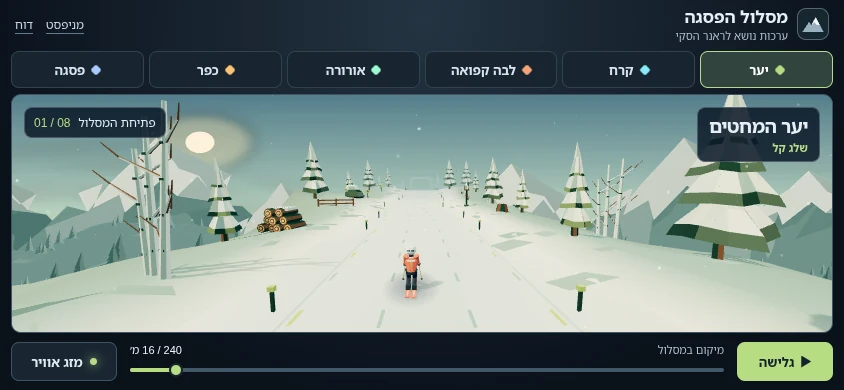
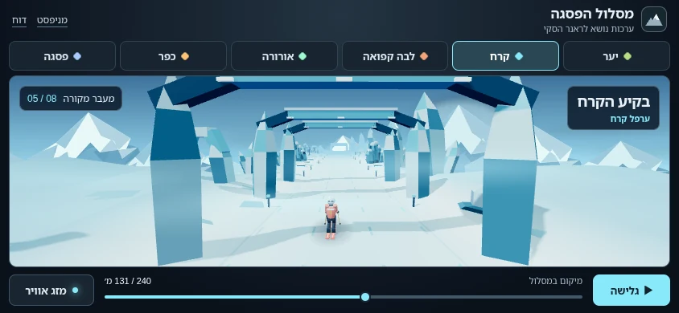
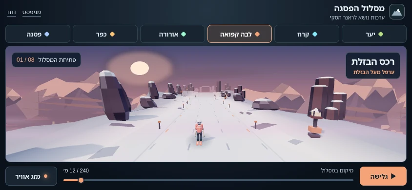
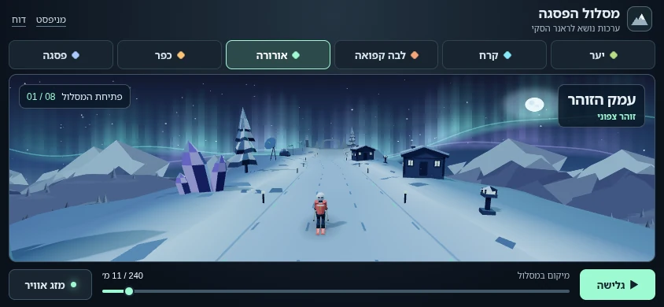
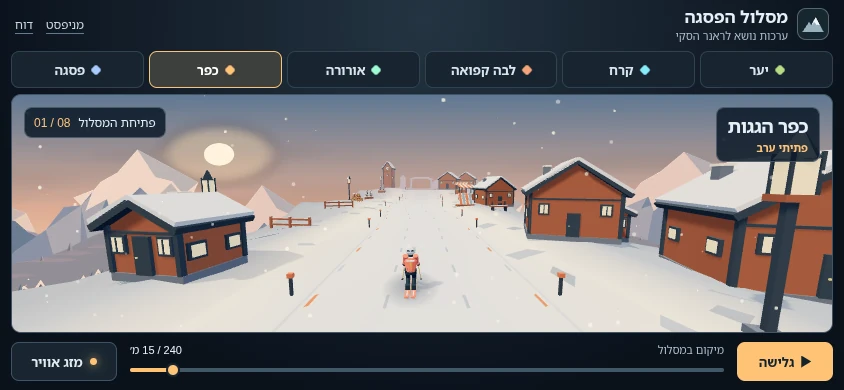
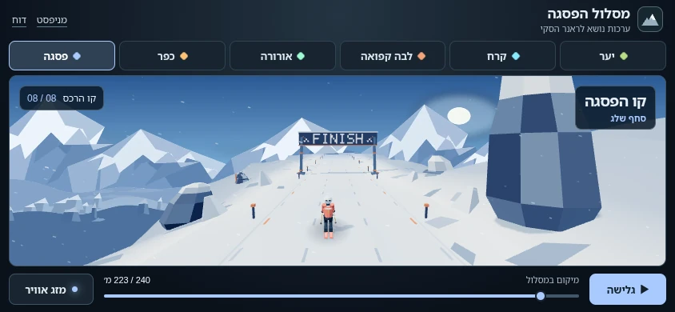

# מסירת ערכות הנושא לראנר הסקי

18/11/2026 · ענף `codex/alpine-runner-themes-v2` על בסיס `codex/alpine-runner-v1` בקומיט `e726ec0f811d5fdb200362c9a7a6ae6adc4582af`. כל הקבצים שנוספו מרוכזים בתיקייה זו.

כל ערכה כוללת 240 מטר ב־8 אריחים, 3 שכבות פרלקסה, 10 דגמי אביזרי צד, אפקט מזג אוויר ושני שלטים. יחד נמסרו **144 נכסים מקוריים** במשקל **3,963,820 בתים**. החבילה המלאה, כולל מקור, תצוגה וראיות בדיקה, שוקלת כ־**4.51 MB** מתוך תקרה של **8,000,000 בתים**. האריח הגדול ביותר שוקל **73,324 בתים**. [מניפסט עם גדלים וגיבובי SHA-256](manifest.json)

| ערכה | מראה המסלול | מזג אוויר | משקל נכסים בבתים |
|---|---|---|---:|
| יער | אשוחים מושלגים, ליבנה, ערימות עצים ומעקות ארז | שלג קל | 713,849 |
| קרח | צריחי קרח, שברי קרחון וגשר מעל גדות קפואות | ערפל קרח | 634,929 |
| לבה קפואה | בזלת, שכבות אובסידיאן ועורקי נחושת מתחת לכפור | ערפל מעל הבזלת | 605,730 |
| אורורה | לילה כחול, גבישים סגולים ועמדת תצפית מוארת | זוהר צפוני | 635,274 |
| כפר | בקתות, גגות מושלגים, מגדל שעון ואור חם בחלונות | פתיתי ערב | 755,027 |
| פסגה | מחטי סלע, רכס חשוף, ציוד מדידה ובקתת חילוץ | סחף שלג | 619,011 |

| יער | קרח |
|---|---|
|  |  |
| **לבה קפואה** | **אורורה** |
|  |  |
| **כפר** | **פסגה** |
|  |  |

[שלט התחלה ביער](verification/start-844x390.webp) · [שלט סיום בפסגה](verification/finish-844x390.webp) · [מקור ורישיונות](LICENSES.md)

## שימוש בתצוגה

1. מריצים משורש המאגר `python3 -m http.server 8765 --bind 127.0.0.1`.
2. פותחים את [התצוגה המקומית](http://127.0.0.1:8765/workout/island/design/alpine-runner-themes-v2/preview.html) בחלון לרוחב. בוחרים ערכה, גוררים את מד המרחק או לוחצים **גלישה**. בחירת ערכה שומרת את המיקום להשוואה.
3. בודקים את אפקט מזג האוויר בכפתור הייעודי. כשהמיקוד על מד המרחק, `Home` ו־`End` עוברים לשלטי ההתחלה והסיום. אפשר גם לפתוח ישירות קטע לפי `?theme=ice&at=131`.

התצוגה היא דף סקירה ב־844×390. היא משתמשת בגולש הקורל ובספריית התלת־ממד המקומית מתיקיית גרסת הבסיס הסמוכה. תצוגת המסלול קוראת את המניפסט בעת ההפעלה.

## מבנה לחיבור לראנר

- יחידות במטרים, `+Y` למעלה ו־`+Z` קדימה. שלושת מרכזי הנתיבים הם `−2.4, 0, +2.4` מטר. מזהי שמונת האריחים ועקומות המרכז תואמים לגרסת הבסיס.
- נקודת החיבור הקרובה ב־`z=0` והרחוקה ב־`z=30`. מוסיפים את `startMeters` לציר `z` של האריח ושל האביזרים המוצבים בו. נקודות המיקום של השלטים כבר נמדדות ביחס למסלול כולו.
- כל שכבת רקע היא תמונת WebP בגודל 1536×512. סדר הציור מהמניפסט הוא שמיים, רכסים ומורדות. שתי השכבות הקדמיות שקופות מעל קו הרקיע. `pixelsPerMeter` מגדיר גלילה אופקית חוזרת ביחס לרוחב 844 פיקסלים.
- קובץ JSON בכל ערכה מגדיר את פרמטרי מזג האוויר. המימוש ב־`weather.mjs` מציב את האורורה מאחורי הרכסים ומצייר שלג וערפל מעל הסצנה.
- המודלים הם GLB 2.0 עם חומרים וצבעי קודקודים כלולים. האפקטים מבוססים על Canvas 2D. ספירת תוספי המודלים ומפענחי הדחיסה בחבילה היא אפס.

## אימות

| בדיקה | תוצאה |
|---|---|
| Khronos glTF Validator ‏2.0.0-dev.3.10 | 120 מודלים, 0 שגיאות, 0 אזהרות, 0 הודעות מידע ו־0 רמזים |
| חיבורי אריחים | 2,304 חיבורים מכוונים בין אריחי v2 ו־768 חיבורים מול v1 בשני הכיוונים, בהתאמת מיקום ונורמלים. צבעי שפת החיבור נבדקו בתוך כל ערכה |
| הצבת אביזרים | כל 372 ההצבות מחוץ לרוחב המשחק ובתוך תחום האריח. דגמי אביזרי הצד מעוגנים לקרקע |
| Chromium ‏151 ב־844×390 | מעבר ב־48 אריחים, הפעלה וכיבוי של ששת האפקטים, שינוי מיקום, השהיה, חזרה מהסיום, מקלדת, מגע באמולציה, החלפה מהירה וגלישה רציפה של 240 מטר באורורה |
| טעינה מקומית | 24 משאבים לכל ערכה, 0 בקשות מחוץ לשרת המקומי, 0 שגיאות סקריפט ו־0 כשלים בטעינת הערכות |
| רכיבי דחיסה | 0 קובצי WASM ו־0 רכיבי Draco, meshopt או KTX2 |
| בנייה חוזרת | המניפסט וכל 144 הנכסים זהים בבנייה חוזרת עם Python 3.12 ו־Pillow 12.3.0 |
| בדיקות המאגר | 4,262 עברו, 64 דולגו, 0 נכשלו. בדיקת הדפדפן של המאגר השתמשה ב־Chromium המותקן באמצעות מתאם זמני מחוץ לעץ המקור |

[דוח נכסים ומחברים](verification/assets.json) · [דוח דפדפן](verification/browser.json)

## שחזור הבדיקות

הפקודות הבאות מיועדות לתיקיית הערכה. בדיקת הדפדפן משתמשת בשרת המקומי שבסעיף התצוגה. אפשר להגדיר `ALPINE_CHROMIUM` לנתיב הכרומיום המותקן. הבנייה משתמשת ב־Pillow 12.3.0 עם libwebp 1.6.0.

```sh
PYTHONDONTWRITEBYTECODE=1 python3 source/build.py
npm --cache /tmp/alpine-themes-npm --prefix /tmp/alpine-themes-qa install gltf-validator@2.0.0-dev.3.10 playwright-core@1.65.1 --no-audit --no-fund
node tools/verify.mjs /tmp/alpine-themes-qa
node tools/check-preview.mjs /tmp/alpine-themes-qa
```
