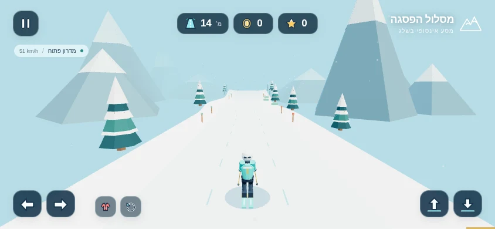

# מסירת Alpine Runner v1

נבנה בענף `codex/alpine-runner-v1` מתוך `main` בקומיט `43b27dc235387e3cb737aee9558cdf9d5fd5a262`, בתאריך 17/11/2026. כל התוספות נמצאות בתיקייה זו בלבד. קריטריון הסיום: חבילת נכסים מקוריים, תצוגה משחקית, בדיקות שחזוריות ודחיפת הענף.

החבילה כוללת ראנר סקי במבט מאחור: החלפת שלושה נתיבים, קפיצה, כריעה מתחת למכשול, איסוף, ארבעה כוחות מיוחדים, נפילה וקימה, ומסלול שממשיך במחזור עם שש משבצות טעונות. כל משבצת היא באורך 30 מטר. המצלמה והאביזרים עוקבים אחרי העיקול והשיפוע. הקוד והתלויות הדרושים לתצוגה מקומיים.

| דרישה | תוצאה |
|---|---|
| גולש מקורי, 1,200 משולשים, שלד קנוני | שלושה GLB: קורל, טורקיז וסגול; בכל קובץ בדיוק 1,200 משולשים ו־18 עצמות, כולל ציוד |
| תנועה ב־30Hz | 13 קליפים בכל חליפה: גלישה, שני מעברי נתיב, שלושה שלבי קפיצה, כריעה, שלוש נפילות, קימה, חגיגה וטורבו |
| שמונה סביבות | ישר, עיקול, שיפוע, גשר, מנהרת קרח, כפר, יער ופסגה |
| מכשולים | עץ, סלע, גדר נמוכה, קורה גבוהה, רכבל, חריץ קרח, איש שלג, פינגווין וכדור שלג מתגלגל |
| איסוף וכוחות | מטבעות בקשתות, כוכבים, מגנט, מגן, טורבו ומטבע כפול; הכוחות פעילים בתצוגה |
| אפקטים וממשק | שלג מעופף ושובל סקי, מד מרחק, 16 אייקונים שקופים ללא טקסט מוטמע |
| משקל | כ־3.05MB לכל התיקייה כולל המקור, ספריית התצוגה והראיות; 1,600,544 בתים לכל קובצי ה־GLB יחד |
| מגבלת אריח | הגדול ביותר: 72,716 בתים; התקרה היא 150,000 בתים |
| Khronos | 26 GLB; אפס שגיאות ואפס אזהרות |
| רציפות | כל 64 הזוגות הסדורים של חיבורי האריחים: אפס פערי מיקום ונורמל |

הביטוי „קרוב קרח” בבקשה פורש כחריץ/סדק קרח (`ice_crevasse`); הוא מסומן בקרח כהה ובשפה קפואה, והפעולה הנדרשת היא קפיצה.



## תנועה ומרווחים

`tools/measure-motion.mjs` שולף את `metrics.mjs` ואת `glb.mjs` המקוריים של `motion-qa-v1` מהקומיט המקובע `5eb4f093bc22523ee417a7f2345c3b813bffba24`. הנוסחאות וקורא ה־GLB אינם משתנים. הדגימה היא מקובצי המסירה ב־120Hz; כל קובץ עצמו מכיל מפתחות ב־30Hz. גיבובי קוד הבדיקה וקובץ המקור נשמרים ב־[verification/motion-qa.json](verification/motion-qa.json).

| פעולה מלאה | ציון |
|---|---:|
| גלישה | 99.8 |
| מעבר שמאלה / ימינה | 96.8 / 96.7 |
| כריעה | 93.2 |
| נפילה שמאלה / ימינה / קדימה | 95.5 / 95.5 / 97.0 |
| קימה | 98.1 |
| חגיגה | 97.7 |
| טורבו | 97.9 |
| קפיצה רציפה: עלייה + שיא + נחיתה | 90.8 |

המינימום לפעולות המלאות הוא **90.8**, מעל 88, ללא מדדים אדומים. זהו מדד סינון חישובי, כפי שמגדיר כלי המקור, ולא ציון תפיסתי או אישור אמנותי.

**הבחנה לגבי שלבי הקפיצה:** נמסרו 13 קליפים ונמדדו 11 פעולות מלאות. שלושת קליפי הקפיצה נבדקים ברצף אחד. המדד המקורי אינו מאפשר לסמן תמיכת כף רגל כלא־ישימה בשלב אווירי מבודד; באבחון הנפרד ציוני העלייה, השיא והנחיתה הם 86.4, 70.5 ו־68.0. אבחונים אלה נשמרו ללא שינוי, ואינם מוצגים כעוברים לבדם. חיבורי הפוזה בין השלבים נבדקו בנפרד.

בדיקת הנכסים סרקה **12,841,200 קודקודים מונפשים**, כולל קסדה, סקי ומקלות, בכל שלוש החליפות. לא נמצאה חדירה לרצפה. הקפיצה עוברת מעל גדר בגובה 1.03 מטר, עם מרווח נוסף של 2 ס״מ, בזמנים 0.267–0.733 שניות. הכריעה עוברת מתחת לקורה בגובה 1.05 מטר בזמנים 0.175–0.625 שניות. חלון הכריעה בתצוגה הוא 0.2–0.6 שניות. Root אחראי לגובה הקפיצה; אין להוסיף היסט אנכי נוסף בזמן ניגון. מעברי נתיב הם קליפי הטיה במקום; מנוע התצוגה מניע את הדמות לרוחב. נפילות צד עוברות לקימה באמצעות crossfade של 0.18 שניות.

## בדיקות משחק ושימוש

שחזור שלושת מחוללי הנכסים נתן בדיוק אותם SHA-256 לכל הנכסים ולמפרטים. כל **37 בדיקות הדפדפן עברו**, ללא שגיאות JavaScript וללא בקשות שנכשלו. ראיות הדפדפן ותרחיש ריצה של 150 שניות נמצאים ב־[verification/browser.json](verification/browser.json). נבדקו מקלדת והחלקה, גבולות נתיבים, איסוף, התחמקות מהגדר ומהקורה, פגיעה בכל סוגי המכשולים, קימה, ארבעת הכוחות, השהיה, החלפת חליפה ואיפוס. הריצה עוברת בכל שמונה הסביבות ושומרת על שש משבצות ועל מספר עצמים מוגבל. הבדיקה רצה ב־Chromium עם WebGL בתוכנה; ביצועים במכשיר טלפון לא נמדדו.

1. פותחים את [preview.html](preview.html) דרך שרת HTTP מקומי של המאגר.
2. לוחצים „יוצאים לדרך”. חצים לצדדים משנים נתיב, חץ למעלה או רווח קופץ, חץ למטה מתכופף. במגע: החלקה בארבעה כיוונים או כפתורי האייקונים. `P` או `Escape` משהים.
3. בודקים תנועה במבט מאחור, איסוף והמשך רצוף של המסלול. כפתור החליפה מחליף צבע; החץ המעגלי מתחיל מחדש.

פקודת השרת, משורש המאגר:

```sh
python3 -m http.server 8765 --bind 0.0.0.0
```

כתובת התצוגה:

```text
http://localhost:8765/workout/island/design/alpine-runner-v1/preview.html
```

## בדיקות המאגר

`npm test` הריץ 4,326 בדיקות: 4,261 עברו, 64 דולגו ואחת נכשלה משום ש־Playwright ביקש קובץ Chromium שאינו מותקן. הבדיקה הקיימת `tests/workout-royiki.test.mjs` הורצה שוב עם Chromium המותקן ועם מתאם זמני מחוץ למאגר: **5/5 עברו**. הסוויטה המלאה לא הורצה פעם שנייה. פירוט ב־[verification/repository-tests.json](verification/repository-tests.json). שום קובץ בדיקה קיים לא שונה.

## שחזור

בניית האמנות מתבצעת באמצעות Python; בניית הדמות דורשת NumPy. כל פקודה נכתבת ביחס לתיקייה זו:

```sh
python3 source/build-skier.py
python3 source/build-world.py
python3 source/build-icons.py
```

כלי הבדיקה משתמש ב־Node וב־`gltf-validator@2.0.0-dev.3.10`. כדי להשאיר את התלויות מחוץ למאגר:

```sh
npm --cache /tmp/alpine-runner-npm-cache --prefix /tmp/alpine-runner-qa-tools install gltf-validator@2.0.0-dev.3.10 --no-audit --no-fund
```

הרצת המדידות והאינוונטר:

```sh
node tools/measure-motion.mjs
node tools/validate-assets.mjs --modules /tmp/alpine-runner-qa-tools
python3 tools/check-browser.py
python3 source/build-manifest.py
```

בדיקת הדפדפן דורשת Playwright ו־Chromium; אפשר לבחור נתיב לדפדפן באמצעות `--chromium`. בדיקת התנועה דורשת את היסטוריית Git של המאגר, או גישה למקור כדי לשלוף את הקומיט המקובע. [manifest.json](manifest.json) כולל נתיבים, גדלים ו־SHA-256 לכל משאב ריצה.

זוהי חבילת עיצוב ותצוגה עצמאית. חיבור למשחק האי הקיים, עדכון גרסה ופרסום לאתר אינם חלק מהשינוי. מדיניות התיקייה החדשה נשמרה גם ביחס ל־`ops/CONTROL.md`: הקובץ נקרא, ורישום המסירה נמצא בדוח זה כדי שלא לערוך קובץ קיים.
