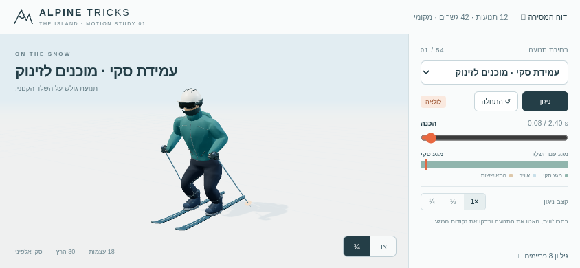

# Alpine Tricks v1 · דוח מסירה

ענף: `codex/alpine-tricks-v1`. בסיס: `19d9cdc5e3718236df5a2fc4d8b8c26c72007575`. כל התוספות נמצאות ב־`workout/island/design/alpine-tricks-v1/`; קבצים קיימים לא שונו.

[תצוגה 844×390](preview.html) · [קטלוג](catalog.json) · [GLB](alpine-tricks.glb) · [הוראות צפייה ושחזור](README.md) · [רישיונות](LICENSES.md).

החבילה כוללת **12 תנועות ו־42 גשרים דו־כיווניים מול עמידת הסקי והגלישה**, על שלד `Motion2Canonical18`. כל 54 הקליפים עברו `motion-qa-v1`, בציונים **91.4–100**, ממוצע **95.756**, ללא מדדים אדומים או חסרים. סטיית מגע מרבית בשש נקודות הסקי: **0.064676 מ״מ**, מתחת ל־20 מ״מ.



## תנועות

הקישורים פותחים גיליון שמונה פריימים מה־GLB הסופי. לכל אחד מ־42 הגשרים גיליון משלו ב־`sheets/` וקישור בקטלוג. קפיצה כוללת דחיסה, עלייה, שיא, נחיתה וספיגת הפגיעה; הנפילה כוללת החלקה עדינה וקימה חזרה.

| קליפ וגיליון | תנועה | שניות | motion-qa-v1 | סטיית מגע, מ״מ |
|---|---|---:|---:|---:|
| [ski_ready](sheets/ski_ready.webp) | עמידת סקי · מוכנים לזינוק | 2.4 | 100.0 | 0.0002 |
| [glide](sheets/glide.webp) | גלישה ישרה | 2.4 | 96.4 | 0.0002 |
| [turn_left](sheets/turn_left.webp) | פנייה שמאלה | 3.2 | 95.9 | 0.0022 |
| [turn_right](sheets/turn_right.webp) | פנייה ימינה | 3.2 | 95.9 | 0.0043 |
| [brake](sheets/brake.webp) | בלימה · מחרשה | 3.6 | 91.6 | 0.0100 |
| [jump](sheets/jump.webp) | קפיצה · עלייה, שיא ונחיתה | 3.6 | 94.5 | 0.0647 |
| [air_180](sheets/air_180.webp) | סיבוב 180 באוויר | 4 | 94.5 | 0.0444 |
| [air_360](sheets/air_360.webp) | סיבוב 360 באוויר | 4.8 | 93.4 | 0.0239 |
| [perfect_landing](sheets/perfect_landing.webp) | נחיתה מושלמת | 2.8 | 95.6 | 0.0037 |
| [soft_fall_recover](sheets/soft_fall_recover.webp) | נפילה רכה · החלקה וקימה | 7.2 | 94.2 | 0.0002 |
| [victory](sheets/victory.webp) | ניצחון · ידיים למעלה | 4 | 93.7 | 0.0003 |
| [gate_exit](sheets/gate_exit.webp) | עמידה ביציאה מהשער | 2.8 | 95.2 | 0.0002 |

הגשרים נמשכים 1.2 שניות. ציוני כל 54 הקליפים, כולל כל גשר בנפרד, נמצאים ב־[דוח הכלי המקורי](verification/motion-qa/report.html) וב־[JSON המלא](verification/motion-qa/report.json).

## אימות הנכס הסופי

| בדיקה | תוצאה |
|---|---|
| שלד | 18 עצמות בדיוק; שמות, סדר והורות קנוניים; אותו bind מכויל; המקלות אביזרים |
| דגימה | מלוא מפתחות ה־30Hz בכל עקומה משתנה; תנוחות קבועות מקודדות בשני מפתחות קצה זהים ללא שינוי בזמן |
| אינטרפולציה | `CUBICSPLINE`; נגזרות בשניות, זהות משני צדי כל מפתח; קווטרניונים מנורמלים ו־hemisphere רציף |
| C1 בין קליפים | כל 42 הגשרים וכל הלולאות עברו בדיקת פוזה ומהירות בקצוות לאחר העברת היסט השורש למארח |
| סטייה בקצות C1 | עד 1.20×10⁻⁸ מ׳, 5.97×10⁻⁸ רדיאן; הפרשי מהירות ליניארית וזוויתית אפס |
| מגעי סקי | קשירה, חרטום ועקב של כל מגלש; דגימות פענוח סופי ב־120Hz ובגבולות החלונות |
| רצפה | כל קודקודי ה־skin המשוקללים ב־30Hz; כל קודקודי הסקי הקשיחים והציוד ב־120Hz; מינימום -2.03e-07 מ׳ |
| 180 / 360 | הצטברות סיבוב שורש π ו־2π; סיבוב 180 נשמר בנחיתה לאחור |
| Khronos GLB | 0 שגיאות, 0 אזהרות; גאומטריית Draco פוענחה ונבדקה בנפרד |
| בקרות שליליות | הזזת מגע ב־3 ס״מ, שבירת tangent ופתיחת לולאה נדחו כולן |
| דפדפן | 844×390 ללא חריגה מהמסך; 54 קליפים נבחרים, ניגון/השהיה/מהירות/מבט צד; 432 פריימים, 0 שגיאות, 0 בקשות חיצוניות |
| גודל GLB | **1,921,644 בתים**, מתחת למגבלת הריפו 2,000,000 |

[מדידות עצמאיות](verification/qa.json) · [מחוון וספים](verification/qa-rubric.json) · [בדיקת דפדפן וכל זמני הפריימים](verification/browser-report.json) · [מקור כלי המדידה ו־SHA-256](verification/motion-qa-provenance.json).

## כיצד נמדד הציון

הופעלו הקורא `sampleGLB` והפונקציה `analyzeClip` המקוריים של `motion-qa-v1`, בקומיט מוצמד `5eb4f093bc22523ee417a7f2345c3b813bffba24`. הקוד נשלף ל־`/tmp`; נוסחאות, משקלות וספים נשמרו. `tools/measure.mjs` מספק קלט בלבד: האנימציה לפי שמה, נקודות סקי מכוילות, חלונות תמיכה, תחולת סקי ללא כדור וללא הליכה, ועמידת הייחוס האמיתית בכיוון הכניסה והיציאה. דגימות הקליפ לא סובבו ולא תוזמנו מחדש.

לסיבוב 180 נדרשת עמידת ייחוס בכיוון הנחיתה ההפוך. הציון עם ההקשר הזה הוא 94.5; אבחון נוסף מול עמידה קדמית בלבד (87.3) נשמר בכל רשומה תחת `nativeForwardIdleDiagnostic`. שימוש בעמידה קדמית בלבד מעניש את עצם הנחיתה לאחור. מדידת C1 העצמאית בודקת את התנוחה והנגזרת מול קליפ היעד בפועל, עם היסטי השורש המפורשים.

בדיקת המגע העצמאית מודדת סטייה תלת־ממדית מול מסלול הציוד המכוון, שנבנה מיעדי ציוד לפני הייצוא ונבדק מול FK מפוענח מהנכס הסופי. התקדמות הגולש במורד, סיבוב המחרשה והחלקת הנפילה הם תנועה מכוונת; המספר אינו טענה שהסקי אינו מתקדם על שלג. נקודות הבדיקה אומתו מול משטח הריצה של הגאומטריה המפוענחת. מדד `footSliding` המקורי נשמר בנוסף ללא שינוי.

## חיבור ושחזור

מקור הגוף והציוד הוא הגולש הקיים ב־`alpine-v7`; האנימציות והגשרים מקוריים לחבילה זו, ללא motion capture. ה־GLB מכיל גאומטריית Draco, אטלס מוטמע וערוצי glTF רגילים. צומצמו נתונים קבועים וכפולים בלבד; כל העקומות המשתנות שומרות את דגימות ה־30Hz. כימות רכיבי התנועה עד 10⁻⁷ מפורט בכלי הבנייה ונבדק במדידה הסופית.

התקדמות במורד וחיבור לרמפות הם באחריות מנוע המשחק. בסיום גשר מ־180 מעבירים למארח סיבוב π והזזה `[0,0,0.026]`; מ־360 סיבוב 2π; ומהנפילה הזזה `[0,0,0.45]`. מעבירים את ההיסט ומתחילים את קליפ היעד באותו עדכון, תוך שמירת פוזת העולם. [הוראות מלאות ופקודות שחזור](README.md).

בדיקת הנכסים הקיימת `node --test tests/island-assets.test.mjs`: **4 עברו, 0 נכשלו**, כולל תקציב כל קובצי ה־GLB. הסוויטה הכללית `npm test` לא הושלמה: בדיקת דפדפן קיימת של `workout-royiki` דורשת עותק Chromium של Playwright שאינו מותקן, ומשאירה שרת פתוח לאחר כשל ההפעלה. התקלה שוחזרה בנפרד; פרטים ב־[verification/repository-tests.json](verification/repository-tests.json). תצוגת הנכס החדש נבדקה בהצלחה עם Chromium המותקן בסביבה. בדיקת טלפון וחיבור לליגת הסקי לא בוצעו במסגרת חבילת הנכסים.

SHA-256 של ה־GLB שנמדד וצולם:

```text
b0897eed62385e8695f8f65ae67d93413e198116a3806bdc3e6aa6a696b2d25b
```
