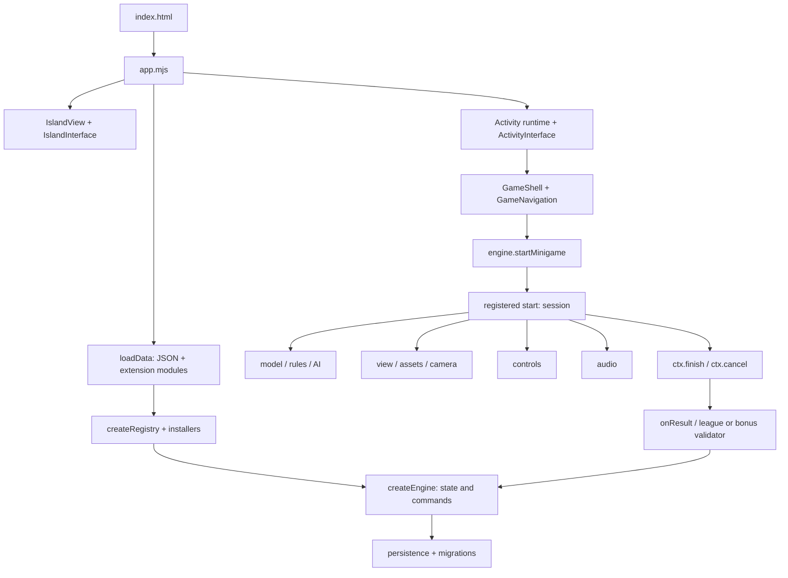

# מפת הארכיטקטורה של האי — v1

תאריך בדיקה: 17 בנובמבר 2026. בסיס: `main` בקומיט `43b27dc235387e3cb737aee9558cdf9d5fd5a262` (מיזוג PR 461). גרסת הקוד: `island-v2-20261107-15`; גרסת השמירה הראשית: **19**, מפתח `island.v1`. המסמך מתאר את הקוד בבסיס זה; התאריכים ושמות הגרסאות במסמכים ישנים אינם מקור סמכות למצב הנוכחי.

זהו מיפוי של `workout/island/`, אפליקציית האי. `workout/js/games/` הוא מנוע המשחקים הישן של אפליקציית האימונים; הוא אינו מנוע הסשנים המתואר כאן. שמות כמו `streetSlam`, `islandRacing` ו־`alienDefense` הם מזהים מתמידים, גם כאשר השם שעל המסך והמשחק השתנו.

לרישום כל פרמטרי הכתובת, ברירות המחדל, ההיסטוריה וראיות הבדיקה: [FLAGS.md](FLAGS.md), [flags.json](flags.json). לשיטת הסקירה, האימות והגבולות: [REPORT.md](REPORT.md).

## היכן להתחיל לפי משימה

| משימה | נקודת התחלה | ההמשך הרלוונטי |
|---|---|---|
| מסך האי אינו עולה | [index.html](../../index.html), [app.mjs](../../app.mjs), [load-data.mjs](../../engine/load-data.mjs) | מילון, נתונים, מייבאי הרחבות, קונסול וגרסת משאבים |
| משחק אינו מוצג/נעול | [extensions.json](../../data/extensions.json), [featureFlags.json](../../data/featureFlags.json) | [registry.mjs](../../engine/registry.mjs), [availability.mjs](../../activity/availability.mjs), התקדמות ותנאי התצורה |
| משחק עולה אך נתקע | הסשן בשורת המשחק בטבלה בהמשך | [load-rescue.mjs](../../ui/load-rescue.mjs), דוח טעינה, `snapshot`, נכסים ו־`dispose` |
| פיזיקה/חוקים/AI | מודל או מנוע המשחק | לבדוק דגל URL, אפשרויות מפורשות, תצורת איזון וזרע זהה לפני שינוי |
| צבע/תנועה/מצלמה | תצוגת המשחק ומודולי הדמויות | [device-tier.mjs](../../ui/device-tier.mjs), סף איכות, דגלי חבילות ונפילה לנכס קודם |
| שליטה או כיוון מגע | מודול הפקדים והסשן | [game-shell.mjs](../../ui/game-shell.mjs), מיפוי viewport, ניקוי קלט בהשהיה |
| פרס/כוכבים/שלב שלא נשמרו | `engine.startMinigame` ב־[engine.mjs](../../engine/engine.mjs) | `onResult`, מאמת התוצאה, מסלול ליגה/אימון/בונוס ו־[persistence.mjs](../../engine/persistence.mjs) |
| אופליין או גרסה ישנה | [ui/offline.mjs](../../ui/offline.mjs), [offline-sw.js](../../offline-sw.js) | [offline-manifest.json](../../offline-manifest.json), גרסת העובד, [release-watch.mjs](../../ui/release-watch.mjs) |

## שכבות ואחריות



| שכבה | מודולים | חוזה ואחריות |
|---|---|---|
| כניסה והרכבה | `index.html`, `app.mjs`, `release.mjs`, `release.json` | הרכבת המערכות, גרסת כתובות, לולאת כלכלת האי ושמירה ביציאה |
| נתונים ורישום | `engine/load-data.mjs`, `engine/registry.mjs`, `data/*.json`, `episodes/`, `extensions/` | טעינת תוכן מקומי, איזון, רשומות ותוספים; רישום משחק מחייב `start` ו־`onResult` |
| מנוע האי | `engine/engine.mjs`, `rules.mjs`, `economy.mjs`, `metrics.mjs`, `persistence.mjs`, `hooks.mjs` | סמכות למצב, בנייה, הכנסה, תגמול, שמירה, הרשאות משחק וסיום יחיד של סיבוב |
| עיר ותכנון | `engine/city-*.mjs`, `ready-plots.mjs`, `placement-help.mjs`; מקביליהם ב־`view/` וב־`ui/` | קישור בין כללי מגרשים/ניהול/תשתיות לבין תצוגה ובקרה; לא מנועי הפיזיקה של המשחקים |
| פעילות והתקדמות | `activity/runtime.mjs`, `state.mjs`, `availability.mjs`, `eligibility.mjs`, `progress.mjs`, `equipment.mjs` | אירועים מתוזמנים, תנאי מבנה, כוכבים, ציוד והתקדמות; מודולי קבוצה/האנגר/תעודות מוסיפים מצב ייעודי |
| ממשק האי | `ui/interface.mjs`, `ui/activity.mjs`, `ui/city-access.mjs`, `ui/translate.mjs`, `learning/interface.mjs` | חלוניות, כניסה למשחקים/מבנים/למידה, תרגום וחיבור פקודות למנוע |
| מעטפת משחק משותפת | `ui/game-shell.mjs`, `ui/load-rescue.mjs`, `ui/load-report.mjs`, `ui/press.mjs` | מסך מלא, כיוון, חזרה, השהיה, יציאה, חילוץ מטעינה ודיווח |
| סשן | `minigames/*-session.mjs` ומתאמי המשחק | תזמון, דגימת קלט, חיבור מודל לתצוגה, קול ו־HUD, טעינה ושחרור משאבים |
| סימולציה | `minigames/*-engine.mjs`, `soccer.mjs`, `tennis.mjs`, `racing-physics.mjs`, מודלים ייעודיים | מצב המשחק, פיזיקה, AI וחוקים. הבידוד המדויק משתנה; בחלק מהמודולים יש קריאות דגלים בעת ייבוא או בנייה |
| תצוגה | `view/island-view.mjs`, `view/*`, `minigames/*-view*.mjs`, מודולי דמויות/סביבות | Three.js, מצלמות, מודלים, תנועה, HUD חזותי ובקרי פירוט; אינה מעניקה פרסים |
| קול | מודולי `*-audio.mjs`, `presentation/audio.mjs`, `g2m-audio.mjs`, `g2n-audio.mjs`, `g3h-audio.mjs`, `g4e-audio.mjs`, `g6d-audio.mjs` | אין ספריית `audio/` מרכזית; לכל משחק חיבורי קול, דגימות ושערי השתקה/השהיה משלו |
| שליטה | `minigames/controls.mjs`, `soccer-design-controls.mjs`, `*-controls.mjs`, `alien-flight-input*.mjs` | אין ספריית `controls/` מרכזית; `controls.mjs` משותף לכמה משחקים, והיתר ייעודיים |
| אופליין ושחרור | `ui/offline.mjs`, `ui/offline-panel.mjs`, `offline-sw.js`, `offline-manifest.json`, `ui/release-watch.mjs` | מטמון נכסים וקוד, הורדה יזומה/אוטומטית, זיהוי גרסה חדשה ורענון בנקודה בטוחה |
| למידה | `learning/{runtime,state,questions,banks,voice,interface}.mjs`, `view/learning-buildings.mjs` | מסלול נוסף של שאלות, מצב וממשק סביב מבני האי; אינו מיני־משחק רשום חדש |

הגבול המשותף הוא חוזה המשחק והמצב; אין מנוע גרפי או לולאת פריימים אחת לכל המשחקים. אין גם ספריות פיזיות בשם `session/`, `audio/`, `controls/` או `offline/`: האחריות מפוזרת בנתיבים המפורטים בטבלה.

## מפת המשחקים

כל שם קובץ בטבלאות הבאות הוא ביחס ל־`minigames/`, אלא אם מצוין אחרת. תוספים ביחס ל־`extensions/`. הסיומת `*.mjs` כוללת שכבות עזר, גרסאות קודמות ומסלולי השוואה; אין להסיק מהמספר בשם איזה קוד נבחר בפועל.

| משחק ומזהה מתמיד | הרחבה וכניסה | מודל / חוקים | סשן ותוצאה | תצוגה וקול | שליטה |
|---|---|---|---|---|---|
| כדורגל — `soccer` | `soccer.mjs` → `startSoccer` | `soccer.mjs`, `soccer-physics.mjs`, `soccer-teamplay.mjs`, `soccer-rules.mjs`, `soccer-full.mjs`, `soccer-r241.mjs`; קמפיין/פנדלים/אימונים במודולים נפרדים | `soccer-session.mjs`, `soccer-result.mjs` | `soccer-view.mjs`, `soccer-design-{character,scene,audio}.mjs`, `soccer-v*.mjs`, `soccer-show.mjs`, `soccer-presentation.mjs` | `controls.mjs` + `soccer-design-controls.mjs` |
| כדורסל — `streetSlam` | `street-slam.mjs` → `startHoops` | `hoops-engine.mjs` כולל תנועה וחוקים; `hoops-{ai,ball,roles,tactics}.mjs` ושאר מודולי `hoops-*`; `hoops-franchise.mjs` למועדון | `hoops-session.mjs`, `hoops-loop.mjs`, `hoops-result.mjs` | `hoops-view.mjs`, `hoops-{athlete,tall,v4,v5,v7,v8-*,v241}.mjs`, `hoops-show.mjs`, `hoops-audio.mjs` | `hoops-controls.mjs`, פרופיל שליטה וקלט לפי מצב החזקה |
| טניס — `tennis` | `tennis.mjs` → `startTennis` | `tennis.mjs` כולל פיזיקה, קבלה והחזרה; בחירת היריב ב־`tennis-session.mjs`; `tennis-tour.mjs` משמר התקדמות ישנה בהרחבת הטור; `tennis-grip.mjs` הוא חוזה אחיזה חזותי | `tennis-session.mjs`, `tennis-result.mjs` | `tennis-view.mjs`, `tennis-{motion,grip,v7*,v11-stadium,v12-stadium}.mjs`, `g4e-audio.mjs`, `tennis-ui.mjs` | `tennis-controls.mjs` |
| סקי — `alpineRush` | `alpine-rush.mjs` → `runAlpineSession` | `alpine-engine.mjs`, `alpine-track.mjs`, `alpine-v241.mjs`, מודולי מסלול/תנועה | `alpine-session.mjs`, `alpine-result.mjs`; ליגה דרך `alpine-league-island.mjs` | `alpine-view.mjs`, `alpine-character.mjs`, `alpine-env.mjs`, `alpine-design-*.mjs`, `alpine-{audio,hud,presentation}.mjs` | `alpine-controls.mjs`; שכבת v24.1 משנה גם בלימה/אחיזה |
| מרוצים — `islandRacing` | `racing.mjs` → `runRacingSession` | `racing-physics.mjs`, `racing-tracks.mjs`, `racing-{v24,offtrack,f1}.mjs` | `racing-session.mjs`, `racing-result.mjs`; בליגה `racing-league-result.mjs` | `racing-view.mjs`, `racing-{v7*,formula*,env-v2,pit-crew,broadcast*,tower,speedometer}.mjs`, `racing-{audio,samples,unlock}.mjs` | `racing-controls.mjs`; מיפוי קלט v24 ב־`racing-v24.mjs` |
| ספינות — `navalDuel` | `naval-duel.mjs` → `startNaval` | `naval.mjs`, `naval-{ballistics,campaign,forecast,lockon,air,supply,v24,v241}.mjs` | `naval.mjs` משתמש ב־`canvas-session.mjs`; אימות ב־`result.mjs` | `naval-view.mjs`, `naval-base-view.mjs`, `naval-{v7,assets,hud,v24-hud,v241-hud}.mjs`, `g6d-audio.mjs`, `naval-*-audio.mjs` | `naval-controls.mjs`; בנוסף התאמת קואורדינטות במעטפת Canvas |
| כיבוי אש — `fireRescue` | `fire-rescue.mjs` → `startFire` | `fire.mjs`, `fire-{campaign,roads,navigation,ladder,assistance,v24,bonus,interior,targets}.mjs` | `fire-session.mjs`; כניסה לבניין דרך `fire-v24-{flow,session}.mjs`; בונוס דרך `fire-bonus-session.mjs`; אימות ב־`result.mjs` או חוזה בונוס | `fire-view.mjs`, `fire-canvas.mjs`, `fire-v7.mjs`, `fire-ui.mjs`, `g2n-audio.mjs` גם בבונוס | הסשן משתמש ב־`controls.mjs` ומוסיף ניווט, חילוץ ומילוי |
| הגנת חייזרים — `alienDefense` | `alien-defense.mjs` → `startAliens` ב־`aliens.mjs` | `alien-flight-{model,combat}.mjs`, `alien-move.mjs`, שכבות `alien-v9` עד `alien-v25*` | `alien-session.mjs`; `onResult` בהרחבה מאמת ניקוד ומחשב הכנסה בעזרת `result.mjs` | `alien-view.mjs`, `alien-assets.mjs`, `alien-v*-draw/ui/audio.mjs`, `g2m-audio.mjs` | `alien-flight-input.mjs`, `alien-flight-input-hud.mjs`, `controls.mjs` וחיווט נשקים בסשן |
| חזירים — `boarDefense` | `boar-defense.mjs` → `runBoarSession` | `boar-island/game.js`, `core.mjs`, `chain.mjs`, `kit.js` ומשאבי המשחק העצמאי | `boar-session.mjs` הוא גשר iframe; `onResult` מחזיר null במכוון | דף `boar-island/index.html`, `world.js`, `creatures.js`, `weather.js`, נשקים וקול מקומי | בתוך `boar-island/game.js`; גשר ההורה מסנכרן השהיה, השתקה ויציאה |
| תפיסת הפושע — `catchCriminal` | `catch-criminal.mjs`; `catch=off` מונע רישום | `catch-engine.mjs`, `catch-chase6.mjs`, `catch-tyres.mjs`, `catch-{weapons,assist}.mjs`; מודולי `catch-chase*.mjs` למסלולים הקודמים | ברירת מחדל `catch-session6.mjs` בייבוא לפי דרישה; גיבוי `catch-session.mjs`; אימות `result.mjs` | `catch-view6.mjs`, `catch-view.mjs`, `catch-{actors,props7,chase-fx7,audio}.mjs`, ממשקי נשק/ירי/קשת | חיווט בתוך הסשנים; פקדי נהיגה, נשקים וכיוון זריקה |

| משחק | תנאי מבנה בקובץ התצורה |
|---|---|
| כדורגל | `soccer` |
| כדורסל | `basketball` |
| טניס | `tennis` |
| ספינות | `harbor` |
| כיבוי אש | `fireStation` |
| חייזרים | `airbase` |
| סקי, מרוצים, חזירים, תפיסת הפושע | אין `requiresBuilding` פעיל |

המקור הוא `config.minigames[id].requiresBuilding`, והבדיקה האחידה ב־`activity/availability.mjs`. היעדר דרישת מבנה אינו עוקף דגלי תוכן, יצירת דמות, התקדמות, זמן משחק או בדיקה ייעודית של הרשומה.

### שכבות משותפות בין משחקים

| תחום | מודולים | מה משותף בפועל |
|---|---|---|
| הקשר וזרע | `minigames/context.mjs` | `seededRandom`, `gameContext`: שלב, ציוד, כוח, בונוסי עיר והאנגר; ה־seed מאפשר השוואת ריצות |
| תוצאה | `minigames/result.mjs`, `*-result.mjs`, `activity/progress.mjs` | אימות תוצאה לפני תגמול; לכל משחק יש נתוני תוצאה שונים |
| Canvas ו־viewport | `minigames/canvas-session.mjs`, `ui/game-shell.mjs` | מסלול Canvas משותף לספינות ונתיבי תאימות; משחקים אחרים מנהלים לולאות משלהם |
| ספורטאים | `athlete-body*.mjs`, `athletes-{core,gait,roles}.mjs`, `athlete.mjs` | גופים, כיפוף אצבעות, מיפוי שלד, תפקידי גוף ותנועה משותפת; הביצוע בכדורגל/כדורסל מוסיף קליפים ו־IK משלו |
| נכסים | `art.mjs`, `model-art.mjs`, `hoops-gltf.mjs`, מודולי Draco ייעודיים, `view/local-models.mjs` | כמה מסלולי טעינה מקומיים; אין asset manager יחיד. ביטול/נפילה ושחרור מאוחר נבדקים במסלול המסוים |
| איכות | `ui/device-tier.mjs`, `alpine-quality.mjs`, בקרי איכות ב־`*-view.mjs` | בחירת tier למכשיר ומסלול `ctx.lite`, ולאחריה בקרי גרפיקה לפי משחק; מספור איכות אינו אחיד בין המשחקים |
| תמיכה חזותית | `presentation/`, `ui/ui-kit.mjs`, `ui/adventure-emblems.mjs` | פתיחה/תוצאה/כרטיסים, אייקונים ומשוב; חלק מהקבצים משתמשים ישירות בערכות ב־`design/` |
| קוד ספקים | `vendor/` | Three.js, loaders ו־Draco מקומיים; אינו מנוע האי ואינו חלק מרישום דגלי הקוד שלנו |

## זרימת הטעינה בפועל

1. `index.html` מגדיר מסמך עברי RTL, מגבלות CSP, קנבס עיר, שורשי ממשק/חלוניות ומסך טעינה סטטי. נטענים `ui/boot-splash-start.mjs` ו־`app.mjs`. סרטון הטעינה כבוי כברירת מחדל; המסך הסטטי אינו מחכה לו.
2. `app.mjs` מביא תחילה `data/strings.he.json` דרך `dataURL`, יוצר מתרגם ומעדכן כותרת ומצב טעינה. הבקשה הזו נמצאת לפני ה־`try` המרכזי: כשל בה שונה מכשל בהמשך `loadData` מבחינת טיפול השגיאות.
3. `loadData` מביא במקביל 13 קובצי נתונים: `config`, `city`, `buildings`, `categories`, `metrics`, `avatar`, `team`, `players`, `world`, `tutorial`, `featureFlags`, `sports`, `missions`. אחריהם נטענים מניפסטי הרחבות ופרקים, נתוני הפרקים, ואז מודולי ההרחבות בלולאה. לפני ייבוא הרחבה נבדקים origin ותחום הנתיב; לכל כתובת ייבוא מוצמדת גרסה.
4. מתקבל מערך installers; `createEngine` מפעיל `createRegistry`, רושם תוכן בסיסי ומפעיל את ההרחבות. הרשומות נשמרות ב־Map; מזהה לא חוקי או כפול נדחה. בדגלי התוכן יש שערים בזמן שימוש; רישום הרחבה אינו כשלעצמו הבטחה שהיא זמינה. לצד עשרת משחקי המוצר רשומה גם דוגמת `practiceContract`, שנעולה באמצעות `exampleContent=false`.
5. המנוע טוען, מעביר מיגרציות ומאמת את השמירה. הוא יוצר מצב חדש כאשר אין שמירה תקפה לשימוש, ומגן מפני דריסת שמירה בלתי תקינה דרך `saveBlocked`. `cityPreview` מספק במקום זאת עטיפת אחסון שאינה כותבת.
6. מורכבים `IslandView`, `IslandInterface`, פעילות, למידה, ממשק משחקים, גישה לעיר ומעטפת המשחק. מסך הטעינה הראשוני נסגר לאחר הרכבת הממשק; מוכנות מודלי העיר אינה זהה למוכנות נכסי כל משחק.
7. מופעלים בדיקת שחרור, רישום Service Worker, מדידת FPS והורדה אוטומטית בעת פניות (למעט preview ושערי מכשיר/רשת). לולאת העיר קוראת `activity.tick`, עדכון ממשק, `engine.tick` ובקשת רענון בטוח; היא אינה לולאת פיזיקת המשחק.
8. כניסה למשחק ב־`ActivityInterface` בודקת מבנה, מציגה הסבר אם צריך, מקימה DOM/canvas/פקדים ו־GameShell, ובונה `ctx`. `engine.startMinigame` בודק מנעולים, מבנה, סיבוב פעיל, שלב וזמן משחק; הוא מכין מסלולים מיוחדים ונותן `finish` ו־`cancel` לרשומת ההרחבה.
9. `start` מחזיר סשן סינכרוני, לעיתים proxy שמסתיר טעינה אסינכרונית. אין `await` כללי על כל `start`. כדורסל וסקי מייבאים תצוגה לפי דרישה; תפיסת הפושע מייבאת סשן v6 לפי דרישה; אש מייבאת סשן בונוס לפי דרישה. כדורגל, מרוצים וחלקים אחרים מייבאים מודולי תצוגה סטטית, אבל נכסי GLB/קול עדיין נטענים בהמשך. לכן **לא כל קוד המשחקים נטען רק בעת כניסה**: מניפסט ההרחבות מייבא מראש גם סשנים ושרשראות סטטיות.
10. הסשן דוגם פקדים, מקדם מודל ומציג אותו. לדוגמה, כדורסל משתמש בצעד קבוע של `1/60` שנייה ובאינטרפולציה; למשחקים אחרים מסלולי תזמון שונים. לאחר מוכנות התצוגה, או בכשל/המתנה, מנגנון חילוץ הטעינה בוחן `ready`, `loadFailed`, `snapshot` ומדדי רינדור.

### סיום, השהיה וניקוי

`GameShell` מטפל במסך מלא ובגיבוי שכבה קבועה, שטח משחק, שינוי כיוון, כפתור השהיה, חזרה ודיאלוג יציאה. `GameNavigation` מנהל רשומות היסטוריה למפה/תפריט/משחק. חזרה, מעבר לרקע ועזרה נכנסים למסלול השהיה; הסשן נדרש לעצור את הסימולציה, לנקות קלט ולטפל בקול. חזרה לטאב אינה אמורה להמשיך סיבוב בלי פעולת המשך.

`ctx.finish(raw)` מעביר את התוצאה למנוע. המנוע מאמת את חוזה המשחק, ניקוד, כסף וכוכבים; רק לאחר מכן הוא משחרר את הסשן, קורא לחוזה חיוב זמן המשחק ומעדכן מצב/פרסים/התקדמות ושמירה. תוצאה לא תקפה אינה מזכה. דגל `ended` מונע זיכוי כפול, וגם `start` שמסיים סינכרונית מטופל. `ctx.cancel()` מסיים בלי פרס ועם הודעת ביטול לממשק.

חוזה סשן בסיסי הוא `setPaused(value)`, `dispose()` ו־`snapshot`; מוכנות/כשל ו־`debug` משתנים בין המשחקים. `dispose` חייב להיות בטוח בקריאות חוזרות ולשחרר RAF, timers, מאזינים, AudioContext, worker, משאבי WebGL ותוצאת טעינה שמגיעה באיחור. אין להניח שביטול מסיר מעצמו הבטחה אסינכרונית שכבר התחילה.

`engine/hooks.mjs` מגדיר כרגע חוזי זמן כמצייני מקום: `canPlay()` ו־`spendPlayTime()` מחזירים `true`. המנוע קורא להם בנקודות הנכונות, אך אין בהם היום מגבלת הורה או ניכוי מבנק זמן. גם narration הוא hook למתאם, ללא דיבור ממומש בקובץ זה.

## מצב, פרסים ומסלולים חריגים

| מצב | מקור | משמעות לשינוי עתידי |
|---|---|---|
| מצב האי | `engine/persistence.mjs`, `activity/state.mjs`, `data/config.json` | `CURRENT_VERSION=19`, `STORAGE_KEY=island.v1`; מיגרציות ואימות מפורשים, לא רק הוספת שדה אקראית |
| משחק רגיל | `engine.startMinigame` + `onResult` + `activity/progress.mjs` | כסף אי, שיא, ניצחונות, חלקים, כוכבים ושלב; שדות מתמידים מעודכנים רק למזהים שיש ב־`config.minigameLevels` |
| כדורגל | `activity/soccer-{team,card,roster}.mjs`, קמפיין ודרילים | סגל נשמר בנפרד מסגל משחק מורחב; אימון משתמש במסלול practice ולא באותו זיכוי של ניצחון קמפיין |
| כדורסל | `hoops-franchise.mjs` ו־`state.hoops` | סגל/מועדון/עונה, מיגרציה פנימית ואימות תוצאת מועדון לצד חוזה התוצאה הראשי |
| ליגת מרוצים | `racing-league*.mjs`, `state.islandRacingLeague` | מטבעות וסיום מרוץ של הליגה; מסלול תוצאה ייעודי אינו מעדכן כסף אי, כוכבים, שלב או שיא רגיל |
| ליגת סקי | `alpine-league-{core,store,island,result,stages,ghost,theme}.mjs` | מפתח `island.alpine.league.v1` נפרד; גם ghosts ושיאי סקי הם נתונים ייעודיים; אין שינוי בגרסת שמירת האי בעקבות שלב ליגה |
| בונוס אש | `fire-bonus.mjs`, `fire-bonus-session.mjs` | אימות ייעודי וכסף בלבד; אין קידום קמפיין, תעודה, ניצחונות, חלקים או שיא רגיל |
| חזירים | `minigames/boar-island/game.js` | שמירה וארנק ב־`boar-island-v1`; מתאם האי לא ממציא תגמול נוסף, ו־`onResult` מחזיר null |
| אירועי עיר | `activity/runtime.mjs`, הרחבת `island-events.mjs` | warning → ready → playing; חידוש דף מחזיר אירוע שנקטע ל־ready. הזמינות נבדקת שוב לפני הפעלה |
| העדפות ומדידות | `ui/device-tier.mjs`, פקדים וקול ייעודיים | למשל `island.quality.auto`, `island.racing.auto`, `boar-island-aim`; אינן שדות התקדמות ולא דגלי URL |

## מנגנון הדגלים

`data/featureFlags.json` הוא אובייקט של 28 דגלי תוכן. `createEngine` מחזיק אותם ב־`engine.flags`; תנאי הרישום, הבנייה, האירועים והממשק משתמשים בהם. `startMinigame` דורש גם `flags.minigames` וגם את הדגל הרשום ב־`record.featureFlag`. `catch=off` הוא חריג שמונע את רישום המשחק עצמו מתוך מתקין ההרחבה.

דגלי כתובת נקראים במודולים באמצעות `URLSearchParams`, אובייקט `params` שהועבר, או עוזרים כמו `polishValue`, `fireV20`, `read`, `on` ו־`engineRule`. לדוגמה:

| ביטוי | בלי פרמטר | עם `0` | עם `false` כמחרוזת |
|---|---|---|---|
| `get('x') !== '0'` | פעיל | כבוי | פעיל |
| `get('x') === '1'` | כבוי | כבוי | כבוי |
| `get('x') !== 'v24'` | פעיל | פעיל | פעיל |
| `has('x')` | כבוי | פעיל | פעיל |

ב־`URLSearchParams.get` מפתח חסר מחזיר null, מפתח ללא ערך מחזיר מחרוזת ריקה, ובמפתח כפול נקרא הערך הראשון לאחר פענוח הכתובת. שמות וערכים תלויים ברישיות. לכן אין להשתמש בהנחה שכל דגל כבה ב־0. גם ערך ריק, שגיאה וערך לא מוכר נבחנים לכל דגל בנפרד. ארבעה מכוונים מספריים של יציאה מהמסלול, למשל, מוגבלים לטווח; ב־`v2scale` ובכמה מכווני מסלול `Number(...) || fallback` גורם גם ל־0 לחזור לברירת המחדל.

קריאות מסוימות נעשות בעת ייבוא (למשל `racing-tracks.mjs` ו־`racing-league-core.mjs`), ואחרות בתחילת סשן או בכל שימוש. שינוי הכתובת בלי טעינה מחדש אינו ממשק נתמך להחלפת כל הדגלים. אפשרות פונקציה, תצורה, `ctx.lite`, העדפה שמורה ומשתנה גלובלי של בדיקה עשויים לקבל קדימות שונה. ההבדלים מפורטים לכל שם ב־[FLAGS.md](FLAGS.md).

## אופליין ושחרור

`release.mjs` מייצא `DATA_VERSION` ו־`dataURL`; `release.json` הוא יעד בדיקת גרסה טרייה. `ui/release-watch.mjs` מסמן גרסה ממתינה, מאפשר קדם־הורדה ומרענן רק כשהמנוע יכול לשמור ואין משחק, חלונית, בחירה או ניווט פעילים. פרמטרי `release` ו־`check` נכתבים לכתובות; הם אינם מתגים של כללי משחק.

`offline-manifest.json` מפריד בין `shell` לבין קבוצות נכסים. שמות הקבוצות אינם מזהי המשחק: לדוגמה `hoops`, `alpine`, `alien` ו־`catch`, לעומת `streetSlam`, `alpineRush`, `alienDefense` ו־`catchCriminal`. נכון לבסיס יש קבוצות כדורגל, כדורסל, סקי וליגתו, טניס, מרוצים, ספינות, אש, חייזרים, עיר ותפיסת הפושע. אין כאן הבטחה להורדת קמפיין החזירים העצמאי כחבילה ייעודית.

הדף מוריד קבצים ל־Cache API דרך `ui/offline.mjs`; העובד `offline-sw.js` מגיש אותם. נכסים מנוהלים מקומיים מקבלים cache-first וכתובות ללא query כמפתח, כולל תמיכה ב־Range למדיה. קוד ומעטפת מקבלים network-first עם fallback למטמון. `release.json` והעובד עצמו אינם מעטפת שמוגשת דרך המטמון הזה. שם המטמון כולל גרסה; בהפעלת עובד חדש נמחקים מטמוני נכסים ישנים לפי prefix, בלי לנקות שמירות משחק.

הורדה אוטומטית ממתינה לפניות, אינה רצה במשחק/חלונית, נעצרת במכשיר חלש או בחיסכון בנתונים ומכבדת `autodownload=0`; כפתור ההורדה יזום הוא מסלול נוסף. חילוץ טעינה מציע בסדר: התחלה מחדש, גרסה קלה ואז ניקוי נכסי המשחק בלבד. פעולות אלו אינן מיגרציית שמירה.

`tools/offline-shell.mjs` בונה רשימת מעטפת מתוך imports, קישורי HTML/CSS ונתונים. בהוספת מודול בזמן עבודה עתידית יש להריץ אותו ולבדוק את המניפסט; בביקורת זו הוא נקרא בלבד, משום שהפעלתו כותבת לקובץ קיים. עדכון גרסה ותגי כתובות הוא פעולה מרכזית לפי נוהל הפרויקט, ולא צעד שכל ענף משחק מבצע לעצמו. ה־push לענף התיעוד אינו מעלה את האתר: workflow הפרסום מוגבל ל־`main`.

## איך מוסיפים משחק חדש

הצעדים הבאים הם מדריך לחיבור עתידי; הם לא בוצעו בענף התיעוד.

1. **בחרו מזהה מתמיד וחוזה תוצאה.** [example-minigame.mjs](../../extensions/example-minigame.mjs) מדגים את צורת הרישום בלבד: הוא אינו משחק מלא ותוצאת הדוגמה אינה חוזה תגמול תקף למסלול המוצר. לחוזה ממשי התחילו בהרחבה של משחק קרוב ובמאמת התוצאה שלה. הפרידו מודל/כללים, סשן, תצוגה, קול, פקדים ו־result. חוזה התוצאה צריך להוכיח מה קרה בסימולציה, לא לסמוך על כסף שהלקוח מספק.
2. **הגדירו תוכן ואיזון.** הוסיפו רשומה ל־`data/extensions.json.records`, דגל ל־`data/featureFlags.json`, איזון ב־`config.minigames[id]`, שלבים/ציוד בנתיבים הדרושים וטקסטים ב־`data/strings.he.json`. `requiresBuilding` שייך לתצורה; `featureFlag` שייך לרשומה. נדרשת גם הגדרת `config.gameShell.games[id]` לכיוון המשחק ולפריסה הרלוונטית.
3. **רשמו הרחבה.** קובץ חדש ב־`extensions/` מייצא `install(registry,data)`, ובתוכו `registry.registerMinigame({...record,start,onResult})`. הוסיפו את נתיב ההרחבה ל־`extensions.json.modules`. רישום חסר, כפול או ללא הפונקציות נדחה; `start` חייב להחזיר מיד אובייקט סשן, או proxy שמסנכרן השהיה וביטול בזמן טעינה.
4. **חברו הקשר ומעטפת.** השתמשו ב־`ctx.finish` ו־`ctx.cancel`; אל תעדכנו כסף/שלב מתוך התצוגה. התאימו `gameContext` לציוד/בונוסים כשצריך, ובנו ניקוי קלט, השהיית קול ו־dispose. ודאו שהמצב הנצפה מאפשר לחילוץ הטעינה להבחין בין loading, ready ו־failed.
5. **בדקו אם נדרש חיווט ממשק ייעודי.** רישום הרחבה אינו מספיק אוטומטית למוצר עשיר: `ui/activity.mjs` בונה פקדים ו־HUD בענפים לפי מזהה, ושכבות תוצאה/ציוד/אייקונים עשויות לדרוש חיבור. ליגות, סגל, אירועים ובונוסים דורשים חוזים נפרדים; אל תכפו אותם על מסלול תוצאה רגיל.
6. **הוסיפו מצב מתמיד במפורש.** כדי שמשחק יקבל שיא/ניצחונות/שלבים במסלול הקיים נדרשת הגדרת `config.minigameLevels[id]` ושדות התחלתיים/אימות תואמים ב־`activity/state.mjs` וב־`engine/persistence.mjs`. שינוי סכמה דורש מיגרציה, fixture מגרסה קודמת ובדיקת ייבוא/מיזוג. אל תשנו מזהה משחק קיים כדי להתאים שם תצוגה חדש.
7. **תכננו דגל השוואה ומסלול כשל.** הגדירו ערך מדויק, ברירת מחדל, קדימויות ויחסי גומלין עם קבוצות דגלים. תעדו גם מה קורה ב־Node בלי `location`. נכס חסר, טעינה מאוחרת, כשל WebGL וכניסה/יציאה חוזרות צריכים להגיע למצב שימושי בלי זיכוי כפול.
8. **חברו נכסים ואופליין.** העדיפו עותקי runtime מקומיים עם רישיון/חוזה נתונים. עדכנו קבוצת נכסים ב־`offline-manifest.json`, מיפוי הורדה אם נדרש, והריצו את בונה המעטפת. `design/` אינו מילה נרדפת ל־“לא נטען”: חלק מהערכות עדיין מיובאות ממנו ישירות. בדקו בפועל גם את כללי הסינון ב־`.github/workflows/pages.yml`.
9. **אמתו את החוזים לפני פרסום.** בדיקות משמעותיות: שוויון תחת seed, חוקים/כישלון/ניצחון, תוצאה פסולה/כפולה, ביטול והשהיה, טעינה שנכשלת, חזרה וניווט, שתי אוריינטציות, טווחי מגע, שמירה ישנה ואופליין. בדקו את דגל ההשוואה במפורש ולא רק את מודול ברירת המחדל. CI מריץ `tests/*.mjs`; קובץ תחת `workout/island/tests/` אינו מצטרף אוטומטית להרצה זו.
10. **רעננו את התיעוד.** הריצו את [סורק הדגלים](tools/scan-flags.mjs), סקרו ועדכנו [פירושי הדגלים](tools/flag-notes.json), הריצו `--history` לשמות חדשים ו־`--check` לאימות. אחרי חיבור מרכזי מבצעים שחרור ותגי גרסה לפי נוהל הפרויקט.

## נקודות שבהן קל לטעות

| הנחה | מה הקוד עושה בפועל |
|---|---|
| `soccerV241=0` מחזיר כל היבט של מוצר v24 | הוא מכבה את קבוצת v24.1; `soccerFull` ויתר שכבות v24 נשלטים בנפרד |
| בדיקת Node ללא URL מייצגת את הדף | כמה כללי כדורגל חדשים נשארים כבויים ב־Node כדי לשמר חוזים קודמים |
| `streetSlam` הוא משחק רחוב ישן | מזהה השמירה נשמר, אבל ההרחבה מפעילה `hoops-session` של כדורסל חמש מול חמש |
| דרגת איכות 0 היא תמיד הגרפיקה הטובה | מספור איכות תלוי במשחק; יש לבדוק את הפונקציה ואת התצורה המקומית |
| כל `design/` הוא חומר סקירה | יש imports וקישורי נכסים אמיתיים ממנו, למשל סביבות סקי, מסלולים וערכת ממשק |
| כל תוצאה עוברת ב־`recordStageWin` | לליגות, בונוסי אש, אימוני כדורגל וחזירים יש מסלולים אחרים |
| כל דגל מופיע כליטרל בתוך `.get` | קיימים קבועים, מפות שמות, פונקציות עזר ופרמטרים מספריים דרך wrapper |
| מסמך הארכיטקטורה הישן מתאר את המצב הנוכחי | הוא כולל אבני דרך היסטוריות; בנתונים הנוכחיים השמירה כבר בגרסה 19 והמוצר מכיל עשרה משחקים |

## אינדקס מלא של מודולי המוצר

האינדקס הבא כולל את כל קובצי ה־JS/MJS/CSS ב־`minigames/`, ואת קובצי שכבות המוצר האחרות. הוא משייך קבצים למשפחה לצורך ניווט; עצם ההופעה אינה הוכחה שהקובץ נגיש בכל גרסת דגל. נכסי מדיה, חבילות ספקים, תצוגות design, בדיקות וכלי מדידה אינם מורחבים באינדקס הזה; פרמטרי ה־URL שלהם כן נכללים ברישום הדגלים.

<!-- MODULE_INDEX -->

נספרו **555 קובצי קוד/סגנון/כניסה של המוצר**, ללא קובצי ספקים. הרשימה נגזרה מ־`git ls-files` בבסיס הבדיקה; שמות הקבצים מלאים ביחס ל־`workout/island/`.

### שורש המוצר (5)

```text
app.mjs
index.html
offline-sw.js
release.mjs
styles.css
```

### מנוע האי (18)

```text
engine/city-connections.mjs
engine/city-depth.mjs
engine/city-hall.mjs
engine/city-management.mjs
engine/city-runtime.mjs
engine/city-sites.mjs
engine/economy.mjs
engine/engine.mjs
engine/episodes.mjs
engine/hooks.mjs
engine/load-data.mjs
engine/metrics.mjs
engine/paths.mjs
engine/persistence.mjs
engine/placement-help.mjs
engine/ready-plots.mjs
engine/registry.mjs
engine/rules.mjs
```

### פעילות ומצב משחקים (12)

```text
activity/alien-upgrades.mjs
activity/availability.mjs
activity/eligibility.mjs
activity/equipment.mjs
activity/fire-certificates.mjs
activity/hangar.mjs
activity/progress.mjs
activity/runtime.mjs
activity/soccer-card.mjs
activity/soccer-roster.mjs
activity/soccer-team.mjs
activity/state.mjs
```

### הרחבות ורישום (17)

```text
extensions/activity-income.mjs
extensions/alien-defense.mjs
extensions/alpine-rush.mjs
extensions/boar-defense.mjs
extensions/catch-criminal.mjs
extensions/example-building.mjs
extensions/example-event.mjs
extensions/example-metric.mjs
extensions/example-minigame.mjs
extensions/example-sport.mjs
extensions/fire-rescue.mjs
extensions/island-events.mjs
extensions/naval-duel.mjs
extensions/racing.mjs
extensions/soccer.mjs
extensions/street-slam.mjs
extensions/tennis.mjs
```

### ממשק משותף (40)

```text
ui/activity.mjs
ui/adventure-emblems.mjs
ui/alpine-league.css
ui/alpine-league.mjs
ui/boot-splash-start.mjs
ui/boot-splash.css
ui/boot-splash.mjs
ui/city-access.css
ui/city-access.mjs
ui/city-depth.css
ui/city-depth.mjs
ui/city-management.css
ui/city-management.mjs
ui/city-planning.css
ui/city-preview.mjs
ui/clean-hud.css
ui/device-tier.mjs
ui/fire-bonus-ui.mjs
ui/game-shell.css
ui/game-shell.mjs
ui/hangar-preview.mjs
ui/hoops-club.mjs
ui/interface.mjs
ui/load-report.mjs
ui/load-rescue.mjs
ui/offline-panel.mjs
ui/offline.mjs
ui/press.mjs
ui/racing-league-art.mjs
ui/racing-league.css
ui/racing-league.mjs
ui/ready-plots.css
ui/ready-plots.mjs
ui/release-watch.mjs
ui/soccer-card.mjs
ui/translate.mjs
ui/ui-kit-bridge.css
ui/ui-kit.mjs
ui/upgrade-offer-core.mjs
ui/upgrade-offer.mjs
```

### תצוגת האי (35)

```text
view/avatar.mjs
view/batch.mjs
view/buildings.mjs
view/city-citizens.mjs
view/city-depth.mjs
view/city-growth.mjs
view/city-life.mjs
view/city-lighting.mjs
view/city-models.mjs
view/city-navigation.mjs
view/city-occlusion.mjs
view/city-overlay.mjs
view/city-preview-layout.mjs
view/city-preview-props.mjs
view/city-sites.mjs
view/city-streets.mjs
view/city-traffic-model.mjs
view/city-traffic.mjs
view/coastal-surfaces.mjs
view/environment.mjs
view/island-view.mjs
view/learning-buildings.mjs
view/local-models.mjs
view/meshy-pilot.mjs
view/planning-frame.mjs
view/plot-landscape.mjs
view/ready-plots.mjs
view/skeleton-utils.mjs
view/street-distribution.mjs
view/street-surfaces.mjs
view/ultra-island-flora.mjs
view/ultra-island-roads.mjs
view/ultra-island-scenery.mjs
view/ultra-island-terrain.mjs
view/ultra-island-water.mjs
```

### למידה (7)

```text
learning/banks.mjs
learning/interface.mjs
learning/learning.css
learning/questions.mjs
learning/runtime.mjs
learning/state.mjs
learning/voice.mjs
```

### הצגה ומשוב (2)

```text
presentation/adventure.css
presentation/surfaces.mjs
```

### משחקים: משותפים ותאימות (52)

```text
minigames/art.mjs
minigames/athlete-body-v2.mjs
minigames/athlete-body-v22.mjs
minigames/athlete-body.mjs
minigames/athlete.mjs
minigames/athletes-core.mjs
minigames/athletes-gait.mjs
minigames/athletes-roles.mjs
minigames/audio-guard.mjs
minigames/canvas-session.mjs
minigames/context.mjs
minigames/controls.mjs
minigames/g2m-audio.mjs
minigames/g2m-effects.mjs
minigames/g2m-motion.mjs
minigames/g2n-audio.mjs
minigames/g2n-fire.css
minigames/g2o-fire.css
minigames/g2p-alien.css
minigames/g3h-audio.mjs
minigames/g3h-soccer.css
minigames/g3j-soccer.css
minigames/g4e-audio.mjs
minigames/g4f-tennis.css
minigames/g6d-audio.mjs
minigames/g6d-effects.mjs
minigames/g6e-naval.css
minigames/icons.mjs
minigames/model-art.mjs
minigames/patrol-boat.mjs
minigames/polish-flag.mjs
minigames/pool.mjs
minigames/result.mjs
minigames/rider-fallback.mjs
minigames/sound.mjs
minigames/sports-audio-rules.mjs
minigames/technical-suit.mjs
minigames/ultra-alien-effects.mjs
minigames/ultra-alien-environment.mjs
minigames/ultra-alien-feedback.mjs
minigames/ultra-alien-fleet.mjs
minigames/ultra-fire-city.mjs
minigames/ultra-fire-effects.mjs
minigames/ultra-fire-scenery.mjs
minigames/ultra-naval-effects.mjs
minigames/ultra-naval-environment-layout.mjs
minigames/ultra-soccer-design.css
minigames/ultra-soccer-effects.mjs
minigames/ultra-soccer-stadium.mjs
minigames/ultra-soccer-ui.css
minigames/ultra-tennis-court.mjs
minigames/ultra-tennis-environment.mjs
```

### כדורגל (71)

```text
minigames/soccer-ai-flag.mjs
minigames/soccer-arm-swing.mjs
minigames/soccer-assistance.mjs
minigames/soccer-athlete-body.mjs
minigames/soccer-athlete-motion.mjs
minigames/soccer-athlete.mjs
minigames/soccer-boundary.mjs
minigames/soccer-campaign.mjs
minigames/soccer-codex-motion.mjs
minigames/soccer-control-depth.mjs
minigames/soccer-controls-assets.css
minigames/soccer-controls.css
minigames/soccer-crowd.mjs
minigames/soccer-design-audio.mjs
minigames/soccer-design-character.mjs
minigames/soccer-design-contracts.mjs
minigames/soccer-design-controls.mjs
minigames/soccer-design-loader.mjs
minigames/soccer-design-replay.mjs
minigames/soccer-design-scene.mjs
minigames/soccer-design-screens.mjs
minigames/soccer-design-tactics.mjs
minigames/soccer-design-vfx.mjs
minigames/soccer-draco-worker.mjs
minigames/soccer-drill.mjs
minigames/soccer-feel.mjs
minigames/soccer-full-lod.mjs
minigames/soccer-full.css
minigames/soccer-full.mjs
minigames/soccer-headers.mjs
minigames/soccer-icons.mjs
minigames/soccer-lighting.mjs
minigames/soccer-loft.mjs
minigames/soccer-motion-v9.mjs
minigames/soccer-penalties.mjs
minigames/soccer-physics.mjs
minigames/soccer-poses.mjs
minigames/soccer-presentation.mjs
minigames/soccer-r241.mjs
minigames/soccer-referee.mjs
minigames/soccer-restart-motion.mjs
minigames/soccer-restart-poses.mjs
minigames/soccer-restarts.mjs
minigames/soccer-result.mjs
minigames/soccer-rig.mjs
minigames/soccer-rules.mjs
minigames/soccer-scale.mjs
minigames/soccer-session.mjs
minigames/soccer-shot.mjs
minigames/soccer-show-view.mjs
minigames/soccer-show.mjs
minigames/soccer-sprint.mjs
minigames/soccer-squad.mjs
minigames/soccer-surround.mjs
minigames/soccer-tactics-data.mjs
minigames/soccer-tactics.mjs
minigames/soccer-teamplay.mjs
minigames/soccer-teams.mjs
minigames/soccer-telemetry.mjs
minigames/soccer-v23.mjs
minigames/soccer-v24-crowd.mjs
minigames/soccer-v24-fx.mjs
minigames/soccer-v24-pitch.mjs
minigames/soccer-v24.mjs
minigames/soccer-v5.mjs
minigames/soccer-v7.mjs
minigames/soccer-v8-layout.mjs
minigames/soccer-v8-stadium.mjs
minigames/soccer-v8.mjs
minigames/soccer-view.mjs
minigames/soccer.mjs
```

### כדורסל (51)

```text
minigames/hoops-ai.mjs
minigames/hoops-arena.mjs
minigames/hoops-athlete.mjs
minigames/hoops-audio.mjs
minigames/hoops-baked.mjs
minigames/hoops-ball.mjs
minigames/hoops-body-v2.mjs
minigames/hoops-controls-profile.mjs
minigames/hoops-controls.mjs
minigames/hoops-court.mjs
minigames/hoops-crowd3d.mjs
minigames/hoops-draco-worker.mjs
minigames/hoops-draco.mjs
minigames/hoops-engine.mjs
minigames/hoops-feel.mjs
minigames/hoops-franchise.mjs
minigames/hoops-gltf.mjs
minigames/hoops-icons.mjs
minigames/hoops-league.mjs
minigames/hoops-lod.mjs
minigames/hoops-loop.mjs
minigames/hoops-meshopt-worker.mjs
minigames/hoops-models.mjs
minigames/hoops-motion-v13.mjs
minigames/hoops-motion-v2.mjs
minigames/hoops-motion.mjs
minigames/hoops-perf.mjs
minigames/hoops-players-v1.mjs
minigames/hoops-players.mjs
minigames/hoops-referee.mjs
minigames/hoops-reflection.mjs
minigames/hoops-result.mjs
minigames/hoops-role-labels.mjs
minigames/hoops-roles.mjs
minigames/hoops-screens.mjs
minigames/hoops-session.mjs
minigames/hoops-show.mjs
minigames/hoops-skin-shader.mjs
minigames/hoops-tactics.mjs
minigames/hoops-tall.mjs
minigames/hoops-textures.mjs
minigames/hoops-v241.mjs
minigames/hoops-v4.mjs
minigames/hoops-v5-venue.mjs
minigames/hoops-v5.mjs
minigames/hoops-v7.mjs
minigames/hoops-v8-motion.mjs
minigames/hoops-v8-venue.mjs
minigames/hoops-vfx.mjs
minigames/hoops-view.mjs
minigames/hoops.css
```

### טניס (19)

```text
minigames/tennis-controls.mjs
minigames/tennis-crowd.mjs
minigames/tennis-draco-worker.mjs
minigames/tennis-draco.mjs
minigames/tennis-environment.mjs
minigames/tennis-grip.mjs
minigames/tennis-motion.mjs
minigames/tennis-pose.mjs
minigames/tennis-result.mjs
minigames/tennis-session.mjs
minigames/tennis-tour.mjs
minigames/tennis-ui.mjs
minigames/tennis-v11-stadium.mjs
minigames/tennis-v12-stadium.mjs
minigames/tennis-v7-venue.mjs
minigames/tennis-v7.mjs
minigames/tennis-view.mjs
minigames/tennis.css
minigames/tennis.mjs
```

### סקי (45)

```text
minigames/alpine-arrows.mjs
minigames/alpine-art.mjs
minigames/alpine-audio.mjs
minigames/alpine-character.mjs
minigames/alpine-clean.css
minigames/alpine-controls.mjs
minigames/alpine-design-audio.mjs
minigames/alpine-design-world.mjs
minigames/alpine-dial.mjs
minigames/alpine-draco-worker.mjs
minigames/alpine-draco.mjs
minigames/alpine-engine.mjs
minigames/alpine-env.mjs
minigames/alpine-feel.css
minigames/alpine-feel.mjs
minigames/alpine-fir.mjs
minigames/alpine-hud.mjs
minigames/alpine-league-core.mjs
minigames/alpine-league-ghost.mjs
minigames/alpine-league-island.mjs
minigames/alpine-league-look.mjs
minigames/alpine-league-result.mjs
minigames/alpine-league-stages.mjs
minigames/alpine-league-store.mjs
minigames/alpine-league-theme.mjs
minigames/alpine-league.css
minigames/alpine-polish.css
minigames/alpine-presentation.mjs
minigames/alpine-quality.mjs
minigames/alpine-records.mjs
minigames/alpine-result.mjs
minigames/alpine-scenery.mjs
minigames/alpine-screen.css
minigames/alpine-screen.mjs
minigames/alpine-session.mjs
minigames/alpine-start-lights.css
minigames/alpine-start-lights.mjs
minigames/alpine-steer.mjs
minigames/alpine-track.mjs
minigames/alpine-v241.css
minigames/alpine-v241.mjs
minigames/alpine-v7.mjs
minigames/alpine-vfx.mjs
minigames/alpine-view.mjs
minigames/alpine.css
```

### מרוצים (35)

```text
minigames/racing-audio.mjs
minigames/racing-broadcast-art.mjs
minigames/racing-broadcast.mjs
minigames/racing-car-look.mjs
minigames/racing-controls.mjs
minigames/racing-crash-assets.mjs
minigames/racing-effects.mjs
minigames/racing-env-v2.mjs
minigames/racing-f1.mjs
minigames/racing-formula-all.mjs
minigames/racing-league-core.mjs
minigames/racing-league-result.mjs
minigames/racing-league.mjs
minigames/racing-offtrack.mjs
minigames/racing-physics.mjs
minigames/racing-pit-crew.mjs
minigames/racing-pit-ui.mjs
minigames/racing-pit-view.mjs
minigames/racing-pit.mjs
minigames/racing-recover.mjs
minigames/racing-result.mjs
minigames/racing-roadside.mjs
minigames/racing-samples.mjs
minigames/racing-scenery.mjs
minigames/racing-session.mjs
minigames/racing-speedometer.mjs
minigames/racing-tower.mjs
minigames/racing-tracks.mjs
minigames/racing-unlock.mjs
minigames/racing-v24.css
minigames/racing-v24.mjs
minigames/racing-v7-assets.mjs
minigames/racing-v7.mjs
minigames/racing-view.mjs
minigames/racing.css
```

### ספינות (41)

```text
minigames/naval-aim-flag.mjs
minigames/naval-aim-view.mjs
minigames/naval-aim.css
minigames/naval-air-audio.mjs
minigames/naval-air-view.mjs
minigames/naval-air.mjs
minigames/naval-assets.mjs
minigames/naval-ballistics.mjs
minigames/naval-base-view.mjs
minigames/naval-camera.mjs
minigames/naval-campaign.mjs
minigames/naval-controls.mjs
minigames/naval-dressing.mjs
minigames/naval-environment.mjs
minigames/naval-forecast.mjs
minigames/naval-hud.mjs
minigames/naval-icons.mjs
minigames/naval-impacts.mjs
minigames/naval-lock.mjs
minigames/naval-lockon-hud.mjs
minigames/naval-lockon.mjs
minigames/naval-marks.mjs
minigames/naval-patrol.mjs
minigames/naval-projectiles.mjs
minigames/naval-scenery.mjs
minigames/naval-supply-view.mjs
minigames/naval-supply.mjs
minigames/naval-upgrades.css
minigames/naval-upgrades.mjs
minigames/naval-v24-audio.mjs
minigames/naval-v24-hud.mjs
minigames/naval-v24.css
minigames/naval-v24.mjs
minigames/naval-v241-hud.mjs
minigames/naval-v241.css
minigames/naval-v241.mjs
minigames/naval-v7.mjs
minigames/naval-view.mjs
minigames/naval-water.mjs
minigames/naval.css
minigames/naval.mjs
```

### כיבוי אש (29)

```text
minigames/fire-assistance.mjs
minigames/fire-bonus-draw.mjs
minigames/fire-bonus-session.mjs
minigames/fire-bonus.mjs
minigames/fire-campaign.mjs
minigames/fire-canvas.mjs
minigames/fire-crew.mjs
minigames/fire-interior.mjs
minigames/fire-ladder.mjs
minigames/fire-navigation.mjs
minigames/fire-roads.mjs
minigames/fire-session.mjs
minigames/fire-targets.mjs
minigames/fire-truck.mjs
minigames/fire-ui.mjs
minigames/fire-v23-anchors.mjs
minigames/fire-v23-assets.mjs
minigames/fire-v23.css
minigames/fire-v24-anchors.mjs
minigames/fire-v24-flow.mjs
minigames/fire-v24-interior.mjs
minigames/fire-v24-scene.mjs
minigames/fire-v24-session.mjs
minigames/fire-v24.css
minigames/fire-v24.mjs
minigames/fire-v7.mjs
minigames/fire-view.mjs
minigames/fire.css
minigames/fire.mjs
```

### הגנת חייזרים (38)

```text
minigames/alien-assets.mjs
minigames/alien-flight-combat.mjs
minigames/alien-flight-input-hud.mjs
minigames/alien-flight-input.mjs
minigames/alien-flight-model.mjs
minigames/alien-move.mjs
minigames/alien-session.mjs
minigames/alien-ui.mjs
minigames/alien-v10-draw.mjs
minigames/alien-v10.mjs
minigames/alien-v11-draw.mjs
minigames/alien-v11.mjs
minigames/alien-v12-draw.mjs
minigames/alien-v12.mjs
minigames/alien-v13.mjs
minigames/alien-v14-draw.mjs
minigames/alien-v14.mjs
minigames/alien-v15-audio.mjs
minigames/alien-v15.mjs
minigames/alien-v23-draw.mjs
minigames/alien-v23-ui.mjs
minigames/alien-v23.css
minigames/alien-v23.mjs
minigames/alien-v24-audio.mjs
minigames/alien-v24-draw.mjs
minigames/alien-v24.css
minigames/alien-v24.mjs
minigames/alien-v25-arsenal.mjs
minigames/alien-v25-audio.mjs
minigames/alien-v25-draw.mjs
minigames/alien-v25-ui.mjs
minigames/alien-v25.css
minigames/alien-v25.mjs
minigames/alien-v7.mjs
minigames/alien-v9.mjs
minigames/alien-view.mjs
minigames/alien.css
minigames/aliens.mjs
```

### חזירים (14)

```text
minigames/boar-island/aim-v24.mjs
minigames/boar-island/chain.mjs
minigames/boar-island/core.mjs
minigames/boar-island/creatures.js
minigames/boar-island/game.js
minigames/boar-island/guns.js
minigames/boar-island/index.html
minigames/boar-island/kit.js
minigames/boar-island/style.css
minigames/boar-island/weapon-fx.mjs
minigames/boar-island/weapon-polish.mjs
minigames/boar-island/weather.js
minigames/boar-island/world.js
minigames/boar-session.mjs
```

### תפיסת הפושע (24)

```text
minigames/catch-actors.mjs
minigames/catch-arsenal-hud.mjs
minigames/catch-assist.mjs
minigames/catch-audio.mjs
minigames/catch-audio8.mjs
minigames/catch-bow-hud.mjs
minigames/catch-bow-view.mjs
minigames/catch-burst8.mjs
minigames/catch-chase-fx7.mjs
minigames/catch-chase.mjs
minigames/catch-chase6.mjs
minigames/catch-engine.mjs
minigames/catch-fire-hud.mjs
minigames/catch-gfx.mjs
minigames/catch-props7.mjs
minigames/catch-session.mjs
minigames/catch-session6.mjs
minigames/catch-track.mjs
minigames/catch-tyre-fx.mjs
minigames/catch-tyres.mjs
minigames/catch-view.mjs
minigames/catch-view6.mjs
minigames/catch-weapons.mjs
minigames/catch.css
```
