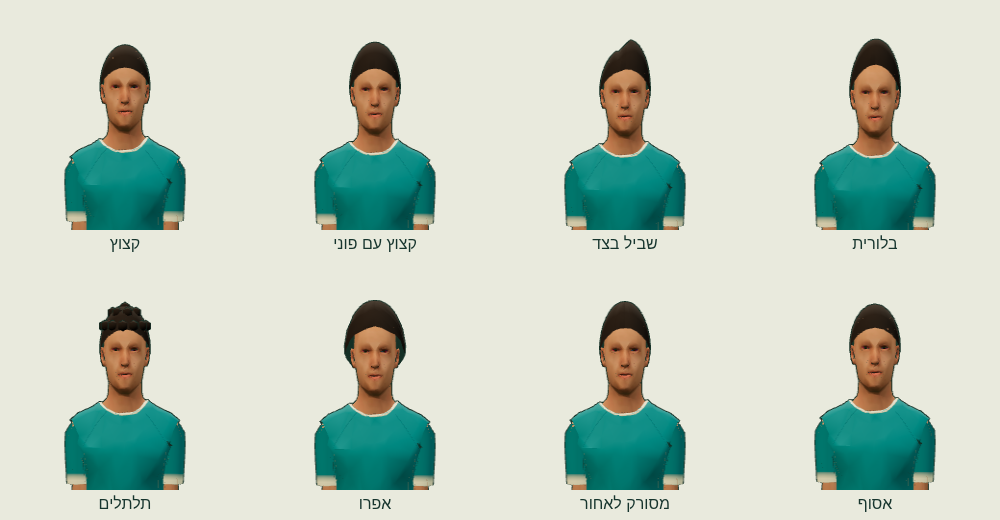
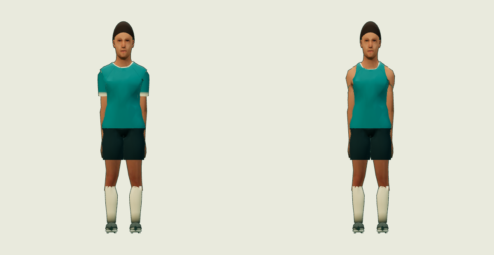

# גוף אתלט משותף — athlete-body-v1

12/11/2026. ענף `codex/athlete-body-v1`, בסיס main בקומיט `51f4faab518c695672efaf6323a8b72f239a2b84`.

[פתיחת התצוגה](preview.html) · [נתוני הגופים](body-manifest.json) · [נתוני התנועות](motion-manifest.json) · [מקור ורישיון לכל קובץ](LICENSES.md) · [מניפסט SHA-256](manifest.json)

הכדורגל והכדורסל מקבלים כאן אותו בסיס אנטומי, פנים, UV, אטלס, חומר והגדרת תאורה. ארבעת קובצי הגוף נגזרו מאותה דמות CC0 קנונית קיימת של הכדורגל; שינויי המבנה נעשים ברשת סביב מרכזי המפרקים. הסנטר רחב ועמוק יותר, הרכז צר יותר. השלד ומיקומי המנוחה נשארים זהים ל־CANON_BONES.

זוהי חבילת נכסים ותצוגת ביקורת. כל קובצי ה־PR חדשים ורק בתיקייה זו. חיבור למנועי המשחק נשאר לשלב האינטגרציה.

## גופים, משולשים ומשקל

| פרופיל | גובה במטרים | גוף | גוף + התסרוקת הכבדה ביותר | GLB בבתים | KiB |
|---|---:|---:|---:|---:|---:|
| כדורגל | 1.80 | 5,080 | 5,736 | 478,588 | 467.37 |
| רכז | 1.78 | 5,080 | 5,736 | 478,588 | 467.37 |
| קיצוני | 1.94 | 5,080 | 5,736 | 478,592 | 467.38 |
| סנטר | 2.08 | 5,080 | 5,736 | 478,588 | 467.37 |

התקציב המרבי הוא **5,736 משולשים**, כולל נעליים, בגד ותסרוקת אחת; נמוך מ־7,000 בכל פרופיל ובכל צורת לבוש. המורפים שומרים על הטופולוגיה ואינם מוסיפים משולשים. גוף: 3,944 קודקודים, primitive אחד, חומר צבע אחד. קו המתאר הוא מעבר ציור נוסף ולכן מכפיל את עבודת ציור הגאומטריה; הוא אינו גאומטריה נוספת בקובצי הנכסים.

גובה נמדד מסוליה עד הקרקפת ללא שיער. מדידות ה־CPU הן soccer=1.80, guard=1.78, wing=1.94, center=2.08 מ׳. תסרוקת עשויה להוסיף גובה. `BodyScale` מגדיל את השלד כולו ואת תנועתו באותו יחס, ומתקן את גובה הסוליה. רשת העור היא scene root לפי כללי glTF; הקנה נמצא בהורה של עצם Root. אין שינוי אורכי עצמות בתוך השלד.

אטלס משותף יחיד: **1024×1024 PNG**, ‏474,663 בתים (463.54 KiB). הוא מקושר חיצונית מכל GLB ואינו משוכפל בתוכם. כל תיקיית runtime, כולל ארבעת הגופים, שמונה התסרוקות, 25 קליפי הביקורת והמניפסט הפנימי: 3,442,111 בתים (3.283 MiB).

## אותו חומר, צבעי אזורים ותלבושות

`athlete_shared`: PBR פשוט, metalness=0, roughness=0.88, אטלס sRGB וצבעי קודקודים ליניאריים. גם השיער משתמש באותו חומר בזמן ההרכבה. ה־preview מפעיל אותה תאורת סטודיו, ACES/exposure=1.03, ואת אותו קו מתאר בקליפה הפוכה של 3 מ״מ במרחב הקנוני, לכל גוף ולכל ענף.

| `_REGION` | אזור | שינוי בזמן ריצה |
|---:|---|---|
| 0 | skin | שישה גוונים ב־body-manifest |
| 1 | uniform_primary | צבע חולצה |
| 2 | uniform_secondary | צבע מכנסיים |
| 3 | uniform_trim | צבע גימור |
| 4 / 5 | shoe_upper / shoe_sole | נעל וסוליה |
| 6 | eyes | פרטי עיניים מהאטלס |
| 7 | hair | צבע שיער, בנכס המחובר לראש |
| 8 | sock | צבע גרביים |

מחליפים RGB של `COLOR_0` לפי `_REGION`, ושומרים alpha=1. כל הגופים חולקים UV וטופולוגיה זהים; בדיקת גיבובים השוותה את הנתונים בפועל. ששת הגוונים: `#f2c6a0`, `#d9a17b`, `#bd8058`, `#9a6041`, `#70422d`, `#44291f`.

בחירת ענף מפעילה morph target אחד: `basketball`, `tennis` או `hockey`; כדורגל הוא כל המשקלים 0. גופיית הכדורסל חושפת כתפיים ועור מתחתיה. הטניס מקבל צווארון; ההוקי שרוולים ארוכים. השרוולים נבנו ברציפות עם משקלי כתף, מרפק וכף יד, כדי שהחלפת ענף לא תמתח שרוול קצר קשיח. קטעים מוסתרים נכנסים מתחת לעור; אין החלפת חומרים או טקסטורות בין ענפים.

[כדורגל — שמונה פריימים](verification/uniform-soccer.png) · [כדורסל](verification/uniform-basketball.png) · [טניס](verification/uniform-tennis.png) · [הוקי](verification/uniform-hockey.png)

## שמונה תסרוקות

| תסרוקת | משולשים | בתים |
|---|---:|---:|
| קצוץ | 456 | 17,520 |
| קצוץ עם פוני | 456 | 17,548 |
| שביל בצד | 456 | 17,556 |
| בלורית | 456 | 17,532 |
| תלתלים | 656 | 25,804 |
| אפרו | 456 | 17,520 |
| מסורק לאחור | 456 | 17,572 |
| אסוף | 368 | 14,700 |

תסרוקת אחת מחוברת כילד ל־Head בקואורדינטות מקומיות. קנה מקומי `[bodyShape.width, 1, bodyShape.depth]` מתאים את הכיפה למבנה הראש; קנה הגובה מגיע מהשלד. השיער מקורי, אטום, ללא alpha cards. ה־preview מחליף תסרוקות וצבע שיער בלי לשנות גוף או קליפ.



## תאימות לקליפים המתוקנים

המקור נעול ל־[catalog.json של motion-fix-v12](https://github.com/roynaor-work/Bakasun/blob/5d71491ea9a3b44b5fe6139e516c1d2e5577e9ad/workout/island/design/motion-fix-v12/runtime/catalog.json), קומיט `5d71491ea9a3b44b5fe6139e516c1d2e5577e9ad`. נבדקה הרשאה מול הקטלוג ו־blocklist; נבחרו חמישה קליפים מכל אחת מחמש הספריות, כולל שלושת מקורות המבנה בכדורסל. כל מקור וגיבוב נמצאים ב־motion-manifest.

הקליפים החדשים הם animation-only על 18 עצמות קנוניות. שמות, סדר, הורות, מיקומי מנוחה וסיבובי מנוחה נבדקו מול athletes-core. סיבובי המקור וזמני המפתח נשמרו בדיוק; שגיאת read-back מרבית 0. ערוצים סטטיים חסרים מקבלים identity מפורש, וכל החלפה בתצוגה מאפסת את השלד.

המקור של hoops אינו אותו bind: לכן לא נכתבת לאגן הקנוני תנועת האגן האבסולוטית של גוף tall. משתמשים בנוסחה `targetRest + (sourceTranslation - sourceRest) × canonicalLegLength/sourceLegLength`, עבור Hips ו־Root בלבד. היחסים בכדורסל: guard ‏0.824177, wing ‏0.782552, center ‏0.744929. הסיבובים אינם משתנים, ואין translation או scale של עצמות גפיים. קנה גוף משנה את טווח התנועה ואת המהירות במטרים; משך הקליפ והקצב נשמרים.

הקליפים המתוקנים כוללים idle handles ומנוגנים בשלמותם, ללא חיתוך שקט של הפתיחה והסיום. `sourceLoop` ו־`coreRange` שמורים במניפסט לצורך חיבור מחזורי. כדור ואביזרים אינם חלק משלד הגוף; התאמת מגע בכדור ונעילת רגל בעולם המשחק דורשת כיול באינטגרציה, לאחר שינוי קנה. הבדיקה כאן מאמתת את הגוף, הסקינינג והטעינה, ולא משנה את לוגיקת המשחק.

## אימות קבצים ותנועה

| בדיקה | תוצאה |
|---|---|
| Khronos glTF Validator 2.0.0-dev.3.10 | 37 GLB, ‏0 שגיאות ו־0 אזהרות |
| טעינה בפועל ב־GLTFLoader ללא מפענחים | 4 גופים + 8 תסרוקות + 25 קליפים נטענו |
| CSP ו־WebAssembly | ללא wasm-eval; כל כניסות יצירה/הידור של WASM נחסמו בבדיקה; 0 ניסיונות ו־0 הפרות CSP |
| מטריצת גוף × קליפ | 100 צירופים, 4 צורות לבוש בכל אחד |
| דגימות CPU | 21,512 זמנים שונים לאורך הצירופים, כל זמני המפתח ובנוסף 30Hz |
| סקינינג של כל קודקוד | 339,373,312 הערכות, 0 רכיבים לא סופיים |
| שגיאת אורכי עצמות מרבית | 6.104e-08 מ׳ |
| שגיאת bind מרבית | 9.938e-08 מ׳ |
| שינוי יחסי מרבי בקצוות ראש קשיח | 7.074e-08 |
| היפוך מטריצת skinning באזורי מרפק/ברך | 0 דגימות |
| גיליונות בפועל | 100 גיליונות × 8 = 800 פריימים |
| מסגור אוטומטי | 800 דמויות נוכחות בפריים, ללא מגע בשולי התמונה |
| ממשק | ארבע תלבושות, 6 גווני עור, 8 תסרוקות ו־3 צבעי קבוצה נבדקו דרך הבקרים |
| Chromium | 0 שגיאות, 0 אזהרות, 0 כשלי בקשה ואיבוד הקשר WebGL |
| תצוגה צרה | 390×844; רוחב מסמך=390 ללא גלילה אופקית |

[אימות גאומטריה וסקינינג](verification/assets.json) · [פלט Validator](verification/gltf-validator.json) · [דוח דפדפן ופריימים](verification/browser.json) · [מדידות תמונה](verification/appearance.json)

המדדים כוללים סקינינג אמיתי של הרשת ולא רק מדידת שלד. נמדדו גם דטרמיננטים ומתיחת קצוות במשולשים ליד מרפקים וברכיים. אין סף אוניברסלי שממיר אותם לציון חזותי; הם מופיעים במלואם בדוח הנתונים. אורכי העצמות והראש נשמרו, לא נמצאו היפוכים או קודקודים לא תקינים, והגיליונות מראים את כיפופי המפרקים. ביקורת העין כללה הליכה, זריקה מעל הראש, הטבעה, זינוק שוער ושרוול הוקי; תוקנו בה כיוון פני השרוולים והתאמת כיפת השיער. לא נמדד קצב פריימים במכשיר פיזי.

## מדידת הפרש מראה

כל זוג צולם ב־600×620 פיקסלים לכל צד, באותה מצלמה אורתוגרפית, אותה תנוחת מנוחה, תאורה, חומר, אטלס, צבעי עור ומדים ושיער. ההשוואה בגובה משותף מנטרלת את הפרש הגובה ומותירה את שינוי המבנה. בנוסף נשמר צילום בגבהים הטבעיים. ביקורת שני עותקים זהים נתנה תמונות זהות פיקסל־לפיקסל.

| השוואה | חפיפת צללית IoU | הפרש RGB ממוצע בחזית, מתוך 255 | פיקסלים שהשתנו ביותר מ־2, מכל התמונה |
|---|---:|---:|---:|
| [גובה 1.80 משותף, אותה תלבושת](verification/compare-same-kit-normalized.png) | 98.558% | 5.347 | 1.805% |
| [גובה משותף, חולצה מול גופייה](verification/compare-sports-normalized.png) | 96.921% | 11.708 | 2.576% |
| [גבהים טבעיים 1.80 / 1.78, תלבושות ענף](verification/compare-sports-native-height.png) | 94.414% | 19.624 | 5.497% |
| [ביקורת: שני עותקים של אותו גוף](verification/compare-control-identical-body.png) | 100.000% | 0.000 | 0.000% |

המסכה נוצרת מריחוק RGB של יותר מ־10 מהרקע. אלו מדידות תמונה, ולא ציון תפיסתי ל״אותה גרפיקה״. ההפרש הנשאר בהשוואת אותה תלבושת נובע ממבנה רכז צר יותר; החלפת הענף מוסיפה את הבדל הגופייה. במישור הנכסים, אטלס ה־UV וחומר הצבע משותפים ממש.



## כל 100 גיליונות הביקורת

כל תא בטבלה פותח שמונה פריימים של אותו קליפ על הגוף המתאים. המצלמה קבועה לאורך כל גיליון ומכילה את טווח התנועה כולו.

| ספרייה | קליפ | כדורגל | רכז | קיצוני | סנטר |
|---|---|---|---|---|---|
| soccer-v9 | הליכה · `walk` | [כדורגל](verification/sheets/soccer--soccer-v9--walk.png) | [רכז](verification/sheets/guard--soccer-v9--walk.png) | [קיצוני](verification/sheets/wing--soccer-v9--walk.png) | [סנטר](verification/sheets/center--soccer-v9--walk.png) |
| soccer-v9 | ריצה · `run` | [כדורגל](verification/sheets/soccer--soccer-v9--run.png) | [רכז](verification/sheets/guard--soccer-v9--run.png) | [קיצוני](verification/sheets/wing--soccer-v9--run.png) | [סנטר](verification/sheets/center--soccer-v9--run.png) |
| soccer-v9 | ספרינט · `sprint` | [כדורגל](verification/sheets/soccer--soccer-v9--sprint.png) | [רכז](verification/sheets/guard--soccer-v9--sprint.png) | [קיצוני](verification/sheets/wing--soccer-v9--sprint.png) | [סנטר](verification/sheets/center--soccer-v9--sprint.png) |
| soccer-v9 | חיתוך 90 מעלות · `cut_90` | [כדורגל](verification/sheets/soccer--soccer-v9--cut_90.png) | [רכז](verification/sheets/guard--soccer-v9--cut_90.png) | [קיצוני](verification/sheets/wing--soccer-v9--cut_90.png) | [סנטר](verification/sheets/center--soccer-v9--cut_90.png) |
| soccer-v9 | הוצאת חוץ · `throw_in` | [כדורגל](verification/sheets/soccer--soccer-v9--throw_in.png) | [רכז](verification/sheets/guard--soccer-v9--throw_in.png) | [קיצוני](verification/sheets/wing--soccer-v9--throw_in.png) | [סנטר](verification/sheets/center--soccer-v9--throw_in.png) |
| soccer-v10 | חיתוך שמאלה 45 מעלות · `cut_45_left` | [כדורגל](verification/sheets/soccer--soccer-v10--cut_45_left.png) | [רכז](verification/sheets/guard--soccer-v10--cut_45_left.png) | [קיצוני](verification/sheets/wing--soccer-v10--cut_45_left.png) | [סנטר](verification/sheets/center--soccer-v10--cut_45_left.png) |
| soccer-v10 | חיתוך ימינה 90 מעלות · `cut_90_right` | [כדורגל](verification/sheets/soccer--soccer-v10--cut_90_right.png) | [רכז](verification/sheets/guard--soccer-v10--cut_90_right.png) | [קיצוני](verification/sheets/wing--soccer-v10--cut_90_right.png) | [סנטר](verification/sheets/center--soccer-v10--cut_90_right.png) |
| soccer-v10 | עצירת חזה · `first_touch_chest_standing_quick` | [כדורגל](verification/sheets/soccer--soccer-v10--first_touch_chest_standing_quick.png) | [רכז](verification/sheets/guard--soccer-v10--first_touch_chest_standing_quick.png) | [קיצוני](verification/sheets/wing--soccer-v10--first_touch_chest_standing_quick.png) | [סנטר](verification/sheets/center--soccer-v10--first_touch_chest_standing_quick.png) |
| soccer-v10 | בעיטת שוער ארוכה · `goalkeeper_long_goal_kick` | [כדורגל](verification/sheets/soccer--soccer-v10--goalkeeper_long_goal_kick.png) | [רכז](verification/sheets/guard--soccer-v10--goalkeeper_long_goal_kick.png) | [קיצוני](verification/sheets/wing--soccer-v10--goalkeeper_long_goal_kick.png) | [סנטר](verification/sheets/center--soccer-v10--goalkeeper_long_goal_kick.png) |
| soccer-v10 | בלימה והאצה · `brake_reaccelerate` | [כדורגל](verification/sheets/soccer--soccer-v10--brake_reaccelerate.png) | [רכז](verification/sheets/guard--soccer-v10--brake_reaccelerate.png) | [קיצוני](verification/sheets/wing--soccer-v10--brake_reaccelerate.png) | [סנטר](verification/sheets/center--soccer-v10--brake_reaccelerate.png) |
| soccer-v11 | כדרור איטי · `dribble_slow` | [כדורגל](verification/sheets/soccer--soccer-v11--dribble_slow.png) | [רכז](verification/sheets/guard--soccer-v11--dribble_slow.png) | [קיצוני](verification/sheets/wing--soccer-v11--dribble_slow.png) | [סנטר](verification/sheets/center--soccer-v11--dribble_slow.png) |
| soccer-v11 | הגבהה משמאל · `pass_cross_left` | [כדורגל](verification/sheets/soccer--soccer-v11--pass_cross_left.png) | [רכז](verification/sheets/guard--soccer-v11--pass_cross_left.png) | [קיצוני](verification/sheets/wing--soccer-v11--pass_cross_left.png) | [סנטר](verification/sheets/center--soccer-v11--pass_cross_left.png) |
| soccer-v11 | בעיטת יעף · `shot_volley` | [כדורגל](verification/sheets/soccer--soccer-v11--shot_volley.png) | [רכז](verification/sheets/guard--soccer-v11--shot_volley.png) | [קיצוני](verification/sheets/wing--soccer-v11--shot_volley.png) | [סנטר](verification/sheets/center--soccer-v11--shot_volley.png) |
| soccer-v11 | הוצאת חוץ בעמידה · `set_throw_in` | [כדורגל](verification/sheets/soccer--soccer-v11--set_throw_in.png) | [רכז](verification/sheets/guard--soccer-v11--set_throw_in.png) | [קיצוני](verification/sheets/wing--soccer-v11--set_throw_in.png) | [סנטר](verification/sheets/center--soccer-v11--set_throw_in.png) |
| soccer-v11 | זינוק שוער ימינה · `keeper_dive_right` | [כדורגל](verification/sheets/soccer--soccer-v11--keeper_dive_right.png) | [רכז](verification/sheets/guard--soccer-v11--keeper_dive_right.png) | [קיצוני](verification/sheets/wing--soccer-v11--keeper_dive_right.png) | [סנטר](verification/sheets/center--soccer-v11--keeper_dive_right.png) |
| hoops-tall-v1 | רכז · ריצה · `guard/v9/run` | [כדורגל](verification/sheets/soccer--hoops-tall-v1--guard--v9--run.png) | [רכז](verification/sheets/guard--hoops-tall-v1--guard--v9--run.png) | [קיצוני](verification/sheets/wing--hoops-tall-v1--guard--v9--run.png) | [סנטר](verification/sheets/center--hoops-tall-v1--guard--v9--run.png) |
| hoops-tall-v1 | רכז · שינוי יד שמאלה · `guard/v9/dribble_crossover_left` | [כדורגל](verification/sheets/soccer--hoops-tall-v1--guard--v9--dribble_crossover_left.png) | [רכז](verification/sheets/guard--hoops-tall-v1--guard--v9--dribble_crossover_left.png) | [קיצוני](verification/sheets/wing--hoops-tall-v1--guard--v9--dribble_crossover_left.png) | [סנטר](verification/sheets/center--hoops-tall-v1--guard--v9--dribble_crossover_left.png) |
| hoops-tall-v1 | קיצוני · קליעת ניתור · `wing/v9/jump_shot` | [כדורגל](verification/sheets/soccer--hoops-tall-v1--wing--v9--jump_shot.png) | [רכז](verification/sheets/guard--hoops-tall-v1--wing--v9--jump_shot.png) | [קיצוני](verification/sheets/wing--hoops-tall-v1--wing--v9--jump_shot.png) | [סנטר](verification/sheets/center--hoops-tall-v1--wing--v9--jump_shot.png) |
| hoops-tall-v1 | סנטר · הטבעה בשתי ידיים · `center/v9/dunk_two_hands` | [כדורגל](verification/sheets/soccer--hoops-tall-v1--center--v9--dunk_two_hands.png) | [רכז](verification/sheets/guard--hoops-tall-v1--center--v9--dunk_two_hands.png) | [קיצוני](verification/sheets/wing--hoops-tall-v1--center--v9--dunk_two_hands.png) | [סנטר](verification/sheets/center--hoops-tall-v1--center--v9--dunk_two_hands.png) |
| hoops-tall-v1 | סנטר · תנועת הגנה שמאלה · `center/v9/defensive_slide_left` | [כדורגל](verification/sheets/soccer--hoops-tall-v1--center--v9--defensive_slide_left.png) | [רכז](verification/sheets/guard--hoops-tall-v1--center--v9--defensive_slide_left.png) | [קיצוני](verification/sheets/wing--hoops-tall-v1--center--v9--defensive_slide_left.png) | [סנטר](verification/sheets/center--hoops-tall-v1--center--v9--defensive_slide_left.png) |
| hoops-v11 | רכז · כדרור בין הרגליים · `guard/dribble_between_legs` | [כדורגל](verification/sheets/soccer--hoops-v11--guard--dribble_between_legs.png) | [רכז](verification/sheets/guard--hoops-v11--guard--dribble_between_legs.png) | [קיצוני](verification/sheets/wing--hoops-v11--guard--dribble_between_legs.png) | [סנטר](verification/sheets/center--hoops-v11--guard--dribble_between_legs.png) |
| hoops-v11 | קיצוני · מסירת חזה · `wing/pass_chest` | [כדורגל](verification/sheets/soccer--hoops-v11--wing--pass_chest.png) | [רכז](verification/sheets/guard--hoops-v11--wing--pass_chest.png) | [קיצוני](verification/sheets/wing--hoops-v11--wing--pass_chest.png) | [סנטר](verification/sheets/center--hoops-v11--wing--pass_chest.png) |
| hoops-v11 | סנטר · קליעת ניתור · `center/jump_shot` | [כדורגל](verification/sheets/soccer--hoops-v11--center--jump_shot.png) | [רכז](verification/sheets/guard--hoops-v11--center--jump_shot.png) | [קיצוני](verification/sheets/wing--hoops-v11--center--jump_shot.png) | [סנטר](verification/sheets/center--hoops-v11--center--jump_shot.png) |
| hoops-v11 | רכז · קליעה בנסיגה · `guard/fadeaway` | [כדורגל](verification/sheets/soccer--hoops-v11--guard--fadeaway.png) | [רכז](verification/sheets/guard--hoops-v11--guard--fadeaway.png) | [קיצוני](verification/sheets/wing--hoops-v11--guard--fadeaway.png) | [סנטר](verification/sheets/center--hoops-v11--guard--fadeaway.png) |
| hoops-v11 | סנטר · חסימת קליעה · `center/shot_block` | [כדורגל](verification/sheets/soccer--hoops-v11--center--shot_block.png) | [רכז](verification/sheets/guard--hoops-v11--center--shot_block.png) | [קיצוני](verification/sheets/wing--hoops-v11--center--shot_block.png) | [סנטר](verification/sheets/center--hoops-v11--center--shot_block.png) |

## בדיקה מקומית ושחזור

1. משורש המאגר מפעילים את השרת שלמטה ופותחים את הכתובת. התוצאה הרצויה: ארבעה גופים מונפשים, בחירת ענף, גוון עור, תסרוקת וצבעי קבוצה, והשוואה זוגית.
2. עוברים בין חמש ספריות התנועה ובין ארבעת ענפי הספורט. בתצוגה ניתן להשהות, לגרור זמן ולהחליף מבט.
3. להרצה חוזרת של המדידות מתקינים כלי פיתוח מחוץ לחבילה, ואז מריצים מתוך תיקיית החבילה את פקודות האימות. `--load-only` טוען גם את קובצי הדוח והמניפסט הסופיים ללא שינוי תוצרים.

```sh
python3 -m http.server 8765 --bind 127.0.0.1
```

```text
http://127.0.0.1:8765/workout/island/design/athlete-body-v1/preview.html
```

```sh
npm install --prefix /tmp/athlete-tools --cache /tmp/athlete-npm-cache three@0.160.1 @gltf-transform/core@4.2.1 gltf-validator@2.0.0-dev.3.10 playwright@1.56.1 sharp@0.35.5
```

```sh
ATHLETE_TOOL_ROOT=/tmp/athlete-tools node tools/verify-assets.mjs
ATHLETE_TOOL_ROOT=/tmp/athlete-tools CHROMIUM_PATH=/usr/bin/chromium node tools/browser-evidence.mjs
python3 tools/measure-appearance.py
node tools/write-inventory.mjs
ATHLETE_TOOL_ROOT=/tmp/athlete-tools node tools/verify-assets.mjs --load-only
node tools/write-inventory.mjs --check
```

סביבת האימות: Node 24.19, Chromium עם ANGLE SwiftShader, NumPy 2.3.5 ו־Pillow 12.3.0. אלה תלותי פיתוח חיצוניות; בדפדפן נדרשים רק קובצי Three.js הקיימים במאגר וקובצי החבילה.

לשחזור הגופים: `python3 tools/build-hair.py`, אחר כך `python3 tools/build-bodies.py --source /path/to/canonical-player-01.glb`. המקור חייב להתאים ל־SHA-256 במניפסט. לשחזור הקליפים: `node tools/build-motion.mjs /path/to/motion-fix-v12`. הנתיבים מצביעים לייצוא קומיט המקור הנעול, לא לקוד משחק שנערך. אחרי יצירה מחדש מריצים את האימות והאינדקס מחדש.

## מקורות ותחום השינוי

הגוף והאטלס נגזרו מ־canonical-player-01 של motion-fix-v12, שמגיע מדמות soccer-v7 דרך soccer-motion-v8/v11. שרשרת המקור, ההודעות המקוריות ורישוי MakeHuman CC0 מתועדים ב־[LICENSES.md](LICENSES.md). השרוולים, המורפים, התסרוקות, כלי ההפקה, התצוגה והצילומים נוצרו למשימה זו ומוקדשים ל־CC0. הדמויות בדיוניות וללא מותגים.

כל השינוי הוא הוספות תחת `workout/island/design/athlete-body-v1/`. קוד קיים, ops, בדיקות קיימות, CLAUDE.md, release.json/release.mjs ותגי גרסה לא נערכו. הבדיקות שבוצעו הן בדיקות הנכסים והדפדפן המתועדות כאן; חבילת בדיקות האפליקציה המלאה לא הורצה עבור מסירת נכסים זו.
