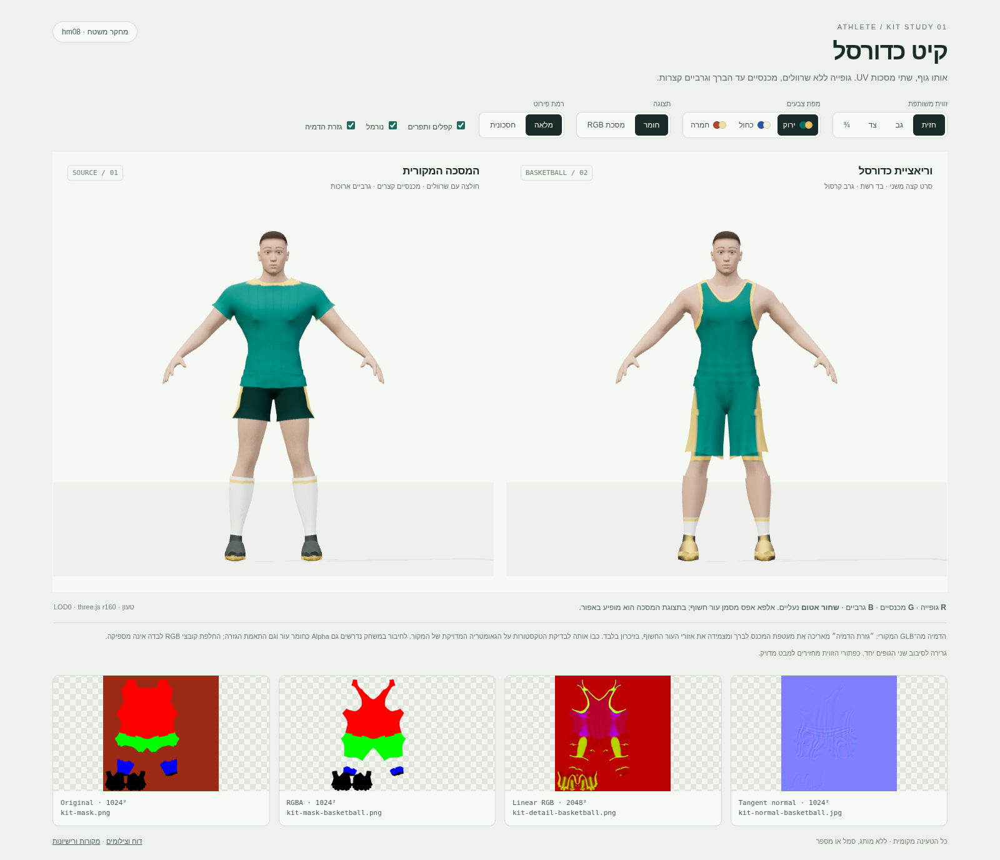
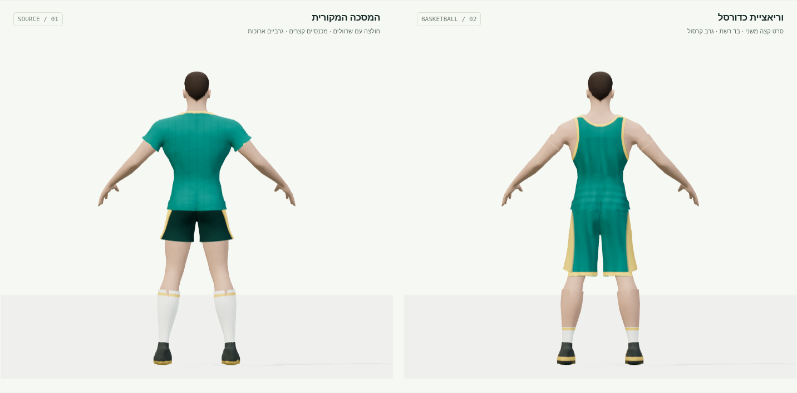
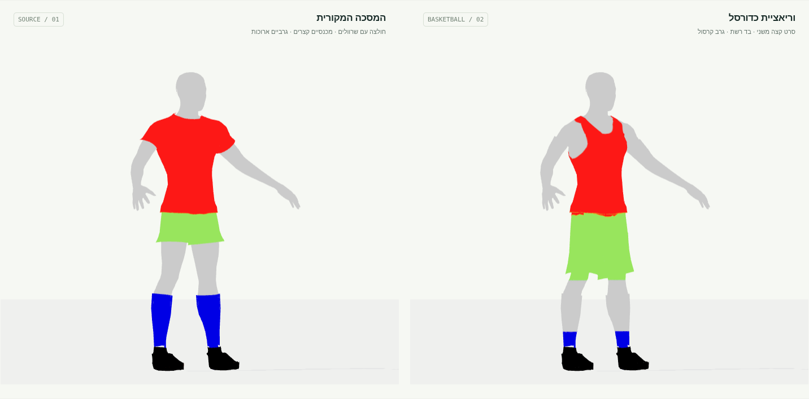
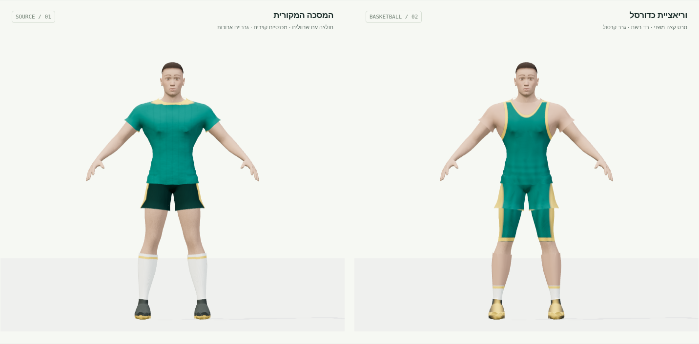

# קיט כדורסל — athlete-kits-v1

נוצרה וריאציית UV מקורית לגוף MakeHuman hm08 הקיים: גופייה ללא שרוולים עם סרט בצבע משני סביב הצוואר ובתי השחי, מכנסיים עד הברך, גרבי קרסול וקטגוריית נעליים שחורה במסכה. נוספו קפלי בד, תפרים, אזורי רשת ונורמל תואם. כל התוספות נמצאות בתיקייה זו בלבד.

**החבילה היא נכס עיצוב לבדיקה, וכוללת חוזה חומר חדש.** החלפת שלושת הקבצים בשיידר הקיים בלבד אינה מספיקה: יש לפענח Alpha כעור, להחיל את המסכה גם על משטח הרגל, ולהתאים את גזרת המכנס. התצוגה מדגימה את ההתאמות הללו בזיכרון, עם מתג לבדיקת הגאומטריה המקורית ללא התאמה. ה־GLB וקוד המשחק לא שונו.

## קבצים

| קובץ | פורמט וגודל | שימוש |
| --- | --- | --- |
| `kit-mask-basketball.png` | RGBA, ‏1024×1024, ‏16,828 בתים | R גופייה, G מכנסיים, B גרביים, שחור אטום נעליים; Alpha מכסה בגד/נעליים ומפריד עור |
| `kit-detail-basketball.png` | RGB, ‏2048×2048, ‏802,733 בתים | R בהירות/קפלים/תפרים; G צבע משני/סרטים; B רשת בגופייה |
| `kit-normal-basketball.jpg` | RGB, ‏1024×1024, ‏127,422 בתים | נורמל במרחב המשיק של UV ה־GLB, JPEG איכות 94 ללא דגימת צבע מופחתת |
| `generate.py` | Python | שחזור דטרמיניסטי מגאומטריית המקור, ללא קלט של תמונות |
| `preview.html` + `preview.mjs` | HTML + ES module | מקור מול כדורסל, סיבוב משותף, שלושה שילובי צבעים, מסכה, נורמל, פרטים, LOD והתאמת גזרה |
| `LICENSES.md` | Markdown | מקור ורישיון לכל קובץ חדש ולתלויות המקומיות הקיימות |

כל קובץ בחבילה קטן מ־2 MB. שלוש הטקסטורות יחד: **946,983 בתים**. אין תמונות ממאגרים חיצוניים, מותג, חסות, מספר או סמל ליגה.

## פתיחה ובדיקה

1. משורש המאגר הפעילו שרת מקומי:

   ```sh
   python -m http.server 8765
   ```

2. פתחו את [תצוגת ההשוואה המקומית](http://localhost:8765/workout/island/design/athlete-kits-v1/preview.html).
3. בחרו חזית, גב וצד, החליפו צבעים ומצב מסכה. כבו את ״גזרת הדמיה״ כדי לראות בדיוק את מגבלות המודל המקורי. התוצאה הרצויה: סרט רציף בצוואר ובבתי השחי, G עד הברך, B באזור הקרסול בלבד, ושחור אטום בנעליים.

הדף משתמש ב־three.js r160 וב־GLTFLoader/SkeletonUtils המקומיים הקיימים ב־`../../vendor/`; אין CDN, התקנה או חיבור לרשת בזמן הפעלתו. יש לפתוח ב־HTTP, ולא ב־`file://`. הקישור המקומי פעיל כאשר השרת רץ במחשב שבו נפתח הדפדפן.

## חוזה הטקסטורות וחיבור עתידי

- כל שלוש המפות הן **נתונים ליניאריים**, `THREE.NoColorSpace`, עם `flipY=false`. אין להפעיל המרת sRGB על המסכה, הפרטים או הנורמל. UV נשמר במיפוי hm08 הקיים, ללא אריזה מחדש.
- במסכה, RGB מחלק אזורים. **A=255** הוא בגד או נעל, **A=0** הוא עור חשוף או שטח UV שאינו בשימוש. Alpha ביניים משמש להחלקת קצוות. שחור עם Alpha מלא הוא נעל; שחור שקוף אינו נעל.
- `detail.r` נקרא כבהירות לפי `0.25 + 0.95*r`; `detail.g` מערבב צבע ראשי עם משני; `detail.b` מכהה רשת בגופייה לפי `1 - 0.16*b`, בהתאם לחוזה הקיט הקיים. הפסים והקפלים אינם צבעי קבוצה אפויים.
- יש לדגום את Alpha **לפני** חישוב `1-r-g-b` לנעליים. אין להעביר אותו ישירות לשקיפות על כל מעטפת הקיט: העור חסר מתחת לחלק מהשרוול והשוק, ולכן ייפתחו חורים. בהדמיה אזורים אלו משתמשים בגוון העור של המקור על המעטפת הקיימת; הנורמל שם הוא של המשטח, ללא קפלי בד.
- המכנס המקורי מסתיים ב־Y≈0.769 מ׳, והברך ב־Y≈0.536 מ׳ בפוזת המנוחה. G ממשיך על UV משטח הרגל עד Y=0.55 מ׳. הגרב החדשה מסתיימת ב־Y=0.23 מ׳, לעומת כ־0.469 מ׳ במקור.
- ״גזרת הדמיה״ משכפלת את הגאומטריה בזיכרון: היא מאריכה את מעטפת המכנס סביב ציר Y=1.025 מ׳ עד מכפלת ב־0.55 מ׳, ומצמידה עד 1.9 ס״מ של מעטפת השרוול באזור שנחשף כעור. המיפוי והטופולוגיה נשמרים; נורמלי המשטח מחושבים מחדש בגזרה המותאמת, ומוחזרים עם מיקומי המקור כשמכבים אותה. תפר המכפלת בטקסטורת הפרטים נבנה עבור התאמה זו. הקוד נמצא ב־`fitGeometry()` ב־`preview.mjs`; הנוסחה התואמת ב־`fitted_shorts_y()` בגנרטור.
- בהדמיה החדשה החומר מוחל על משטח העור ועל מעטפת הקיט; בהשוואת המקור נשמרת חלוקת החומרים המקורית. בהטמעה עתידית צריך להעביר גם את הגזרה וגם את חוזה החומר, ולבדוק אנימציות, משקלי שלד וחיתוכי ברך במנוע המשחק. לא בוצעה אינטגרציה או בדיקת משחק במשימה זו.

## צילומים

חזית: המקור משמאל, כדורסל מימין. התאמת הגזרה פעילה; למטה מופיעים קובצי המקור והטקסטורות החדשות.



גב: סרטי הקצה, הגופייה והארכת המכנס.



מסכות בזווית שלושה רבעים: אפור הוא עור, שחור אטום הוא נעליים.



התאמת הגזרה כבויה: מראה במפורש את צללית השרוול ואת המכנס הקצר של המקור לצד המשך הצבע על הרגל.



בדיקות נוספות: [LOD1 בצד](screenshots/lod1-side.png), [תצוגה ברוחב 390 פיקסלים](screenshots/mobile.png).

## אימות ושחזור

נבדק ב־Chromium עם WebGL/SwiftShader, ב־1600×1100 וב־390×844. נטענו הגוף וכל המפות, ללא שגיאות JavaScript/GLSL, ללא תשובות HTTP כושלות וללא בקשות חיצוניות. נבדקו לחצני זווית/צבע/LOD, גרירה, מסכה, פרטים, נורמל והתאמת גזרה. שינויי פרטים, נורמל, צבע, LOD וגזרה אומתו גם באמצעות שינוי בפיקסלים המצוירים. לא נמצאה גלילה אופקית בשתי המידות.

במסכה יש 49,117 פיקסלים שחורים אטומים לנעליים, 737,536 פיקסלים עם Alpha אפס ו־3,138 פיקסלי Alpha ביניים. הנורמל נשאר בכיוון חצי הכדור החיובי (B לפחות 206); שגיאת אורך ממוצעת לאחר דחיסת JPEG כ־0.00815. נוסף ריפוד של 8 פיקסלים סביב איי ה־UV ברזולוציית 1024. רסטר החולצה מקבל קדימות עקבית על המכנס בחפיפת המותן, כדי למנוע משולשי צבע מתחלפים.

שחזור דורש Python 3 עם numpy, Pillow ו־scipy:

```sh
python workout/island/design/athlete-kits-v1/generate.py
```

בסיס הענף: `main` בקומיט `51f4faab518c695672efaf6323a8b72f239a2b84`. SHA-256 של ה־GLB שנקרא: `ca4bed47cba1b8cea7334514936d1723c1fb046d6c97c99ab1776255b020bdd7`. לא נוספו או נערכו בדיקות, קובצי שחרור, תגי גרסה או קובצי ops. אימות החבילה בוצע בכלים זמניים מחוץ למאגר.

| טקסטורה | SHA-256 |
| --- | --- |
| `kit-mask-basketball.png` | `08b412b0c79484d63ab3e9a163da8e8ce7785da00fcd59aa349bbe74bb3ab503` |
| `kit-detail-basketball.png` | `f00433cfba1d2a74b91e479e8a68641d513bd904c0cb7ccabdf5a9236fc3178b` |
| `kit-normal-basketball.jpg` | `1086d55e6bf5b1705ee4a540dea79b95a70e70ded4fc90ef5cbec8447bc3e408` |
