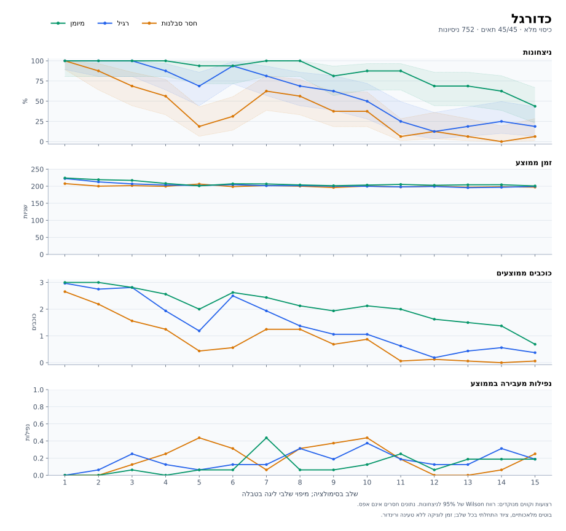
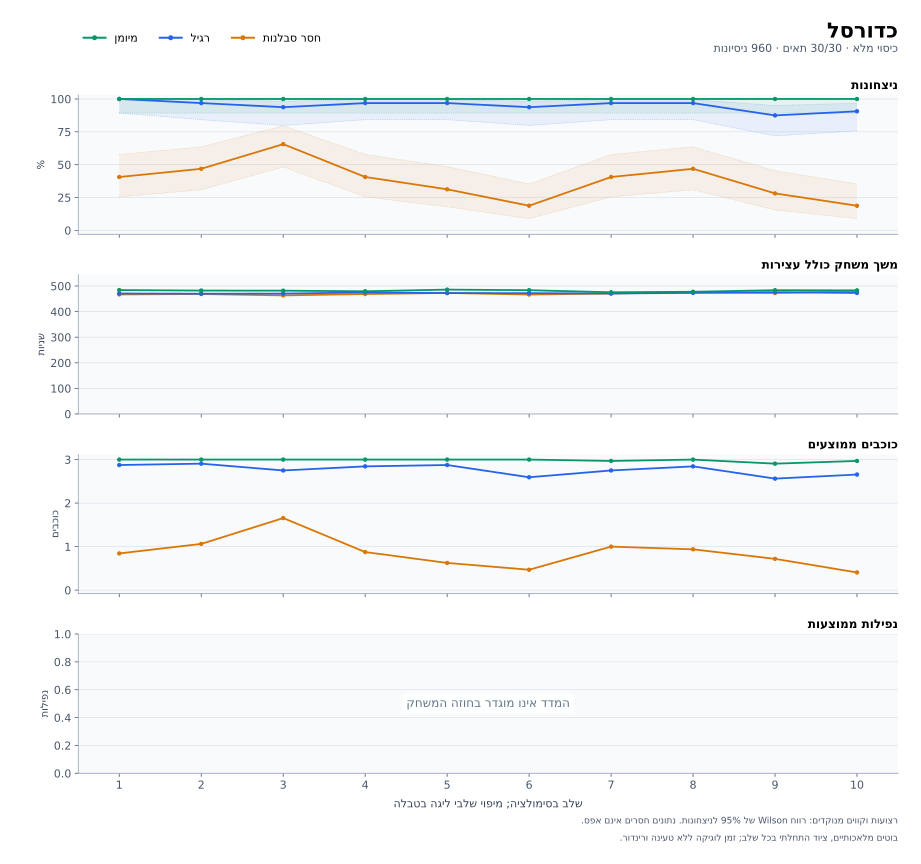
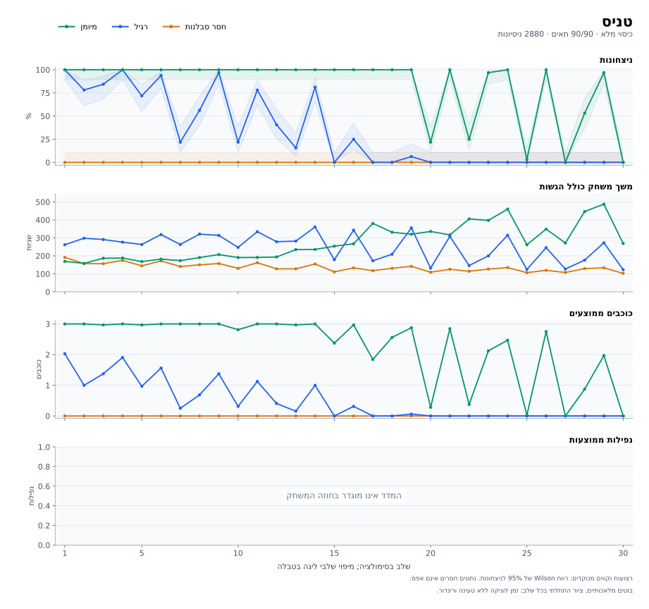
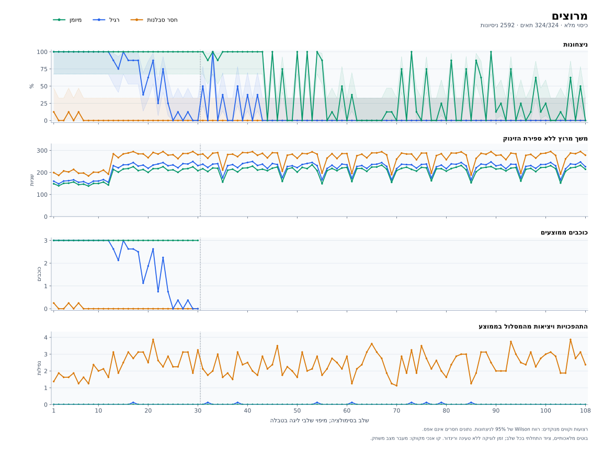
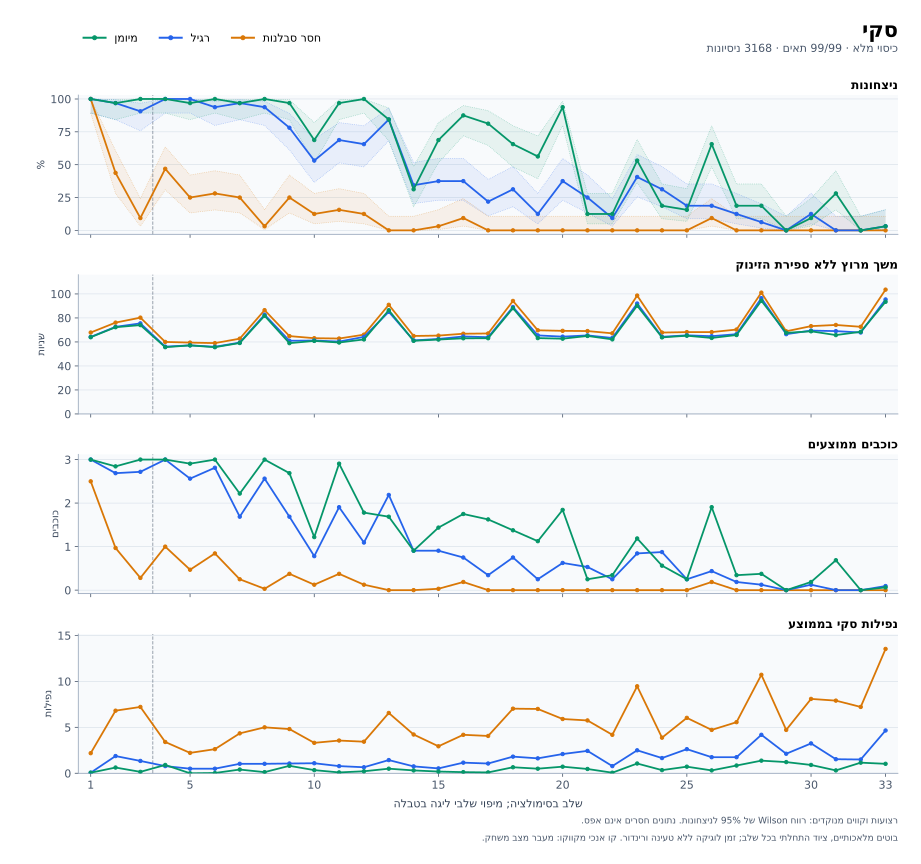
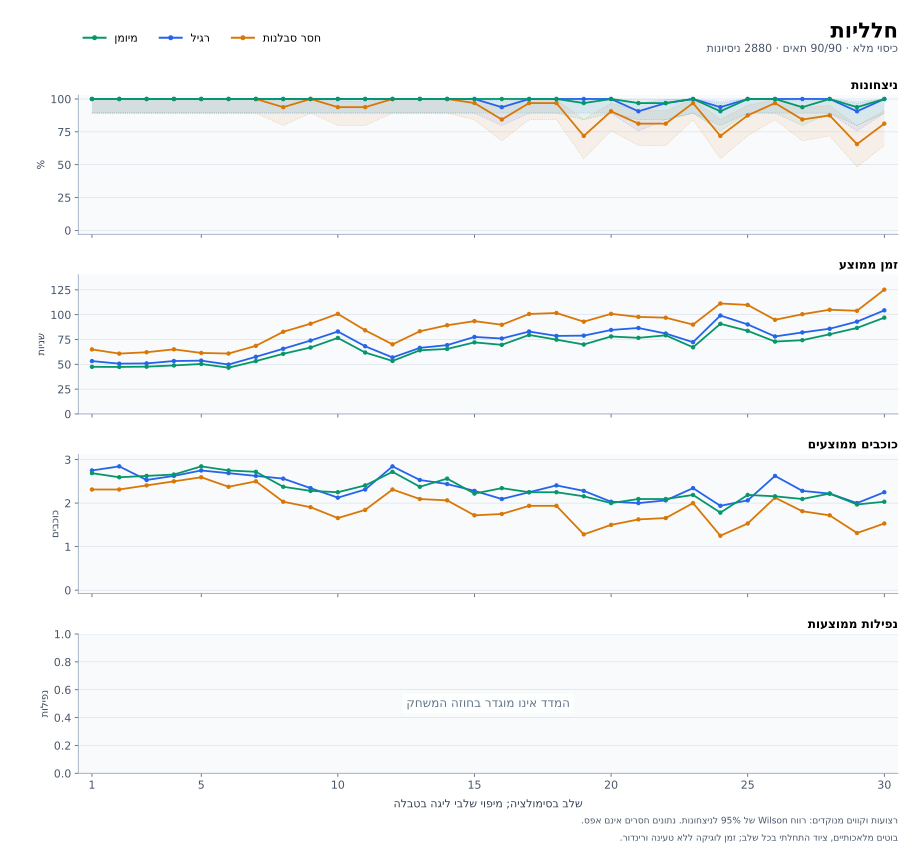
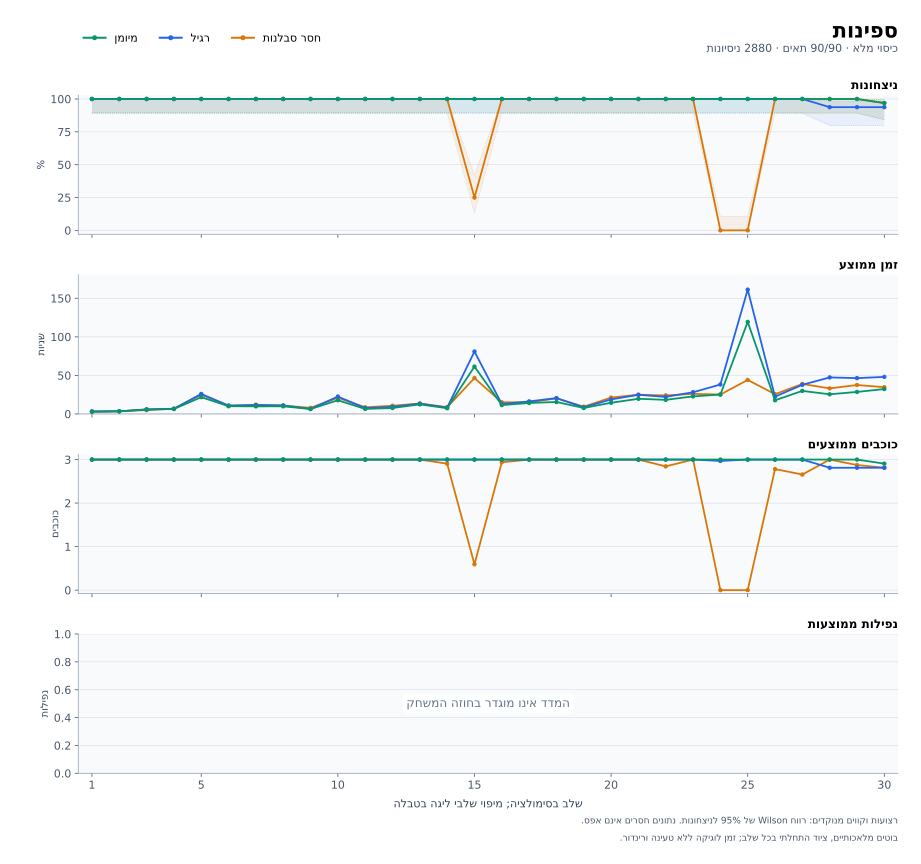
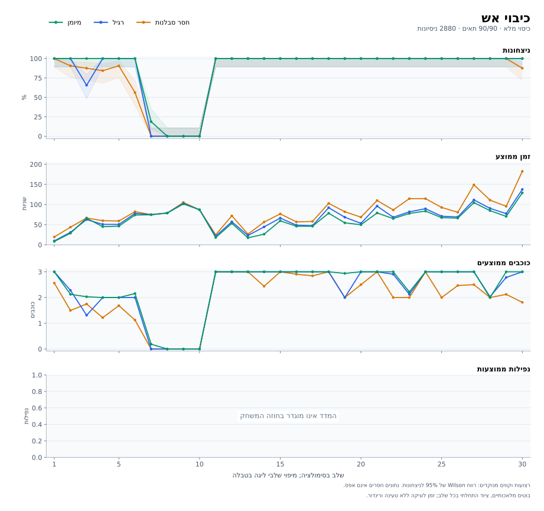
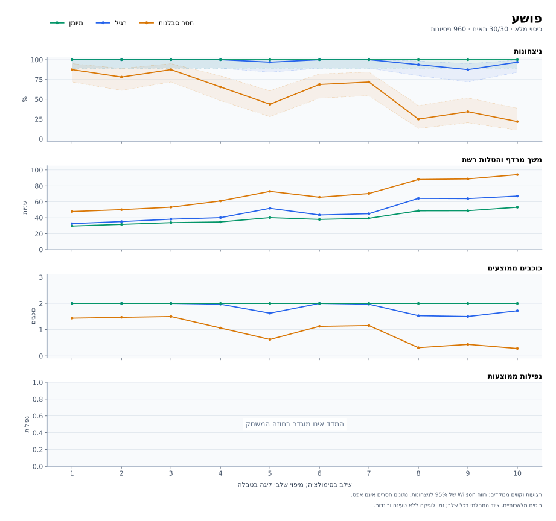
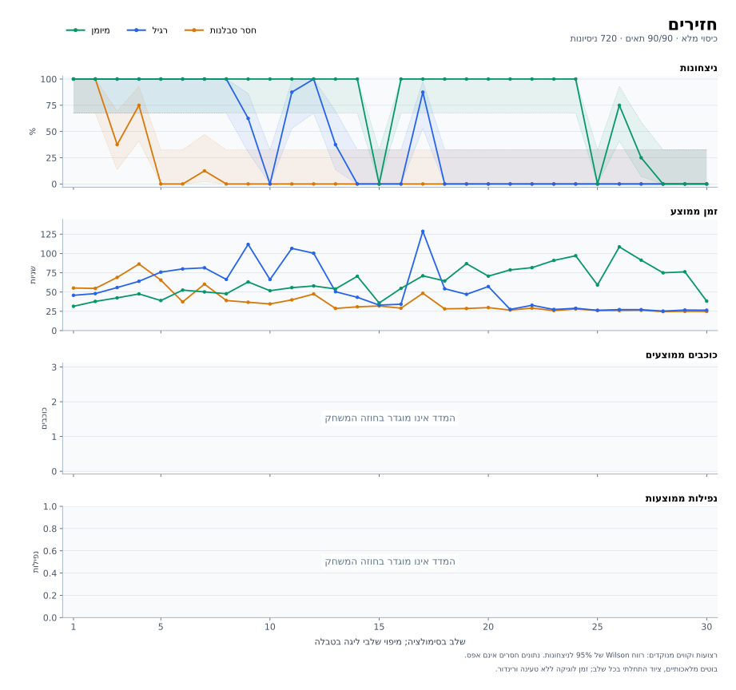

# בדיקת עקומת קושי — סימולציות בוטים, גרסה 1

17 בנובמבר 2026. הבדיקה מוסיפה תיעוד וכלים בלבד. קוד המשחק, נתוני האיזון, השמירות והגרסה הקיימים לא שונו. המלצות הכוונון הן הצעות לבדיקה ולחיבור.

מקור נמדד: `43b27dc235387e3cb737aee9558cdf9d5fd5a262`. גיבוב מקורות: `fd6c9abd3392ab91504777feb75f2f00dd4f521cb0bccf29ae6817534040fd07`. כל משחק רץ מתוך העתק זמני; פירוט הקבצים וגיבוביהם ב־[source-manifest.json](data/source-manifest.json).

הכיסוי הראשי כולל **10 משחקים, 326 מזהי שלב/אירוע, שלושה פרופילים ו־20,672 ניסיונות סימולציה**. בחזירים אין שלב אחרון: הכיסוי הוא כל 20 הגלים המתוכננים, הגלים המחושבים 21–30 ובדיקת עומס משלימה ל־35 ול־40. אין טענה שנמדד כל זנב הקמפיין האינסופי.

## ממצאים מרכזיים

- **כבאות, שלבים 7–10:** קיר קושי במצב חדש ללא ציוד. המועמד המדוד למטה נבדק על זרעי אימות נפרדים: הבוט הרגיל עבר מ־0/16 בכל ארבעת השלבים ל־16/16, 8/16, 15/16 ו־9/16. המיומן הגיע ל־16/16 בכל הארבעה. הבוט חסר הסבלנות עדיין מתקשה במיוחד ב־8 וב־10. ההקלה אינה מבטיחה עקומה מונוטונית.
- **פושע, תגמול:** ב־144 ניסויי הבסיס בניסוי המזווּג לא ניתנו שלושה כוכבים, אף שהמיומן ניצח בכל 48 ניסיונותיו. התאמת האזור המושלם העלתה שלושה כוכבים ל־72/144 בלי לשנות ניצחון או זמן באף זוג. זה פער בין הצלחה לבין תגמול.
- **כבאות, תעודה:** בשלבים 1, 2, 11 ו־13 אין חילוץ, אך הכוכב השלישי בתעודה דורש חילוץ. לכן שלושה כוכבי תעודה בלתי אפשריים שם במבנה הנוכחי. כוכבי המשחק הם מדד נפרד, שאינו חסום בגלל היעדר החילוץ.
- **כדורגל, יעדי בונוס:** יעדי הגבהה ונגיחה מופיעים בקמפיין המורשת, אך אינם נבחרים באף אחד מ־15 משחקי הליגה. בחירת היעד נעשית לפי דרגת הכוונון המעוגלת. זו היעדרות של יעד מהמסלול, ולא הוכחה שאי אפשר לבצע את הפעולה.
- **משך משחקי ספורט:** כדורגל מלא מחייב שתי מחציות של 90 שניות; כדורסל מהיר מחייב ארבעה רבעים של 90 שניות. עצירות מאריכות את שניהם. חריגה מתקציב הסבלנות מדווחת בנפרד, ואינה הופכת אוטומטית להפסד.
- **סקי וטניס:** כישלון מאוחר בציוד התחלתי אינו מוכיח שהשלב בלתי אפשרי. בדיקות ציוד מזווגות מראות שיפור ניכר, ועדיין נשארים פערים לבוט הרגיל. אין המלצה להחליש את כל היריבים באופן גורף.

## היקף וכיסוי

| משחק | שלבים/אירועים נמדדים | ניסיונות לכל שלב ובוט | הרצות ראשיות |
|---|---:|---:|---:|
| [כדורגל](#game-soccer) | 15 | 16–32 | 752 |
| [כדורסל](#game-streetSlam) | 10 | 32 | 960 |
| [טניס](#game-tennis) | 30 | 32 | 2,880 |
| [מרוצים](#game-islandRacing) | 108 | 8 | 2,592 |
| [סקי](#game-alpineRush) | 33 | 32 | 3,168 |
| [חלליות](#game-alienDefense) | 30 | 32 | 2,880 |
| [ספינות](#game-navalDuel) | 30 | 32 | 2,880 |
| [כיבוי אש](#game-fireRescue) | 30 | 32 | 2,880 |
| [פושע](#game-catchCriminal) | 10 | 32 | 960 |
| [חזירים](#game-boarDefense) | 30 | 8 | 720 |

כדורגל כולל את כל 15 משחקי הליגה הנבחרים. 30 רשומות ההגדרה אינן 30 משחקי ליגה נפרדים; רשומות 16–30 הן מורשת. מרוצים כולל 30 שלבים ותיקים ואת כל 78 אירועי הליגה: 12, 14, 16, 18 ו־18 אירועים בעונות. בסקי נמדדו שלושת שלבי הבסיס ועוד 30 שלבי ליגה. פושע כולל את כל עשרת השלבים, עם המרדף הנוכחי וקטע הלכידה שאחריו. כבאות כוללת את עשרת שלבי הכניסה למבנה ואת מעטפת הסשן המקורית.

[מלאי השלבים וההבדלים במקור](data/static-audit.json), [מיפוי הכדורגל](data/soccer-stage-audit.json), [בדיקת יעדי תעודת כבאות](data/fire-goal-audit.json). קפיצת פרמטר סטטית היא השערה בלבד; טבלאות הבוטים מספקות את המדידה בפועל.

## שיטת המדידה

| פרופיל בוט | החלטה חדשה בכל | שגיאת קלט יחסית | סיכוי להחמצת החלטה | תקציב סבלנות מדווח |
|---|---:|---:|---:|---:|
| ילד חסר סבלנות | 450 מ״ש | 0.22 | 16% | 90 שניות |
| ילד רגיל | 250 מ״ש | 0.10 | 6% | 180 שניות |
| ילד מיומן | 100 מ״ש | 0.03 | 1.5% | 300 שניות |

אלה בקרי ניסוי סינתטיים, ללא כיול מול ילדים אמיתיים. השגיאה ממופה ליחידות השליטה של כל משחק; אין פירוש זהה ל־0.10 במטרים, בכוונת ובתזמון זריקה. בכל שלב מתחילים מחדש ללא קניות, אימון או בונוס מבני העיר. אין כאן מסלול רכישות רציף. נבדקו בנפרד הנחות ההתקדמות בסקי ובטניס, ודירוג העונות במרוצים מחושב מהסדרים שנמדדו.

הלוגיקה רצה בצעדי 1/60 שנייה, דרך מנועים, פקודות וקלט קיימים; תוצאות וכוכבים נקבעים בחוזי התוצאה המקוריים. בוט אינו מזיז שחקנים, ממלא חיים או כופה ניצחון. בחזירים נעשה שימוש ב־API הבדיקות המקורי ובחישוב אזורי פגיעה של Three.js, עם שרת מקומי המגיש העתק בלבד. איפוס שמירה לשלב נועד לבודד ניסוי, ולא מעניק ציוד.

זמני הטבלאות הם **זמני סימולציה**, וההחרגות כתובות לכל משחק: בסקי ובמרוצים זמן התוצאה אינו כולל ספירה לאחור; בכדורסל נכללות עצירות והארכה; בפושע נכללים מרדף, ספירה לאחור, מעבר וזריקות. טעינה, המתנת משתמש, האטות קולנועיות ורינדור אינם זמן משחק אנושי נמדד. אין להשוות את משכי המשחקים כאילו נמדדו מקצה לקצה באותו ממשק.

המשחקים ממשיכים עד תוצאה טבעית גם אחרי תקציב הסבלנות. הנתונים שומרים בנפרד ניצחון במסגרת התקציב, אחוז ריצות במסגרת התקציב, כישלון טבעי וחריגה ממגבלת בטיחות. כוכבים ממוצעים כוללים הפסדים עם אפס; מדד שאינו קיים נשמר כ־null. נפילות נשמרות לפי המונה המקורי וההגדרה המקומית, ואינן מדד פיזי אחיד בין משחקים.

## ודאות ומגבלות

רווחי סמך לניצחון הם Wilson של 95%. במדגם של 8 ניסיונות, 0/8 עדיין מאפשר שיעור אמיתי עד 32.4%; ב־16 עד 19.4%; ב־32 עד 10.7%. אפס הצלחות במדגם אינו הוכחת אי־אפשרות. המדגם אינו אוכלוסיית ילדים; רווחי הסמך מתארים שונות בין זרעים של הבקר הזה.

קפיצה לחקירה מוגדרת מראש כירידה של לפחות 25 נקודות אחוז בין שלבים עוקבים באותו פרופיל. נבדק McNemar מדויק על זרעים משותפים ותיקון Holm על כל ההשוואות הסמוכות במשחק. בטבלה נכתב במפורש מתי הדגל שורד את התיקון. במרוצים, מדגם קטן ומשפחה גדולה של בדיקות משאירים דגלים רבים ברמת איתות בלבד. מעבר בין בסיס לליגה או בין מכניקות דורש פירוש, גם כשיש ירידה גדולה.

שלב מסומן קל לחקירה אם הרגיל מגיע לפחות ל־95% וחסר הסבלנות לפחות ל־90%; קשה אם המיומן מגיע לכל היותר ל־25% או הרגיל לכל היותר ל־10%. אלה ספי סינון על ציוד התחלתי, ולא החלטת עיצוב אוטומטית. שלב פתיחה קל יכול למלא את תפקידו.

חלליות: הבסיס נמדד בגאומטריית המודל ללא נכס החללית, שהלוע שלה שונה מעט מהנכס הטעון. [144 זוגות בדיקת רגישות](data/alien-muzzle-sensitivity.json) נתנו 139/144 מול 138/144 ניצחונות; זמני הממוצע השתנו בכ־0.5%–4.1%, והכוכבים רגישים יותר. אין זו הוכחת שקילות. ספינות: הבדיקה מניחה בחירת יעד במכ״ם, ואינה מודדת הקשות ריקות על מסך. כבאות פנים: המודל מעביר טיפול לצוות כשנגמר זמן החדר וממשיך, ולכן התוצאה אינה חוק הפסד רגיל. הבוט מזהה כלי מתאים לאש, ללא שלב לימוד.

כדורגל: הפיזיקה ודגלי הסשן המלא נמדדים, אך מחולל האקראיות הוא המחולל המקורי של בנאי המודל; הסשן בדפדפן מספק מחולל אחר מהקשר המשחק. הזרעים משחזרים את הסימולטור, ואינם הבטחה לאותו מהלך בדפדפן לפי אותו מספר זרע. בחזירים, אקראיות מזהי הגרפיקה הופרדה מאקראיות המשחק בהעתק בלבד; [בדיקת שחזור אחרי החלפת גל וזרע](data/pigs-replay-verification.json) נשמרה.

## המלצות כוונון מדודות

הערכים הבאים **לא הוחלו**. מומלץ להתחיל בשני המועמדים בעלי הראיות הישירות ביותר: כבאות ותגמול הפושע. בכבאות שינויי השלב נבדקו כחבילה; אין לייחס את כל השיפור לשעון או להתנגדות לבדם.

| משחק ושלב | פרמטר | קיים | מוצע | ראיה והסתייגות |
|---|---|---:|---:|---|
| כבאות 7 | `minigames.fireRescue.levels[6].resistance` | 1.4 | 1.15 | רגיל באימות: 0/16 ← 16/16 |
| כבאות 8 | `minigames.fireRescue.levels[7].resistance` | 1.85 | 1.25 | רגיל באימות: 0/16 ← 8/16 |
| כבאות 9 | `minigames.fireRescue.levels[8].resistance` | 2.4 | 1.4 | יחד עם השעון: 0/16 ← 15/16 |
| כבאות 9 | `minigames.fireRescue.levels[8].seconds` | 78 | 104 | ההצלחה עולה וגם זמן המשחק מתארך |
| כבאות 10 | `minigames.fireRescue.levels[9].resistance` | 3.1 | 1.55 | יחד עם השעון: 0/16 ← 9/16 |
| כבאות 10 | `minigames.fireRescue.levels[9].seconds` | 82 | 108 | חסר הסבלנות עדיין 0/16 באימות |
| פושע | `minigames.catchCriminal.tools.narrow.perfectY` | 1.5 | 1.1 | יחד עם X: שלושה כוכבים 0/144 ← 72/144; אותה תוצאת ניצחון וזמן בכל זוג |
| פושע | `minigames.catchCriminal.tools.narrow.perfectX` | 0.5 | 0.75 | מיומן בשלבים 1/5/10: 16/13/9 מתוך 16 מקבלים שלושה כוכבים |

[הכבאות: בחירה לפני אימות](data/fire-tuning-recommendations.json), [מדגם אימות נפרד](data/tuning-fire-holdout.json), [הפושע: זוגות לפני/אחרי](data/tuning-catch.json). בחלופות שנדחו נשמרו גם ניסיונות שלא פתחו את קיר הקושי.

כוכבי תעודת כבאות דורשים תיקון כלל, ולא מספר שרירותי: בשלבים ללא חילוץ יש להגדיר במפורש שקריטריון החילוץ אינו נדרש, או להציג מראש תעודה בעלת שני קריטריונים. לא נמדד שינוי כללים זה, והוא מופרד מהמלצות הפרמטרים המאומתות.

### ניסויים מותנים ומועמדים שלא אומצו

| משחק | פרמטר/תרחיש שנבדק | תוצאה | החלטה |
|---|---|---|---|
| כדורסל | `minigames.streetSlam.rules.profiles.quick.quarterSeconds`: 90 ← 45 | ב־192 משחקים, משך כ־464–486 ← 242–262 שניות. המיומן נשאר 100% ניצחון; הרגיל במצטבר 93.75% ← 83.33%, והכוכבים ירדו | ניסוי משך מותנה. גם 45 עדיין אינו עומד בתקציב 180 שניות של הרגיל |
| טניס | ציוד קיים בדרגה 1 ← 3, בשלבים 20/30 | מיומן 6/16 ← 16/16 ו־1/16 ← 11/16; הרגיל נשאר 0/16 | חלק מהקיר תלוי בציוד; אין המלצה לבאף גלובלי. מהירות שחקן גבוהה יותר משפיעה גם על רצפת מהירות היריב |
| סקי | ציוד התקדמות לעומת ציוד התחלתי, שלבי מנוע 14/19/29/33 | בשלב 33 רגיל/מיומן: 3.1%/3.1% ← 59.4%/90.6%; בשלב 29: 0%/0% ← 59.4%/43.8% | אין המלצה להחלשה גורפת של AI; להחליט אם נדרש מצב ללא ציוד |
| סקי | `GOAL_PACE_V241`: `[1.25,1.33]` ← `[1.25,1.30]` | בשלב מנוע 19, המיומן בציוד התחלתי שומר 78.1% ניצחון; יעד זמן 0% ← 84.4%, כוכבים 1.5625 ← 2.25. עם ציוד התקדמות יעד הזמן כבר נגיש | כוונון תגמול מותנה רק אם מצב ציוד התחלתי מיועד לתמיכה |
| ספינות 24 | `minigames.navalDuel.levels[23].fleet[5].hpScale`: 4 ← 3 | רגיל 36.34 ← 28.23 שניות, מיומן 26.04 ← 22.25; ניצחונותיהם נשמרו. חסר סבלנות: 0/16 ← 1/16 | מועמד לקיצור משך; אין ראיה מספקת לפתיחת הקיר לחסר הסבלנות |
| חלליות 10 | `minigames.alienDefense.levels[9].lives`: 5 ← 6 | רגיל ומיומן 15/16 ← 16/16, חסר הסבלנות נשאר 16/16 | ראיה קטנה לשינוי; לא המלצה דחופה |
| ספינות 24 | קני בסיס 4 ← 3 | לא שיפר ניצחונות באף פרופיל בניסוי | נדחה |

כדורגל: ניסוי 90 ← 40 שניות למחצית כולל 480 הרצות בחמשת שלבי הביקורת 1, 6, 10, 11 ו־15. הזמן ירד מ־204.38 ל־91.93 שניות, אך ניצחונות ירדו מ־58.75% ל־51.67% והשלמת יעדים מ־84.17% ל־78.33%. לכן השינוי נדחה ככוונון גורף. הפרמטר הפעיל הוא `SOCCER_FULL.halfSeconds` בקובץ `soccer-full.mjs`; שינוי רשומת המחצית הישנה בקונפיג אינו כוונון של הסשן המלא. [תוצאות הניסוי ורווחי סמך מזווגים](data/tuning-soccer.json). ניסוי משך עתידי צריך להתאים גם את יעדי הפעולות ואת חוזה אימות התוצאה.

ראיות נוספות: [כדורסל](data/tuning-hoops.json), [טניס](data/tennis-gear-sensitivity.json), [סקי](data/alpine-probes.json), [חלליות וספינות](data/tuning-aliens-naval.json). בכל מקום שבו הניסוי אינו תומך בשינוי, נשארת החלטה ללא שינוי מוצע.

## קפיצות קושי ושלבים חריגים במדגם הראשי

הטבלה הבאה מסכמת את דגלי הסינון. המספרים הם מזהי הסימולציה; טבלאות המשחקים מפרטות את שמות הליגות והשלבים. הדגלים תלויים בבוט ובציוד ההתחלתי.

| משחק | קל לפי הסף | קשה לפי הסף | ירידות של 25 נ״א ומעלה | מהן מובהקות לאחר Holm |
|---|---|---|---|---|
| כדורגל | 1 | — | 5, 11 | — |
| כדורסל | — | — | 4 | — |
| טניס | — | 15, 17–30 | 5, 7, 10, 12–13, 15, 17, 20, 22, 25, 27, 30 | 7, 10, 15, 20, 22, 25, 27, 30 |
| מרוצים | — | 25, 27, 29–30, 32, 34, 36–37, 39, 41, 43–108 | 19, 22, 24–25, 32, 34, 36, 39, 41, 43–44, 46, 48, 51, 53, 56, 60, 62, 72, 74, 77, 80, 82, 85, 87–88, 90, 92, 94, 96, 99, 101, 106, 108 | — |
| סקי | 1 | 21–22, 24–25, 27–33 | 2–3, 10, 14, 21, 24, 27, 32 | 2, 14, 21, 27 |
| חלליות | 1–15, 17–18, 20, 23, 26 | — | 19, 24 | — |
| ספינות | 1–14, 16–23, 26–27 | — | 15, 24 | 15, 24 |
| כיבוי אש | 1–2, 5, 11–29 | 7–10 | 3, 6–7 | 7 |
| פושע | — | — | 8 | 8 |
| חזירים | 1–2 | 10, 14–16, 18–30 | 3, 5, 9–10, 13–15, 18, 25, 27–28 | — |

## יעדי התקדמות בליגת המרוצים

אחוז ניצחון במרוץ בודד שונה מעמידה בשער מעבר לעונה. חושבו הנקודות והדירוג באמצעות פונקציות הליגה המקוריות וסדרי הסיום שנמדדו. כל עונה נבדקת בנפרד עם ציוד התחלתי, ללא רכישות או ניסיונות חוזרים. אם שער מוקדם נכשל, העונות המאוחרות הן תרחיש נגדי. בעונה החמישית מוצג מקום ראשון כמדד אליפות בניתוח, ולא שער לפתיחת עונה נוספת.

| עונה | יעד דירוג | חסר סבלנות | רגיל | מיומן |
|---|---|---|---|---|
| 1 | מעבר לעונה: עד מקום 10 | 0.0% [0/8] | 100.0% [8/8] | 100.0% [8/8] |
| 2 | מעבר לעונה: עד מקום 8 | 0.0% [0/8] | 0.0% [0/8] | 100.0% [8/8] |
| 3 | מעבר לעונה: עד מקום 5 | 0.0% [0/8] | 0.0% [0/8] | 25.0% [2/8] |
| 4 | מעבר לעונה: עד מקום 5 | 0.0% [0/8] | 0.0% [0/8] | 100.0% [8/8] |
| 5 | אליפות בניתוח: עד מקום 1 | 0.0% [0/8] | 0.0% [0/8] | 0.0% [0/8] |

[סדרי סיום, נקודות ודירוגים לפי זרע](data/racing-seasons.json). אף שינוי בספי המעבר לא הומלץ בלי ניסוי מתאים של ציוד והתקדמות.

כל רווחי הסמך, ההשוואות המזווּגות, יעדי 0/n ומדדי הזמן נמצאים ב־[summary.json](data/summary.json). רווחי סמך נקודתיים אינם מבחן גלובלי של כל העקומה; תיקון ריבוי הבדיקות חל על מבחני הקפיצה בלבד.

## שחזור ואימות

[הוראות הרצה](tools/README.md) · [כלי הסיכום והגרפים](tools/SUMMARY.md) · [הנחות ופרופילי הבוטים](tools/profiles.mjs). קבצי הבסיס שומרים ניסיון נפרד לכל משחק/שלב/פרופיל/זרע, תוצאת מודל, יעדים ואבחון. הסקריפטים מעתיקים גם את דגלי הלוגיקה, החוזים והקבצים הטקטיים הנדרשים.

הניסויים אינם בדיקת חוויית משתמש או ביצועי טלפון. זמני CPU של הסימולטור אינם זמן משחק או מדד קושי. הגרפים נוצרו מנתוני הבסיס בלבד; ניסויי כוונון וציוד נשמרים בנפרד. הנתונים, התרשימים והטבלאות ניתנים ליצירה מחדש.

במרוצים מופעל אינדקס גאומטרי בהעתק של שאילתת ההיטל המקורית: אותם מקטעים, אותו סדר הכרעה ואותה אריתמטיקה. [תעודת שקילות](data/racing-project-equivalence.json) כוללת עשרה מרוצים מלאים וכ־3.5 מיליון השוואות ללא סבילות, וכן [בדיקות רגרסיה מספריות](data/racing-project-regression.json). הפיזיקה, הכביש, הבוט ותנאי הניצחון לא הוחלפו. החזירים נבדקו גם בגלים המחושבים 35 ו־40: [בדיקת הזנב](data/pigs-tail-stress.json). גודל הגלים וחיי האויבים ממשיכים לגדול; מחזור מזג האוויר והבוסים אינו יוצר מחזור זהה של הקושי.

[בדיקת ציוד משלימה בחזירים](data/pigs-gear-sensitivity.json) משתמשת בשמירת הבנצ׳מרק המקורית, ללא שינוי מדיניות המקלע של הבוט. בגל 40 המיומן ניצח 1/8 לעומת 0/8 בציוד התחלתי; זו דוגמה ממשית לכך שהגל אינו חסום עקרונית. זו אינה מדידת קריירה או מדיניות החלפת נשקים, ולא הצדקה להחלשה גורפת של הגלים.

[אימות הכיסוי, גיבובי המקורות ושחזור מודלים](data/verification.json). [בדיקות הסטטיסטיקה](tools/statistics.test.mjs) כוללות תוצאות ידועות של רווחי סמך, בדיקות מזווגות, ריבוי השוואות, מדדים חסרים ותגמול שאינו מוגדר.

בדיקות הריפו הקיימות: 4,261 עברו ו־64 דולגו. בדיקת דפדפן אחת נכשלה תחילה משום שבינארי Chromium של Playwright לא הותקן; הקובץ הקיים הורץ בנפרד מול Chromium המערכתי, עם CPU פנוי, וכל חמש בדיקותיו עברו. בריצה תחת עומס נצפתה רגישות של ספירת חזרות לשעון אמיתי. בדיקות המקור לא נערכו. [תיעוד פקודות, תוצאות והבחנה בין הריצות](data/test-results.json).

<!-- נוצר אוטומטית באמצעות tools/summarize.mjs; אין לערוך ידנית. -->

## טבלאות מלאות לפי שלב

כל תא: **אחוז ניצחון [ניצחונות/ניסיונות] (רווח Wilson של 95%) / זמן ממוצע בשניות / כוכבים ממוצעים / נפילות ממוצעות**. `—` מציין מדד שאינו מוגדר או נתון חסר, ולא אפס. ספי הקושי הם דגלים לחקירה בבוטים מלאכותיים ובציוד התחלתי; הם אינם נתוני ילדים. מוני נפילות מוגדרים בנפרד לכל משחק ואינם מדד פיזי אחיד להשוואה בין משחקים.

יעד שסומן 0/n לא הושג במדגם. הגבול העליון של Wilson מצורף; הממצא אינו הוכחה שהיעד בלתי אפשרי.

### כדורגל

כיסוי: 45/45 תאים הגיעו לפחות ל־16 ניסיונות; 752 ניסיונות בסך הכול.

שניות סימולציה עד התוצאה המקורית, לרבות שלבי פתיחה והפסקות שהבוט מריץ; זמני טעינה, רינדור ושידור חוזר אינם נמדדים.

נפילות: עבירות על שחקני הבית שהפעילו fouledTime; מעידות והגלשות יזומות אינן נספרות.

- המסלול המשווק הוא league:true: שלוש ליגות של חמישה משחקים. נמדדים כל 15 המשחקים הנבחרים. 16–30 הן רשומות מורשת שהמודל ממפה למשחק 15 ואינן שלבים נבחרים.
- סגל חדש ללא רכישות או אימון; תפקיד שדה. קושי המשחק נלקח מהליגה, ורמת הבוט משפיעה רק על הקלט.
- זמן נמדד הוא זמן סימולציה כולל עצירות. שעון המשחק עצמו 180 שניות (SOCCER_FULL.halfSeconds=90), אף שב־JSON רשום halfSeconds=75. כוכבי הפסד מנורמלים ל־0 לפי soccerResult, אף שהמודל הגולמי מחזיר stars:1.
- פנדלי הבונוס הנפרדים אינם משנים ניצחון/כוכבים ואינם כלולים בזמן משחק הליגה. נפילות נספרות מעבירות על שחקני הבית שהפעילו fouledTime; מעידות והגלשות יזומות אינן נפילות. זמן הגרפיקה שמקפיא את המודל בשידור חוזר אינו כלול.

| שלב | חסר סבלנות | רגיל | מיומן | דגלי בדיקה |
|---|---|---|---|---|
| 1 | 100.0% [32/32] (89.3–100.0) / 207.6 / 2.66 / 0.00 | 100.0% [32/32] (89.3–100.0) / 222.4 / 2.97 / 0.00 | 100.0% [16/16] (80.6–100.0) / 224.1 / 3.00 / 0.00 | קל לפי הסף |
| 2 | 87.5% [14/16] (64.0–96.5) / 200.2 / 2.19 / 0.00 | 100.0% [16/16] (80.6–100.0) / 212.6 / 2.75 / 0.06 | 100.0% [16/16] (80.6–100.0) / 219.2 / 3.00 / 0.00 | — |
| 3 | 68.8% [11/16] (44.4–85.8) / 201.7 / 1.56 / 0.13 | 100.0% [16/16] (80.6–100.0) / 206.8 / 2.81 / 0.25 | 100.0% [16/16] (80.6–100.0) / 217.1 / 2.81 / 0.06 | — |
| 4 | 56.3% [9/16] (33.2–76.9) / 199.7 / 1.25 / 0.25 | 87.5% [14/16] (64.0–96.5) / 203.6 / 1.94 / 0.13 | 100.0% [16/16] (80.6–100.0) / 208.1 / 2.56 / 0.00 | — |
| 5 | 18.8% [3/16] (6.6–43.0) / 206.4 / 0.44 / 0.44 | 68.8% [11/16] (44.4–85.8) / 202.0 / 1.19 / 0.06 | 93.8% [15/16] (71.7–98.9) / 201.0 / 2.00 / 0.06 | ירידה 38 נ״א · חסר סבלנות |
| 6 | 31.3% [5/16] (14.2–55.6) / 198.8 / 0.56 / 0.31 | 93.8% [15/16] (71.7–98.9) / 204.6 / 2.50 / 0.13 | 93.8% [15/16] (71.7–98.9) / 207.2 / 2.63 / 0.06 | — |
| 7 | 62.5% [10/16] (38.6–81.5) / 201.8 / 1.25 / 0.06 | 81.3% [13/16] (57.0–93.4) / 201.4 / 1.94 / 0.13 | 100.0% [16/16] (80.6–100.0) / 206.7 / 2.44 / 0.44 | — |
| 8 | 56.3% [9/16] (33.2–76.9) / 200.1 / 1.25 / 0.31 | 68.8% [11/16] (44.4–85.8) / 201.6 / 1.38 / 0.31 | 100.0% [16/16] (80.6–100.0) / 203.8 / 2.13 / 0.06 | — |
| 9 | 37.5% [6/16] (18.5–61.4) / 196.2 / 0.69 / 0.38 | 62.5% [10/16] (38.6–81.5) / 200.0 / 1.06 / 0.19 | 81.3% [13/16] (57.0–93.4) / 201.5 / 1.94 / 0.06 | — |
| 10 | 37.5% [6/16] (18.5–61.4) / 200.2 / 0.88 / 0.44 | 50.0% [8/16] (28.0–72.0) / 199.7 / 1.06 / 0.38 | 87.5% [14/16] (64.0–96.5) / 203.4 / 2.13 / 0.13 | — |
| 11 | 6.3% [1/16] (1.1–28.3) / 197.8 / 0.06 / 0.19 | 25.0% [4/16] (10.2–49.5) / 198.1 / 0.63 / 0.19 | 87.5% [14/16] (64.0–96.5) / 205.3 / 2.00 / 0.25 | ירידה 31 נ״א · חסר סבלנות; ירידה 25 נ״א · רגיל |
| 12 | 12.5% [2/16] (3.5–36.0) / 200.0 / 0.13 / 0.00 | 12.5% [2/16] (3.5–36.0) / 199.3 / 0.19 / 0.13 | 68.8% [11/16] (44.4–85.8) / 202.7 / 1.63 / 0.06 | — |
| 13 | 6.3% [1/16] (1.1–28.3) / 197.1 / 0.06 / 0.00 | 18.8% [3/16] (6.6–43.0) / 195.7 / 0.44 / 0.13 | 68.8% [11/16] (44.4–85.8) / 204.2 / 1.50 / 0.19 | — |
| 14 | 0.0% [0/16] (0.0–19.4) / 198.4 / 0.00 / 0.06 | 25.0% [4/16] (10.2–49.5) / 196.9 / 0.56 / 0.31 | 62.5% [10/16] (38.6–81.5) / 204.4 / 1.38 / 0.19 | — |
| 15 | 6.3% [1/16] (1.1–28.3) / 197.3 / 0.06 / 0.25 | 18.8% [3/16] (6.6–43.0) / 199.5 / 0.38 / 0.19 | 43.8% [7/16] (23.1–66.8) / 200.8 / 0.69 / 0.19 | — |

### כדורסל

כיסוי: 30/30 תאים הגיעו לפחות ל־32 ניסיונות; 960 ניסיונות בסך הכול.

שניות סימולציה כוללות עצירות והארכות. quick מחייב לפחות 360 שניות שעון משחק; רינדור ושידורים חוזרים אוטומטיים אינם נמדדים.

אין מונה נפילות מוגדר בחוזה המתאם; המדד נשאר חסר. נזק, התנגשויות או מעידות, אם קיימים, נשמרים באבחונים ואינם מומרים לנפילות.

- מועדון initialHoops חדש, משחק quick וקושי normal; החלפות אוטומטיות ותכנון טקטי נטען כמו בסשן.
- בכל שלב משחקים את המשחק הראשון בעונת המועדון החדש, ללא שדרוגי ציוד או אימונים; stageLevel מעלה את דירוג היריב.
- מערכי levels[].ai הוותיקים אינם מועברים למנוע 5 על 5; קושי המשחק בפועל נשען על league.stageLevel ו-ai.difficulty.normal.
- quick מחייב 360 שניות שעון משחק, לפני עצירות והארכה; חריגה מתקציב הסבלנות מתועדת ואינה מפסיקה את המשחק.
- הבוט מחליט לפי snapshot ציבורי, שולח ג׳ויסטיק, מסירה/חטיפה וזריקה/קפיצה; אינו מפעיל autopilot ואינו משנה מצב.

| שלב | חסר סבלנות | רגיל | מיומן | דגלי בדיקה |
|---|---|---|---|---|
| 1 | 40.6% [13/32] (25.5–57.7) / 467.2 / 0.84 / — | 100.0% [32/32] (89.3–100.0) / 470.8 / 2.88 / — | 100.0% [32/32] (89.3–100.0) / 484.1 / 3.00 / — | — |
| 2 | 46.9% [15/32] (30.9–63.6) / 468.8 / 1.06 / — | 96.9% [31/32] (84.3–99.4) / 469.9 / 2.91 / — | 100.0% [32/32] (89.3–100.0) / 482.3 / 3.00 / — | — |
| 3 | 65.6% [21/32] (48.3–79.6) / 463.3 / 1.66 / — | 93.8% [30/32] (79.9–98.3) / 470.3 / 2.75 / — | 100.0% [32/32] (89.3–100.0) / 481.8 / 3.00 / — | — |
| 4 | 40.6% [13/32] (25.5–57.7) / 468.7 / 0.88 / — | 96.9% [31/32] (84.3–99.4) / 474.9 / 2.84 / — | 100.0% [32/32] (89.3–100.0) / 479.5 / 3.00 / — | ירידה 25 נ״א · חסר סבלנות |
| 5 | 31.3% [10/32] (18.0–48.6) / 472.9 / 0.63 / — | 96.9% [31/32] (84.3–99.4) / 472.3 / 2.88 / — | 100.0% [32/32] (89.3–100.0) / 485.9 / 3.00 / — | — |
| 6 | 18.8% [6/32] (8.9–35.3) / 466.7 / 0.47 / — | 93.8% [30/32] (79.9–98.3) / 472.1 / 2.59 / — | 100.0% [32/32] (89.3–100.0) / 483.7 / 3.00 / — | — |
| 7 | 40.6% [13/32] (25.5–57.7) / 470.7 / 1.00 / — | 96.9% [31/32] (84.3–99.4) / 470.9 / 2.75 / — | 100.0% [32/32] (89.3–100.0) / 475.6 / 2.97 / — | — |
| 8 | 46.9% [15/32] (30.9–63.6) / 475.9 / 0.94 / — | 96.9% [31/32] (84.3–99.4) / 473.1 / 2.84 / — | 100.0% [32/32] (89.3–100.0) / 477.6 / 3.00 / — | — |
| 9 | 28.1% [9/32] (15.6–45.4) / 472.7 / 0.72 / — | 87.5% [28/32] (71.9–95.0) / 475.9 / 2.56 / — | 100.0% [32/32] (89.3–100.0) / 483.6 / 2.91 / — | — |
| 10 | 18.8% [6/32] (8.9–35.3) / 479.6 / 0.41 / — | 90.6% [29/32] (75.8–96.8) / 472.9 / 2.66 / — | 100.0% [32/32] (89.3–100.0) / 482.9 / 2.97 / — | — |

### טניס

כיסוי: 90/90 תאים הגיעו לפחות ל־32 ניסיונות; 2880 ניסיונות בסך הכול.

שניות קבועות כוללות הגשות שהשעון הפנימי elapsed אינו סופר; זמני טעינה ורינדור אינם נמדדים.

אין מונה נפילות מוגדר בחוזה המתאם; המדד נשאר חסר. נזק, התנגשויות או מעידות, אם קיימים, נשמרים באבחונים ואינם מומרים לנפילות.

- קושי easy, דרגות ציוד התחלתיות 1/1/1; כל שלב נבחן בנפרד, ללא רכישות מצטברות.
- זמן הסימולציה כולל הגשות שהשעון elapsed הפנימי אינו סופר. סבלנות היא מדד נפרד; היא אינה מפסיקה משחק.
- הבוט קורא את חיווי הנחיתה/מגע הציבורי, מניע ג׳ויסטיק ולוחץ הגשה/חבטה; אין שינוי מצב או תוצאה.
- המיומן בוחר כדור קצר/קשת לפי מיקום היריב; הרגיל מחליף פינות, וחסר הסבלנות מחזיר כדור שטוח.

| שלב | חסר סבלנות | רגיל | מיומן | דגלי בדיקה |
|---|---|---|---|---|
| 1 | 0.0% [0/32] (0.0–10.7) / 191.3 / 0.00 / — | 100.0% [32/32] (89.3–100.0) / 261.7 / 2.03 / — | 100.0% [32/32] (89.3–100.0) / 169.5 / 3.00 / — | — |
| 2 | 0.0% [0/32] (0.0–10.7) / 156.9 / 0.00 / — | 78.1% [25/32] (61.2–89.0) / 298.1 / 1.00 / — | 100.0% [32/32] (89.3–100.0) / 158.1 / 3.00 / — | — |
| 3 | 0.0% [0/32] (0.0–10.7) / 156.3 / 0.00 / — | 84.4% [27/32] (68.2–93.1) / 291.0 / 1.38 / — | 100.0% [32/32] (89.3–100.0) / 186.7 / 2.97 / — | — |
| 4 | 0.0% [0/32] (0.0–10.7) / 175.0 / 0.00 / — | 100.0% [32/32] (89.3–100.0) / 276.3 / 1.91 / — | 100.0% [32/32] (89.3–100.0) / 188.1 / 3.00 / — | — |
| 5 | 0.0% [0/32] (0.0–10.7) / 144.3 / 0.00 / — | 71.9% [23/32] (54.6–84.4) / 263.3 / 0.97 / — | 100.0% [32/32] (89.3–100.0) / 168.1 / 2.97 / — | ירידה 28 נ״א · רגיל |
| 6 | 0.0% [0/32] (0.0–10.7) / 171.8 / 0.00 / — | 93.8% [30/32] (79.9–98.3) / 318.5 / 1.56 / — | 100.0% [32/32] (89.3–100.0) / 181.8 / 3.00 / — | — |
| 7 | 0.0% [0/32] (0.0–10.7) / 140.4 / 0.00 / — | 21.9% [7/32] (11.0–38.8) / 263.2 / 0.25 / — | 100.0% [32/32] (89.3–100.0) / 173.5 / 3.00 / — | ירידה 72 נ״א · רגיל · Holm≤0.05 |
| 8 | 0.0% [0/32] (0.0–10.7) / 150.2 / 0.00 / — | 56.3% [18/32] (39.3–71.8) / 321.1 / 0.69 / — | 100.0% [32/32] (89.3–100.0) / 190.5 / 3.00 / — | — |
| 9 | 0.0% [0/32] (0.0–10.7) / 157.4 / 0.00 / — | 96.9% [31/32] (84.3–99.4) / 313.9 / 1.38 / — | 100.0% [32/32] (89.3–100.0) / 207.1 / 3.00 / — | — |
| 10 | 0.0% [0/32] (0.0–10.7) / 130.6 / 0.00 / — | 21.9% [7/32] (11.0–38.8) / 247.3 / 0.31 / — | 100.0% [32/32] (89.3–100.0) / 190.5 / 2.81 / — | ירידה 75 נ״א · רגיל · Holm≤0.05 |
| 11 | 0.0% [0/32] (0.0–10.7) / 161.8 / 0.00 / — | 78.1% [25/32] (61.2–89.0) / 334.5 / 1.13 / — | 100.0% [32/32] (89.3–100.0) / 191.0 / 3.00 / — | — |
| 12 | 0.0% [0/32] (0.0–10.7) / 127.6 / 0.00 / — | 40.6% [13/32] (25.5–57.7) / 278.7 / 0.41 / — | 100.0% [32/32] (89.3–100.0) / 193.7 / 3.00 / — | ירידה 38 נ״א · רגיל |
| 13 | 0.0% [0/32] (0.0–10.7) / 127.5 / 0.00 / — | 15.6% [5/32] (6.9–31.8) / 282.1 / 0.16 / — | 100.0% [32/32] (89.3–100.0) / 234.9 / 2.97 / — | ירידה 25 נ״א · רגיל |
| 14 | 0.0% [0/32] (0.0–10.7) / 154.8 / 0.00 / — | 81.3% [26/32] (64.7–91.1) / 360.9 / 1.00 / — | 100.0% [32/32] (89.3–100.0) / 235.7 / 3.00 / — | — |
| 15 | 0.0% [0/32] (0.0–10.7) / 111.0 / 0.00 / — | 0.0% [0/32] (0.0–10.7) / 178.7 / 0.00 / — | 100.0% [32/32] (89.3–100.0) / 253.8 / 2.38 / — | קשה לפי הסף; ירידה 81 נ״א · רגיל · Holm≤0.05 |
| 16 | 0.0% [0/32] (0.0–10.7) / 133.0 / 0.00 / — | 25.0% [8/32] (13.3–42.1) / 343.2 / 0.31 / — | 100.0% [32/32] (89.3–100.0) / 267.3 / 2.97 / — | — |
| 17 | 0.0% [0/32] (0.0–10.7) / 117.6 / 0.00 / — | 0.0% [0/32] (0.0–10.7) / 172.7 / 0.00 / — | 100.0% [32/32] (89.3–100.0) / 380.6 / 1.84 / — | קשה לפי הסף; ירידה 25 נ״א · רגיל |
| 18 | 0.0% [0/32] (0.0–10.7) / 130.5 / 0.00 / — | 0.0% [0/32] (0.0–10.7) / 209.2 / 0.00 / — | 100.0% [32/32] (89.3–100.0) / 331.2 / 2.56 / — | קשה לפי הסף |
| 19 | 0.0% [0/32] (0.0–10.7) / 141.8 / 0.00 / — | 6.3% [2/32] (1.7–20.1) / 355.4 / 0.06 / — | 100.0% [32/32] (89.3–100.0) / 320.3 / 2.88 / — | קשה לפי הסף |
| 20 | 0.0% [0/32] (0.0–10.7) / 108.8 / 0.00 / — | 0.0% [0/32] (0.0–10.7) / 131.8 / 0.00 / — | 21.9% [7/32] (11.0–38.8) / 335.8 / 0.28 / — | קשה לפי הסף; ירידה 78 נ״א · מיומן · Holm≤0.05 |
| 21 | 0.0% [0/32] (0.0–10.7) / 125.3 / 0.00 / — | 0.0% [0/32] (0.0–10.7) / 308.2 / 0.00 / — | 100.0% [32/32] (89.3–100.0) / 316.6 / 2.84 / — | קשה לפי הסף |
| 22 | 0.0% [0/32] (0.0–10.7) / 114.4 / 0.00 / — | 0.0% [0/32] (0.0–10.7) / 146.1 / 0.00 / — | 25.0% [8/32] (13.3–42.1) / 405.5 / 0.38 / — | קשה לפי הסף; ירידה 75 נ״א · מיומן · Holm≤0.05 |
| 23 | 0.0% [0/32] (0.0–10.7) / 126.5 / 0.00 / — | 0.0% [0/32] (0.0–10.7) / 200.0 / 0.00 / — | 96.9% [31/32] (84.3–99.4) / 397.4 / 2.13 / — | קשה לפי הסף |
| 24 | 0.0% [0/32] (0.0–10.7) / 134.7 / 0.00 / — | 0.0% [0/32] (0.0–10.7) / 314.8 / 0.00 / — | 100.0% [32/32] (89.3–100.0) / 460.2 / 2.47 / — | קשה לפי הסף |
| 25 | 0.0% [0/32] (0.0–10.7) / 106.5 / 0.00 / — | 0.0% [0/32] (0.0–10.7) / 124.1 / 0.00 / — | 3.1% [1/32] (0.6–15.7) / 261.7 / 0.03 / — | קשה לפי הסף; ירידה 97 נ״א · מיומן · Holm≤0.05 |
| 26 | 0.0% [0/32] (0.0–10.7) / 119.5 / 0.00 / — | 0.0% [0/32] (0.0–10.7) / 245.3 / 0.00 / — | 100.0% [32/32] (89.3–100.0) / 348.9 / 2.75 / — | קשה לפי הסף |
| 27 | 0.0% [0/32] (0.0–10.7) / 107.4 / 0.00 / — | 0.0% [0/32] (0.0–10.7) / 126.5 / 0.00 / — | 0.0% [0/32] (0.0–10.7) / 271.5 / 0.00 / — | קשה לפי הסף; ירידה 100 נ״א · מיומן · Holm≤0.05 |
| 28 | 0.0% [0/32] (0.0–10.7) / 129.1 / 0.00 / — | 0.0% [0/32] (0.0–10.7) / 176.4 / 0.00 / — | 53.1% [17/32] (36.4–69.1) / 446.7 / 0.88 / — | קשה לפי הסף |
| 29 | 0.0% [0/32] (0.0–10.7) / 133.3 / 0.00 / — | 0.0% [0/32] (0.0–10.7) / 272.7 / 0.00 / — | 96.9% [31/32] (84.3–99.4) / 487.8 / 1.97 / — | קשה לפי הסף |
| 30 | 0.0% [0/32] (0.0–10.7) / 102.5 / 0.00 / — | 0.0% [0/32] (0.0–10.7) / 123.0 / 0.00 / — | 0.0% [0/32] (0.0–10.7) / 269.0 / 0.00 / — | קשה לפי הסף; ירידה 97 נ״א · מיומן · Holm≤0.05 |

יעדים שלא הושגו במדגם

| יעד | פרופיל | שלבים | ניסיונות לתא | גבול עליון 95% |
|---|---|---|---|---|
| threeStars | חסר סבלנות | 1–30 | 0/32 | 32: 10.7% |
| threeStars | רגיל | 5, 7–8, 10, 12–13, 15–30 | 0/32 | 32: 10.7% |
| threeStars | מיומן | 20, 25, 27, 30 | 0/32 | 32: 10.7% |
| won | חסר סבלנות | 1–30 | 0/32 | 32: 10.7% |
| won | רגיל | 15, 17–18, 20–30 | 0/32 | 32: 10.7% |
| won | מיומן | 27, 30 | 0/32 | 32: 10.7% |

### מרוצים

כיסוי: 324/324 תאים הגיעו לפחות ל־8 ניסיונות; 2592 ניסיונות בסך הכול.

משך המרוץ המקורי durationSeconds מתחיל אחרי ספירת הזינוק של 3 שניות; הוא כולל את זמן הנהיגה והטיפולים במרוץ. זמני טעינה, רינדור וספירת הזינוק אינם נמדדים.

נפילות: מונה crashes המקורי של המכונית, הכולל התהפכויות ויציאה מהמסלול; bumps ו־recoveries נשמרים בנפרד.

- המסלולים, מספר ההקפות, זמני היעד ודירוג הניצחון נלקחים מ־RACING_STAGES בקוד, כפי שעושה הסשן; ערכי levels ב־config.json אינם שולטים בפיזיקה.
- סשן חדש, ציוד בסיסי, קושי easy כברירת המחדל במוצר. אין שינוי במצב המכונית, בשערים או במתחרים.
- היגוי pursuit אל הכביש הנראה, בלימה בפניות וניטרו בישורת; החלטות וקלט נשמרים למשך זמן התגובה. רעש קלט והחמצת החלטות תלויים בפרופיל.
- מכסה גם 30 שלבי בסיס מוסתרים (racingLevels=1) וגם 78 אירועי ליגה בברירת המחדל: מזהי הסימולציה31–108 ממפים 12/14/16/18/18 מרוצים בחמש עונות. כל אירוע מתחיל בציוד בסיסי; מצב ליגה אינו מועבר בין אירועים.
- דגלי ברירת המחדל של הסשן: v24, בלי קירות, offtrack, פיטים אוטומטיים, מנוע ו־ERS; עשרה רכבים בבסיס ושנים עשר בליגה. עצמי צד שנמסרים מהרנדרר אינם כלולים במודל headless.
- falls הוא crashes המקורי (כולל התהפכויות); recoveries, offroadSeconds ו־bumps נשמרים בנפרד. סבלנות היא תקציב קשב מדווח בלבד והשלב ממשיך עד תוצאה טבעית.
- שאילתות project מאונדקסות בדיוק מול אותם מקטעים ואותו סדר שוברי שוויון; תעודת racing-project-equivalence מאמתת 10 מרוצים מלאים ו־3,498,588 שאילתות מול המקור, ללא סבולת מספרית. variant.exactProjection=false מפעיל את השאילתה המקורית.
- בליגה אין כוכבים לפי חוזה התוצאה; הכוכבים שהמודל הפנימי מחזיר נשמרים ב־diagnostics.modelStars. ניצחון מרוץ אינו תנאי לפתיחת המרוץ הבא; פתיחת עונה תלויה בדירוג העונה.

| שלב | חסר סבלנות | רגיל | מיומן | דגלי בדיקה |
|---|---|---|---|---|
| 1 · בסיס 1 | 12.5% [1/8] (2.2–47.1) / 199.4 / 0.25 / 1.38 | 100.0% [8/8] (67.6–100.0) / 160.5 / 3.00 / 0.00 | 100.0% [8/8] (67.6–100.0) / 148.8 / 3.00 / 0.00 | — |
| 2 · בסיס 2 | 0.0% [0/8] (0.0–32.4) / 186.9 / 0.00 / 1.88 | 100.0% [8/8] (67.6–100.0) / 148.6 / 3.00 / 0.00 | 100.0% [8/8] (67.6–100.0) / 139.4 / 3.00 / 0.00 | — |
| 3 · בסיס 3 | 0.0% [0/8] (0.0–32.4) / 207.1 / 0.00 / 1.63 | 100.0% [8/8] (67.6–100.0) / 161.2 / 3.00 / 0.00 | 100.0% [8/8] (67.6–100.0) / 150.7 / 3.00 / 0.00 | — |
| 4 · בסיס 4 | 12.5% [1/8] (2.2–47.1) / 202.2 / 0.25 / 1.63 | 100.0% [8/8] (67.6–100.0) / 162.7 / 3.00 / 0.00 | 100.0% [8/8] (67.6–100.0) / 151.5 / 3.00 / 0.00 | — |
| 5 · בסיס 5 | 0.0% [0/8] (0.0–32.4) / 213.9 / 0.00 / 1.88 | 100.0% [8/8] (67.6–100.0) / 166.6 / 3.00 / 0.00 | 100.0% [8/8] (67.6–100.0) / 156.8 / 3.00 / 0.00 | — |
| 6 · בסיס 6 | 12.5% [1/8] (2.2–47.1) / 196.4 / 0.25 / 1.25 | 100.0% [8/8] (67.6–100.0) / 155.5 / 3.00 / 0.00 | 100.0% [8/8] (67.6–100.0) / 144.6 / 3.00 / 0.00 | — |
| 7 · בסיס 7 | 0.0% [0/8] (0.0–32.4) / 197.5 / 0.00 / 1.63 | 100.0% [8/8] (67.6–100.0) / 158.6 / 3.00 / 0.00 | 100.0% [8/8] (67.6–100.0) / 147.0 / 3.00 / 0.00 | — |
| 8 · בסיס 8 | 0.0% [0/8] (0.0–32.4) / 184.1 / 0.00 / 1.25 | 100.0% [8/8] (67.6–100.0) / 148.4 / 3.00 / 0.00 | 100.0% [8/8] (67.6–100.0) / 138.3 / 3.00 / 0.00 | — |
| 9 · בסיס 9 | 0.0% [0/8] (0.0–32.4) / 201.4 / 0.00 / 2.38 | 100.0% [8/8] (67.6–100.0) / 160.8 / 3.00 / 0.00 | 100.0% [8/8] (67.6–100.0) / 150.2 / 3.00 / 0.00 | — |
| 10 · בסיס 10 | 0.0% [0/8] (0.0–32.4) / 200.4 / 0.00 / 2.00 | 100.0% [8/8] (67.6–100.0) / 161.2 / 3.00 / 0.00 | 100.0% [8/8] (67.6–100.0) / 150.0 / 3.00 / 0.00 | — |
| 11 · בסיס 11 | 0.0% [0/8] (0.0–32.4) / 211.0 / 0.00 / 2.13 | 100.0% [8/8] (67.6–100.0) / 167.6 / 3.00 / 0.00 | 100.0% [8/8] (67.6–100.0) / 156.5 / 3.00 / 0.00 | — |
| 12 · בסיס 12 | 0.0% [0/8] (0.0–32.4) / 192.3 / 0.00 / 1.63 | 100.0% [8/8] (67.6–100.0) / 155.7 / 3.00 / 0.00 | 100.0% [8/8] (67.6–100.0) / 143.2 / 3.00 / 0.00 | — |
| 13 · בסיס 13 | 0.0% [0/8] (0.0–32.4) / 284.5 / 0.00 / 3.13 | 87.5% [7/8] (52.9–97.8) / 230.7 / 2.63 / 0.00 | 100.0% [8/8] (67.6–100.0) / 213.6 / 3.00 / 0.00 | — |
| 14 · בסיס 14 | 0.0% [0/8] (0.0–32.4) / 267.0 / 0.00 / 1.88 | 75.0% [6/8] (40.9–92.9) / 220.9 / 2.13 / 0.00 | 100.0% [8/8] (67.6–100.0) / 201.3 / 3.00 / 0.00 | — |
| 15 · בסיס 15 | 0.0% [0/8] (0.0–32.4) / 284.1 / 0.00 / 2.50 | 100.0% [8/8] (67.6–100.0) / 234.8 / 3.00 / 0.00 | 100.0% [8/8] (67.6–100.0) / 215.7 / 3.00 / 0.00 | — |
| 16 · בסיס 16 | 0.0% [0/8] (0.0–32.4) / 288.3 / 0.00 / 3.13 | 87.5% [7/8] (52.9–97.8) / 235.4 / 2.63 / 0.00 | 100.0% [8/8] (67.6–100.0) / 217.7 / 3.00 / 0.00 | — |
| 17 · בסיס 17 | 0.0% [0/8] (0.0–32.4) / 294.6 / 0.00 / 2.75 | 87.5% [7/8] (52.9–97.8) / 244.9 / 2.63 / 0.13 | 100.0% [8/8] (67.6–100.0) / 226.1 / 3.00 / 0.00 | — |
| 18 · בסיס 18 | 0.0% [0/8] (0.0–32.4) / 284.3 / 0.00 / 3.13 | 87.5% [7/8] (52.9–97.8) / 228.9 / 2.50 / 0.00 | 100.0% [8/8] (67.6–100.0) / 208.3 / 3.00 / 0.00 | — |
| 19 · בסיס 19 | 0.0% [0/8] (0.0–32.4) / 284.2 / 0.00 / 3.13 | 37.5% [3/8] (13.7–69.4) / 233.4 / 1.13 / 0.00 | 100.0% [8/8] (67.6–100.0) / 213.5 / 3.00 / 0.00 | ירידה 50 נ״א · רגיל |
| 20 · בסיס 20 | 0.0% [0/8] (0.0–32.4) / 266.8 / 0.00 / 2.50 | 62.5% [5/8] (30.6–86.3) / 219.0 / 1.88 / 0.00 | 100.0% [8/8] (67.6–100.0) / 200.4 / 3.00 / 0.00 | — |
| 21 · בסיס 21 | 0.0% [0/8] (0.0–32.4) / 290.8 / 0.00 / 3.88 | 87.5% [7/8] (52.9–97.8) / 233.6 / 2.63 / 0.00 | 100.0% [8/8] (67.6–100.0) / 217.3 / 3.00 / 0.00 | — |
| 22 · בסיס 22 | 0.0% [0/8] (0.0–32.4) / 283.5 / 0.00 / 2.63 | 25.0% [2/8] (7.1–59.1) / 238.6 / 0.75 / 0.00 | 100.0% [8/8] (67.6–100.0) / 217.3 / 3.00 / 0.00 | ירידה 63 נ״א · רגיל |
| 23 · בסיס 23 | 0.0% [0/8] (0.0–32.4) / 294.6 / 0.00 / 2.25 | 75.0% [6/8] (40.9–92.9) / 244.7 / 2.25 / 0.00 | 100.0% [8/8] (67.6–100.0) / 226.1 / 3.00 / 0.00 | — |
| 24 · בסיס 24 | 0.0% [0/8] (0.0–32.4) / 278.4 / 0.00 / 2.88 | 25.0% [2/8] (7.1–59.1) / 230.3 / 0.75 / 0.00 | 100.0% [8/8] (67.6–100.0) / 209.2 / 3.00 / 0.00 | ירידה 50 נ״א · רגיל |
| 25 · בסיס 25 | 0.0% [0/8] (0.0–32.4) / 280.5 / 0.00 / 2.25 | 0.0% [0/8] (0.0–32.4) / 234.3 / 0.00 / 0.00 | 100.0% [8/8] (67.6–100.0) / 212.1 / 3.00 / 0.00 | קשה לפי הסף; ירידה 25 נ״א · רגיל |
| 26 · בסיס 26 | 0.0% [0/8] (0.0–32.4) / 262.7 / 0.00 / 2.25 | 12.5% [1/8] (2.2–47.1) / 221.2 / 0.38 / 0.00 | 100.0% [8/8] (67.6–100.0) / 200.6 / 3.00 / 0.00 | — |
| 27 · בסיס 27 | 0.0% [0/8] (0.0–32.4) / 285.8 / 0.00 / 3.13 | 0.0% [0/8] (0.0–32.4) / 240.0 / 0.00 / 0.00 | 100.0% [8/8] (67.6–100.0) / 215.7 / 3.00 / 0.00 | קשה לפי הסף |
| 28 · בסיס 28 | 0.0% [0/8] (0.0–32.4) / 286.0 / 0.00 / 3.13 | 12.5% [1/8] (2.2–47.1) / 238.3 / 0.38 / 0.00 | 100.0% [8/8] (67.6–100.0) / 217.5 / 3.00 / 0.00 | — |
| 29 · בסיס 29 | 0.0% [0/8] (0.0–32.4) / 294.8 / 0.00 / 1.88 | 0.0% [0/8] (0.0–32.4) / 249.6 / 0.00 / 0.00 | 100.0% [8/8] (67.6–100.0) / 225.6 / 3.00 / 0.00 | קשה לפי הסף |
| 30 · בסיס 30 | 0.0% [0/8] (0.0–32.4) / 280.3 / 0.00 / 3.25 | 0.0% [0/8] (0.0–32.4) / 230.9 / 0.00 / 0.00 | 100.0% [8/8] (67.6–100.0) / 208.0 / 3.00 / 0.00 | קשה לפי הסף |
| 31 · עונה 1 מרוץ 1 | 0.0% [0/8] (0.0–32.4) / 284.0 / — / 2.13 | 50.0% [4/8] (21.5–78.5) / 237.5 / — / 0.00 | 100.0% [8/8] (67.6–100.0) / 217.0 / — / 0.00 | — |
| 32 · עונה 1 מרוץ 2 | 0.0% [0/8] (0.0–32.4) / 264.5 / — / 1.75 | 0.0% [0/8] (0.0–32.4) / 222.6 / — / 0.13 | 87.5% [7/8] (52.9–97.8) / 204.0 / — / 0.00 | קשה לפי הסף; ירידה 50 נ״א · רגיל |
| 33 · עונה 1 מרוץ 3 | 0.0% [0/8] (0.0–32.4) / 287.5 / — / 2.00 | 100.0% [8/8] (67.6–100.0) / 237.9 / — / 0.00 | 100.0% [8/8] (67.6–100.0) / 220.4 / — / 0.00 | — |
| 34 · עונה 1 מרוץ 4 | 0.0% [0/8] (0.0–32.4) / 290.0 / — / 3.00 | 0.0% [0/8] (0.0–32.4) / 239.9 / — / 0.00 | 87.5% [7/8] (52.9–97.8) / 218.8 / — / 0.00 | קשה לפי הסף; ירידה 100 נ״א · רגיל |
| 35 · עונה 1 מרוץ 5 | 0.0% [0/8] (0.0–32.4) / 211.0 / — / 1.63 | 37.5% [3/8] (13.7–69.4) / 175.5 / — / 0.00 | 100.0% [8/8] (67.6–100.0) / 156.5 / — / 0.00 | — |
| 36 · עונה 1 מרוץ 6 | 0.0% [0/8] (0.0–32.4) / 281.2 / — / 1.88 | 0.0% [0/8] (0.0–32.4) / 230.8 / — / 0.00 | 100.0% [8/8] (67.6–100.0) / 210.1 / — / 0.00 | קשה לפי הסף; ירידה 38 נ״א · רגיל |
| 37 · עונה 1 מרוץ 7 | 0.0% [0/8] (0.0–32.4) / 283.1 / — / 1.50 | 0.0% [0/8] (0.0–32.4) / 235.7 / — / 0.00 | 100.0% [8/8] (67.6–100.0) / 214.8 / — / 0.00 | קשה לפי הסף |
| 38 · עונה 1 מרוץ 8 | 0.0% [0/8] (0.0–32.4) / 271.6 / — / 3.13 | 50.0% [4/8] (21.5–78.5) / 221.9 / — / 0.13 | 100.0% [8/8] (67.6–100.0) / 202.1 / — / 0.00 | — |
| 39 · עונה 1 מרוץ 9 | 0.0% [0/8] (0.0–32.4) / 290.5 / — / 2.38 | 0.0% [0/8] (0.0–32.4) / 240.4 / — / 0.00 | 100.0% [8/8] (67.6–100.0) / 219.5 / — / 0.00 | קשה לפי הסף; ירידה 50 נ״א · רגיל |
| 40 · עונה 1 מרוץ 10 | 0.0% [0/8] (0.0–32.4) / 289.4 / — / 2.50 | 37.5% [3/8] (13.7–69.4) / 245.3 / — / 0.00 | 100.0% [8/8] (67.6–100.0) / 221.0 / — / 0.00 | — |
| 41 · עונה 1 מרוץ 11 | 0.0% [0/8] (0.0–32.4) / 294.3 / — / 2.00 | 0.0% [0/8] (0.0–32.4) / 249.7 / — / 0.00 | 100.0% [8/8] (67.6–100.0) / 228.5 / — / 0.00 | קשה לפי הסף; ירידה 38 נ״א · רגיל |
| 42 · עונה 1 מרוץ 12 | 0.0% [0/8] (0.0–32.4) / 277.9 / — / 1.75 | 37.5% [3/8] (13.7–69.4) / 231.7 / — / 0.00 | 100.0% [8/8] (67.6–100.0) / 210.7 / — / 0.00 | — |
| 43 · עונה 2 מרוץ 1 | 0.0% [0/8] (0.0–32.4) / 286.9 / — / 2.88 | 0.0% [0/8] (0.0–32.4) / 237.6 / — / 0.00 | 100.0% [8/8] (67.6–100.0) / 215.0 / — / 0.00 | קשה לפי הסף; ירידה 38 נ״א · רגיל |
| 44 · עונה 2 מרוץ 2 | 0.0% [0/8] (0.0–32.4) / 265.9 / — / 2.13 | 0.0% [0/8] (0.0–32.4) / 218.1 / — / 0.00 | 0.0% [0/8] (0.0–32.4) / 208.0 / — / 0.00 | קשה לפי הסף; ירידה 100 נ״א · מיומן |
| 45 · עונה 2 מרוץ 3 | 0.0% [0/8] (0.0–32.4) / 289.6 / — / 2.38 | 0.0% [0/8] (0.0–32.4) / 240.6 / — / 0.00 | 100.0% [8/8] (67.6–100.0) / 219.3 / — / 0.00 | קשה לפי הסף |
| 46 · עונה 2 מרוץ 4 | 0.0% [0/8] (0.0–32.4) / 288.8 / — / 3.50 | 0.0% [0/8] (0.0–32.4) / 236.1 / — / 0.00 | 0.0% [0/8] (0.0–32.4) / 224.8 / — / 0.00 | קשה לפי הסף; ירידה 100 נ״א · מיומן |
| 47 · עונה 2 מרוץ 5 | 0.0% [0/8] (0.0–32.4) / 205.8 / — / 1.75 | 0.0% [0/8] (0.0–32.4) / 176.4 / — / 0.00 | 75.0% [6/8] (40.9–92.9) / 159.4 / — / 0.00 | קשה לפי הסף |
| 48 · עונה 2 מרוץ 6 | 0.0% [0/8] (0.0–32.4) / 278.1 / — / 2.25 | 0.0% [0/8] (0.0–32.4) / 227.0 / — / 0.00 | 0.0% [0/8] (0.0–32.4) / 215.7 / — / 0.00 | קשה לפי הסף; ירידה 75 נ״א · מיומן |
| 49 · עונה 2 מרוץ 7 | 0.0% [0/8] (0.0–32.4) / 282.9 / — / 2.00 | 0.0% [0/8] (0.0–32.4) / 230.5 / — / 0.00 | 0.0% [0/8] (0.0–32.4) / 221.5 / — / 0.00 | קשה לפי הסף |
| 50 · עונה 2 מרוץ 8 | 0.0% [0/8] (0.0–32.4) / 264.3 / — / 1.63 | 0.0% [0/8] (0.0–32.4) / 221.8 / — / 0.00 | 100.0% [8/8] (67.6–100.0) / 201.5 / — / 0.00 | קשה לפי הסף |
| 51 · עונה 2 מרוץ 9 | 0.0% [0/8] (0.0–32.4) / 286.4 / — / 3.13 | 0.0% [0/8] (0.0–32.4) / 236.2 / — / 0.00 | 0.0% [0/8] (0.0–32.4) / 223.1 / — / 0.00 | קשה לפי הסף; ירידה 100 נ״א · מיומן |
| 52 · עונה 2 מרוץ 10 | 0.0% [0/8] (0.0–32.4) / 284.7 / — / 2.00 | 0.0% [0/8] (0.0–32.4) / 240.9 / — / 0.00 | 100.0% [8/8] (67.6–100.0) / 217.5 / — / 0.00 | קשה לפי הסף |
| 53 · עונה 2 מרוץ 11 | 0.0% [0/8] (0.0–32.4) / 293.6 / — / 2.13 | 0.0% [0/8] (0.0–32.4) / 245.3 / — / 0.00 | 0.0% [0/8] (0.0–32.4) / 234.8 / — / 0.00 | קשה לפי הסף; ירידה 100 נ״א · מיומן |
| 54 · עונה 2 מרוץ 12 | 0.0% [0/8] (0.0–32.4) / 283.3 / — / 2.88 | 0.0% [0/8] (0.0–32.4) / 231.0 / — / 0.13 | 100.0% [8/8] (67.6–100.0) / 208.3 / — / 0.00 | קשה לפי הסף |
| 55 · עונה 2 מרוץ 13 | 0.0% [0/8] (0.0–32.4) / 197.3 / — / 1.75 | 0.0% [0/8] (0.0–32.4) / 166.7 / — / 0.00 | 87.5% [7/8] (52.9–97.8) / 149.1 / — / 0.00 | קשה לפי הסף |
| 56 · עונה 2 מרוץ 14 | 0.0% [0/8] (0.0–32.4) / 264.8 / — / 2.13 | 0.0% [0/8] (0.0–32.4) / 217.9 / — / 0.00 | 0.0% [0/8] (0.0–32.4) / 208.0 / — / 0.00 | קשה לפי הסף; ירידה 88 נ״א · מיומן |
| 57 · עונה 3 מרוץ 1 | 0.0% [0/8] (0.0–32.4) / 285.2 / — / 2.75 | 0.0% [0/8] (0.0–32.4) / 232.9 / — / 0.00 | 12.5% [1/8] (2.2–47.1) / 218.3 / — / 0.00 | קשה לפי הסף |
| 58 · עונה 3 מרוץ 2 | 0.0% [0/8] (0.0–32.4) / 263.1 / — / 2.50 | 0.0% [0/8] (0.0–32.4) / 217.3 / — / 0.00 | 0.0% [0/8] (0.0–32.4) / 208.0 / — / 0.00 | קשה לפי הסף |
| 59 · עונה 3 מרוץ 3 | 0.0% [0/8] (0.0–32.4) / 285.6 / — / 2.13 | 0.0% [0/8] (0.0–32.4) / 238.1 / — / 0.00 | 50.0% [4/8] (21.5–78.5) / 220.5 / — / 0.00 | קשה לפי הסף |
| 60 · עונה 3 מרוץ 4 | 0.0% [0/8] (0.0–32.4) / 285.6 / — / 2.88 | 0.0% [0/8] (0.0–32.4) / 234.8 / — / 0.00 | 0.0% [0/8] (0.0–32.4) / 223.1 / — / 0.00 | קשה לפי הסף; ירידה 50 נ״א · מיומן |
| 61 · עונה 3 מרוץ 5 | 0.0% [0/8] (0.0–32.4) / 195.9 / — / 1.25 | 0.0% [0/8] (0.0–32.4) / 173.9 / — / 0.13 | 37.5% [3/8] (13.7–69.4) / 158.8 / — / 0.00 | קשה לפי הסף |
| 62 · עונה 3 מרוץ 6 | 0.0% [0/8] (0.0–32.4) / 275.8 / — / 2.13 | 0.0% [0/8] (0.0–32.4) / 227.1 / — / 0.00 | 0.0% [0/8] (0.0–32.4) / 217.5 / — / 0.00 | קשה לפי הסף; ירידה 38 נ״א · מיומן |
| 63 · עונה 3 מרוץ 7 | 0.0% [0/8] (0.0–32.4) / 283.0 / — / 2.38 | 0.0% [0/8] (0.0–32.4) / 231.5 / — / 0.00 | 0.0% [0/8] (0.0–32.4) / 218.4 / — / 0.00 | קשה לפי הסף |
| 64 · עונה 3 מרוץ 8 | 0.0% [0/8] (0.0–32.4) / 266.2 / — / 3.13 | 0.0% [0/8] (0.0–32.4) / 218.3 / — / 0.00 | 0.0% [0/8] (0.0–32.4) / 205.0 / — / 0.00 | קשה לפי הסף |
| 65 · עונה 3 מרוץ 9 | 0.0% [0/8] (0.0–32.4) / 288.7 / — / 3.63 | 0.0% [0/8] (0.0–32.4) / 236.4 / — / 0.00 | 0.0% [0/8] (0.0–32.4) / 224.5 / — / 0.00 | קשה לפי הסף |
| 66 · עונה 3 מרוץ 10 | 0.0% [0/8] (0.0–32.4) / 288.8 / — / 3.13 | 0.0% [0/8] (0.0–32.4) / 237.5 / — / 0.00 | 0.0% [0/8] (0.0–32.4) / 224.9 / — / 0.00 | קשה לפי הסף |
| 67 · עונה 3 מרוץ 11 | 0.0% [0/8] (0.0–32.4) / 294.0 / — / 2.75 | 0.0% [0/8] (0.0–32.4) / 244.6 / — / 0.00 | 0.0% [0/8] (0.0–32.4) / 233.2 / — / 0.00 | קשה לפי הסף |
| 68 · עונה 3 מרוץ 12 | 0.0% [0/8] (0.0–32.4) / 279.9 / — / 1.88 | 0.0% [0/8] (0.0–32.4) / 227.5 / — / 0.00 | 12.5% [1/8] (2.2–47.1) / 215.1 / — / 0.00 | קשה לפי הסף |
| 69 · עונה 3 מרוץ 13 | 0.0% [0/8] (0.0–32.4) / 189.9 / — / 1.25 | 0.0% [0/8] (0.0–32.4) / 167.2 / — / 0.00 | 12.5% [1/8] (2.2–47.1) / 155.2 / — / 0.00 | קשה לפי הסף |
| 70 · עונה 3 מרוץ 14 | 0.0% [0/8] (0.0–32.4) / 260.5 / — / 1.13 | 0.0% [0/8] (0.0–32.4) / 217.3 / — / 0.00 | 0.0% [0/8] (0.0–32.4) / 208.3 / — / 0.00 | קשה לפי הסף |
| 71 · עונה 3 מרוץ 15 | 0.0% [0/8] (0.0–32.4) / 287.9 / — / 2.88 | 0.0% [0/8] (0.0–32.4) / 237.3 / — / 0.00 | 75.0% [6/8] (40.9–92.9) / 218.6 / — / 0.00 | קשה לפי הסף |
| 72 · עונה 3 מרוץ 16 | 0.0% [0/8] (0.0–32.4) / 283.6 / — / 1.88 | 0.0% [0/8] (0.0–32.4) / 235.6 / — / 0.00 | 0.0% [0/8] (0.0–32.4) / 223.9 / — / 0.00 | קשה לפי הסף; ירידה 75 נ״א · מיומן |
| 73 · עונה 4 מרוץ 1 | 0.0% [0/8] (0.0–32.4) / 283.7 / — / 3.25 | 0.0% [0/8] (0.0–32.4) / 235.1 / — / 0.13 | 100.0% [8/8] (67.6–100.0) / 214.0 / — / 0.00 | קשה לפי הסף |
| 74 · עונה 4 מרוץ 2 | 0.0% [0/8] (0.0–32.4) / 257.6 / — / 1.88 | 0.0% [0/8] (0.0–32.4) / 219.7 / — / 0.00 | 12.5% [1/8] (2.2–47.1) / 206.2 / — / 0.00 | קשה לפי הסף; ירידה 88 נ״א · מיומן |
| 75 · עונה 4 מרוץ 3 | 0.0% [0/8] (0.0–32.4) / 288.0 / — / 3.50 | 0.0% [0/8] (0.0–32.4) / 236.3 / — / 0.00 | 0.0% [0/8] (0.0–32.4) / 223.0 / — / 0.00 | קשה לפי הסף |
| 76 · עונה 4 מרוץ 4 | 0.0% [0/8] (0.0–32.4) / 288.0 / — / 2.75 | 0.0% [0/8] (0.0–32.4) / 238.3 / — / 0.13 | 75.0% [6/8] (40.9–92.9) / 220.9 / — / 0.00 | קשה לפי הסף |
| 77 · עונה 4 מרוץ 5 | 0.0% [0/8] (0.0–32.4) / 197.0 / — / 2.13 | 0.0% [0/8] (0.0–32.4) / 175.3 / — / 0.00 | 0.0% [0/8] (0.0–32.4) / 162.3 / — / 0.00 | קשה לפי הסף; ירידה 75 נ״א · מיומן |
| 78 · עונה 4 מרוץ 6 | 0.0% [0/8] (0.0–32.4) / 276.5 / — / 2.63 | 0.0% [0/8] (0.0–32.4) / 225.4 / — / 0.00 | 0.0% [0/8] (0.0–32.4) / 216.4 / — / 0.00 | קשה לפי הסף |
| 79 · עונה 4 מרוץ 7 | 0.0% [0/8] (0.0–32.4) / 285.0 / — / 2.00 | 0.0% [0/8] (0.0–32.4) / 233.4 / — / 0.13 | 25.0% [2/8] (7.1–59.1) / 217.1 / — / 0.00 | קשה לפי הסף |
| 80 · עונה 4 מרוץ 8 | 0.0% [0/8] (0.0–32.4) / 257.9 / — / 1.63 | 0.0% [0/8] (0.0–32.4) / 217.3 / — / 0.00 | 0.0% [0/8] (0.0–32.4) / 206.0 / — / 0.00 | קשה לפי הסף; ירידה 25 נ״א · מיומן |
| 81 · עונה 4 מרוץ 9 | 0.0% [0/8] (0.0–32.4) / 288.3 / — / 2.38 | 0.0% [0/8] (0.0–32.4) / 238.9 / — / 0.00 | 87.5% [7/8] (52.9–97.8) / 217.7 / — / 0.00 | קשה לפי הסף |
| 82 · עונה 4 מרוץ 10 | 0.0% [0/8] (0.0–32.4) / 287.6 / — / 2.88 | 0.0% [0/8] (0.0–32.4) / 237.0 / — / 0.00 | 0.0% [0/8] (0.0–32.4) / 223.9 / — / 0.00 | קשה לפי הסף; ירידה 88 נ״א · מיומן |
| 83 · עונה 4 מרוץ 11 | 0.0% [0/8] (0.0–32.4) / 293.4 / — / 3.00 | 0.0% [0/8] (0.0–32.4) / 244.9 / — / 0.00 | 0.0% [0/8] (0.0–32.4) / 231.5 / — / 0.00 | קשה לפי הסף |
| 84 · עונה 4 מרוץ 12 | 0.0% [0/8] (0.0–32.4) / 279.3 / — / 3.00 | 0.0% [0/8] (0.0–32.4) / 229.5 / — / 0.00 | 75.0% [6/8] (40.9–92.9) / 211.8 / — / 0.00 | קשה לפי הסף |
| 85 · עונה 4 מרוץ 13 | 0.0% [0/8] (0.0–32.4) / 188.8 / — / 1.25 | 0.0% [0/8] (0.0–32.4) / 166.7 / — / 0.13 | 0.0% [0/8] (0.0–32.4) / 153.4 / — / 0.00 | קשה לפי הסף; ירידה 75 נ״א · מיומן |
| 86 · עונה 4 מרוץ 14 | 0.0% [0/8] (0.0–32.4) / 263.6 / — / 1.88 | 0.0% [0/8] (0.0–32.4) / 220.9 / — / 0.00 | 87.5% [7/8] (52.9–97.8) / 202.6 / — / 0.00 | קשה לפי הסף |
| 87 · עונה 4 מרוץ 15 | 0.0% [0/8] (0.0–32.4) / 287.0 / — / 3.13 | 0.0% [0/8] (0.0–32.4) / 238.3 / — / 0.00 | 62.5% [5/8] (30.6–86.3) / 220.1 / — / 0.00 | קשה לפי הסף; ירידה 25 נ״א · מיומן |
| 88 · עונה 4 מרוץ 16 | 0.0% [0/8] (0.0–32.4) / 282.5 / — / 3.13 | 0.0% [0/8] (0.0–32.4) / 234.8 / — / 0.00 | 0.0% [0/8] (0.0–32.4) / 223.5 / — / 0.00 | קשה לפי הסף; ירידה 63 נ״א · מיומן |
| 89 · עונה 4 מרוץ 17 | 0.0% [0/8] (0.0–32.4) / 294.3 / — / 2.50 | 0.0% [0/8] (0.0–32.4) / 248.0 / — / 0.00 | 100.0% [8/8] (67.6–100.0) / 226.9 / — / 0.00 | קשה לפי הסף |
| 90 · עונה 4 מרוץ 18 | 0.0% [0/8] (0.0–32.4) / 277.5 / — / 2.00 | 0.0% [0/8] (0.0–32.4) / 229.8 / — / 0.00 | 12.5% [1/8] (2.2–47.1) / 215.4 / — / 0.00 | קשה לפי הסף; ירידה 88 נ״א · מיומן |
| 91 · עונה 5 מרוץ 1 | 0.0% [0/8] (0.0–32.4) / 279.5 / — / 2.00 | 0.0% [0/8] (0.0–32.4) / 234.7 / — / 0.00 | 25.0% [2/8] (7.1–59.1) / 218.0 / — / 0.00 | קשה לפי הסף |
| 92 · עונה 5 מרוץ 2 | 0.0% [0/8] (0.0–32.4) / 258.3 / — / 2.00 | 0.0% [0/8] (0.0–32.4) / 217.2 / — / 0.00 | 0.0% [0/8] (0.0–32.4) / 206.8 / — / 0.00 | קשה לפי הסף; ירידה 25 נ״א · מיומן |
| 93 · עונה 5 מרוץ 3 | 0.0% [0/8] (0.0–32.4) / 287.9 / — / 3.75 | 0.0% [0/8] (0.0–32.4) / 237.6 / — / 0.00 | 75.0% [6/8] (40.9–92.9) / 219.7 / — / 0.00 | קשה לפי הסף |
| 94 · עונה 5 מרוץ 4 | 0.0% [0/8] (0.0–32.4) / 284.6 / — / 3.00 | 0.0% [0/8] (0.0–32.4) / 236.6 / — / 0.00 | 0.0% [0/8] (0.0–32.4) / 222.5 / — / 0.00 | קשה לפי הסף; ירידה 75 נ״א · מיומן |
| 95 · עונה 5 מרוץ 5 | 0.0% [0/8] (0.0–32.4) / 196.8 / — / 2.50 | 0.0% [0/8] (0.0–32.4) / 175.0 / — / 0.00 | 25.0% [2/8] (7.1–59.1) / 161.0 / — / 0.00 | קשה לפי הסף |
| 96 · עונה 5 מרוץ 6 | 0.0% [0/8] (0.0–32.4) / 277.5 / — / 2.38 | 0.0% [0/8] (0.0–32.4) / 227.3 / — / 0.00 | 0.0% [0/8] (0.0–32.4) / 214.3 / — / 0.00 | קשה לפי הסף; ירידה 25 נ״א · מיומן |
| 97 · עונה 5 מרוץ 7 | 0.0% [0/8] (0.0–32.4) / 282.2 / — / 3.13 | 0.0% [0/8] (0.0–32.4) / 231.3 / — / 0.00 | 12.5% [1/8] (2.2–47.1) / 218.5 / — / 0.00 | קשה לפי הסף |
| 98 · עונה 5 מרוץ 8 | 0.0% [0/8] (0.0–32.4) / 265.1 / — / 2.25 | 0.0% [0/8] (0.0–32.4) / 218.6 / — / 0.00 | 62.5% [5/8] (30.6–86.3) / 203.8 / — / 0.00 | קשה לפי הסף |
| 99 · עונה 5 מרוץ 9 | 0.0% [0/8] (0.0–32.4) / 285.2 / — / 2.75 | 0.0% [0/8] (0.0–32.4) / 236.1 / — / 0.00 | 12.5% [1/8] (2.2–47.1) / 222.1 / — / 0.00 | קשה לפי הסף; ירידה 50 נ״א · מיומן |
| 100 · עונה 5 מרוץ 10 | 0.0% [0/8] (0.0–32.4) / 287.7 / — / 3.00 | 0.0% [0/8] (0.0–32.4) / 236.4 / — / 0.00 | 25.0% [2/8] (7.1–59.1) / 223.2 / — / 0.00 | קשה לפי הסף |
| 101 · עונה 5 מרוץ 11 | 0.0% [0/8] (0.0–32.4) / 295.0 / — / 3.13 | 0.0% [0/8] (0.0–32.4) / 245.3 / — / 0.00 | 0.0% [0/8] (0.0–32.4) / 230.7 / — / 0.00 | קשה לפי הסף; ירידה 25 נ״א · מיומן |
| 102 · עונה 5 מרוץ 12 | 0.0% [0/8] (0.0–32.4) / 277.3 / — / 2.88 | 0.0% [0/8] (0.0–32.4) / 230.0 / — / 0.00 | 0.0% [0/8] (0.0–32.4) / 217.3 / — / 0.00 | קשה לפי הסף |
| 103 · עונה 5 מרוץ 13 | 0.0% [0/8] (0.0–32.4) / 192.7 / — / 1.88 | 0.0% [0/8] (0.0–32.4) / 166.2 / — / 0.00 | 12.5% [1/8] (2.2–47.1) / 152.1 / — / 0.00 | קשה לפי הסף |
| 104 · עונה 5 מרוץ 14 | 0.0% [0/8] (0.0–32.4) / 261.6 / — / 1.88 | 0.0% [0/8] (0.0–32.4) / 216.4 / — / 0.00 | 0.0% [0/8] (0.0–32.4) / 205.1 / — / 0.00 | קשה לפי הסף |
| 105 · עונה 5 מרוץ 15 | 0.0% [0/8] (0.0–32.4) / 288.1 / — / 3.88 | 0.0% [0/8] (0.0–32.4) / 238.8 / — / 0.00 | 62.5% [5/8] (30.6–86.3) / 220.8 / — / 0.00 | קשה לפי הסף |
| 106 · עונה 5 מרוץ 16 | 0.0% [0/8] (0.0–32.4) / 285.1 / — / 2.75 | 0.0% [0/8] (0.0–32.4) / 236.0 / — / 0.00 | 0.0% [0/8] (0.0–32.4) / 223.8 / — / 0.00 | קשה לפי הסף; ירידה 63 נ״א · מיומן |
| 107 · עונה 5 מרוץ 17 | 0.0% [0/8] (0.0–32.4) / 294.9 / — / 3.13 | 0.0% [0/8] (0.0–32.4) / 247.6 / — / 0.00 | 50.0% [4/8] (21.5–78.5) / 232.5 / — / 0.00 | קשה לפי הסף |
| 108 · עונה 5 מרוץ 18 | 0.0% [0/8] (0.0–32.4) / 278.2 / — / 2.38 | 0.0% [0/8] (0.0–32.4) / 226.0 / — / 0.00 | 0.0% [0/8] (0.0–32.4) / 214.5 / — / 0.00 | קשה לפי הסף; ירידה 50 נ״א · מיומן |

יעדים שלא הושגו במדגם

| יעד | פרופיל | שלבים | ניסיונות לתא | גבול עליון 95% |
|---|---|---|---|---|
| finish | חסר סבלנות | 77, 101 | 0/8 | 8: 32.4% |
| rank | חסר סבלנות | 2–3, 5, 7–108 | 0/8 | 8: 32.4% |
| rank | רגיל | 25, 27, 29–30, 32, 34, 36–37, 39, 41, 43–108 | 0/8 | 8: 32.4% |
| rank | מיומן | 44, 46, 48–49, 51, 53, 56, 58, 60, 62–67, 70, 72, 75, 77–78, 80, 82–83, 85, 88, 92, 94, 96, 101–102, 104, 106, 108 | 0/8 | 8: 32.4% |

### סקי

כיסוי: 99/99 תאים הגיעו לפחות ל־32 ניסיונות; 3168 ניסיונות בסך הכול.

זמן elapsedMs המקורי מתחיל אחרי ספירת הזינוק של 3 שניות; זוהי גם יחידת הזמן של יעדי הליגה. זמני טעינה, רינדור וספירת הזינוק אינם נמדדים.

נפילות: מונה crashes המקורי של הסקיאר, ולא כלל המגעים במכשולים.

- מכסה שלבים1–3 המקוריים ואת שלושים שלבי הליגה במזהי מנוע4–33. אלה מסלולי v24.1 כברירת המחדל של הסשן.
- הבוט הקיים createKidBot קורא snapshot גלוי בלבד. הפרופילים משנים זמן תכנון, טווח ראייה, שגיאת כיוון, החמצת מכשול ופיצוי רוח. החזקת יעד והיגוי רציף הם אותה התנהגות של טייס הכיול המקורי.
- ציוד בסיסי; זה תרחיש מבודד לכל שלב, ללא קניות. עקומת הליגה במקור כוילה עם שדרוגי ציוד לפי התקדמות, ולכן יש לדווח גם על הבדל זה. variant.gearProgress מאפשר בדיקה חוזרת עם ההנחה המקורית.
- ניצחון בסיסי וכוכבי בסיס מתוצאת המנוע. בליגה: חובה לעמוד ביעד המקום; כוכב לכל יעד מקום/זמן/שערים או ריצה נקייה, ללא כוכבים אם יעד המקום נכשל.
- המסלול עצמו קבוע לכל שלב; seed משנה את התנהגות היריבים ואת שגיאות הבוט. סבלנות היא תקציב קשב מדווח בלבד; כל שלב מסתיים באופן טבעי.

| שלב | חסר סבלנות | רגיל | מיומן | דגלי בדיקה |
|---|---|---|---|---|
| 1 · בסיס 1 | 100.0% [32/32] (89.3–100.0) / 67.8 / 2.50 / 2.19 | 100.0% [32/32] (89.3–100.0) / 64.2 / 3.00 / 0.06 | 100.0% [32/32] (89.3–100.0) / 63.9 / 3.00 / 0.06 | קל לפי הסף |
| 2 · בסיס 2 | 43.8% [14/32] (28.2–60.7) / 76.1 / 0.97 / 6.81 | 96.9% [31/32] (84.3–99.4) / 72.6 / 2.69 / 1.88 | 96.9% [31/32] (84.3–99.4) / 72.3 / 2.84 / 0.63 | ירידה 56 נ״א · חסר סבלנות · Holm≤0.05 |
| 3 · בסיס 3 | 9.4% [3/32] (3.2–24.2) / 80.3 / 0.28 / 7.22 | 90.6% [29/32] (75.8–96.8) / 75.5 / 2.72 / 1.34 | 100.0% [32/32] (89.3–100.0) / 74.0 / 3.00 / 0.16 | ירידה 34 נ״א · חסר סבלנות |
| 4 · ליגה 1 | 46.9% [15/32] (30.9–63.6) / 60.0 / 1.00 / 3.41 | 100.0% [32/32] (89.3–100.0) / 56.1 / 3.00 / 0.78 | 100.0% [32/32] (89.3–100.0) / 55.6 / 3.00 / 0.91 | — |
| 5 · ליגה 2 | 25.0% [8/32] (13.3–42.1) / 59.5 / 0.47 / 2.22 | 100.0% [32/32] (89.3–100.0) / 57.2 / 2.56 / 0.50 | 96.9% [31/32] (84.3–99.4) / 57.1 / 2.91 / 0.00 | — |
| 6 · ליגה 3 | 28.1% [9/32] (15.6–45.4) / 59.0 / 0.84 / 2.63 | 93.8% [30/32] (79.9–98.3) / 56.0 / 2.81 / 0.50 | 100.0% [32/32] (89.3–100.0) / 55.6 / 3.00 / 0.03 | — |
| 7 · ליגה 4 | 25.0% [8/32] (13.3–42.1) / 62.7 / 0.25 / 4.34 | 96.9% [31/32] (84.3–99.4) / 59.4 / 1.69 / 1.03 | 96.9% [31/32] (84.3–99.4) / 59.1 / 2.22 / 0.41 | — |
| 8 · ליגה 5 | 3.1% [1/32] (0.6–15.7) / 86.5 / 0.03 / 5.00 | 93.8% [30/32] (79.9–98.3) / 82.7 / 2.56 / 1.03 | 100.0% [32/32] (89.3–100.0) / 81.8 / 3.00 / 0.13 | — |
| 9 · ליגה 6 | 25.0% [8/32] (13.3–42.1) / 64.9 / 0.38 / 4.81 | 78.1% [25/32] (61.2–89.0) / 61.0 / 1.69 / 1.06 | 96.9% [31/32] (84.3–99.4) / 59.0 / 2.69 / 0.81 | — |
| 10 · ליגה 7 | 12.5% [4/32] (5.0–28.1) / 63.1 / 0.13 / 3.31 | 53.1% [17/32] (36.4–69.1) / 61.2 / 0.78 / 1.09 | 68.8% [22/32] (51.4–82.0) / 60.9 / 1.22 / 0.34 | ירידה 25 נ״א · רגיל; ירידה 28 נ״א · מיומן |
| 11 · ליגה 8 | 15.6% [5/32] (6.9–31.8) / 62.8 / 0.38 / 3.56 | 68.8% [22/32] (51.4–82.0) / 60.3 / 1.91 / 0.78 | 96.9% [31/32] (84.3–99.4) / 59.5 / 2.91 / 0.09 | — |
| 12 · ליגה 9 | 12.5% [4/32] (5.0–28.1) / 66.1 / 0.13 / 3.44 | 65.6% [21/32] (48.3–79.6) / 64.2 / 1.09 / 0.66 | 100.0% [32/32] (89.3–100.0) / 62.1 / 1.78 / 0.22 | — |
| 13 · ליגה 10 | 0.0% [0/32] (0.0–10.7) / 90.9 / 0.00 / 6.56 | 84.4% [27/32] (68.2–93.1) / 85.1 / 2.19 / 1.44 | 84.4% [27/32] (68.2–93.1) / 86.4 / 1.69 / 0.50 | — |
| 14 · ליגה 11 | 0.0% [0/32] (0.0–10.7) / 65.0 / 0.00 / 4.22 | 34.4% [11/32] (20.4–51.7) / 61.3 / 0.91 / 0.75 | 31.3% [10/32] (18.0–48.6) / 60.9 / 0.91 / 0.31 | ירידה 50 נ״א · רגיל · Holm≤0.05; ירידה 53 נ״א · מיומן · Holm≤0.05 |
| 15 · ליגה 12 | 3.1% [1/32] (0.6–15.7) / 65.3 / 0.03 / 2.94 | 37.5% [12/32] (22.9–54.7) / 62.5 / 0.91 / 0.53 | 68.8% [22/32] (51.4–82.0) / 62.0 / 1.44 / 0.19 | — |
| 16 · ליגה 13 | 9.4% [3/32] (3.2–24.2) / 66.8 / 0.19 / 4.19 | 37.5% [12/32] (22.9–54.7) / 64.5 / 0.75 / 1.16 | 87.5% [28/32] (71.9–95.0) / 63.0 / 1.75 / 0.13 | — |
| 17 · ליגה 14 | 0.0% [0/32] (0.0–10.7) / 67.1 / 0.00 / 4.06 | 21.9% [7/32] (11.0–38.8) / 64.0 / 0.34 / 1.06 | 81.3% [26/32] (64.7–91.1) / 63.1 / 1.63 / 0.09 | — |
| 18 · ליגה 15 | 0.0% [0/32] (0.0–10.7) / 94.1 / 0.00 / 7.03 | 31.3% [10/32] (18.0–48.6) / 89.1 / 0.75 / 1.81 | 65.6% [21/32] (48.3–79.6) / 88.2 / 1.38 / 0.66 | — |
| 19 · ליגה 16 | 0.0% [0/32] (0.0–10.7) / 69.7 / 0.00 / 7.00 | 12.5% [4/32] (5.0–28.1) / 65.4 / 0.25 / 1.63 | 56.3% [18/32] (39.3–71.8) / 63.2 / 1.13 / 0.50 | — |
| 20 · ליגה 17 | 0.0% [0/32] (0.0–10.7) / 69.2 / 0.00 / 5.91 | 37.5% [12/32] (22.9–54.7) / 64.4 / 0.63 / 2.09 | 93.8% [30/32] (79.9–98.3) / 62.7 / 1.84 / 0.72 | — |
| 21 · ליגה 18 | 0.0% [0/32] (0.0–10.7) / 69.1 / 0.00 / 5.75 | 25.0% [8/32] (13.3–42.1) / 65.4 / 0.53 / 2.44 | 12.5% [4/32] (5.0–28.1) / 65.0 / 0.25 / 0.47 | קשה לפי הסף; ירידה 81 נ״א · מיומן · Holm≤0.05 |
| 22 · ליגה 19 | 0.0% [0/32] (0.0–10.7) / 67.2 / 0.00 / 4.19 | 9.4% [3/32] (3.2–24.2) / 63.3 / 0.25 / 0.78 | 12.5% [4/32] (5.0–28.1) / 62.1 / 0.34 / 0.06 | קשה לפי הסף |
| 23 · ליגה 20 | 0.0% [0/32] (0.0–10.7) / 98.6 / 0.00 / 9.47 | 40.6% [13/32] (25.5–57.7) / 92.0 / 0.84 / 2.50 | 53.1% [17/32] (36.4–69.1) / 90.2 / 1.19 / 1.06 | — |
| 24 · ליגה 21 | 0.0% [0/32] (0.0–10.7) / 67.8 / 0.00 / 3.88 | 31.3% [10/32] (18.0–48.6) / 64.3 / 0.88 / 1.66 | 18.8% [6/32] (8.9–35.3) / 63.8 / 0.56 / 0.34 | קשה לפי הסף; ירידה 34 נ״א · מיומן |
| 25 · ליגה 22 | 0.0% [0/32] (0.0–10.7) / 68.2 / 0.00 / 6.03 | 18.8% [6/32] (8.9–35.3) / 65.5 / 0.25 / 2.63 | 15.6% [5/32] (6.9–31.8) / 65.2 / 0.25 / 0.72 | קשה לפי הסף |
| 26 · ליגה 23 | 9.4% [3/32] (3.2–24.2) / 68.2 / 0.19 / 4.72 | 18.8% [6/32] (8.9–35.3) / 64.8 / 0.44 / 1.75 | 65.6% [21/32] (48.3–79.6) / 63.3 / 1.91 / 0.31 | — |
| 27 · ליגה 24 | 0.0% [0/32] (0.0–10.7) / 70.3 / 0.00 / 5.56 | 12.5% [4/32] (5.0–28.1) / 66.5 / 0.19 / 1.75 | 18.8% [6/32] (8.9–35.3) / 65.8 / 0.34 / 0.84 | קשה לפי הסף; ירידה 47 נ״א · מיומן · Holm≤0.05 |
| 28 · ליגה 25 | 0.0% [0/32] (0.0–10.7) / 101.1 / 0.00 / 10.72 | 6.3% [2/32] (1.7–20.1) / 96.5 / 0.13 / 4.19 | 18.8% [6/32] (8.9–35.3) / 94.3 / 0.38 / 1.38 | קשה לפי הסף |
| 29 · ליגה 26 | 0.0% [0/32] (0.0–10.7) / 68.9 / 0.00 / 4.72 | 0.0% [0/32] (0.0–10.7) / 66.5 / 0.00 / 2.13 | 0.0% [0/32] (0.0–10.7) / 67.6 / 0.00 / 1.22 | קשה לפי הסף |
| 30 · ליגה 27 | 0.0% [0/32] (0.0–10.7) / 73.2 / 0.00 / 8.09 | 12.5% [4/32] (5.0–28.1) / 69.5 / 0.13 / 3.25 | 9.4% [3/32] (3.2–24.2) / 68.9 / 0.19 / 0.91 | קשה לפי הסף |
| 31 · ליגה 28 | 0.0% [0/32] (0.0–10.7) / 74.1 / 0.00 / 7.91 | 0.0% [0/32] (0.0–10.7) / 69.0 / 0.00 / 1.53 | 28.1% [9/32] (15.6–45.4) / 65.7 / 0.69 / 0.31 | קשה לפי הסף |
| 32 · ליגה 29 | 0.0% [0/32] (0.0–10.7) / 72.6 / 0.00 / 7.22 | 0.0% [0/32] (0.0–10.7) / 67.9 / 0.00 / 1.50 | 0.0% [0/32] (0.0–10.7) / 68.4 / 0.00 / 1.16 | קשה לפי הסף; ירידה 28 נ״א · מיומן |
| 33 · ליגה 30 | 0.0% [0/32] (0.0–10.7) / 103.6 / 0.00 / 13.53 | 3.1% [1/32] (0.6–15.7) / 95.4 / 0.09 / 4.66 | 3.1% [1/32] (0.6–15.7) / 93.4 / 0.06 / 1.03 | קשה לפי הסף |

יעדים שלא הושגו במדגם

| יעד | פרופיל | שלבים | ניסיונות לתא | גבול עליון 95% |
|---|---|---|---|---|
| clean | חסר סבלנות | 7, 10, 12, 15, 17, 20, 25, 27, 30, 32 | 0/32 | 32: 10.7% |
| place | חסר סבלנות | 13–14, 17–25, 27–33 | 0/32 | 32: 10.7% |
| place | רגיל | 29, 31–32 | 0/32 | 32: 10.7% |
| place | מיומן | 29, 32 | 0/32 | 32: 10.7% |
| time | חסר סבלנות | 7–10, 12–21, 23–24, 26–33 | 0/32 | 32: 10.7% |
| time | רגיל | 12, 16–17, 19, 28, 30–32 | 0/32 | 32: 10.7% |
| time | מיומן | 10, 12–13, 16, 21, 28–30, 32 | 0/32 | 32: 10.7% |

### חלליות

כיסוי: 90/90 תאים הגיעו לפחות ל־32 ניסיונות; 2880 ניסיונות בסך הכול.

זמן סימולציה קבוע עד תוצאה מקורית או מגבלת הרצה; זמני טעינה ורינדור אינם נמדדים. הגדרה מדויקת נשמרת במתאם ובנתוני כל ניסיון.

אין מונה נפילות מוגדר בחוזה המתאם; המדד נשאר חסר. נזק, התנגשויות או מעידות, אם קיימים, נשמרים באבחונים ואינם מומרים לנפילות.

- מצב הסשן הפעיל: completion=waves, roundChoices=false, flight=true; כל דגלי ברירת המחדל עד v25; ללא ציוד, שדרוגים קבועים או בונוסים.
- הבוט דוגם אויבים, קליעים ובונוסים בתדירות התגובה שלו; סטיית הכיוון היא aimError כפול 40% מרוחב המסך (סטיית תקן).
- חסר הסבלנות מחזיק וולקן עד חימום; רגיל ומיומן משחררים לפי מד החום. נשקים מיוחדים מתחלפים בלחיצות חוקיות בלבד כשהתחמושת נגמרת.
- הבוט המיומן חוזה תנועה לפי שתי תצפיות ומעדיף התחמקות מקליע קרוב; שאר הפרופילים מגיבים לטווח קצר יותר.
- אין מדד נפילות; damage ולבבות שאבדו נשמרים באבחון. כוכבים מחושבים בחוזה gameResult המקורי.

| שלב | חסר סבלנות | רגיל | מיומן | דגלי בדיקה |
|---|---|---|---|---|
| 1 | 100.0% [32/32] (89.3–100.0) / 65.0 / 2.31 / — | 100.0% [32/32] (89.3–100.0) / 53.3 / 2.75 / — | 100.0% [32/32] (89.3–100.0) / 47.5 / 2.69 / — | קל לפי הסף |
| 2 | 100.0% [32/32] (89.3–100.0) / 60.8 / 2.31 / — | 100.0% [32/32] (89.3–100.0) / 50.7 / 2.84 / — | 100.0% [32/32] (89.3–100.0) / 47.4 / 2.59 / — | קל לפי הסף |
| 3 | 100.0% [32/32] (89.3–100.0) / 62.2 / 2.41 / — | 100.0% [32/32] (89.3–100.0) / 50.9 / 2.53 / — | 100.0% [32/32] (89.3–100.0) / 47.7 / 2.63 / — | קל לפי הסף |
| 4 | 100.0% [32/32] (89.3–100.0) / 65.1 / 2.50 / — | 100.0% [32/32] (89.3–100.0) / 53.3 / 2.63 / — | 100.0% [32/32] (89.3–100.0) / 48.9 / 2.66 / — | קל לפי הסף |
| 5 | 100.0% [32/32] (89.3–100.0) / 61.4 / 2.59 / — | 100.0% [32/32] (89.3–100.0) / 53.7 / 2.75 / — | 100.0% [32/32] (89.3–100.0) / 50.3 / 2.84 / — | קל לפי הסף |
| 6 | 100.0% [32/32] (89.3–100.0) / 60.9 / 2.38 / — | 100.0% [32/32] (89.3–100.0) / 49.8 / 2.69 / — | 100.0% [32/32] (89.3–100.0) / 46.6 / 2.75 / — | קל לפי הסף |
| 7 | 100.0% [32/32] (89.3–100.0) / 68.6 / 2.50 / — | 100.0% [32/32] (89.3–100.0) / 57.6 / 2.63 / — | 100.0% [32/32] (89.3–100.0) / 53.3 / 2.72 / — | קל לפי הסף |
| 8 | 93.8% [30/32] (79.9–98.3) / 82.8 / 2.03 / — | 100.0% [32/32] (89.3–100.0) / 65.7 / 2.56 / — | 100.0% [32/32] (89.3–100.0) / 60.6 / 2.38 / — | קל לפי הסף |
| 9 | 100.0% [32/32] (89.3–100.0) / 90.9 / 1.91 / — | 100.0% [32/32] (89.3–100.0) / 73.9 / 2.34 / — | 100.0% [32/32] (89.3–100.0) / 66.9 / 2.28 / — | קל לפי הסף |
| 10 | 93.8% [30/32] (79.9–98.3) / 100.8 / 1.66 / — | 100.0% [32/32] (89.3–100.0) / 83.1 / 2.13 / — | 100.0% [32/32] (89.3–100.0) / 76.6 / 2.25 / — | קל לפי הסף |
| 11 | 93.8% [30/32] (79.9–98.3) / 84.3 / 1.84 / — | 100.0% [32/32] (89.3–100.0) / 68.2 / 2.31 / — | 100.0% [32/32] (89.3–100.0) / 61.9 / 2.41 / — | קל לפי הסף |
| 12 | 100.0% [32/32] (89.3–100.0) / 70.1 / 2.31 / — | 100.0% [32/32] (89.3–100.0) / 56.9 / 2.84 / — | 100.0% [32/32] (89.3–100.0) / 53.4 / 2.72 / — | קל לפי הסף |
| 13 | 100.0% [32/32] (89.3–100.0) / 83.3 / 2.09 / — | 100.0% [32/32] (89.3–100.0) / 66.6 / 2.53 / — | 100.0% [32/32] (89.3–100.0) / 64.1 / 2.38 / — | קל לפי הסף |
| 14 | 100.0% [32/32] (89.3–100.0) / 89.3 / 2.06 / — | 100.0% [32/32] (89.3–100.0) / 69.3 / 2.44 / — | 100.0% [32/32] (89.3–100.0) / 65.5 / 2.56 / — | קל לפי הסף |
| 15 | 96.9% [31/32] (84.3–99.4) / 93.5 / 1.72 / — | 100.0% [32/32] (89.3–100.0) / 77.6 / 2.28 / — | 100.0% [32/32] (89.3–100.0) / 72.1 / 2.22 / — | קל לפי הסף |
| 16 | 84.4% [27/32] (68.2–93.1) / 89.9 / 1.75 / — | 93.8% [30/32] (79.9–98.3) / 76.0 / 2.09 / — | 100.0% [32/32] (89.3–100.0) / 69.6 / 2.34 / — | — |
| 17 | 96.9% [31/32] (84.3–99.4) / 100.7 / 1.94 / — | 100.0% [32/32] (89.3–100.0) / 83.0 / 2.25 / — | 100.0% [32/32] (89.3–100.0) / 79.6 / 2.25 / — | קל לפי הסף |
| 18 | 96.9% [31/32] (84.3–99.4) / 101.7 / 1.94 / — | 100.0% [32/32] (89.3–100.0) / 78.6 / 2.41 / — | 100.0% [32/32] (89.3–100.0) / 74.9 / 2.25 / — | קל לפי הסף |
| 19 | 71.9% [23/32] (54.6–84.4) / 93.0 / 1.28 / — | 100.0% [32/32] (89.3–100.0) / 78.9 / 2.28 / — | 96.9% [31/32] (84.3–99.4) / 70.0 / 2.16 / — | ירידה 25 נ״א · חסר סבלנות |
| 20 | 90.6% [29/32] (75.8–96.8) / 100.8 / 1.50 / — | 100.0% [32/32] (89.3–100.0) / 84.6 / 2.03 / — | 100.0% [32/32] (89.3–100.0) / 78.0 / 2.00 / — | קל לפי הסף |
| 21 | 81.3% [26/32] (64.7–91.1) / 97.8 / 1.63 / — | 90.6% [29/32] (75.8–96.8) / 86.6 / 2.00 / — | 96.9% [31/32] (84.3–99.4) / 76.7 / 2.09 / — | — |
| 22 | 81.3% [26/32] (64.7–91.1) / 97.0 / 1.66 / — | 96.9% [31/32] (84.3–99.4) / 81.0 / 2.06 / — | 96.9% [31/32] (84.3–99.4) / 79.2 / 2.09 / — | — |
| 23 | 96.9% [31/32] (84.3–99.4) / 90.0 / 2.00 / — | 100.0% [32/32] (89.3–100.0) / 72.3 / 2.34 / — | 100.0% [32/32] (89.3–100.0) / 67.1 / 2.19 / — | קל לפי הסף |
| 24 | 71.9% [23/32] (54.6–84.4) / 111.3 / 1.25 / — | 93.8% [30/32] (79.9–98.3) / 99.2 / 1.94 / — | 90.6% [29/32] (75.8–96.8) / 90.8 / 1.78 / — | ירידה 25 נ״א · חסר סבלנות |
| 25 | 87.5% [28/32] (71.9–95.0) / 109.8 / 1.53 / — | 100.0% [32/32] (89.3–100.0) / 90.2 / 2.06 / — | 100.0% [32/32] (89.3–100.0) / 83.7 / 2.19 / — | — |
| 26 | 96.9% [31/32] (84.3–99.4) / 94.8 / 2.13 / — | 100.0% [32/32] (89.3–100.0) / 78.1 / 2.63 / — | 100.0% [32/32] (89.3–100.0) / 72.9 / 2.16 / — | קל לפי הסף |
| 27 | 84.4% [27/32] (68.2–93.1) / 100.5 / 1.81 / — | 100.0% [32/32] (89.3–100.0) / 82.1 / 2.28 / — | 93.8% [30/32] (79.9–98.3) / 74.3 / 2.09 / — | — |
| 28 | 87.5% [28/32] (71.9–95.0) / 105.0 / 1.72 / — | 100.0% [32/32] (89.3–100.0) / 85.9 / 2.22 / — | 100.0% [32/32] (89.3–100.0) / 80.3 / 2.22 / — | — |
| 29 | 65.6% [21/32] (48.3–79.6) / 103.9 / 1.31 / — | 90.6% [29/32] (75.8–96.8) / 93.0 / 2.00 / — | 93.8% [30/32] (79.9–98.3) / 86.7 / 1.97 / — | — |
| 30 | 81.3% [26/32] (64.7–91.1) / 125.2 / 1.53 / — | 100.0% [32/32] (89.3–100.0) / 104.4 / 2.25 / — | 100.0% [32/32] (89.3–100.0) / 97.0 / 2.03 / — | — |

### ספינות

כיסוי: 90/90 תאים הגיעו לפחות ל־32 ניסיונות; 2880 ניסיונות בסך הכול.

זמן סימולציה קבוע עד תוצאה מקורית או מגבלת הרצה; זמני טעינה ורינדור אינם נמדדים. הגדרה מדויקת נשמרת במתאם ובנתוני כל ניסיון.

אין מונה נפילות מוגדר בחוזה המתאם; המדד נשאר חסר. נזק, התנגשויות או מעידות, אם קיימים, נשמרים באבחונים ואינם מומרים לנפילות.

- אותו createNavalModel ומצב normal שמתקבל בכניסה הרגילה; גובה הסשן 390; דגלי ברירת המחדל כולל v24.1; ללא ציוד או בונוסים.
- הבוטים משתמשים במכ״ם (lockTap), ירי מהיר (quickShot), טורפדו (torpedoShot), וולקן ידני (skyMode=manual) והפלגה למצופי אספקה. הפותר והנעילה הם חלק מהמשחק המקורי.
- בחירת מטרה לפי המשימה; סטיית בחירת נקודת נעילה aimError כפול 150 יחידות לכל ציר; בוולקן סטיית תקן של aimError כפול 30 מעלות.
- הבוטים הרגיל והמיומן מגיבים לאזהרות ירי ומשנים נתיב. חסר הסבלנות מפליג רק לצורך טווח ואספקה.
- אין מדד נפילות; נזק לגוף, יריות, תחמושת, בסיסים ואוויר נשמרים באבחון. כוכבים מחוזה gameResult המקורי.

| שלב | חסר סבלנות | רגיל | מיומן | דגלי בדיקה |
|---|---|---|---|---|
| 1 | 100.0% [32/32] (89.3–100.0) / 2.7 / 3.00 / — | 100.0% [32/32] (89.3–100.0) / 3.4 / 3.00 / — | 100.0% [32/32] (89.3–100.0) / 3.0 / 3.00 / — | קל לפי הסף |
| 2 | 100.0% [32/32] (89.3–100.0) / 3.6 / 3.00 / — | 100.0% [32/32] (89.3–100.0) / 3.4 / 3.00 / — | 100.0% [32/32] (89.3–100.0) / 3.4 / 3.00 / — | קל לפי הסף |
| 3 | 100.0% [32/32] (89.3–100.0) / 5.0 / 3.00 / — | 100.0% [32/32] (89.3–100.0) / 6.0 / 3.00 / — | 100.0% [32/32] (89.3–100.0) / 5.7 / 3.00 / — | קל לפי הסף |
| 4 | 100.0% [32/32] (89.3–100.0) / 6.9 / 3.00 / — | 100.0% [32/32] (89.3–100.0) / 6.7 / 3.00 / — | 100.0% [32/32] (89.3–100.0) / 6.4 / 3.00 / — | קל לפי הסף |
| 5 | 100.0% [32/32] (89.3–100.0) / 25.1 / 3.00 / — | 100.0% [32/32] (89.3–100.0) / 25.9 / 3.00 / — | 100.0% [32/32] (89.3–100.0) / 21.8 / 3.00 / — | קל לפי הסף |
| 6 | 100.0% [32/32] (89.3–100.0) / 10.3 / 3.00 / — | 100.0% [32/32] (89.3–100.0) / 11.0 / 3.00 / — | 100.0% [32/32] (89.3–100.0) / 10.1 / 3.00 / — | קל לפי הסף |
| 7 | 100.0% [32/32] (89.3–100.0) / 12.0 / 3.00 / — | 100.0% [32/32] (89.3–100.0) / 11.5 / 3.00 / — | 100.0% [32/32] (89.3–100.0) / 9.9 / 3.00 / — | קל לפי הסף |
| 8 | 100.0% [32/32] (89.3–100.0) / 10.9 / 3.00 / — | 100.0% [32/32] (89.3–100.0) / 11.1 / 3.00 / — | 100.0% [32/32] (89.3–100.0) / 9.9 / 3.00 / — | קל לפי הסף |
| 9 | 100.0% [32/32] (89.3–100.0) / 7.9 / 3.00 / — | 100.0% [32/32] (89.3–100.0) / 6.5 / 3.00 / — | 100.0% [32/32] (89.3–100.0) / 6.4 / 3.00 / — | קל לפי הסף |
| 10 | 100.0% [32/32] (89.3–100.0) / 21.0 / 3.00 / — | 100.0% [32/32] (89.3–100.0) / 22.6 / 3.00 / — | 100.0% [32/32] (89.3–100.0) / 17.8 / 3.00 / — | קל לפי הסף |
| 11 | 100.0% [32/32] (89.3–100.0) / 8.6 / 3.00 / — | 100.0% [32/32] (89.3–100.0) / 7.7 / 3.00 / — | 100.0% [32/32] (89.3–100.0) / 6.5 / 3.00 / — | קל לפי הסף |
| 12 | 100.0% [32/32] (89.3–100.0) / 10.6 / 3.00 / — | 100.0% [32/32] (89.3–100.0) / 9.3 / 3.00 / — | 100.0% [32/32] (89.3–100.0) / 7.7 / 3.00 / — | קל לפי הסף |
| 13 | 100.0% [32/32] (89.3–100.0) / 13.5 / 3.00 / — | 100.0% [32/32] (89.3–100.0) / 13.4 / 3.00 / — | 100.0% [32/32] (89.3–100.0) / 12.4 / 3.00 / — | קל לפי הסף |
| 14 | 100.0% [32/32] (89.3–100.0) / 8.8 / 2.91 / — | 100.0% [32/32] (89.3–100.0) / 8.2 / 3.00 / — | 100.0% [32/32] (89.3–100.0) / 7.5 / 3.00 / — | קל לפי הסף |
| 15 | 25.0% [8/32] (13.3–42.1) / 46.5 / 0.59 / — | 100.0% [32/32] (89.3–100.0) / 81.0 / 3.00 / — | 100.0% [32/32] (89.3–100.0) / 61.4 / 3.00 / — | ירידה 75 נ״א · חסר סבלנות · Holm≤0.05 |
| 16 | 100.0% [32/32] (89.3–100.0) / 15.1 / 2.94 / — | 100.0% [32/32] (89.3–100.0) / 12.8 / 3.00 / — | 100.0% [32/32] (89.3–100.0) / 11.5 / 3.00 / — | קל לפי הסף |
| 17 | 100.0% [32/32] (89.3–100.0) / 15.2 / 3.00 / — | 100.0% [32/32] (89.3–100.0) / 16.3 / 3.00 / — | 100.0% [32/32] (89.3–100.0) / 14.3 / 3.00 / — | קל לפי הסף |
| 18 | 100.0% [32/32] (89.3–100.0) / 20.2 / 3.00 / — | 100.0% [32/32] (89.3–100.0) / 20.6 / 3.00 / — | 100.0% [32/32] (89.3–100.0) / 15.5 / 3.00 / — | קל לפי הסף |
| 19 | 100.0% [32/32] (89.3–100.0) / 9.5 / 3.00 / — | 100.0% [32/32] (89.3–100.0) / 8.7 / 3.00 / — | 100.0% [32/32] (89.3–100.0) / 7.8 / 3.00 / — | קל לפי הסף |
| 20 | 100.0% [32/32] (89.3–100.0) / 21.2 / 3.00 / — | 100.0% [32/32] (89.3–100.0) / 18.8 / 3.00 / — | 100.0% [32/32] (89.3–100.0) / 14.5 / 3.00 / — | קל לפי הסף |
| 21 | 100.0% [32/32] (89.3–100.0) / 25.0 / 3.00 / — | 100.0% [32/32] (89.3–100.0) / 24.9 / 3.00 / — | 100.0% [32/32] (89.3–100.0) / 19.7 / 3.00 / — | קל לפי הסף |
| 22 | 100.0% [32/32] (89.3–100.0) / 24.0 / 2.84 / — | 100.0% [32/32] (89.3–100.0) / 22.2 / 3.00 / — | 100.0% [32/32] (89.3–100.0) / 18.3 / 3.00 / — | קל לפי הסף |
| 23 | 100.0% [32/32] (89.3–100.0) / 26.1 / 3.00 / — | 100.0% [32/32] (89.3–100.0) / 28.2 / 3.00 / — | 100.0% [32/32] (89.3–100.0) / 22.8 / 3.00 / — | קל לפי הסף |
| 24 | 0.0% [0/32] (0.0–10.7) / 25.2 / 0.00 / — | 100.0% [32/32] (89.3–100.0) / 38.2 / 2.97 / — | 100.0% [32/32] (89.3–100.0) / 25.2 / 3.00 / — | ירידה 100 נ״א · חסר סבלנות · Holm≤0.05 |
| 25 | 0.0% [0/32] (0.0–10.7) / 44.1 / 0.00 / — | 100.0% [32/32] (89.3–100.0) / 161.2 / 3.00 / — | 100.0% [32/32] (89.3–100.0) / 119.4 / 3.00 / — | — |
| 26 | 100.0% [32/32] (89.3–100.0) / 25.7 / 2.78 / — | 100.0% [32/32] (89.3–100.0) / 22.4 / 3.00 / — | 100.0% [32/32] (89.3–100.0) / 17.7 / 3.00 / — | קל לפי הסף |
| 27 | 100.0% [32/32] (89.3–100.0) / 38.9 / 2.66 / — | 100.0% [32/32] (89.3–100.0) / 37.9 / 3.00 / — | 100.0% [32/32] (89.3–100.0) / 29.9 / 3.00 / — | קל לפי הסף |
| 28 | 100.0% [32/32] (89.3–100.0) / 33.2 / 3.00 / — | 93.8% [30/32] (79.9–98.3) / 47.4 / 2.81 / — | 100.0% [32/32] (89.3–100.0) / 25.5 / 3.00 / — | — |
| 29 | 100.0% [32/32] (89.3–100.0) / 37.5 / 2.88 / — | 93.8% [30/32] (79.9–98.3) / 46.5 / 2.81 / — | 100.0% [32/32] (89.3–100.0) / 28.6 / 3.00 / — | — |
| 30 | 96.9% [31/32] (84.3–99.4) / 34.7 / 2.81 / — | 93.8% [30/32] (79.9–98.3) / 48.1 / 2.81 / — | 96.9% [31/32] (84.3–99.4) / 32.3 / 2.91 / — | — |

יעדים שלא הושגו במדגם

| יעד | פרופיל | שלבים | ניסיונות לתא | גבול עליון 95% |
|---|---|---|---|---|
| mission | חסר סבלנות | 24–25 | 0/32 | 32: 10.7% |
| survive | חסר סבלנות | 24–25 | 0/32 | 32: 10.7% |

### כיבוי אש

כיסוי: 90/90 תאים הגיעו לפחות ל־32 ניסיונות; 2880 ניסיונות בסך הכול.

זמן המודל ברחוב בתוספת זמן משימת הפנים, כאשר היא נדרשת; זמני טעינה ורינדור אינם נמדדים.

אין מונה נפילות מוגדר בחוזה המתאם; המדד נשאר חסר. נזק, התנגשויות או מעידות, אם קיימים, נשמרים באבחונים ואינם מומרים לנפילות.

- שלבי כניסה 3,6,...,30 עוברים דרך מעטפת v24 המקורית ומודל החדרים המקורי, כולל עצירת שעון הרחוב ומיזוג התוצאה. רק ה-DOM והציור מוחלפים במשטח בדיקה.
- מודל הכבאות המקורי, ניווט אוטומטי לפי הקשה על יעד, ציוד התחלתי וללא בונוס עיר.
- כוכבי תוצאת המשחק מחושבים דרך gameResult; כוכבי תעודת הכבאי נשמרים בנפרד ב-diagnostics.certificateStars.
- הבוט מכבה אש עד תום, מטפל בחילוץ לפי סדר כשהוא נדרש, מתמלא בברז הקרוב ומייצב סולם ברוח. נפילות אינן מדד במודל זה.

| שלב | חסר סבלנות | רגיל | מיומן | דגלי בדיקה |
|---|---|---|---|---|
| 1 | 100.0% [32/32] (89.3–100.0) / 19.6 / 2.56 / — | 100.0% [32/32] (89.3–100.0) / 9.7 / 3.00 / — | 100.0% [32/32] (89.3–100.0) / 8.4 / 3.00 / — | קל לפי הסף |
| 2 | 90.6% [29/32] (75.8–96.8) / 43.8 / 1.50 / — | 100.0% [32/32] (89.3–100.0) / 31.0 / 2.28 / — | 100.0% [32/32] (89.3–100.0) / 28.9 / 2.13 / — | קל לפי הסף |
| 3 | 87.5% [28/32] (71.9–95.0) / 66.7 / 1.75 / — | 65.6% [21/32] (48.3–79.6) / 62.8 / 1.31 / — | 100.0% [32/32] (89.3–100.0) / 66.1 / 2.03 / — | ירידה 34 נ״א · רגיל |
| 4 | 84.4% [27/32] (68.2–93.1) / 59.9 / 1.22 / — | 100.0% [32/32] (89.3–100.0) / 50.8 / 2.00 / — | 100.0% [32/32] (89.3–100.0) / 45.1 / 2.00 / — | — |
| 5 | 90.6% [29/32] (75.8–96.8) / 59.2 / 1.69 / — | 100.0% [32/32] (89.3–100.0) / 50.7 / 2.00 / — | 100.0% [32/32] (89.3–100.0) / 46.4 / 2.00 / — | קל לפי הסף |
| 6 | 56.3% [18/32] (39.3–71.8) / 82.3 / 1.13 / — | 100.0% [32/32] (89.3–100.0) / 77.9 / 2.00 / — | 100.0% [32/32] (89.3–100.0) / 74.0 / 2.16 / — | ירידה 34 נ״א · חסר סבלנות |
| 7 | 0.0% [0/32] (0.0–10.7) / 75.0 / 0.00 / — | 0.0% [0/32] (0.0–10.7) / 75.0 / 0.00 / — | 18.8% [6/32] (8.9–35.3) / 74.6 / 0.19 / — | קשה לפי הסף; ירידה 56 נ״א · חסר סבלנות · Holm≤0.05; ירידה 100 נ״א · רגיל · Holm≤0.05; ירידה 81 נ״א · מיומן · Holm≤0.05 |
| 8 | 0.0% [0/32] (0.0–10.7) / 79.0 / 0.00 / — | 0.0% [0/32] (0.0–10.7) / 79.0 / 0.00 / — | 0.0% [0/32] (0.0–10.7) / 79.0 / 0.00 / — | קשה לפי הסף |
| 9 | 0.0% [0/32] (0.0–10.7) / 105.1 / 0.00 / — | 0.0% [0/32] (0.0–10.7) / 102.9 / 0.00 / — | 0.0% [0/32] (0.0–10.7) / 101.5 / 0.00 / — | קשה לפי הסף |
| 10 | 0.0% [0/32] (0.0–10.7) / 87.0 / 0.00 / — | 0.0% [0/32] (0.0–10.7) / 87.0 / 0.00 / — | 0.0% [0/32] (0.0–10.7) / 87.0 / 0.00 / — | קשה לפי הסף |
| 11 | 100.0% [32/32] (89.3–100.0) / 24.8 / 3.00 / — | 100.0% [32/32] (89.3–100.0) / 21.5 / 3.00 / — | 100.0% [32/32] (89.3–100.0) / 18.1 / 3.00 / — | קל לפי הסף |
| 12 | 100.0% [32/32] (89.3–100.0) / 72.0 / 3.00 / — | 100.0% [32/32] (89.3–100.0) / 57.3 / 3.00 / — | 100.0% [32/32] (89.3–100.0) / 53.4 / 3.00 / — | קל לפי הסף |
| 13 | 100.0% [32/32] (89.3–100.0) / 26.6 / 3.00 / — | 100.0% [32/32] (89.3–100.0) / 23.3 / 3.00 / — | 100.0% [32/32] (89.3–100.0) / 17.4 / 3.00 / — | קל לפי הסף |
| 14 | 100.0% [32/32] (89.3–100.0) / 56.6 / 2.44 / — | 100.0% [32/32] (89.3–100.0) / 44.5 / 3.00 / — | 100.0% [32/32] (89.3–100.0) / 26.5 / 3.00 / — | קל לפי הסף |
| 15 | 100.0% [32/32] (89.3–100.0) / 76.8 / 3.00 / — | 100.0% [32/32] (89.3–100.0) / 66.5 / 3.00 / — | 100.0% [32/32] (89.3–100.0) / 59.6 / 3.00 / — | קל לפי הסף |
| 16 | 100.0% [32/32] (89.3–100.0) / 57.0 / 2.91 / — | 100.0% [32/32] (89.3–100.0) / 48.9 / 3.00 / — | 100.0% [32/32] (89.3–100.0) / 46.2 / 3.00 / — | קל לפי הסף |
| 17 | 100.0% [32/32] (89.3–100.0) / 58.1 / 2.84 / — | 100.0% [32/32] (89.3–100.0) / 47.7 / 3.00 / — | 100.0% [32/32] (89.3–100.0) / 46.2 / 3.00 / — | קל לפי הסף |
| 18 | 100.0% [32/32] (89.3–100.0) / 103.0 / 3.00 / — | 100.0% [32/32] (89.3–100.0) / 92.2 / 3.00 / — | 100.0% [32/32] (89.3–100.0) / 78.5 / 3.00 / — | קל לפי הסף |
| 19 | 100.0% [32/32] (89.3–100.0) / 82.1 / 2.00 / — | 100.0% [32/32] (89.3–100.0) / 68.5 / 2.00 / — | 100.0% [32/32] (89.3–100.0) / 54.6 / 2.94 / — | קל לפי הסף |
| 20 | 100.0% [32/32] (89.3–100.0) / 68.8 / 2.50 / — | 100.0% [32/32] (89.3–100.0) / 53.3 / 3.00 / — | 100.0% [32/32] (89.3–100.0) / 49.8 / 3.00 / — | קל לפי הסף |
| 21 | 100.0% [32/32] (89.3–100.0) / 110.1 / 3.00 / — | 100.0% [32/32] (89.3–100.0) / 96.2 / 3.00 / — | 100.0% [32/32] (89.3–100.0) / 79.1 / 3.00 / — | קל לפי הסף |
| 22 | 100.0% [32/32] (89.3–100.0) / 86.6 / 2.00 / — | 100.0% [32/32] (89.3–100.0) / 68.5 / 2.91 / — | 100.0% [32/32] (89.3–100.0) / 65.2 / 3.00 / — | קל לפי הסף |
| 23 | 100.0% [32/32] (89.3–100.0) / 114.7 / 2.00 / — | 100.0% [32/32] (89.3–100.0) / 82.0 / 2.13 / — | 100.0% [32/32] (89.3–100.0) / 77.9 / 2.22 / — | קל לפי הסף |
| 24 | 100.0% [32/32] (89.3–100.0) / 114.7 / 3.00 / — | 100.0% [32/32] (89.3–100.0) / 89.7 / 3.00 / — | 100.0% [32/32] (89.3–100.0) / 83.8 / 3.00 / — | קל לפי הסף |
| 25 | 100.0% [32/32] (89.3–100.0) / 92.8 / 2.00 / — | 100.0% [32/32] (89.3–100.0) / 71.1 / 3.00 / — | 100.0% [32/32] (89.3–100.0) / 67.4 / 3.00 / — | קל לפי הסף |
| 26 | 100.0% [32/32] (89.3–100.0) / 80.8 / 2.47 / — | 100.0% [32/32] (89.3–100.0) / 69.2 / 3.00 / — | 100.0% [32/32] (89.3–100.0) / 66.2 / 3.00 / — | קל לפי הסף |
| 27 | 100.0% [32/32] (89.3–100.0) / 148.9 / 2.50 / — | 100.0% [32/32] (89.3–100.0) / 111.5 / 3.00 / — | 100.0% [32/32] (89.3–100.0) / 104.7 / 3.00 / — | קל לפי הסף |
| 28 | 100.0% [32/32] (89.3–100.0) / 111.0 / 2.00 / — | 100.0% [32/32] (89.3–100.0) / 90.5 / 2.03 / — | 100.0% [32/32] (89.3–100.0) / 84.8 / 2.00 / — | קל לפי הסף |
| 29 | 100.0% [32/32] (89.3–100.0) / 95.6 / 2.13 / — | 100.0% [32/32] (89.3–100.0) / 77.4 / 2.78 / — | 100.0% [32/32] (89.3–100.0) / 70.6 / 3.00 / — | קל לפי הסף |
| 30 | 87.5% [28/32] (71.9–95.0) / 182.6 / 1.81 / — | 100.0% [32/32] (89.3–100.0) / 137.5 / 3.00 / — | 100.0% [32/32] (89.3–100.0) / 129.0 / 3.00 / — | — |

יעדים שלא הושגו במדגם

| יעד | פרופיל | שלבים | ניסיונות לתא | גבול עליון 95% |
|---|---|---|---|---|
| carefulCertificate | חסר סבלנות | 7–10 | 0/32 | 32: 10.7% |
| carefulCertificate | רגיל | 7–10 | 0/32 | 32: 10.7% |
| carefulCertificate | מיומן | 8–10 | 0/32 | 32: 10.7% |
| firesExtinguished | חסר סבלנות | 7–10 | 0/32 | 32: 10.7% |
| firesExtinguished | רגיל | 7–10 | 0/32 | 32: 10.7% |
| firesExtinguished | מיומן | 8–10 | 0/32 | 32: 10.7% |
| quickCertificate | חסר סבלנות | 3–10, 18–19, 22–23, 25, 27–28, 30 | 0/32 | 32: 10.7% |
| quickCertificate | רגיל | 3–10, 28, 30 | 0/32 | 32: 10.7% |
| quickCertificate | מיומן | 4–10, 28, 30 | 0/32 | 32: 10.7% |

### פושע

כיסוי: 30/30 תאים הגיעו לפחות ל־32 ניסיונות; 960 ניסיונות בסך הכול.

זמן כולל שעון מרדף, ספירה לאחור, מעבר של שתי שניות ושעון זריקות. השהיות טעינה והאטת אנימציה קולנועית אינן כלולות.

אין מונה נפילות מוגדר בחוזה המתאם; המדד נשאר חסר. נזק, התנגשויות או מעידות, אם קיימים, נשמרים באבחונים ואינם מומרים לנפילות.

- כל עשרת השלבים בברירת המחדל: מרדף chase6 עם כלי v7 ותיקון v8, ואחריו רשת קשת עם levels7, סיוע ו־close time. אין שימוש במסלול headless הישן שמדלג על המרדף.
- הבוטים משתמשים בבקרי הילד הקיימים kidDrive/kidThrow. הפרופיל משנה זמן תגובה, שגיאת כיוון והחמצת מכשול. שגיאת כיוון היא Gaussian עם סטיית תקן aimError×80 מעלות, וטווח ±20% לכל ניסיון.
- הבוט קורא את סמן ההובלה והכוונת שהמשחק מציג. אין חיפוש אחר תוצאת trajectory מושלמת, אין שינוי מצבי משחק ואין כפיית פגיעות.
- ציוד התחלתי, ללא בונוס מבני משטרה/כלא. ניצחון וכוכבים נקבעים מהתוצאה המקורית לאחר כל המרדף והזריקות; המרדף לבדו אינו ניצחון.
- זמן כולל שעון מרדף, ספירה לאחור, מעבר של שתי שניות ושעון זריקות. השהיות טעינה והאטת אנימציה קולנועית אינן כלולות. אין מונה נפילות; התנגשויות מדווחות בנפרד.

| שלב | חסר סבלנות | רגיל | מיומן | דגלי בדיקה |
|---|---|---|---|---|
| 1 | 87.5% [28/32] (71.9–95.0) / 47.8 / 1.44 / — | 100.0% [32/32] (89.3–100.0) / 32.7 / 2.00 / — | 100.0% [32/32] (89.3–100.0) / 29.6 / 2.00 / — | — |
| 2 | 78.1% [25/32] (61.2–89.0) / 50.2 / 1.47 / — | 100.0% [32/32] (89.3–100.0) / 35.2 / 2.00 / — | 100.0% [32/32] (89.3–100.0) / 31.7 / 2.00 / — | — |
| 3 | 87.5% [28/32] (71.9–95.0) / 53.3 / 1.50 / — | 100.0% [32/32] (89.3–100.0) / 38.2 / 2.00 / — | 100.0% [32/32] (89.3–100.0) / 33.9 / 2.00 / — | — |
| 4 | 65.6% [21/32] (48.3–79.6) / 61.1 / 1.06 / — | 100.0% [32/32] (89.3–100.0) / 40.1 / 1.97 / — | 100.0% [32/32] (89.3–100.0) / 34.8 / 2.00 / — | — |
| 5 | 43.8% [14/32] (28.2–60.7) / 73.1 / 0.63 / — | 96.9% [31/32] (84.3–99.4) / 51.8 / 1.63 / — | 100.0% [32/32] (89.3–100.0) / 40.2 / 2.00 / — | — |
| 6 | 68.8% [22/32] (51.4–82.0) / 65.8 / 1.13 / — | 100.0% [32/32] (89.3–100.0) / 43.5 / 2.00 / — | 100.0% [32/32] (89.3–100.0) / 37.9 / 2.00 / — | — |
| 7 | 71.9% [23/32] (54.6–84.4) / 70.4 / 1.16 / — | 100.0% [32/32] (89.3–100.0) / 45.1 / 1.97 / — | 100.0% [32/32] (89.3–100.0) / 39.3 / 2.00 / — | — |
| 8 | 25.0% [8/32] (13.3–42.1) / 88.1 / 0.31 / — | 93.8% [30/32] (79.9–98.3) / 64.4 / 1.53 / — | 100.0% [32/32] (89.3–100.0) / 48.7 / 2.00 / — | ירידה 47 נ״א · חסר סבלנות · Holm≤0.05 |
| 9 | 34.4% [11/32] (20.4–51.7) / 88.8 / 0.44 / — | 87.5% [28/32] (71.9–95.0) / 64.1 / 1.50 / — | 100.0% [32/32] (89.3–100.0) / 48.9 / 2.00 / — | — |
| 10 | 21.9% [7/32] (11.0–38.8) / 94.1 / 0.28 / — | 96.9% [31/32] (84.3–99.4) / 67.2 / 1.72 / — | 100.0% [32/32] (89.3–100.0) / 53.2 / 2.00 / — | — |

### חזירים

כיסוי: 90/90 תאים הגיעו לפחות ל־8 ניסיונות; 720 ניסיונות בסך הכול.

זמן סימולציה קבוע עד תוצאה מקורית או מגבלת הרצה; זמני טעינה ורינדור אינם נמדדים. הגדרה מדויקת נשמרת במתאם ובנתוני כל ניסיון.

אין מונה נפילות מוגדר בחוזה המתאם; המדד נשאר חסר. נזק, התנגשויות או מעידות, אם קיימים, נשמרים באבחונים ואינם מומרים לנפילות.

- קמפיין החזירים אינו מסתיים: 20 גלים מתוכננים ואחריהם גלים מחושבים ללא גבול. נמדדים כל 20 הגלים המתוכננים וגם מדגם הזנב 21–30.
- מריצים את לולאת המשחק המקורית ב-Chromium, דרך API הבדיקות הקיים. אין מודל headless מלא; ה-Three.js נדרש לחישוב אזורי הפגיעה.
- כל גל מתחיל בשמירה חדשה, מקלע דרגה 1, ללא שדרוגים וללא יתרון. זו מדידת קושי ללא ציוד, ולא הדמיית צבירת מטבעות בין גלים.
- אין כוכבים או נפילות במודל זה: stars ו-falls הם null. הבוט הקיים בוחר מטרות בכל זמן תגובה ומוסיף רעד בכל פריים; השהיות הקלט נדגמות בנפרד.
- מחולל מזהי UUID של Three מופרד לזרם אקראי נפרד בעותק בלבד: זיהוי אובייקט אינו משנה פיזיקה, והפרדה מונעת מצריכת מספרים על ידי מטמון גרפיקה לשנות את seed המשחק.
- השרת מוסיף לעותק בלבד פונקציית איפוס שעון/אפקטים/שמירה ומדדים. פונקציות התנועה, הירי, הנזק והניצחון המקוריות נשארות כפי שהן; לולאת הציור הרגילה עצורה.

| שלב | חסר סבלנות | רגיל | מיומן | דגלי בדיקה |
|---|---|---|---|---|
| 1 | 100.0% [8/8] (67.6–100.0) / 55.2 / — / — | 100.0% [8/8] (67.6–100.0) / 45.7 / — / — | 100.0% [8/8] (67.6–100.0) / 31.5 / — / — | קל לפי הסף |
| 2 | 100.0% [8/8] (67.6–100.0) / 54.7 / — / — | 100.0% [8/8] (67.6–100.0) / 48.0 / — / — | 100.0% [8/8] (67.6–100.0) / 37.8 / — / — | קל לפי הסף |
| 3 | 37.5% [3/8] (13.7–69.4) / 68.9 / — / — | 100.0% [8/8] (67.6–100.0) / 55.8 / — / — | 100.0% [8/8] (67.6–100.0) / 42.4 / — / — | ירידה 63 נ״א · חסר סבלנות |
| 4 | 75.0% [6/8] (40.9–92.9) / 86.3 / — / — | 100.0% [8/8] (67.6–100.0) / 63.9 / — / — | 100.0% [8/8] (67.6–100.0) / 47.6 / — / — | — |
| 5 | 0.0% [0/8] (0.0–32.4) / 65.5 / — / — | 100.0% [8/8] (67.6–100.0) / 75.8 / — / — | 100.0% [8/8] (67.6–100.0) / 39.0 / — / — | ירידה 75 נ״א · חסר סבלנות |
| 6 | 0.0% [0/8] (0.0–32.4) / 37.3 / — / — | 100.0% [8/8] (67.6–100.0) / 80.0 / — / — | 100.0% [8/8] (67.6–100.0) / 52.5 / — / — | — |
| 7 | 12.5% [1/8] (2.2–47.1) / 60.3 / — / — | 100.0% [8/8] (67.6–100.0) / 81.4 / — / — | 100.0% [8/8] (67.6–100.0) / 50.2 / — / — | — |
| 8 | 0.0% [0/8] (0.0–32.4) / 39.0 / — / — | 100.0% [8/8] (67.6–100.0) / 66.3 / — / — | 100.0% [8/8] (67.6–100.0) / 47.8 / — / — | — |
| 9 | 0.0% [0/8] (0.0–32.4) / 36.7 / — / — | 62.5% [5/8] (30.6–86.3) / 111.8 / — / — | 100.0% [8/8] (67.6–100.0) / 63.1 / — / — | ירידה 38 נ״א · רגיל |
| 10 | 0.0% [0/8] (0.0–32.4) / 34.6 / — / — | 0.0% [0/8] (0.0–32.4) / 66.2 / — / — | 100.0% [8/8] (67.6–100.0) / 51.7 / — / — | קשה לפי הסף; ירידה 63 נ״א · רגיל |
| 11 | 0.0% [0/8] (0.0–32.4) / 39.8 / — / — | 87.5% [7/8] (52.9–97.8) / 106.6 / — / — | 100.0% [8/8] (67.6–100.0) / 55.7 / — / — | — |
| 12 | 0.0% [0/8] (0.0–32.4) / 47.4 / — / — | 100.0% [8/8] (67.6–100.0) / 100.3 / — / — | 100.0% [8/8] (67.6–100.0) / 57.8 / — / — | — |
| 13 | 0.0% [0/8] (0.0–32.4) / 28.7 / — / — | 37.5% [3/8] (13.7–69.4) / 50.4 / — / — | 100.0% [8/8] (67.6–100.0) / 54.0 / — / — | ירידה 63 נ״א · רגיל |
| 14 | 0.0% [0/8] (0.0–32.4) / 30.8 / — / — | 0.0% [0/8] (0.0–32.4) / 43.1 / — / — | 100.0% [8/8] (67.6–100.0) / 70.5 / — / — | קשה לפי הסף; ירידה 38 נ״א · רגיל |
| 15 | 0.0% [0/8] (0.0–32.4) / 31.9 / — / — | 0.0% [0/8] (0.0–32.4) / 33.0 / — / — | 0.0% [0/8] (0.0–32.4) / 35.7 / — / — | קשה לפי הסף; ירידה 100 נ״א · מיומן |
| 16 | 0.0% [0/8] (0.0–32.4) / 29.1 / — / — | 0.0% [0/8] (0.0–32.4) / 34.2 / — / — | 100.0% [8/8] (67.6–100.0) / 54.7 / — / — | קשה לפי הסף |
| 17 | 0.0% [0/8] (0.0–32.4) / 48.4 / — / — | 87.5% [7/8] (52.9–97.8) / 128.7 / — / — | 100.0% [8/8] (67.6–100.0) / 71.0 / — / — | — |
| 18 | 0.0% [0/8] (0.0–32.4) / 28.2 / — / — | 0.0% [0/8] (0.0–32.4) / 54.3 / — / — | 100.0% [8/8] (67.6–100.0) / 64.4 / — / — | קשה לפי הסף; ירידה 88 נ״א · רגיל |
| 19 | 0.0% [0/8] (0.0–32.4) / 28.6 / — / — | 0.0% [0/8] (0.0–32.4) / 47.0 / — / — | 100.0% [8/8] (67.6–100.0) / 86.8 / — / — | קשה לפי הסף |
| 20 | 0.0% [0/8] (0.0–32.4) / 29.8 / — / — | 0.0% [0/8] (0.0–32.4) / 57.1 / — / — | 100.0% [8/8] (67.6–100.0) / 70.6 / — / — | קשה לפי הסף |
| 21 | 0.0% [0/8] (0.0–32.4) / 26.6 / — / — | 0.0% [0/8] (0.0–32.4) / 27.5 / — / — | 100.0% [8/8] (67.6–100.0) / 78.7 / — / — | קשה לפי הסף |
| 22 | 0.0% [0/8] (0.0–32.4) / 29.2 / — / — | 0.0% [0/8] (0.0–32.4) / 32.8 / — / — | 100.0% [8/8] (67.6–100.0) / 81.6 / — / — | קשה לפי הסף |
| 23 | 0.0% [0/8] (0.0–32.4) / 25.9 / — / — | 0.0% [0/8] (0.0–32.4) / 27.4 / — / — | 100.0% [8/8] (67.6–100.0) / 91.0 / — / — | קשה לפי הסף |
| 24 | 0.0% [0/8] (0.0–32.4) / 28.0 / — / — | 0.0% [0/8] (0.0–32.4) / 29.0 / — / — | 100.0% [8/8] (67.6–100.0) / 97.0 / — / — | קשה לפי הסף |
| 25 | 0.0% [0/8] (0.0–32.4) / 26.1 / — / — | 0.0% [0/8] (0.0–32.4) / 26.3 / — / — | 0.0% [0/8] (0.0–32.4) / 59.1 / — / — | קשה לפי הסף; ירידה 100 נ״א · מיומן |
| 26 | 0.0% [0/8] (0.0–32.4) / 26.0 / — / — | 0.0% [0/8] (0.0–32.4) / 27.2 / — / — | 75.0% [6/8] (40.9–92.9) / 108.5 / — / — | קשה לפי הסף |
| 27 | 0.0% [0/8] (0.0–32.4) / 26.3 / — / — | 0.0% [0/8] (0.0–32.4) / 27.2 / — / — | 25.0% [2/8] (7.1–59.1) / 91.3 / — / — | קשה לפי הסף; ירידה 50 נ״א · מיומן |
| 28 | 0.0% [0/8] (0.0–32.4) / 24.6 / — / — | 0.0% [0/8] (0.0–32.4) / 25.3 / — / — | 0.0% [0/8] (0.0–32.4) / 75.0 / — / — | קשה לפי הסף; ירידה 25 נ״א · מיומן |
| 29 | 0.0% [0/8] (0.0–32.4) / 24.9 / — / — | 0.0% [0/8] (0.0–32.4) / 26.7 / — / — | 0.0% [0/8] (0.0–32.4) / 76.2 / — / — | קשה לפי הסף |
| 30 | 0.0% [0/8] (0.0–32.4) / 24.8 / — / — | 0.0% [0/8] (0.0–32.4) / 26.4 / — / — | 0.0% [0/8] (0.0–32.4) / 38.2 / — / — | קשה לפי הסף |

יעדים שלא הושגו במדגם

| יעד | פרופיל | שלבים | ניסיונות לתא | גבול עליון 95% |
|---|---|---|---|---|
| waveCleared | חסר סבלנות | 5–6, 8–30 | 0/8 | 8: 32.4% |
| waveCleared | רגיל | 10, 14–16, 18–30 | 0/8 | 8: 32.4% |
| waveCleared | מיומן | 15, 25, 28–30 | 0/8 | 8: 32.4% |

