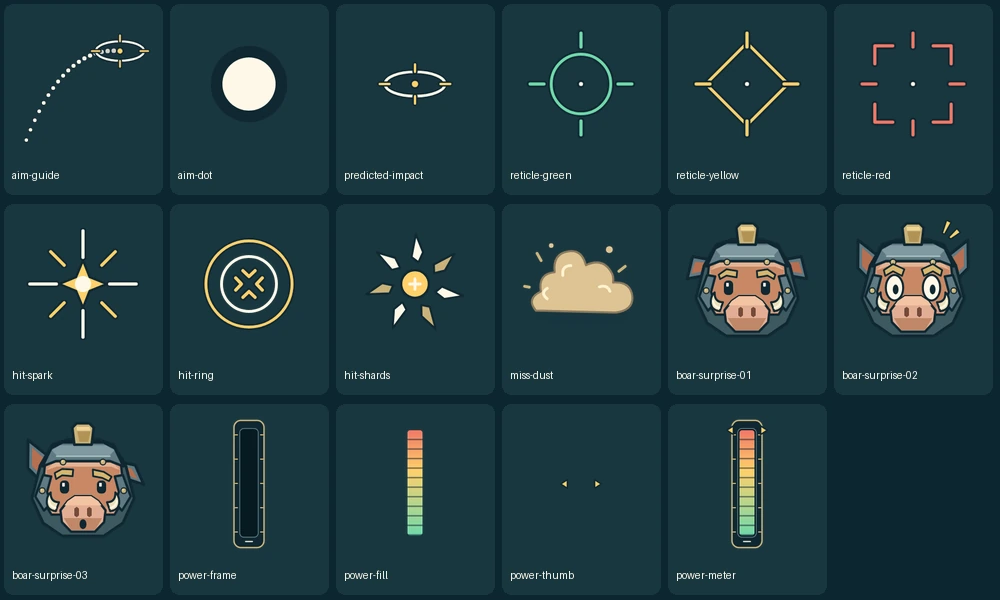
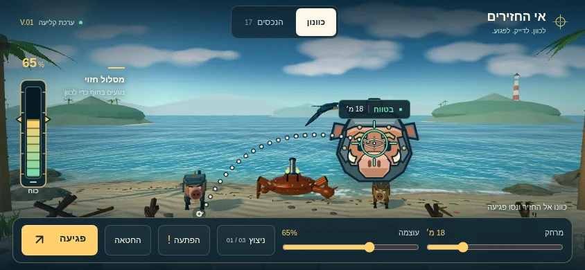

# מסירה — Boars Aim v1

14.11.2026 · ענף `codex/boars-aim-v1` · חבילת נכסים ותצוגת עיצוב עצמאית.

נוצרו **17 נכסים, 51 קובצי גרפיקה**: לכל נכס SVG וקטורי ו־PNG שקוף בגודל 256×256 ובגודל 512×512. משקל הגרפיקה הכולל **576,115 בתים**. הקובץ הגדול ביותר **54,891 בתים**, מתחת לתקרת 500,000 בתים לקובץ. כל הקבצים החדשים נמצאים ב־`workout/island/design/boars-aim-v1/`.

בסיס העבודה הוא `main` בקומיט `19d9cdc5e3718236df5a2fc4d8b8c26c72007575`. נוצר worktree נפרד; ה־checkout המקורי נשמר. זו מסירת עיצוב לחיבור בהמשך: קוד המשחק, בקרת הכוונון, נשקים, שמירות ותגי הגרסה לא שונו. גם רישום הסשן נשאר בדוח זה כדי לכבד את ההנחיה המפורשת ליצור קבצים רק בתיקייה החדשה.

## התוצרים

| רכיב | שמות בסיס הקבצים | כמות | שימוש |
|---|---|---:|---|
| כיוון ונקודת פגיעה | `aim-guide`, `aim-dot`, `predicted-impact` | 3 | דוגמת קומפוזיציה, נקודה להרכבת מסלול משתנה, סמן מגע צפוי |
| ריטיקל לפי מרחק | `reticle-green`, `reticle-yellow`, `reticle-red` | 3 | עיגול, מעוין וסוגריים פתוחים; זיהוי גם ללא הבחנה בצבע |
| פגיעה | `hit-spark`, `hit-ring`, `hit-shards` | 3 | ניצוץ מגע, טבעת דיוק ושברי שריון |
| החטאה | `miss-dust` | 1 | ענן חול קצר עם נקודת עיגון בקרקע |
| חזיר בהפתעה | `boar-surprise-01` עד `boar-surprise-03` | 3 | מזהה → נבהל → מתאושש, עם אותו ראש ועוגן |
| מד כוח צדדי | `power-frame`, `power-fill`, `power-thumb`, `power-meter` | 4 | שלוש שכבות להרכבה חיה ודוגמת הרכבה בעוצמה מלאה |

הקבצים נמצאים בתיקיות [svg](svg/), [png/256](png/256/) ו־[png/512](png/512/). ב־[manifest.json](manifest.json) יש מיפוי מזהה לכל פורמט, ממדים, משקל, SHA-256, עוגנים, גבולות פיקסלים נראים, תזמונים, צבעים והנחיות שימוש. ה־SVG מכיל צורות וקטוריות ניתנות לעריכה; אין תמונת bitmap משובצת.



## הסגנון והמקור

הסגנון מחבר את שפת הווקטורים של `ui-kit-v2/intro/boarDefense.svg` לצבעי החזיר הרובוטי `PAL.scout` במשחק הקיים: פלדה `#5F7A84`, פליז `#C9B27A`, פנים `#D49A7C`, חוטם אפרסק וקווי מתאר `#102731`. ריטיקל וקו כיוון מקבלים מסגרת כהה לקריאות גם מעל שמיים, ים וקצף בהירים. מרכז הריטיקל נשאר כמעט פתוח.

ImageGen שימש לרפרנס של שלוש הבעות; הגרפיקה הנמסרת נבנתה כמאסטרים וקטוריים, וכל יצואי ה־PNG רונדרו מאותם מאסטרים. מקור הצללית הקיים הוא CC0. פרטי ההקדשה, מקורות והחרגת זכויות הסצנה הקיימת נמצאים ב־[LICENSE.txt](LICENSE.txt).

`preview-scene.webp` הוא צילום נקי של סצנת המשחק הקיימת, שרונדר מקומית. הוא רקע לתצוגה בלבד. צילומי האימות הם WebP; **כל קובצי ה־PNG בחבילה הם ספרייטים שקופים במידות המבוקשות**.

## פתיחה ובדיקה

1. פותחים את [preview.html](preview.html). אם סביבת הדפדפן מגבילה קבצים מקומיים, מריצים משורש הריפו:

   ```sh
   python -m http.server 8765
   ```

   ופותחים:

   ```text
   http://localhost:8765/workout/island/design/boars-aim-v1/preview.html
   ```

2. מגדירים מסך **844×390**. נוגעים או גוררים בחוף; המסלול, הריטיקל ונקודת הפגיעה נעים יחד. מחווני המרחק והעוצמה משנים את הריטיקל ואת המד בצד.
3. מפעילים ״פגיעה״, עוברים בין שלוש הווריאציות, בודקים ״החטאה״ ו״הפתעה״. בלשונית ״הנכסים״ מחליפים רקע כהה/בהיר/משבצות ומורידים את הפורמט הרצוי. במקלדת: Tab למעבר, חצים למחוונים, Enter להפעלה, Escape לחזרה מהגלריה.

התוצאה הצפויה: פקדים גלויים ללא גלילה אופקית, מסלול ברור, אפקט קצר שנעלם ורצף הבעה שחוזר לפריים הראשון. אין בקשות לאתרים חיצוניים, שמירה מקומית או צורך בשרת יישום.



## הנחיות לחיבור

| מצב | ברירת מחדל בעיצוב | חיווי |
|---|---|---|
| בטווח | מרחק חלקי הטווח היעיל של הנשק ≤ 0.60 | ירוק + עיגול + ״בטווח״ |
| גבול הטווח | יחס גדול מ־0.60 ועד 1.00 כולל | צהוב + מעוין + ״גבול הטווח״ |
| מעבר לטווח | יחס גדול מ־1.00 | אדום + סוגריים פתוחים + ״רחוק מדי״ |

בתצוגה טווח הדגמה של 40 מטר: ירוק עד 24, צהוב מעל 24 ועד 40, אדום מעל 40. אלה ספי עיצוב מוצעים, **לא שינוי באיזון הנשקים ולא הבטחת פגיעה**. בזמן החיבור יש להזין את הטווח היעיל של הנשק ואת נקודת ההתנגשות האמיתית מהמשחק. הקשת בתצוגה מדגימה את השפה הגרפית; היא אינה סימולציה בליסטית, ומד הכוח אינו משנה את מסלול המשחק בחבילה זו.

- להציב `aim-dot` לאורך ההיטל האמיתי של המסלול במרווחים של כ־12 פיקסלי CSS. היצוא המרובע כולל שוליים: ריבוע תצוגה של 8–12 פיקסלים נותן נקודה נראית בקוטר כ־4–6 פיקסלים. `aim-guide` הוא דוגמת הרכבה; אין למתוח אותו כדי להמציא חיזוי.
- עוגן רגיל הוא `(256,256)` במאסטר 512. ל־`miss-dust` העוגן הוא `(256,348)`, ולשלוש מסגרות החזיר `(256,436)`. כל העוגנים זמינים גם כ־UV במניפסט. ב־PNG בגודל 256 מחלקים את העוגן בשניים.
- רצף ההפתעה: 90, 140, 170 מ״ש; סך הכול 400 מ״ש, פעם אחת. אין שינוי בגודל ובמיקום החוטם בין המסגרות. זו תגובת ראש להלבשה על יעד/דיוקן; אין כאן תחליף לגוף או למודל התלת־ממדי.
- פגיעה: ניצוץ 220 מ״ש, טבעת 300 מ״ש, שברים 340 מ״ש. החטאת חול: 420 מ״ש. לכל וריאציה נתוני scale/fade במניפסט. במצב תנועה מופחתת מציגים אישור סטטי ופריים הפתעה 02 למשך 400 מ״ש.
- את `power-frame`, `power-fill` ו־`power-thumb` מציגים כשכבות ריבועיות באותו גודל. המילוי נמצא ב־`x=230, y=70, width=52, height=364`. חושפים אותו מלמטה באמצעות חיתוך; אין למעוך את הטקסטורה. מיקום הסמן במאסטר הוא `y=434−power×364`, כאשר `power` בין 0 ל־1.
- היעדר חיזוי תקין: להסתיר את המסלול, נקודת הפגיעה והריטיקל ולהציג הודעת מצב מתאימה. אין לצייר נקודת פגיעה בשמיים. `miss-dust` מיועד לחול; בפגיעה במים משתמשים באפקט המים של המשחק.

## אימות

הראיות המלאות נמצאות ב־[verification/validation.json](verification/validation.json), ומימוש הבדיקה ב־[tools/verify.py](tools/verify.py).

| בדיקה | תוצאה |
|---|---|
| 17 SVG ו־34 PNG | ממדים, SHA-256 ושקיפות תקינים; שוליים שקופים ללא חיתוך האיור |
| מגבלת משקל | כל קובץ בחבילה עד 500,000 בתים; מקסימום בנכסים 54,891 בתים |
| מסכים | 844×390 בצפיפות 1 ו־2, 740×360, 390×844, 320×740, 1440×900 |
| כוונון | גרירה ומגע אמיתי דרך אמולציית הדפדפן; הריטיקל ונקודת הפגיעה מיושרים |
| מרחק וכוח | גבולות 24/25/40/41 מטר, כוח 0/65/100, חיתוך המד והערך המוצג |
| משובים | שלוש פגיעות, החטאה, סדר שלושת פריימי ההפתעה וחזרה למצב המנוחה |
| נגישות בתצוגה | שליטה במקלדת, טקסט וצורה בנוסף לצבע, תנועה מופחתת, יעדי לחיצה 44 פיקסלים בכפתורי הפעולה |
| דפדפן | Chromium 151; אפס שגיאות דף/קונסול/HTTP ואפס בקשות חיצוניות |
| בדיקות המאגר המלאות | 4,018 עברו, 64 דולגו, 0 נכשלו; 4,082 בדיקות, כ־279 שניות |
| גבולות שינוי | רק נתיבים חדשים בתיקייה זו; ללא שינוי בקובץ קיים |

בדיקות המסך הן אמולציה ב־Chromium; בדיקת מגע במכשיר פיזי וחיבור למערכת הירי נשארים לשלב החיבור. נתוני בדיקות המאגר הכלליות נמצאים ב־[verification/repository-tests.json](verification/repository-tests.json).

בהרצת `npm test` הראשונה חסר הדפדפן המצורף של Playwright בבדיקת האימון הקיימת `workout-royiki.test.mjs`. ההרצה הותאמה ל־Chromium המותקן באמצעות מנגנון `ISLAND_PLAYWRIGHT` הקיים במאגר. מתאם הבדיקה [tools/playwright-system.mjs](tools/playwright-system.mjs) נכלל בחבילה לצורך שחזור; הוא לא נטען בתצוגה ולא משנה קובץ קיים. להרצת הבדיקות בסביבה כזו, משורש הריפו:

```sh
ISLAND_PLAYWRIGHT="$PWD/workout/island/design/boars-aim-v1/tools/playwright-system.mjs" npm test
```

שחזור הגרפיקה והבדיקה, מתוך תיקיית החבילה, עם Python, Pillow, Playwright ו־Chromium מותקנים:

```sh
python tools/build.py
python tools/verify.py
```

במידת הצורך מגדירים `CHROMIUM_PATH` לנתיב הדפדפן המקומי. הבנייה והבדיקה אינן מתקינות חבילות ואינן זקוקות לרשת.
