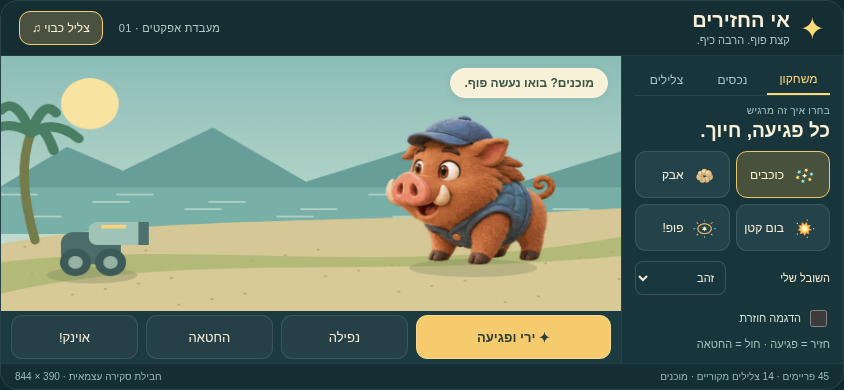

# אי החזירים — חבילת אפקטים, גרסה 1

נוצרה חבילת סקירה עצמאית עם ירי ברור, שלושה שובלים שונים, פגיעות קצרות ומובחנות ונפילה קומית. הדמות בעלת חרטום גדול, הבעות ידידותיות ואפוד תכול; הנפילה מסתיימת במנוחה מחויכת. הפגיעות משתמשות באבק, כוכבים, הבזק קטן וטבעת קופצנית. החטאה נמוכה יותר, בצבעי חול, ובצליל שקט יותר.

תאריך: 14/11/2026. ענף:

`codex/boars-fx-v1`

בסיס הענף:

`19d9cdc5e3718236df5a2fc4d8b8c26c72007575` (`origin/main` בזמן תחילת העבודה).

כל קובצי המשימה חדשים ונמצאים בתיקייה זו בלבד. לא חוברו נכסים למשחק, לא שונו קבצים קיימים, הגדרות גרסה, שירותי מטמון או תהליכי פרסום. הוראת המשימה לשמור על קבצים קיימים חלה גם על יומן הבקרה; המסירה מתועדת כאן במקום לערוך אותו.

## תוצרים

| ויזואל | וריאציות | פריימים לכל וריאציה | משך רצף |
|---|---:|---:|---:|
| הבזק לוע | 1 | 6 | 150 מילישניות |
| קליע ושובל: זהב, בועה תכולה, שביט | 3 | 1 | תמונה נעה; אינה אנימציית הבהוב |
| פגיעה: אבק, כוכבים, פיצוץ קטן, פופ | 4 | 4 | 310 מילישניות |
| החטאה: אבק, אבנים קטנות, חול ניתז | 3 | 4 | 330 מילישניות |
| חזיר נופל: הטיה, נפילה, גלגול, מנוחה | 1 | 4 | 740 מילישניות |
| פגיעת צד: מעיכה, רתיעה, התאוששות | 1 | 3 | 320 מילישניות |
| חזיר במנוחה לתצוגה | 1 | 1 | תמונה קבועה |
| **סך הכול** | **14 רצפים** | **45 קובצי תמונה** | |

| צליל | כמות | אופי |
|---|---:|---|
| ירי | 3 | פקק קופץ, פיו קפיצי, בועה מהירה |
| פגיעה | 4 | פוף, כוכבים מצלצלים בעדינות, בום קטן, גומי קופץ |
| החטאה | 1 | חול מתפזר ותקתוק קטן |
| נפילה | 1 | חריקה קפיצית ואחריה ארבע נקישות גלגול מאטות |
| קול חזיר | 5 | אוינק, אוינק כפול, נחרה קצרה, שיהוק, צחקוק |
| **סך הכול** | **14 צלילים / 28 קבצים** | כל צליל בשני הפורמטים |

כל הצלילים נוצרו מסינתזה מספרית מקורית. נעשה שימוש בגלי סינוס, שינוי גובה, הרמוניות עם פורמנטים אפיים ורעש מסונן עם זרע קבוע. אין הקלטות, דגימות, קולות אנושיים, שירותי דיבור או מוזיקה חיצונית. טווח משך המקור כולל מעטפת השקט: 196–916 מילישניות. חריקה וגלגול נמצאים באותו קובץ נפילה, לפי סדר התנועה.

## גדלים ואיכות

התקציבים נבדקו בבַּייטים עשרוניים: 600,000 לתמונה/אטלס ו־60,000 לקול. גם סכום שני הפורמטים של כל צליל עומד ב־60,000.

| מדד | בפועל | דרישה |
|---|---:|---:|
| תמונות בודדות | 256×256, עם אלפא | 256×256, שקופות |
| אטלסים | 3 × 1024×1024, עם אלפא | 1024×1024 |
| התמונה הבודדת הגדולה ביותר | 17,608 בייט | עד 600,000 |
| האטלס הגדול ביותר | 131,959 בייט | עד 600,000 |
| שלושת האטלסים יחד | **201,969 בייט** | גם הסכום מתחת ל־600,000 |
| קובץ הקול הגדול ביותר | 6,158 בייט | עד 60,000 |
| זוג הפורמטים הגדול ביותר | 12,275 בייט | עד 60,000 |
| כל 28 קובצי הקול יחד | 100,299 בייט | — |
| אטלסים וכל הקול יחד | **302,268 בייט** | אין צורך לטעון גם תמונות בודדות |

הקול: מונו, 22,050 הרץ, בקידוד Ogg Vorbis ו־MP3 בקצב 48 קילוביט לשנייה. פיקים מפוענחים, משכים, היסט DC וסיום שקט נבדקו לכל 28 הקבצים; המדידות המדויקות נמצאות בדוח בדיקות הנכסים.

התמונות משתמשות בפלטת RGBA משותפת של עד 256 צבעים לכל אטלס, כולל אלפא מדורגת. כל תמונה בודדת היא חיתוך זהה בפיקסלים מתוך האטלס. נשמרו לפחות ארבע שורות/עמודות שקופות בכל קצה למניעת זליגה בין תאים. מקור הדמות נמצא בקובץ WebP מקומי ללא אובדן, בגודל 1024×512 ובמשקל 347,362 בייט; הוא אינו נדרש בזמן ריצה.

## תצוגה מקדימה

קובץ הכניסה:

[preview.html](preview.html)

1. משורש המאגר, הפעילו שרת מקומי:

   ```sh
   python -m http.server 8765
   ```

2. פתחו את [התצוגה המקומית](http://localhost:8765/workout/island/design/boars-fx-v1/preview.html).
3. לחצו על ״ירי ופגיעה״, ״נפילה״ ו״החטאה״. בחרו סוג פגיעה ושובל. נגיעה בחזיר פוגעת; נגיעה בחול מחטיאה. רווח או Enter כשהמגרש ממוקד יורים.
4. הפעילו צליל באמצעות הכפתור העליון או נגינה מפורשת בלשונית הצלילים. התצוגה מתחילה בשקט. בלשונית הצלילים ניתן לנגן כל וריאציה בכל פורמט; בלשונית הנכסים ניתן להאט, להשהות ולהתקדם פריים אחד.

התוצאה הצפויה: התצוגה בגודל 844×390 מציגה את כל ארבעת כפתורי הפעולה. בלשונית הנכסים מוצגים האטלס והתמונה הבודדת זה לצד זה על לוח שקיפות, עם נקודת העיגון. התצוגה עובדת ללא בקשות חיצוניות, אחרי טעינת הקבצים המקומיים. יש לפתוח דרך HTTP; פתיחה ישירה כקובץ אינה נתמכת בשל טעינת המניפסט.



## מבנה ומסירה לחיבור

| קובץ/תיקייה | תפקיד |
|---|---|
| [manifest.json](manifest.json) | כל הפריימים, אטלסים, מלבני חיתוך, עיגונים, זמנים, אירועים, קול, תקציבים וחתימות SHA-256 |
| `png/` | 45 תמונות שקופות, 256×256 |
| `atlases/` | שלושה אטלסים, תאי 256×256, ללא סיבוב או חיתוך שוליים |
| `audio/` | 14 זוגות קול ואינדקס של מתכוני הסינתזה |
| `source/boar-poses.webp` | מקור הדמות לשחזור מקומי |
| [synthesize.py](synthesize.py) | סינתזה וקידוד כל הצלילים |
| [build_assets.py](build_assets.py) | יצירת אפקטים פשוטים, חיתוך מכני של הפוזות, אריזת התמונות והפקת מניפסט |
| [validate.py](validate.py) | בדיקות נכסים ופענוח קול אמיתי |
| [LICENSE.txt](LICENSE.txt) | הקדשת CC0 ומקוריות הנכסים |
| `verification/` | בדיקות, מדידות וארבע תמונות מסך |

נקודות העיגון מנורמלות, מראשית בפינה השמאלית העליונה: הבזק לוע ב־(46,128), ראש קליע ב־(216,128), פגיעה ב־(128,136), החטאה בקרקע ב־(128,184), ורגלי חזיר ב־(128,216), ביחידות תמונת 256. כיוון הירי הוא ימינה והחזיר פונה שמאלה. לפגיעה מהצד השני יש להפוך אופקית את הדמות ואת העיגון יחד.

לשימוש בקנבס, חותכים את המלבן המתואר בפריים מהאטלס ומציבים כך שהעיגון נופל על נקודת האירוע. לשימוש בתלת־ממד: שקיפות פעילה, כתיבת עומק כבויה, סינון ליניארי, ללא מפות מוקטנות. ערבוב רגיל לכל הנכסים, עם אפשרות לערבוב חיבורי להבזק הלוע בלבד. מקור מלבני החיתוך עליון; במיפוי UV מלמטה, היסט Y הוא:

```js
const offsetY = 1 - (rect.y + rect.h) / 1024;
```

סדר אירוע מומלץ: ירי מפעיל הבזק, קליע וצליל ירי; רק הגעת הקליע לנקודת הפגיעה מפעילה אפקט וצליל פגיעה תואם יחד עם תגובת הצד. נפילה מחליפה את תגובת הצד בארבעת פריימי הנפילה וצליל החריקה־גלגול. משאירים את הפריים האחרון עד היעלמות הדמות. בתצוגה נוצר יעד חדש לאחר דעיכה, כדי לא להחזיר את החזיר לעמידה בקפיצה.

לירי ולקולות החזיר מומלצת הגרלה ללא חזרה מיידית. המניפסט מציע השהיה של 800 מילישניות בין קולות חזיר, פוליפוניה מרבית של שישה ווליום ראשי 0.72. התצוגה מוסיפה מדחס למיקס, עוצרת צלילים בהשתקה ובהסתרת הלשונית ובודקת תמיכה ב־Ogg עם נפילה אמיתית ל־MP3 במקרה של כשל. מהירות הקליע במניפסט היא 1,100 פיקסלים לשנייה לתצוגה; בעת חיבור יש להשתמש בתזמון ובמהירות הנשק הקיימים במשחק.

## שחזור ובדיקות

דרישות בנייה: Python 3, Pillow, NumPy ו־FFmpeg עם מקודדי Vorbis ו־MP3. כלי הדפדפן דורש Playwright ו־Chromium. אין תלות חיצונית בזמן הפעלת התצוגה.

```sh
cd workout/island/design/boars-fx-v1
python synthesize.py
python build_assets.py
python validate.py
node verification/verify-preview.mjs
```

אם Playwright מותקן מחוץ למאגר, אפשר להעביר את הנתיב המלא למודול במשתנה:

```sh
PLAYWRIGHT_MODULE=/absolute/path/to/playwright/index.mjs node verification/verify-preview.mjs
```

כל סקריפטי הבנייה כותבים בתוך החבילה בלבד; קובצי WAV זמניים נוצרים בתיקיית מערכת זמנית ומוסרים אוטומטית. שחזור התמונות אינו דורש שירות יצירת תמונות: מקור הדמות כבר כלול. יצירת דמות חדשה באמצעות AI היא תהליך נפרד ואינה דטרמיניסטית.

- [בדיקות הנכסים](verification/assets.json): **946 בדיקות עברו**, כולל ממדים, אלפא, שוליים, חיתוך אטלס זהה, זמנים, ספירת וריאציות, חתימות, תקציבים ופענוח כל הקול.
- [בדיקות הדפדפן](verification/browser.json): עברו ב־Chromium ‏151.0.7922.173, בגודל 844×390. נבדקו גם היעדר גלילה אופקית ב־740×360 וב־390×844. נבדקו ירי, פגיעת צד, נפילה, שלוש החטאות, כל 14 הרצפים, השהיה, צעד פריים, מגע, מקלדת, כל 28 קובצי הקול והשתקה.
- מעבר ל־MP3 נבדק באמצעות חסימה מכוונת של משאב Ogg, ולא רק בדיקת סוג הקובץ. כשל הבקשה היחיד בתרחיש זה צפוי ומתועד. אין שגיאות דפדפן בלתי צפויות, שגיאות HTTP, הפרות CSP או בקשות לשרת חיצוני. הבדיקה מגישה את התצוגה תחת מדיניות CSP מצומצמת משלה.
- [בדיקת השחזור](verification/reproducibility.json): הרצה חוזרת של שני סקריפטי הבנייה הניבה **78 קבצים זהים בחתימות**, כולל כל הקול, התמונות, האטלסים והמניפסט, באותן גרסאות כלים.
- כלי הבנייה שנבדקו: Python ‏3.12.14, Pillow ‏12.3.0, NumPy ‏2.3.5 ו־FFmpeg ‏7.1.5. גרסאות מקודד או מכמת צבע אחרות עשויות להפיק קבצים תקינים עם חתימות שונות.

בדיקת המאגר המלאה ותוצאת בדיקת היקף השינויים מתועדות בקובץ [repository.json](verification/repository.json).

בריצה המלאה עברו 4,017 בדיקות, 64 דולגו ובדיקה קיימת אחת נכשלה משום שהתקנת Chromium ברירת המחדל של Playwright חסרה בסביבה. הבדיקה השאירה שרת פתוח; תהליך הבדיקה שלה הופסק אחרי זיהוי הסיבה. לאחר הפניה זמנית מתוך תיקיית המערכת לדפדפן Chromium המותקן, הורץ מחדש הקובץ `tests/workout-royiki.test.mjs`: **כל 5 הבדיקות עברו**, כולל תרחיש הדפדפן. לא שונו בדיקות או קובצי הגדרה במאגר, ולא הורצה מחדש הסימולציה המלאה לאחר שהתברר שכל שאר הבדיקות עברו. לפיכך הפקודה המלאה הראשונה החזירה קוד 1, והכשל היחיד שלה נפתר בהרצה הממוקדת.

אין כאן מדידת ביצועים בטלפון פיזי, בדיקה ב־Safari או האזנה אנושית סובייקטיבית. צבע, שקיפות, פריימי התנועה ותמונות המסך נבדקו חזותית; הקול נבדק בפענוח ובנגינה בדפדפן ובמדידות אות. בחירת טעם ועוצמת מכשיר אפשר לבדוק בתצוגה לפני חיבור למשחק.
