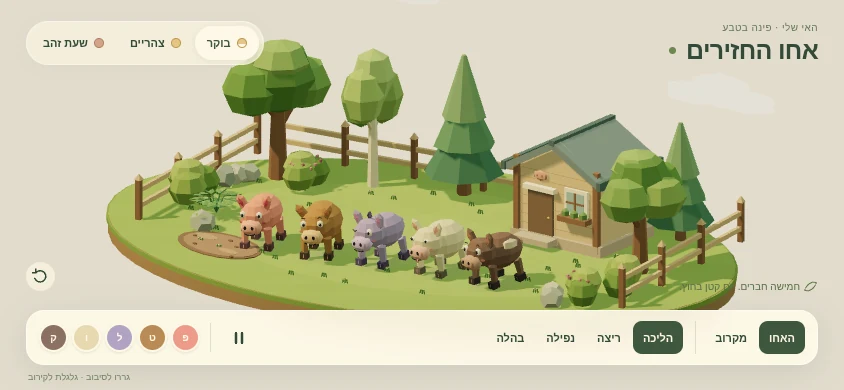
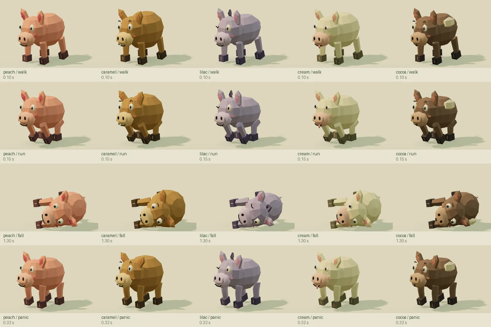

# אחו החזירים — מסירת גרסה 1

תאריך: 17.11.2026. ענף: `codex/boars-world-v1`.

חבילה עצמאית לסקירה תחת `workout/island/design/boars-world-v1/`: חמישה חזירים ידידותיים בעלי פנים שונות, ארבע אנימציות שלד לכל אחד, אחו ירוק, שישה דגמי צמחייה, גדר, בקתה, שלולית בוץ, שלושה דגמי אבנים ושלושה מצבי יום. כל 21 קובצי ה־GLB נקיים בבדיקת Khronos: **0 שגיאות, 0 אזהרות, 0 הערות**.

המשימה מוכנה כאשר כל הנכסים קיימים, חמשת החזירים בטווח 500–900 משולשים, ארבעת הקליפים דגומים ב־30Hz, המציג עובד ב־844×390, כל התיקייה מתחת ל־4,000,000 בתים, והענף נדחף. מצב המסירה והבדיקות נשמרים כאן בהתאם לבקשה לעבוד בתיקייה חדשה בלבד. קובצי הבקרה והיישום הקיימים לא נערכו.

## הצצה





## החזירים

| קובץ | שם ואופי | משולשים | עצמות | גודל בבתים |
|---|---|---:|---:|---:|
| `models/boar-peach.glb` | פיץ׳ — חיוך ולחיים סמוקות | 770 | 14 | 139,096 |
| `models/boar-caramel.glb` | טופי — גבה סקרנית ושן קטנה | 814 | 14 | 143,868 |
| `models/boar-lilac.glb` | לולי — קריצה וציצית מסולסלת | 772 | 14 | 139,316 |
| `models/boar-cream.glb` | וניל — עיניים חולמניות ולשון בחוץ | 782 | 14 | 140,396 |
| `models/boar-cocoa.glb` | קוקו — הבעה מופתעת וכתם קרם | 826 | 14 | 145,160 |

כל חזיר הוא רשת משוקללת אחת עם חומר אחד וצבעי קודקודים. העצמות כוללות גוף, ראש, ארבע רגליים בשני מפרקים, שתי אוזניים וזנב. יש עד שתי השפעות לקודקוד, כולל ערבוב ממשי באזורי החיבור. חמשת הדגמים חולקים את אותה היררכיה ואת אותה תנוחת בסיס; פירוט ב־[`skeleton.json`](skeleton.json). אין ניבים, פצעים או הבעות תוקפניות.

## תנועה

| שם הקליפ | פעולה | משך בשניות | דגימות כולל הקצוות | לולאה | מהירות מוצעת במטר לשנייה |
|---|---|---:|---:|---|---:|
| `walk` | הליכה | 1.2 | 37 | כן | 1.0 |
| `run` | ריצה | 0.6 | 19 | כן | 2.8 |
| `fall` | החלקה ונפילה רכה לצד | 1.6 | 49 | לא | 0 |
| `panic` | בהלה קומית, אוזניים וקפיצות קטנות | 1.4 | 43 | לא | 0 |

המרווח בין הדגימות הוא 1/30 שנייה והאינטרפולציה ליניארית. ההליכה והריצה נסגרות באותה פוזה. הנפילה מחזיקה את תנוחת הסיום; הבהלה חוזרת לפוזת ההתחלה. שני הקליפים מוגדרים במציג להפעלה אחת עם `clampWhenFinished`.

אין תנועה קדימה המיועדת להזיז את הדמות במשחק. תנועת הגוף, הגלגול והגבהת הרגליים נאפו בתוך השלד; את ההתקדמות בעולם יש להפעיל על קבוצה חיצונית. תיקון הגובה נאפה לפי הקודקוד המשוקלל הנמוך בכל דגימה. האימות מחשב מחדש את העור מהקובץ שנמסר, גם באמצע כל מרווח בין פריימים. הגובה הנמוך ביותר שנמדד בכל 1,460 הפוזות נמצא מעל הקרקע; המספרים לכל קליפ ב־[`verification/validation.json`](verification/validation.json).

**30Hz הוא קצב דגימת האנימציה.** לא נמדד קצב פריימים בטלפון פיזי. המציג מגביל את עדכוני התנועה והציור ל־30 בשנייה, משהה ציור חוזר במצב השהיה ומכבד העדפה להפחתת תנועה.

## הסביבה

| קבוצה | קבצים |
|---|---|
| שלושה עצים | `tree-oak.glb`, `tree-birch.glb`, `tree-pine.glb` |
| שלושה שיחים | `bush-round.glb`, `bush-berry.glb`, `bush-fern.glb` |
| קרקע | `meadow.glb` — משטח משחק שטוח, שפת אדמה, תלתן ופרחים |
| חווה | `fence.glb` — מקטע ברוחב 2 מטר; `cabin.glb`; `mud-puddle.glb` |
| אבנים | `rock-round.glb`, `rock-pair.glb`, `rock-cluster.glb` |
| שמיים | `sky-morning.glb`, `sky-noon.glb`, `sky-sunset.glb` — בוקר, צהריים ושעת זהב |

הקבצים נמצאים תחת `models/`. השמיים כוללים כיפה, שמש ועננים. צבעי אור וכיוונו מופיעים תחת `lighting` בכל רשומת שמיים במניפסט. יש להציג מצב שמיים אחד בכל רגע ולהחיל גם את הגדרות האור שלו. רק השמיים משתמשים בהרחבת `KHR_materials_unlit`; קיים גם חומר ליבה חלופי. אין הרחבות דחיסה, מפענחים, מרקמים או קבצים חיצוניים ל־GLB.

[`scene.json`](scene.json) מכיל את פריסת הסביבה, המצלמות, מיקומי חמשת החזירים ותיבות מוצעות להתנגשויות. הבוץ מוגדר כטריגר קוסמטי. הפריסה נועדה למסירה ולסקירה; לא נוספה לוגיקת משחק.

## פתיחת המציג

1. מתוך תיקיית החבילה מפעילים שרת קבצים:

   ```sh
   python3 -m http.server 8765 --bind 127.0.0.1
   ```

2. פותחים [את התצוגה המקומית](http://127.0.0.1:8765/preview.html) בחלון בגודל 844×390.
3. בוחרים זמן ביום ותנועה. לחיצה על עיגול של חזיר פותחת מבט מקרוב. גרירה מסובבת, גלגלת מקרבת, וכפתור האיפוס מחזיר את המצלמה.

התוצאה הצפויה היא אחו עם כל חמש הדמויות, סביבה מלאה והחלפה בין ארבע התנועות ושלושת מצבי היום. כפתור ההשהיה עוצר את התנועה. אפשר להפעיל את הבקרים גם לאחר ניתוק הרשת כשהעמוד כבר נטען. כדי לפתוח עמוד חדש ללא אינטרנט, מגישים את התיקייה המקומית באותו שרת; אין תלות ב־CDN. פתיחה ישירה ב־`file://` אינה נתמכת בגלל טעינת מודולים וקובצי GLB.

## שימוש בנכסים

כל המידות במטרים, הציר האנכי הוא `+Y` וכיוון הפנים הוא `+Z`. הקרקע ב־`Y=0`. יש להוסיף את `gltf.scene` השלם לקבוצת דמות חיצונית, כדי שגם רשת העור וגם השלד ינועו יחד. כל חזיר שנפתח בנפרד מקבל שלד עצמאי; לשכפול חזיר קיים יש להשתמש בשכפול המותאם לשלד, כגון `SkeletonUtils.clone`, ולא בשכפול רגיל של רשת.

המניפסט הוא מפת הנכסים: שמות קבצים, משולשים, גודל, SHA-256, ממדים, קליפים והגדרות תאורה. הוא אינו מחייב שינוי במטעין הנכסים הקיים. ספריות התצוגה כלולות בתוך התיקייה תחת `vendor/`, והרישיון שלהן נשמר ב־[`LICENSES.md`](LICENSES.md).

## אימות

| בדיקה | תוצאה ומקור |
|---|---|
| Khronos glTF Validator ‏`2.0.0-dev.3.10` | 21/21 קבצים; 0 שגיאות, 0 אזהרות, 0 הערות |
| משולשים ושלד | כל חמשת הדגמים 770–826 משולשים; 14 עצמות וזהות בהיררכיה; משקלים מנורמלים וערבוב ממשי |
| תנועה מתוך הקבצים שנמסרו | 20 קליפים, 30Hz, ‏1,460 פוזות עם נקודות ביניים; קווטרניונים ונורמלים באורך יחידה; לולאות תקינות ומניעת חדירה לקרקע |
| טעינה בדפדפן | 21 קבצים מהחבילה העצמאית; חמש דמויות בעלות שלדים עצמאיים; ללא שגיאות, בקשות שנכשלו או בקשות חיצוניות |
| מציג | בחירת כל חזיר, כל תנועה וכל מצב יום; שליטה במצלמה; השהיה וחידוש; סיום קליפים חד־פעמיים; תפקוד אחרי ניתוק רשת |
| מסגור | 844×390 וגם 390×844; ללא גלילה אופקית; צילום לכל מצב יום, דמות וקליפ |
| נגישות תנועה | העדפת מערכת להפחתת תנועה מתחילה בהשהיה; שמות לבקרים ומצב בחירה נגיש |
| תקציב | כל התיקייה, כולל ספריות מקומיות, מקורות, דוחות וצילומים, מתחת ל־4,000,000 בתים; פירוט ב־[`verification/package.json`](verification/package.json) |

תוצאות הדפדפן וצילומי המסך: [`verification/browser.json`](verification/browser.json). הרינדור נבדק ב־Chromium עם SwiftShader; זו בדיקת תקינות חזותית ופונקציונלית, והיא אינה מדידת ביצועים של מכשיר נייד.

בדיקת מאגר מלאה ותוצאת בדיקת גבולות השינוי נשמרות ב־[`verification/repository.json`](verification/repository.json).

בהרצת `npm test` נרשמו 4,261 הצלחות, 64 דילוגים וכשל סביבה אחד: בדיקת האימון הקיימת `tests/workout-royiki.test.mjs` ניסתה להפעיל דפדפן Playwright שאינו מותקן. לאחר כשל ההפעלה נשאר שרת הבדיקה פתוח, ולכן תהליך הבדיקה התקוע הופסק. הקובץ הורץ מחדש עם Chromium המותקן במערכת באמצעות התאמת מפעיל זמנית מחוץ למאגר: **5/5 עברו**, כולל הבדיקה שנכשלה בהפעלה הראשונה. גוף הבדיקות וקוד היישום לא שונו. ההרצה הראשונית אינה מסומנת כהצלחה; סיכומי שתי ההרצות נשמרים בנפרד.

## שחזור הבנייה והבדיקות

אין צורך להתקין דבר כדי להפעיל את המציג. לבנייה מחדש נדרש Node.js; הכלים משתמשים בעותק המקומי של three.js. את המאמת מתקינים מחוץ לחבילה כדי לשמר את תקציב המשקל:

```sh
npm install --prefix /tmp/boars-world-tools --cache /tmp/boars-npm-cache --no-audit --no-fund gltf-validator@2.0.0-dev.3.10
node source/build.mjs
node source/validate.mjs --modules /tmp/boars-world-tools/package.json
python3 source/browser-audit.py --chromium /usr/bin/chromium
node source/package-audit.mjs
```

בדיקת הדפדפן דורשת Playwright ו־Pillow בסביבת הבדיקה בלבד. הבנייה דטרמיניסטית; אין מספרים אקראיים או חותמת זמן משתנה בנכסי המקור. שתי בניות רצופות של 24 הקבצים המיוצרים היו זהות ברמת הבתים; ראו [`verification/reproducibility.json`](verification/reproducibility.json). בדיקת האריזה מאמתת שכל שינוי ביחס לקומיט הבסיס הוא קובץ חדש בתוך התיקייה המותרת ושהגודל הכולל אינו חורג מהמגבלה.
