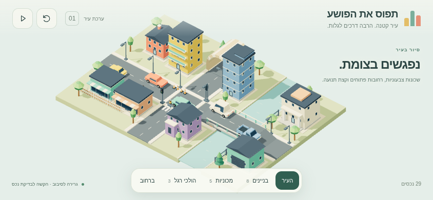
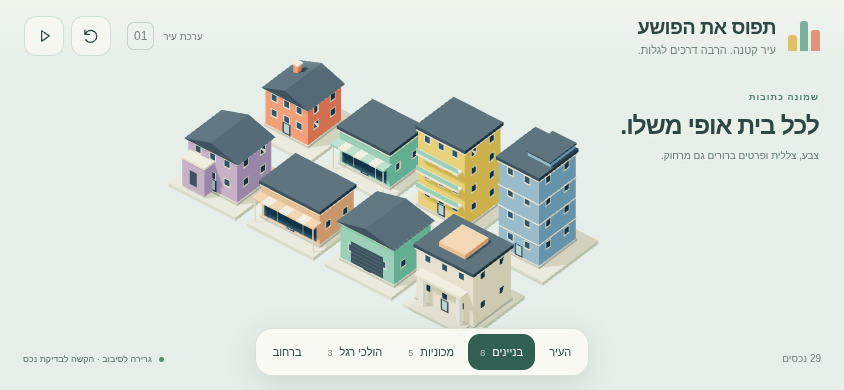
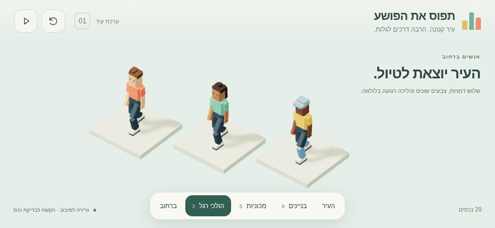

# תפוס את הפושע · מסירת סביבת עיר v1

נמסרה ערכה של **29 דגמי GLB**: שמונה בניינים, חמש מכוניות אזרחיות, שלושה הולכי רגל מונפשים, ארבע תשתיות, שלושה עצים, שתי גדרות, שני קונוסים ושני אריחי כביש. כל הדגמים צבעוניים, ללא מותגים או כיתוב. תצוגת העיר והגלריות מציגות את קובצי ה־GLB עצמם.

תאריך: 17.11.2026. ענף: `codex/catch-city-v1`. בסיס: `43b27dc235387e3cb737aee9558cdf9d5fd5a262`. כל התוספות נמצאות בתיקייה זו בלבד; קבצים קיימים במאגר נשמרו ללא שינוי. [מניפסט, מידות וגיבובים](manifest.json) · [מקורות ורישיונות](LICENSES.md).

## תכולה ונפח

**כל התיקייה: 1849487 bytes מתוך 3,000,000**, כולל GLB, ספריות התצוגה, מקורות, דוחות וצילומי מסך. 29 קובצי ה־GLB יחד: **648,464 bytes**. היחידות עשרוניות: MB = 1,000,000 bytes.

| סוג | מספר | פרטים |
|---|---:|---|
| בניינים | 8 | 88–236 משולשים לכל דגם; כל השמונה בטווח המבוקש 50–400 |
| תשתיות | 4 | רמזור, עמוד תאורה, גשר עם מעבר תחתון פתוח, מקטע מנהרה חלול |
| מכוניות אזרחיות | 5 | קומפקטית, משפחתית, סטיישן, מסחרית וטנדר; 338–386 משולשים |
| הולכי רגל | 3 | 668, 692 ו־696 משולשים; צבעי עור, לבוש ותסרוקת שונים; הליכה מוטבעת |
| עצים | 3 | רחב, צר ומחטני; 68–92 משולשים |
| גדרות | 2 | עץ ומתכת; אורך מקטע 3 מ׳ ועוגני חיבור במניפסט |
| קונוסים | 2 | 0.64 ו־0.96 מ׳; פסים גאומטריים |
| אריחי כביש נוספים | 2 | קטע ישר ומעבר חציה, 6×6 מ׳ |

| בניין | קובץ | משולשים | bytes |
|---|---|---:|---:|
| בית אלמוג, גג משופע וארובה | `models/house-coral.glb` | 128 | 11448 |
| חנות מנטה, חלון ראווה וגגון | `models/shop-mint.glb` | 194 | 16540 |
| בניין שמש, ארבע קומות ומרפסות | `models/apartment-sun.glb` | 236 | 19812 |
| משרדים כחולים, קומות מדורגות | `models/office-blue.glb` | 208 | 17624 |
| וילה לילך, גג ומבואת כניסה | `models/villa-lilac.glb` | 130 | 11624 |
| שוק אפרסק, חזית רחבה וגגון | `models/market-peach.glb` | 194 | 16548 |
| סדנה טורקיז, שער גלילה | `models/workshop-teal.glb` | 88 | 8332 |
| בית ציבורי, עמודים ומדרגה | `models/civic-cream.glb` | 168 | 14504 |

## שלד והליכה

כל שלושת הולכי הרגל מכילים skin אמיתי, `JOINTS_0`, משקלים מנורמלים, inverse bind matrices ו־18 העצמות הקנוניות. [`skeleton.json`](skeleton.json) זהה לחוזה `motion2/soccer.json#skeleton`, לרבות שמות, הורים והזזות מנוחה. כל סיבובי המנוחה הם זהות, והסקייל הוא 1.

קליפ `walk` מוטבע בכל GLB: **30Hz, 33 דגימות על פני 32 מרווחים, 1.0666667 שניות**, עם 18 ערוצי סיבוב וערוץ תרגום Hips. קצות הקליפ זהים. ההליכה במקום; להזזה בעולם יש להתקדם לאורך ‎+Z מקומי במהירות **0.90 מ׳/שנייה**. אפשר להשתמש ב־`AnimationMixer` עם `LoopRepeat`. אין צורך בקובץ אנימציה חיצוני או בהתאמת שלד נוספת עבור הדמויות האלה.

הבדיקה העצמאית ניגנה את העור ב־120Hz, 129 דגימות לכל דמות. שגיאת הסוליה המרבית בזמן תמיכה: **0.45 מ״מ**; סטיית מסלול כף הרגל מהפתרון הרציף בין דגימות: **4.43 מ״מ**; הפרש קודקודים מרבי בתפר הלולאה: **0.000000051 מ׳**. גובה הרמת כף הרגל שנמדד: 0.12875 מ׳. נוסף לכך, Three.js ניגן את כל 33 דגימות הקליפ בכל שלוש הדמויות; שגיאת רכיב מרבית מול ערכי ה־GLB הייתה ‎1.02×10⁻⁷.

## אימות

| בדיקה | תוצאה | ראיות |
|---|---|---|
| Khronos glTF Validator `2.0.0-dev.3.10` | 29/29; אפס שגיאות, אזהרות, הערות ורמזים | [assets.json](verification/assets.json) |
| גאומטריה ופורמט | ללא משולשים מנוונים, אינדקסים מחוץ לטווח או נורמלים הפוכים; צבעי קודקודים ליניאריים; כל GLB עצמאי | [כלי בדיקה](source/validate.mjs) |
| משולשי בניינים, ספירות, גיבובים ומידות | עברו מול המניפסט והבתים שנמסרו | [manifest.json](manifest.json) |
| מעבר במנהרה ובגשר | 9 קרני מעבר לאורך המנהרה נקיות; קירות ותקרה קיימים; כביש הגשר והמעבר התחתון פתוחים | [assets.json](verification/assets.json) |
| תצוגה ב־844×390 | חמש תצוגות, כל 29 הנכסים, ללא שגיאות JavaScript, כשלי טעינה או בקשות חיצוניות | [browser.json](verification/browser.json) |
| בקרי תצוגה | בחירת נכס מהעיר, קודם/הבא, חזרה, סיבוב בגרירה ובמקלדת, קירוב, איפוס והשהיה/המשך | [בדיקת דפדפן](source/check-browser.mjs) |
| העדפת תנועה מופחתת וכשל נכס | מתחיל בהשהיה; GLB חסר מציג הודעת שגיאה | [browser.json](verification/browser.json) |
| יצירה דטרמיניסטית | עבר: 31 קבצים זהים לפי SHA-256 לאחר בנייה חוזרת | [repository.json](verification/repository.json) |
| בדיקות המאגר | `npm test`: ‏4,261 עברו, 64 דולגו; כשל סביבת דפדפן אחד. הרצה חוזרת ממוקדת: 5/5 עברו עם Chromium המקומי | [repository.json](verification/repository.json) |

בדיקת המאגר `tests/workout-royiki.test.mjs:91` ניסתה לפתוח את Chromium מנתיב המטמון של Playwright, שאינו מותקן בסביבה. בדיקת פתיחה עצמאית שחזרה את אותה שגיאת סביבה. תהליך הבדיקה השאיר שרת HTTP פתוח אחרי כשל הפתיחה ונעצר כדי לאפשר ל־runner לסיים. אותה בדיקה הורצה שוב עם מתאם Chromium הקיים ב־`audit/2026-11-05/tools/playwright-runtime.mjs`: כל חמש הבדיקות עברו. קבצי הבדיקה והמתאם נשמרו ללא שינוי. לכן פקודת `npm test` המקורית לא מוצגת כירוקה מלאה.

Chromium 151 נבדק עם ANGLE SwiftShader בתוכנה. תצוגת העיר כוללת 9,772 משולשים ו־112 קריאות ציור במעבר הצבע של הפריים שנמדד; הנתונים הם ספירות רינדור, ואינם מדידת FPS או הבטחת ביצועים בטלפון. ב־390×844 נבדקו טעינה, ניווט והיעדר גלילה אופקית; מסגור הסצנה נבדק בגודל היעד 844×390.







## צפייה ושחזור

1. מתוך תיקיית החבילה להריץ שרת מקומי:

   ```bash
   python3 -m http.server 8765 --bind 127.0.0.1
   ```

2. לפתוח [את התצוגה המקומית](http://127.0.0.1:8765/preview.html) בחלון 844×390. לבחור עיר / בניינים / מכוניות / הולכי רגל / ברחוב. הקשה על דגם פותחת תצוגה אישית עם מידות ומשולשים; גרירה מסובבת וגלילה מקרבת.
3. התוצאה הצפויה: 29 נכסים נטענים, שלוש דמויות הולכות בלולאה, שמונה דגמי בניינים ניתנים לבדיקה, ופתח המנהרה והגשר נשארים פתוחים.

התצוגה עצמאית: אפשר להעתיק את התיקייה בשלמותה ולשרת אותה ב־HTTP. טעינה ישירה ב־`file://` אינה נתמכת בגלל ES modules ו־fetch. בנייה מחדש ובדיקת החוזה הקנוני דורשות את מיקום התיקייה בתוך המאגר.

לשחזור מתוך תיקיית החבילה:

```bash
python3 source/build.py
```

```bash
npm install --prefix /tmp/catch-city-tools --cache /tmp/catch-city-cache gltf-validator@2.0.0-dev.3.10
```

```bash
node source/validate.mjs --modules /tmp/catch-city-tools
```

```bash
node source/check-browser.mjs --playwright /absolute/path/to/playwright/index.mjs
```

בדיקת הדפדפן משתמשת ב־Chromium ב־`/usr/bin/chromium`; אפשר להגדיר `CHROMIUM_PATH`. Playwright וכלי הבדיקה מותקנים מחוץ לתיקייה ואינם דרושים לצפייה.

## הנחיות לחיבור למשחק

הנכסים ביחידות מטרים: ‎+Y למעלה, ‎+Z קדימה, נקודת מוצא במרכז הקרקע. צבעים מוטבעים בקודקודים עם חומר PBR מחוספס; אין מרקמים, Draco, Meshopt או משאבים חיצוניים. המניפסט כולל AABB, מידות, SHA-256, תקרות נפח, עוגנים ונתוני אנימציה.

רצפת הגשר ב־Y=1.02 מ׳; נקודות החיבור שלו ב־Z=±4.5 מ׳. רצפת המנהרה ב־Y=0.08 מ׳; נקודות החיבור ב־Z=±2.75 מ׳, רוחב פנוי 4.5 מ׳ וגובה מרכז פנוי 3.85 מ׳. יש לבנות לגשר ולמנהרה קוליידרים מורכבים מתוך הרכיבים, כדי לשמר את הפתחים. נתוני ההתנגשות במניפסט הם הנחיות לחיבור. עוגני החיבור הם מטא־נתונים במניפסט.

עדשות הרמזור מציגות שלושה צבעים; בחירת האור הפעיל ותזמונו שייכים לבקר המשחק. אור עמוד התאורה הוא גאומטריה בהירה; הוספת מקור אור נעשית בסצנת המשחק לפי תקציב התאורה. הקרקע, התעלה, רמפות הגשר ותנועת המכוניות בתצוגה נועדו להמחשת הערכה ונמצאים בקוד התצוגה. קובצי המשחק, תגי הגרסה ומניפסט האופליין הקיימים נשמרו ללא שינוי.
