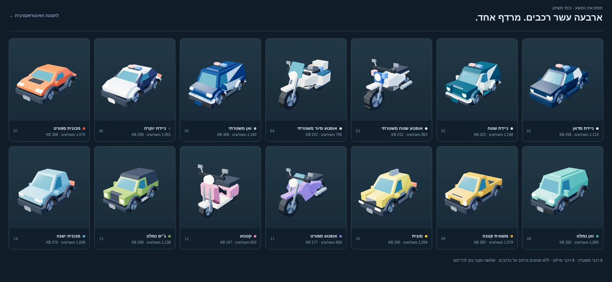
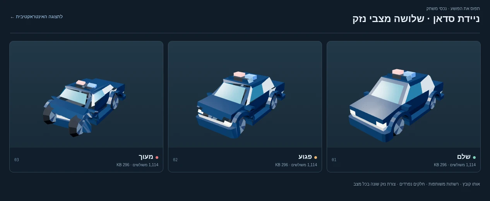
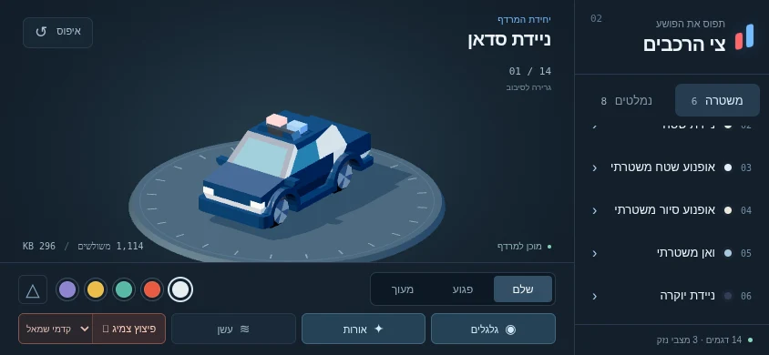

# תפוס את הפושע — רכבים, גרסה 2

נמסרו 14 רכבי תלת־ממד בסגנון מצולעים נמוך: שש ניידות ושמונה רכבי מילוט, בצבעים שונים. לכל דגם קובץ GLB עצמאי עם שלושה מצבי נזק, חלקים נפרדים, צירי גלגלים, פנסים, צמיגים הניתנים לפיצוץ ועוגן עשן. לתיקייה צורפו בקר אפקטים, תצוגה אינטראקטיבית בגודל 844×390, גלריה, מקור לשחזור ותוצאות אימות.

ענף המסירה:

`codex/catch-vehicles-v2`

תאריך המסירה: 17.11.2026, לפי שעון ירושלים. בסיס העבודה הוא ראש הענף הראשי בעת תחילת העבודה:

`43b27dc235387e3cb737aee9558cdf9d5fd5a262`

כל השינויים הם קבצים חדשים בתיקייה המאושרת בלבד:

`workout/island/design/catch-vehicles-v2/`

קובצי קוד קיימים, המשחק הפעיל וקובצי גרסה לא נערכו. הוראת המשימה להגביל כתיבה לתיקייה החדשה קיבלה קדימות על נוהל העדכון של חדר הבקרה; פרטי המסירה מתועדים כאן. בדיקת היקף המסירה נמצאת ב־[verification/scope.json](verification/scope.json).

## לראות ולבדוק

1. מהתיקייה הזו הפעילו:

   ```bash
   python3 -m http.server 8765
   ```

2. פתחו את [התצוגה](http://localhost:8765/preview.html), בחרו רכב, החליפו בין שלם, פגוע ומעוך, והפעילו עשן ופיצוץ צמיג. בחרו גלגל אחר כדי לבדוק שכל צמיג מתפוצץ בנפרד.
3. פתחו את [גלריית הצי](http://localhost:8765/gallery.html) ואת [שלושת מצבי הנזק](http://localhost:8765/gallery.html?states=police-sedan). התוצאה הרצויה: כל 14 הצלליות מופיעות, המשולשים נשמרים בכל מצב, ורק החלקים והגלגלים שנבחרו משתנים.

התצוגה כוללת גלגלים מסתובבים, גרירה לסיבוב מצלמה, צבעים, פנסים, הבהוב, עשן, בחירת צמיג, תצוגת משולשים ואיפוס. התיקייה עצמאית ואינה פונה לרשת חיצונית. פרטי החיבור ושמות הצמתים מתועדים ב־[INTEGRATION.md](INTEGRATION.md).



## הדגמים והתקציב

| רכב | משולשים בכל מצב | גודל הקובץ, בתים |
|---|---:|---:|
| ניידת סדאן | 1,114 | 296,372 |
| ניידת שטח | 1,198 | 321,508 |
| אופנוע שטח משטרתי | 852 | 211,780 |
| אופנוע סיור משטרתי | 796 | 221,516 |
| ואן משטרתי | 1,140 | 308,392 |
| ניידת יוקרה | 1,091 | 298,348 |
| מכונית ספורט | 1,079 | 287,992 |
| ואן נמלט | 1,080 | 282,248 |
| משאית קטנה, בתצורת טנדר | 1,079 | 282,248 |
| מונית | 1,094 | 295,380 |
| אופנוע ספורט | 658 | 177,172 |
| קטנוע | 660 | 167,028 |
| ג׳יפ נמלט | 1,138 | 297,636 |
| מכונית ישנה | 1,038 | 275,260 |

״מוטו״ ו״אופנוע״ בפירוט המשימה פורשו כאופנוע שטח ואופנוע סיור משטרתיים, עם פרופורציות וציוד שונים. לרכבי המילוט פלטות כתום, טורקיז, ענבר, צהוב, סגול, ורוד, ירוק וכחול. לכל רכב חמש בחירות צבע בתצוגה.

טווח המשולשים הוא 658–1,198, בתוך התקציב 500–1,200. הספירה כוללת את כל חלקי הרכב והגלגלים בסצנה אחת, כולל גלגל חלופי בג׳יפים ושתי שכבות ההבהוב בניידות. הרשתות משותפות בין שלוש הסצנות, ולכן גם סכום המשולשים ברשתות הייחודיות בכל קובץ אינו חורג מהתקציב. חלקיקי האפקטים והתפאורה הם רכיבי תצוגה נפרדים.

סך קובצי המודל הוא **3,722,880 בתים**. גודל התיקייה כולה הוא כ־**5.35MB**, כולל מנוע התצוגה המקומי, מקור, תיעוד, צילומים ונתוני בדיקה; התקציב הוא 6,000,000 בתים. אין טקסטורות או מפענחי דחיסה במודלים. המדידה המעודכנת רשומה ב־[verification/assets.json](verification/assets.json).

## נזק, גלגלים ואפקטים

- שלוש סצנות glTF אמיתיות בכל קובץ: שלם, פגוע ומעוך; מצב שלם הוא ברירת המחדל.
- חלקי מרכב נפרדים ושני יעדי מורף לנזק, כולל נורמלים; נזק כבד דוחס את החרטום והגג ומזיז חלקים בנפרד.
- לכל אחד מ־48 הגלגלים צומת גלגול וצומת היגוי נפרדים; ההיגוי פועל בגלגלים הקדמיים. גלגלים חלופיים אינם נספרים בין 48 הגלגלים הניתנים לפיצוץ.
- פנסים קדמיים ואחוריים בחומרים מאירים בכל דגם. בניידות עדשות אדומות וכחולות ושכבות אור נפרדות.
- קליפ גלגול, קליפ פיצוץ לכל צמיג, וקליפ הבהוב בניידות מובנים ב־GLB. כל אלה משתמשים ב־glTF רגיל, ללא הרחבות.
- הבקר מפעיל עיוות צמיג ושיגור 16 שברי גומי, ועשן מנוע מתוך מאגר של 24 חלקיקים. הצמיג המפוצץ נשמר במעבר בין מצבי נזק.



## אימות

| בדיקה | תוצאה |
|---|---|
| מאמת Khronos, כל 14 הקבצים הסופיים | 0 שגיאות, 0 אזהרות, 0 הערות, 0 רמזים; ללא סינון הודעות |
| בדיקות קובץ ומבנה | 8,803 בדיקות: חתימות, גדלים, משולשים, שלוש סצנות, הורות, מורפים, פנסים, אנימציות ומגע גלגלים בקרקע |
| בדיקות דפדפן | 1,377 בדיקות; 0 כישלונות, 0 שגיאות דפדפן, 0 בקשות מחוץ לחבילה |
| מסגור | 252 צירופים: 14 רכבים × 3 מצבי נזק × 3 זוויות × שתי מידות מסך |
| מידות מסך | 844×390 וגם 390×844, ללא גלילה של המסמך או חיתוך הרכב |
| פיצוץ צמיג | כל 48 הגלגלים בנפרד; רק הצמיג שנבחר השתנה, בכל שלושת מצבי הנזק |
| אנימציות מובנות | ניגון אמיתי במערבל אנימציה לכל 14 הרכבים, כולל הבהוב בשש הניידות |
| פקדים | בחירת רכב וצבע, נזק, גלגול, אורות, עשן, בחירת גלגל, פיצוץ, איפוס וגרירת מצלמה |
| בדיקות הריפו | 4,326 בדיקות: 4,262 עברו, 0 נכשלו, 64 דולגו |
| יציבות משאבים | שלושה מחזורי טעינת כל הצי: בכל מחזור 46 גאומטריות ו־37 מרקמי GPU באותה סצנת סיום |

ספירת המרקמים כוללת גם משאבי מורף שמנוע התצוגה יוצר בזיכרון; אין תמונות במודלים. המספרים הם ספירת אובייקטים ואינם מדידת זיכרון במגה־בתים. בדיקות התצוגה נערכו ב־Chromium עם ANGLE/SwiftShader; לא בוצעה מדידת קצב פריימים בטלפון פיזי.

תוצאות בדיקות הריפו הכלליות מופיעות ב־[verification/repository-tests.json](verification/repository-tests.json). בהרצה הראשונה נתיב הדפדפן המצורף של Playwright היה חסר בסביבה. הריצה המלאה חזרה והצליחה עם Chromium המותקן, דרך נקודת החיבור הקיימת של הבדיקות ומתאם שנמצא בחבילה; קובצי הבדיקות הקיימים לא נערכו.

מקורות האימות: [דוחות Khronos הגולמיים](verification/khronos/), [בדיקות הנכסים](verification/assets.json), [בדיקות הדפדפן והנתונים המלאים](verification/browser.json). אפשר לשחזר באמצעות ההוראות ב־[source/README.md](source/README.md). שחזור בפועל מארכיון המקור הפיק את אותם 14 קובצי GLB ואת אותו מניפסט, זהים בבתים; התוצאה ב־[verification/reproducibility.json](verification/reproducibility.json).



## רישוי וגבולות החבילה

הבסיס למכוניות הוא Kenney Car Kit ברישיון CC0. בסיס בניית האופנועים הוא האופנוע המורשה שכבר קיים בחבילת אביזרי המרדף, עם עיבוד לארבע צלליות וחלקים חדשים. השינויים, הנזק, האפקטים והממשק החדשים הם CC0; מנוע Three.js המקומי הוא MIT. רישיון המקור וחתימותיו כלולים. הייחוס המלא ב־[LICENSES.md](LICENSES.md).

על הדגמים אין מותגים, אותיות, מספרים או כיתוב. זו חבילת נכסים ותצוגה המוכנה לחיבור; מערכת החלקיקים נמצאת בבקר, ולוגיקת המשחק הקיים לא נערכה.
