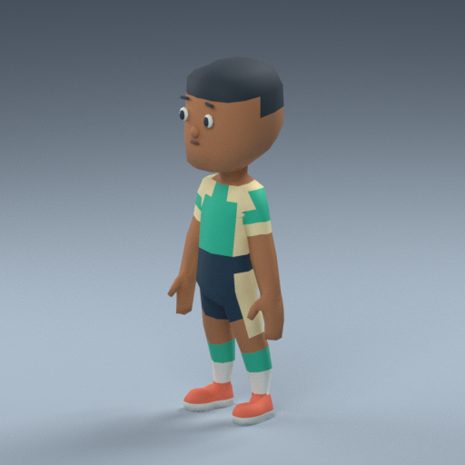
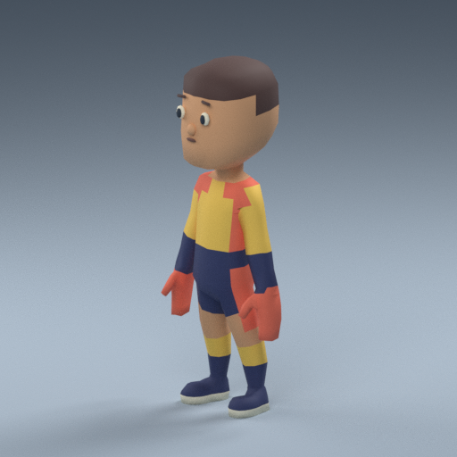
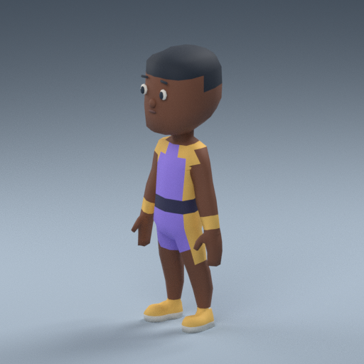
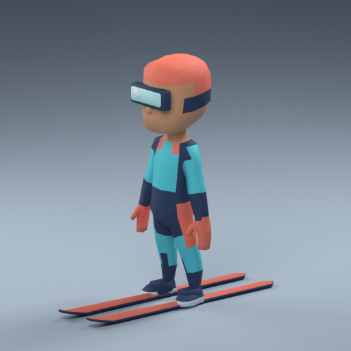

# האי שלי · דמויות GLB

ארבע דמויות ספורט בדויות, המבוססות על גאומטריית Kenney ברישיון CC0 עם מדים, צבעים וציוד מקוריים. תאריך המסירה: 30.10.2026. מקורות ורישיונות: [LICENSES.md](LICENSES.md). תוצאות מדודות: [VALIDATION.md](VALIDATION.md).

| דמות | GLB | תצוגות PNG בגודל 512×512 |
| --- | --- | --- |
| שחקן כדורגל · מנטה וקורל | [soccer-player.glb](soccer-player.glb) | [חזית](soccer-player-front.png) · [שלושה רבעים](soccer-player-three-quarter.png) · [גב](soccer-player-back.png) |
| שוער · צהוב וכחול כהה, כפפות מוגדלות | [goalkeeper.glb](goalkeeper.glb) | [חזית](goalkeeper-front.png) · [שלושה רבעים](goalkeeper-three-quarter.png) · [גב](goalkeeper-back.png) |
| שחקן כדורסל · סגול וענבר, גופייה | [basketball-player.glb](basketball-player.glb) | [חזית](basketball-player-front.png) · [שלושה רבעים](basketball-player-three-quarter.png) · [גב](basketball-player-back.png) |
| גולש סקי · תכלת וקורל, קסדה, משקף ומגלשיים | [skier.glb](skier.glb) | [חזית](skier-front.png) · [שלושה רבעים](skier-three-quarter.png) · [גב](skier-back.png) |

| כדורגל | שוער | כדורסל | סקי |
| --- | --- | --- | --- |
|  |  |  |  |

כל דמות היא glTF 2.0 בינארי עצמאי, עם רשת וחומר יחידים ושלד. הגאומטריה דחוסה ב־Draco באמצעות `KHR_draco_mesh_compression`; תקרת המסירה היא 150,000 bytes לכל GLB. הצבעים שמורים בקודקודים: אין טקסטורות או קבצים חיצוניים לטעינת הדמות. התמונות בטבלה הן תצוגות מקדימות ואינן טקסטורות. אין כיתוב, מספרי חולצה, שמות שחקנים, קבוצות, ליגות או לוגואים אמיתיים.

## שלד ואנימציה משותפים

לכל ארבע הדמויות אותם 20 שמות עצמות, אותה היררכיה ואותה תנוחת מנוחה. החוזה המכני מופיע ב־[rig.json](rig.json):

```text
Root
└─ Hips
   ├─ Spine
   │  └─ Chest
   │     ├─ Neck → Head
   │     ├─ LeftShoulder → LeftArm → LeftForeArm → LeftHand
   │     └─ RightShoulder → RightArm → RightForeArm → RightHand
   ├─ LeftUpLeg → LeftLeg → LeftFoot
   └─ RightUpLeg → RightLeg → RightFoot
```

היחידות הן מטרים, ציר מעלה `+Y`, חזית `+Z`, גובה בסיס 1.60 מ׳ ו־`Root` במישור הרצפה. תנוחת המנוחה היא T; בתצוגות המקדימות הזרועות מונמכות לצפייה. לכל קודקוד עד שתי השפעות עצם מנורמלות. המגלשיים משוקללים לעצמות כפות הרגליים.

אפשר לקשור את אותו קליפ לכל הדמויות באמצעות השמות המדויקים, כולל אותיות גדולות וקטנות, וללא שינוי בקנה המידה של העצמות. לא כלולים קליפי אנימציה בחבילה. שמות אלה הם החוזה לחבילה זו; מפרטי הייצור הישנים בתיקיות המשחקים משתמשים בשמות אחרים.

## שילוב עתידי

פתיחת הקבצים מחייבת loader עם מפענח Draco תואם. הייצוא נעשה באמצעות glTF Transform 4.5.1 ו־Draco 1.5.9. ב־loader של המשחק הקיים עדיין לא מוגדר מפענח זה, ולכן יש להגדירו בשלב שילוב נפרד ולהגישו מקומית. החבילה אינה מוסיפה תלות רשת בזמן משחק.

זוהי מסירת נכסים בלבד: הדמויות אינן מחוברות למשחקים. לא שונו לוגיקה, תגי גרסה או התיקיות `design/soccer`, `design/hoops`, `design/alpine`.
