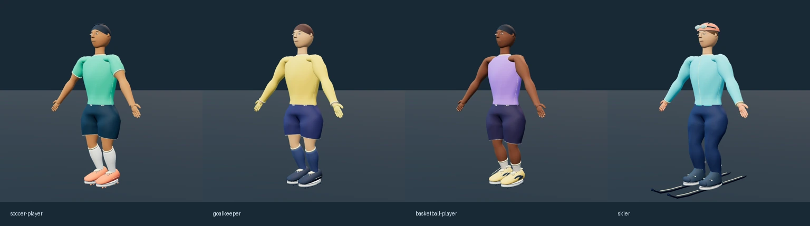

# האי שלי · דמויות v2

ארבע דמויות ספורט מקוריות, עם פנים מפוסלות, עיניים וגבות, שיער בנפח, אצבעות, נעליים מפורטות, קפלי בד, תפרים, נפח במכנסיים ובגרביים ושרירים מרומזים. הדמויות מסוגננות; FIFA ו־NBA Live שימשו יעד לרמת הפירוט והקריאות, בלי לשחזר דמויות או נכסים שלהם. אין כאן הבטחה לשוויון באיכות להפקת AAA.

החבילה מבוססת על main בקומיט `3853d282b6dd7719db49a864fec4286dc7b63cb0`. כל קובצי המסירה חדשים בתיקייה זו. פירוט מדוד ב־[VALIDATION.md](VALIDATION.md), ומקור ורישיון ב־[LICENSES.md](LICENSES.md).



| דמות | נכס | תצוגות מקדימות |
| --- | --- | --- |
| שחקן כדורגל | [soccer-player.glb](soccer-player.glb) | [חזית](soccer-player-front.png) · [שלושה רבעים](soccer-player-three-quarter.png) · [גב](soccer-player-back.png) · [פנים](soccer-player-detail.png) |
| שוער | [goalkeeper.glb](goalkeeper.glb) | [חזית](goalkeeper-front.png) · [שלושה רבעים](goalkeeper-three-quarter.png) · [גב](goalkeeper-back.png) · [פנים](goalkeeper-detail.png) |
| שחקן כדורסל | [basketball-player.glb](basketball-player.glb) | [חזית](basketball-player-front.png) · [שלושה רבעים](basketball-player-three-quarter.png) · [גב](basketball-player-back.png) · [פנים](basketball-player-detail.png) |
| גולש סקי | [skier.glb](skier.glb) | [חזית](skier-front.png) · [שלושה רבעים](skier-three-quarter.png) · [גב](skier-back.png) · [פנים](skier-detail.png) |

## צפייה

1. הפעילו שרת משורש המאגר: `python3 -m http.server 8765`.
2. פתחו [תצוגת דמויות v2 המקומית](http://localhost:8765/workout/island/design/characters2/preview.html).
3. בחרו דמות, תלבושת, עור ושיער, וצפו בחזית, בגב ובתנועה. ההחלפות צריכות להשפיע על אותה דמות; העיניים, הפנים והשלד צריכים להישמר.

התצוגה משתמשת ב־three.js, במפענח Draco, במתאם השלד ובנגן התנועות הקיימים. כל המשאבים מקומיים. לא נדרש חיבור למשחק או שירות חיצוני.

## חוזה GLB ותנועה

כל GLB הוא glTF 2.0 עצמאי עם `KHR_draco_mesh_compression` נדרש, רשת SkinnedMesh אחת, חומר אחד, צבעי קודקודים לינאריים ושלד של 20 עצמות. אין טקסטורה מובנית או משאבים חיצוניים. התקציב הוא 300,000 bytes לכל דמות, לרבות השלד. הגאומטריה אינה משוכפלת לכל תלבושת.

שמות העצמות, סדרן ב־skin, ההיררכיה, translation/rotation/scale ותאי inverseBindMatrix זהים ל־[characters/rig.json](../characters/rig.json). היחידות מטרים, מעלה `+Y`, חזית `+Z`, ותנוחת המנוחה T. עד ארבע השפעות מנורמלות לקודקוד. גובה הדמות החזותית הוקטן ביחס לראש הגדול בחבילה הישנה, וקו המותן הועלה בגאומטריה. אורכי העצמות נשמרו לצורך תאימות לתנועות הקיימות.

```text
Root → Hips → Spine → Chest → Neck → Head
Chest → LeftShoulder → LeftArm → LeftForeArm → LeftHand
Chest → RightShoulder → RightArm → RightForeArm → RightHand
Hips → LeftUpLeg → LeftLeg → LeftFoot
Hips → RightUpLeg → RightLeg → RightFoot
```

האצבעות מפורטות בגאומטריה ומשוקללות לעצם היד הקיימת; הן אינן נעות בנפרד. נעלי הספורט, מגפי הסקי והמגלשיים משוקללים לעצמות הרגליים. ציוד הראש משוקלל ל־Head. המשקף מורם על הקסדה כדי לשמור על פנים גלויות. הקליפים נשארים ב־`design/motion/`; הם אינם מוטמעים בארבעת הנכסים.

## אותם וריאנטים

משתמשים ב־[prepareVariant הקיים](../variants/apply-variant.js) ללא שינוי, עם [regions.json החדש](regions.json). [manifest.json](manifest.json) מפנה לכל 22 הגדרות התלבושת ולפלטות הקיימות. המפות אינן משוכפלות. בכל מראה נדרשת לכל היותר מפת תלבושת אחת בגודל 256×256.

```js
// Relative to a module in design/characters2/.
import * as THREE from '../../vendor/three.module.js';
import {prepareVariant} from '../variants/apply-variant.js';
const regions = await (await fetch('./regions.json')).json();
const outfitURL = new URL('../variants/outfits/soccer-01.json', import.meta.url);
const outfit = await (await fetch(outfitURL)).json();
const texture = await new THREE.TextureLoader().loadAsync(new URL(outfit.map, outfitURL).href);
// mesh: the SkinnedMesh from soccer-player.glb, decoded by the existing Draco loader.
const actor = prepareVariant(mesh, 'soccer-player', regions);
actor.apply(outfit, texture, {skin:'#BF8054', hair:'#222B38'});
// At teardown: actor.dispose(); manage shared cached textures separately.
```

יש להשתמש במפת האזורים של v2; המיפוי הישן קשור למספרי הקודקודים ולצבעים של הנכסים הישנים. `prepareVariant` מנטרלת את צבע הבגד ללבן, משמרת את פרטי הפנים, מוסיפה UV בזיכרון ומשלבת עור ושיער בצבעים לינאריים. מגבלות הקרנת X/Y וסינון המפות נשארות כפי שתועדו בחבילת [variants](../variants/README.md).

## בנייה ואימות חוזרים

התלויות שב־[source/package.json](source/package.json) מותקנות מחוץ לחבילה, למשל ב־`/tmp/island-characters2-tools/`. Python דורש NumPy, ולצילום גם Pillow, Playwright ו־Chromium. הפקודות הבאות מופעלות משורש המאגר:

```sh
npm install --prefix /tmp/island-characters2-tools --cache /tmp/island-characters2-npm-cache @gltf-transform/core@4.5.1 @gltf-transform/extensions@4.5.1 draco3dgltf@1.5.9 gltf-validator@2.0.0-dev.3.10
python3 workout/island/design/characters2/source/build.py
node workout/island/design/characters2/source/export.mjs --modules /tmp/island-characters2-tools/package.json
node workout/island/design/characters2/source/variants.mjs --modules /tmp/island-characters2-tools/package.json
node workout/island/design/characters2/source/validate.mjs --modules /tmp/island-characters2-tools/package.json
python3 workout/island/design/characters2/source/check-viewer.py
python3 workout/island/design/characters2/source/capture.py
npm test
node workout/island/design/characters2/source/audit.mjs
```

כלי הבנייה כותבים רק בתיקייה זו ובתיקייה זמנית של raw JSON. בדיקת ה־viewer מפעילה את הדף הקיים ומחליפה רק את תשובות ה־HTTP של ארבע בקשות ה־GLB בדפדפן הבדיקה. אין שינוי בקובצי ה־viewer או בנתוני התנועה. צילומי שלוש הזוויות נוצרים מה־GLB הסופי באמצעות אותו loader ומפענח.

`audit.mjs` מאמת שהדוחות והתמונות שייכים לאותם קובצי GLB סופיים, שה־viewer רץ במצב הבדיקה המלא, ושה־diff כולל תוספות בתיקייה זו בלבד. הוא מפיק [inventory.json](inventory.json) עם גדלים ו־SHA-256. תוצאת בדיקות המאגר הכלליות מתועדת בנפרד ב־[repository-tests.json](verification/repository-tests.json).
