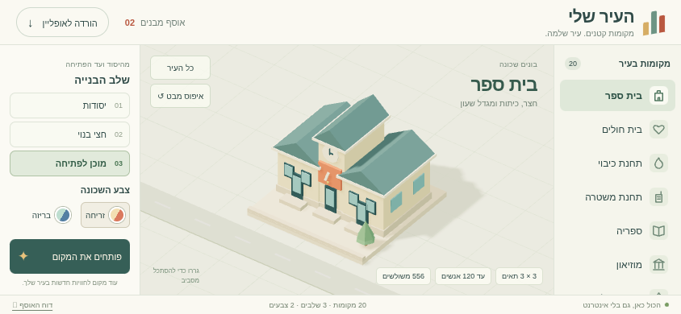

# העיר שלי — אוסף מבנים 2

תאריך: 17 בנובמבר 2026. ענף המסירה:

`codex/city-buildings-v2`

בסיס העבודה הוא הענף הראשי, קומיט:

`43b27dc235387e3cb737aee9558cdf9d5fd5a262`

הושלמה חבילת נכסים עצמאית של 20 מבנים מקוריים: 120 קובצי תלת־ממד,
שלושה שלבי בנייה ושתי גרסאות צבע לכל מבנה. התצוגה כוללת בחירה,
סיבוב, שינוי מרחק, צפייה בכל העיר ופתיחה חגיגית בקונפטי.
כל התוספות נמצאות בתיקייה זו בלבד. רישום הסשן וקריטריון הסיום נמצאים
כאן בהתאם להוראה המפורשת שלא לערוך קבצים קיימים.

קריטריון הסיום: 20 סוגים, 120 קבצים תקינים, 200–800 משולשים לכל
קובץ, כל הגאומטריה בתוך התפוסה המוצהרת, תצוגה מקומית במידה
המבוקשת, ארכיון אופליין, רישיונות, בדיקות ודחיפת הענף.

## תוצאות האימות

| בדיקה | תוצאה |
|---|---|
| מספר מבנים / קבצים | 20 / 120 |
| משולשים בכל קובץ, כולל בסיס, שילוט ואביזרים | 264–556 |
| משולשים בכל 20 המבנים הגמורים יחד | 8,336 |
| גודל 120 קובצי הדגמים | 2,756,676 בתים |
| גבול גודל החבילה | עד 8,000,000 בתים, **כולל הארכיון**, התמונות, המקורות והבדיקות |
| מדידה מדויקת, רשימת קבצים וחתימות | [ביקורת האריזה](verification/package-validation.json) |
| המאמת הרשמי | 120 עברו; 0 שגיאות, 0 אזהרות, 0 הערות ו־0 רמזים |
| בדיקות דפדפן | כל 120 הקבצים נטענו ורונדרו; כל ששת צירופי שלב וצבע |
| גודל התצוגה | 844×390; נבדק גם 390×844, ללא גלישה או חיתוך הדגם |
| תקשורת | אפס בקשות מחוץ לשרת המקומי; נבדק גם בהקשר דפדפן חדש |
| עותק אופליין שחולץ מחוץ למאגר | כל 120 הדגמים רונדרו, קונפטי לכל 20 המקומות וכפתור הורדה תקין כשהגישה החיצונית חסומה |
| פתיחה | השלמת שלב הבנייה, קונפטי, סיום האפקט, פתיחה חוזרת והפחתת תנועה |
| קלט ומשאבים | כפתורים, מקלדת, גרירה, ביטול טעינות ישנות ושחרור גאומטריה |
| סוויטת המאגר הכללית | 4,262 עברו, 0 נכשלו, 64 דולגו |

פרטי המאמת וחתימות כל הדגמים:
[gltf-validation.json](verification/gltf-validation.json).
פרטי בדיקת הדפדפן:
[browser-validation.json](verification/browser-validation.json).
אימות העותק שחולץ מהארכיון:
[offline-validation.json](verification/offline-validation.json).

## סקירה חזותית

[תצוגה אינטראקטיבית](preview.html) ·
[כל 20 המבנים](verification/overview.jpg) ·
[שלבים ושתי פלטות](verification/stages-and-palettes.jpg) ·
[כל העיר ב־844×390](verification/city-844x390.png) ·
[פתיחה חגיגית](verification/opening-844x390.png) ·
[טלפון במצב אנכי](verification/preview-390x844.png).



השפה החזותית: שכונת חוף קטנה, צבעים רכים, חומרים מטיים וצלליות
שאפשר להבחין ביניהן גם במבט על. לכל מקום פרטים משלו: מגדל שעון,
מוסכי כיבוי, גג ספריה משונן, עמודי מוזיאון, ארובת תנור, מגלשה,
רציף רכבת, פנס מגדלור ומנוף נמל.

## קטלוג ומדדי הרשת

יחידת מודל ותא רשת הם מטר אחד. התפוסה שומרת את מלבן המגרש כולו,
כולל אביזרים, כניסה ומים כשיש. כל נקודות הגאומטריה נבדקו מול גבולותיו.
הקיבולת היא הצעת עיצוב במספר אנשים; היא אינה שינוי לכללי המשחק.
סדר ספירת המשולשים: יסודות / חצי בנוי / גמור. הספירה זהה בשני הצבעים.

| מקום | מזהה | גודל רשת | תאים תפוסים | קיבולת אנשים | משולשים בשלושת השלבים |
|---|---|---|---|---|---|
| בית ספר | `school` | 3×3 | 9 | 120 | 284 / 416 / 556 |
| בית חולים | `hospital` | 3×3 | 9 | 80 | 296 / 368 / 464 |
| תחנת כיבוי | `fire-station` | 3×2 | 6 | 18 | 288 / 312 / 308 |
| תחנת משטרה | `police-station` | 2×2 | 4 | 20 | 312 / 288 / 348 |
| ספריה | `library` | 3×2 | 6 | 45 | 288 / 264 / 408 |
| מוזיאון | `museum` | 3×3 | 9 | 60 | 300 / 368 / 424 |
| חנות מכולת | `grocery` | 2×2 | 4 | 18 | 312 / 312 / 432 |
| מאפייה | `bakery` | 2×2 | 4 | 12 | 308 / 320 / 436 |
| קונדיטוריה | `patisserie` | 2×2 | 4 | 16 | 292 / 320 / 454 |
| ספורטק | `sports-park` | 4×3 | 12 | 30 | 324 / 336 / 392 |
| בריכה | `swimming-pool` | 3×3 | 9 | 36 | 336 / 360 / 368 |
| גן שעשועים | `playground` | 3×3 | 9 | 24 | 312 / 360 / 344 |
| פארק | `park` | 3×3 | 9 | 40 | 284 / 316 / 396 |
| תחנת רכבת | `train-station` | 4×2 | 8 | 60 | 328 / 448 / 520 |
| תחנת אוטובוס | `bus-stop` | 2×1 | 2 | 8 | 328 / 304 / 280 |
| מגדלור | `lighthouse` | 2×2 | 4 | 4 | 284 / 368 / 442 |
| נמל | `harbor` | 4×3 | 12 | 32 | 332 / 484 / 428 |
| שוק | `market` | 3×3 | 9 | 48 | 300 / 384 / 528 |
| קולנוע | `cinema` | 3×2 | 6 | 72 | 380 / 392 / 452 |
| תיאטרון | `theatre` | 3×3 | 9 | 90 | 308 / 356 / 356 |

אותו מספר משולשים בשני שלבים אינו גאומטריה זהה. נבדק שלכל מבנה
שלוש גאומטריות שונות ושכל 20 הדגמים הגמורים שונים זה מזה.

## השלבים, הצבעים והשילוט

שלב היסודות כולל חפירה, חגורות בטון, התחלות עמודים, רשת ברזל
ושלט אתר. בחצי הבנייה יש קירות פתוחים עם פנים חלול, עמודים חלקיים,
פיגומים וחומרי בנייה; במתחמים הפתוחים נבנתה רק מחצית מהמשטח.
השלב הגמור מוסיף גגות, חלונות, גמרים, צמחייה ואביזרים ייעודיים.

שתי הפלטות הן זריחה ובריזה. קיימים קבצים נפרדים לכל אחת,
עם גאומטריה זהה וצביעה שונה בערכי צבע לקודקודים. אין טקסטורות.
כל הקבצים הם דגמים סטטיים תקניים, עם רשת אחת וחומר אחד לכל קובץ.

השילוט עשוי גאומטריה: עיפרון, לב, להבה, מכשיר קשר, ספר, כד,
סל, לחם, עוגה, כדור, גלים, מגלשה, עץ, רכבת, אוטובוס, פנס,
עוגן, דוכן, גלגל סרט ומסך במה. אין מותגים או סמלים מוסדיים.
שמות בעברית נמצאים בממשק בלבד ואינם מוטבעים בדגם.

## פתיחה והפעלה מקומית באופליין

1. הורידו את [החבילה המלאה](city-buildings-v2-offline.zip) וחלצו אותה.
2. פתחו מסוף בתוך התיקייה שחולצה, והריצו את הפקודה הבאה.
3. הדפדפן מציג את האוסף; בחרו מקום, שלב וצבע או לחצו על פתיחה חגיגית.

```sh
python3 serve.py --open
```

הכתובת המקומית:

```text
http://127.0.0.1:8765/preview.html
```

נדרש דפדפן התומך בתלת־ממד ו־Python 3 להפעלת השרת המקומי בלבד.
אין התקנות חבילות, חשבונות, שירותי רשת, גופנים מרוחקים או משאבים
מחוץ לתיקייה. השרת קשור לכתובת המקומית בלבד. פתיחת הקובץ ישירות
בדפדפן דרך מערכת הקבצים אינה מספיקה למודולים ולטעינת הדגמים.
בתצוגה יש כפתור להורדת אותו ארכיון.

## נתוני חיבור והאפקט

המניפסט מציין שטח, רשימת תאים תפוסים, קיבולת, קובץ לכל צירוף,
מספר משולשים, גודל, חתימה, גבולות ונקודת פתיחה. ציר מעלה:

`+Y`

החזית פונה לציר:

`+Z`

הציר המקומי נמצא במרכז המגרש ובגובה הקרקע. כניסה בחזית המגרש;
הנמל מסומן להצבה בקו חוף. נקודת הפתיחה נשמרת גם במידע הנוסף בתוך
כל קובץ, כך שאפשר להשתמש בו בנפרד מהמניפסט.

קובצי הדגמים תקניים וניתנים לטעינה בכל קורא מתאים. לנוחות החיבור
מצורפים קורא מקומי מצומצם ומנהל שחרור משאבים:

`runtime.mjs`

הקונפטי הוא רכיב משותף שאפשר להפעיל לכל אחד מ־20 המבנים:

`effects.mjs` → `createOpeningEffect`

הרכיב יוצר 64 פתיתי גאומטריה באצווה אחת למשך 1.65 שניות. יש
לעדכן אותו בשניות בלולאת הרינדור ולשחרר אותו בעת הסרת המקום.
העדפה להפחתת תנועה מכבה את הקונפטי ומשאירה הודעת פתיחה נגישה.
האפקט אינו חלק ממכסת המשולשים של הדגם; הוא מוסיף זמנית 128
משולשים לכל מקום שנפתח.

## שחזור ובדיקות

מקור הבנייה אינו דורש תלויות. מתוך תיקיית החבילה:

```sh
python3 source/build.py
```

כלי האימות הם תלויות פיתוח בלבד. אפשר להתקינם בתיקייה זמנית
מחוץ למאגר, ואז להריץ את המאמת, השרת ובדיקת הדפדפן:

```sh
npm install --prefix /tmp/city-v2-tools --cache /tmp/city-v2-npm-cache --no-audit --no-fund gltf-validator@2.0.0-dev.3.10 playwright@1.56.1
node source/validate.mjs
python3 serve.py
```

במסוף נוסף, כשהשרת פועל, ובסיום הבדיקות:

```sh
node source/check-preview.mjs
python3 source/package.py
```

לבדיקת העותק הארוז, חלצו אותו מחוץ למאגר והפעילו את השרת שלו
בפורט 8766; אז הריצו מתיקיית המקור:

```sh
node source/check-offline.mjs
```

בדיקת הדפדפן משתמשת בכרומיום המקומי. ניתן לשנות את מיקומי
הכלים והדפדפן באמצעות משתני הסביבה המופיעים במקור הבדיקה.
הסוויטה הכללית של המאגר משתמשת במתאם הכלול לחיבור הכרומיום
המקומי, באמצעות משתנה שכבר נתמך בעזרי הבדיקה הקיימים. משורש המאגר:

```sh
ISLAND_PLAYWRIGHT="$PWD/workout/island/design/city-buildings-v2/source/playwright-system.mjs" npm test
```

כך אין צורך להתקין דפדפן נוסף או לערוך את הבדיקות הקיימות.
בריצת ברירת המחדל נתיב הדפדפן של הסביבה לא היה קיים; הבדיקה
החסומה עברה בנפרד, ואחריה כל הסוויטה הורצה שוב בהצלחה באמצעות
המתאם. בדיקות הדפדפן של חבילת המבנים עצמה הורצו במלואן.
תוצאת הסוויטה ופרטי התאמת סביבת הבדיקה נמצאים ב־
[repository-tests.json](verification/repository-tests.json).

האריזה בודקת את תקינות הארכיון ואת זהות כל קובץ לתוכן המקורי,
ומודדת את כל התיקייה מול מגבלת שמונה מיליון בתים. הארכיון אינו
כולל את עצמו או את דוח האריזה, כדי להימנע ממעגל חתימות.

הרישיונות והמקור המלאים נמצאים ב־[LICENSES.md](LICENSES.md).
בדיקת חומרה ותחושת שימוש בטלפון פיזי נשארת לבדיקת הקבלה.
