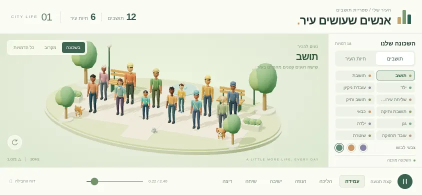
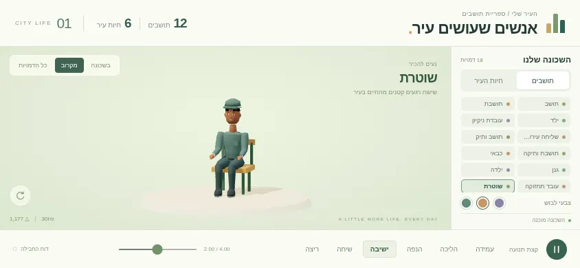

# תושבי העיר v1 — דוח מסירה

נמסרו **12 זהויות × שלוש גרסאות צבע, ועוד שש חיות: 42 קובצי GLB**.
לכל תושב שלד קנוני מדויק בן 18 עצמות ושישה קליפים ב־30Hz.
`motion-qa-v1` המקורי: **מינימום 92.5**, ממוצע **96.96**, בכל 216 קליפי התושבים.
כל 42 הקבצים עברו Khronos עם **אפס שגיאות ואפס אזהרות**.

הענף: `codex/city-citizens-v1`. בסיס: `43b27dc235387e3cb737aee9558cdf9d5fd5a262`.
תאריך המסירה: 17 בנובמבר 2026, שעון ישראל.
כל הקבצים החדשים נמצאים ב־`workout/island/design/city-citizens-v1/` בלבד.
לא שונו קבצים קיימים, לוגיקת המשחק, גרסאות, תלויות המאגר או `ops/CONTROL.md`;
בקשת התיקייה החדשה בלבד גוברת על נוהל עדכון חדר הבקרה.

[תצוגת הנכסים](preview.html) · [מניפסט](manifest.json) · [רישיונות](LICENSES.md) · [מפרט האימות](MOTION_QA.md)

## התכולה

| קבוצה | פירוט | קבצים |
| --- | --- | ---: |
| ילדים | ילד וילדה | 6 |
| מבוגרים | תושב ותושבת | 6 |
| זקנים | תושב ותיק ותושבת ותיקה | 6 |
| עובדי עיר | גנן, עובדת ניקיון, עובד תחזוקה ושליח | 12 |
| שירותי עיר | כבאי ושוטרת, לבוש גנרי ללא סמלים | 6 |
| חיות | חתול, כלב, יונה, ציפור, דג ופרפר | 6 |

הדמויות כוללות פנים, שיער, כובעים ואביזרי לבוש שונים. כל זהות כוללת פלטת מקור,
חלופה חמה וחלופה קרירה; אלה שלושה GLB נפרדים עם צבעי קודקודים מוטמעים.
אין מותגים, כתובות, סמלי רשויות או תמונות אנשים אמיתיים.
הגאומטריה האנושית מכילה **1,021–1,177 משולשים** לדמות, בתוך טווח 800–1,200.

ששת הקליפים: `idle` עמידה, `walk` הליכה, `wave` הנפת יד, `sit` ישיבה,
`talk` שיחה ו־`run` ריצה. האנימציות מקוריות, עם IK לרגליים, ולא motion capture.
הישיבה אורכת ארבע שניות: ירידה, שהייה בין 0.9–3.1 שניות ועלייה חזרה.
לריצה אינטרפולציית `CUBICSPLINE` עם משיקים מחזוריים, והמפתחות נשארים ב־30Hz;
יתר הקליפים משתמשים ב־`LINEAR`. כל קצות הלולאות תואמים.

| חיה | משולשים | לולאות ב־30Hz |
| --- | ---: | --- |
| חתול | 814 | עמידה, הליכה |
| כלב | 800 | עמידה, ריצה קלה |
| יונה | 636 | ניקור, רפרוף |
| ציפור | 576 | תעופה |
| דג | 350 | שחייה |
| פרפר | 326 | רפרוף |

כל 42 קובצי ה־GLB יחד: **5,045,464 בתים**. כל תיקיית המסירה, כולל מקור,
דוחות וצילומים: **כ־5.7MB**, מתחת ל־6,000,000 בתים; אין טקסטורות או מפענח דחיסה.
המניפסט מפרט נתיב, משולשים, קודקודים, בתים, SHA-256, קליפים וקנה מידה לכל נכס.

## התאמה לשלד ושימוש

`skeleton.json` וה־GLB תואמים בדיוק לשמות, סדר, הורות, תרגומי מנוחה וסיבובי הזהות
של `motion2/soccer.json`: 18 עצמות, מטרים, Y למעלה ו־Z קדימה.
הבדלי הגיל נשמרים בלי לשנות את חוזה השלד. יש ליישם את `scale` מהמניפסט על קבוצת
הדמות החיצונית; לדוגמה ילד 0.76 וילדה 0.74. `heightMeters` הוא גובה הנכס המקורי,
ו־`runtimeHeightMeters` מתאר את הגובה לאחר קנה המידה המומלץ.

הליכה וריצה נאפו **במקום**. תנועת הדמות בעולם שייכת למנוע המשחק; יש להתאים אותה
ל־`speed` של הקליפ כפול `scale`, פעם אחת בלבד. בישיבה גובה המושב 0.395 מטרים
ומיקומו Z=-0.41 לפני קנה מידה. התצוגה מדגימה את הכיסא ואת המעברים בפועל.
החיות משתמשות בשלדים נפרדים המתאימים לכל מין; אין להחיל עליהן אנימציות אדם.

## תוצאות בדיקה

| בדיקה | תוצאה | ראיה |
| --- | --- | --- |
| motion-qa-v1 המקורי | 216 קליפים; מינימום 92.5, ממוצע 96.96; כיסוי 100%; אפס מדדים אדומים ואפס מדדים ישימים חסרי נתונים | [תוצאות](verification/motion-qa.json) |
| מקור כלי ה־QA | קומיט `5eb4f093bc22523ee417a7f2345c3b813bffba24`; שישה מודולים ללא שינוי וספים מקוריים | [SHA-256 ומקור](verification/motion-qa-provenance.json) |
| הדוח המקורי המלא | נשמר בשלמותו בדחיסת gzip ללא אובדן | [report JSON.gz](verification/motion-qa-full.json.gz) |
| Khronos | 42 קבצים, 0 שגיאות, 0 אזהרות | [תוצאות](verification/khronos.json) |
| skin ורצפה | 20,625 דגימות פוזה ו־13,932,724 דגימות קודקודים ב־120Hz; חדירה מרבית 0.351 מ״מ מול סף 1 מ״מ | [אימות עצמאי](verification/motion-audit.json) |
| רציפות לולאה | שגיאת מיקום עד 0.000000017 מטר; הפרש מהירות עד 0.302 מ׳/ש׳ מול סף 0.5 | [אימות עצמאי](verification/motion-audit.json) |
| בקרות שיבוש | הזרקות החלקה, חדירה וקפיצת פוזה זוהו בכלי המקורי; הבודק העצמאי זיהה קליפ חסר, לולאה פתוחה וחדירה | [פרוטוקול](MOTION_QA.md) |
| דפדפן | 18 זהויות, 72 בחירות קליפ ו־36 החלפות פלטה; 844×390 וגם 390×844; ללא שגיאות, בקשות חיצוניות או גלילת עמוד | [תוצאות וטביעות קבצים](verification/browser.json) |

הבודק המקורי מיועד לאנטומיה אנושית. ששת בעלי החיים עברו Khronos ובדיקת skin,
רצפה ולולאות עצמאית; לא מיוחס להם ציון אנטומיה אנושי. 360 סימוני `unknownMetrics`
בדוח המקורי הם מדדים שאינם חלים, כגון מגע כדור ונסיעה בפעולה נייחת; מספר מדדי
`insufficient-data` הוא אפס. שלוש הפלטות נבדקו בנפרד בכלי המקורי וב־Khronos;
בדיקת הקודקודים משותפת רק לאחר אימות זהות הגאומטריה והאנימציה ביניהן.

בדיקות המאגר הקיים: `npm test` — 4,261 עברו, 64 דולגו, כשל סביבתי אחד עקב דפדפן
Playwright חסר. אותו קובץ נבדק שוב במלואו עם Chromium המותקן: **5/5 עברו**, כולל
תרחיש הדפדפן לכל 50 התרגילים. המתאם היה זמני ב־`/tmp`; לא שונה קוד הבדיקות.
כל הסוויטה לא הורצה פעם שנייה. [פירוט מדויק](verification/repository-tests.json).

הבדיקות התבצעו ב־Chromium עם WebGL תוכנתי. ביצועי טלפון פיזי טרם נמדדו;
הציונים הם מדדי אבחון ואינם מחליפים הערכה חזותית או בדיקת התנגשות אנטומית מלאה.

## צפייה ושחזור

1. משורש המאגר, להפעיל שרת מקומי:

   ```sh
   python3 -m http.server 8765 --bind 0.0.0.0
   ```

2. לפתוח [את התצוגה המקומית](http://localhost:8765/workout/island/design/city-citizens-v1/preview.html).
   לבחור תושב או חיה, קליפ ופלטה; הכפתורים מאפשרים שכונה, תקריב וספרייה,
   השהיה, ציר זמן וסיבוב. התוצאה הצפויה: 12 תושבים ושש חיות, ללא הודעת שגיאה.

3. לשחזור הנכסים, לאחר התקנת `numpy`, `scipy` ו־`fast-simplification==0.2.0`
   בסביבת Python זמנית, להריץ לפי הסדר:

   ```sh
   python3 workout/island/design/city-citizens-v1/source/citizens.py
   python3 workout/island/design/city-citizens-v1/source/animals.py
   python3 workout/island/design/city-citizens-v1/source/export.py
   ```

   המקורות הגאומטריים הזמניים נשמרים ב־`/tmp/city-citizens/`; הייצוא מעדכן את
   החבילה החדשה בלבד. יש להריץ שוב את בדיקות ה־QA לאחר כל ייצוא, לפי
   [MOTION_QA.md](MOTION_QA.md), ואת `source/browser-check.mjs` עם Playwright ו־Chromium.

התצוגה מפנה לספריות Three.js המקומיות שכבר נמצאות במאגר; היא מיועדת להפעלה
מתוך checkout של המאגר. מקורות ורישיונות מפורטים ב־[LICENSES.md](LICENSES.md).



