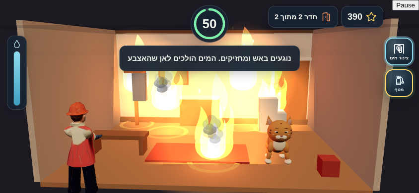
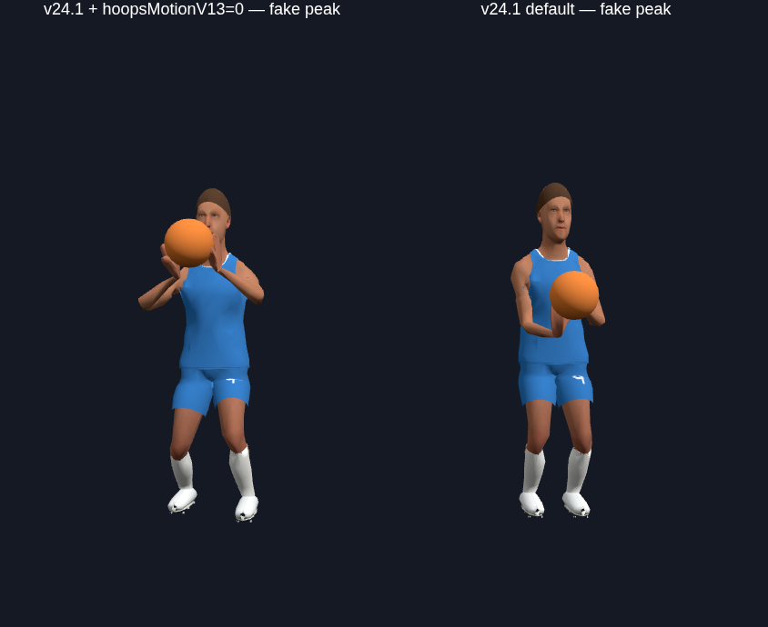

# ביקורת חיצונית: workout/island v24.1

**16 ממצאים מאומתים: 12 בחומרה בינונית ו־4 בחומרה נמוכה. לא אומת ליקוי חדש בחומרה גבוהה.** לא שונה קוד מוצר; כל תוצרי הביקורת הם קבצים חדשים בתיקייה זו. תיקונים להלן הם הצעות בלבד.

נבדק קומיט המיזוג של [PR 461](https://github.com/roynaor-work/Bakasun/pull/461): `43b27dc235387e3cb737aee9558cdf9d5fd5a262`, מול ההורה הראשון `11fef2fb98eec4173381346caee94f2930f9cffa`. מקור: `claude/island-v24-1` / `63d8937eb893f5ba977f52fb39ac7668b1762ecf`. גרסה: `island-v2-20261107-15`. ענף התוצרים: `codex/external-review-v241`. תאריך: 17.11.2026, Asia/Jerusalem.

הביקורת שילבה קריאת diff, השוואה לקוד ההורה, סימולציות דטרמיניסטיות, מודלים ונכסים אמיתיים, דפדפן מגע ב־844×390, הזרקת כשלים, מטמון קר ואובדן WebGL. סוקרים עצמאיים הצליבו את שלוש תקלות הכדורגל ואת סימן כיוון הסקי. `AGENTS.md`, `CLAUDE.md` ו־`ops/CONTROL.md` נקראו; קובץ הבקרה לא נערך, בהתאם להוראה המפורשת לא לערוך קבצים קיימים.

## טבלת הממצאים

ממוינת לפי חומרה, ואחריה השפעה בתוך אותה חומרה. כל מספר מפנה לשחזור, לתוצאה ולתיקון המוצע. השורות והקישורים מתייחסים לקומיט שנבדק, לא ל־HEAD עתידי.

| מזהה | חומרה | ליקוי | קובץ ושורה | שחזור | תיקון מוצע |
|---|---|---|---|---|---|
| [V241-001](#v241-001) | בינונית | כשל בטעינת החדר הראשון מקפיא את שלב הכניסה | [minigames/fire-v24-session.mjs:95](https://github.com/roynaor-work/Bakasun/blob/43b27dc235387e3cb737aee9558cdf9d5fd5a262/workout/island/minigames/fire-v24-session.mjs#L95) | [fire-first-room-shell.py](repro/fire-first-room-shell.py) | לטפל מפורשות ב-loadFailed ובבקשה שנתקעה; לסגור את ה-interior ולקרוא onDone עם שגיאה או להציע ניסיון חוזר |
| [V241-002](#v241-002) | בינונית | אובדן WebGL בחדר משאיר מסך שחור והשעון ממשיך | [minigames/fire-v24-session.mjs:96](https://github.com/roynaor-work/Bakasun/blob/43b27dc235387e3cb737aee9558cdf9d5fd5a262/workout/island/minigames/fire-v24-session.mjs#L96) | [fire-context-loss.py](repro/fire-context-loss.py) | לחבר webglcontextlost/webglcontextrestored ל-lifecycle של החדר, להשהות את המודל בזמן אובדן ההקשר ולנקות את המאזינים ב-dispose |
| [V241-003](#v241-003) | בינונית | אי אפשר לסגור את שיעור הכניסה הראשון במקלדת | [minigames/fire-v24-session.mjs:55](https://github.com/roynaor-work/Bakasun/blob/43b27dc235387e3cb737aee9558cdf9d5fd5a262/workout/island/minigames/fire-v24-session.mjs#L55) | [fire-keyboard.py](repro/fire-keyboard.py) | להוסיף כפתור המשך אמיתי עם click וניהול מיקוד |
| [V241-004](#v241-004) | בינונית | חדר המשך מתחיל מול הגאומטריה והחבר של החדר הקודם | [minigames/fire-v24-scene.mjs:150](https://github.com/roynaor-work/Bakasun/blob/43b27dc235387e3cb737aee9558cdf9d5fd5a262/workout/island/minigames/fire-v24-scene.mjs#L150) | [fire-interior-failures.py](repro/fire-interior-failures.py) | להפוך את טעינת החדר למחסום מפורש ב-session; להציב ready=false בזמן מעבר, להמתין ל-room ול-friend, להעביר שגיאה ולאפשר ניסיון חוזר גם אחרי Promise שנדחה. |
| [V241-005](#v241-005) | בינונית | בחירת עף או מספרת להגבהה ברחבה מוחלפת בנגיחה | [minigames/soccer.mjs:818](https://github.com/roynaor-work/Bakasun/blob/43b27dc235387e3cb737aee9558cdf9d5fd5a262/workout/island/minigames/soccer.mjs#L818) | [soccer-air-choice-override.mjs](repro/soccer-air-choice-override.mjs) | להחריג בחירה חמושה של volley/scissor מן ה-auto-header, ולהקדים armed-air tracking לריצת passTarget |
| [V241-006](#v241-006) | בינונית | שעון אנימציית ההחלקה נהיה NaN מהפריים השני | [minigames/soccer-design-character.mjs:376](https://github.com/roynaor-work/Bakasun/blob/43b27dc235387e3cb737aee9558cdf9d5fd5a262/workout/island/minigames/soccer-design-character.mjs#L376) | [soccer-view-slide-timeline.mjs](repro/soccer-view-slide-timeline.mjs) | להקדים slide.v241?slideTimelineV241 ב-dispatch המתמשך, ולבדוק בקר אמיתי לאורך שני פריימים לפחות והמשך לקימה. |
| [V241-007](#v241-007) | בינונית | זינוק השוער החדש נקטע אחרי פריים אחד | [minigames/soccer-design-character.mjs:419](https://github.com/roynaor-work/Bakasun/blob/43b27dc235387e3cb737aee9558cdf9d5fd5a262/workout/island/minigames/soccer-design-character.mjs#L419) | [soccer-view-keeper-dive.mjs](repro/soccer-view-keeper-dive.mjs) | להגן על active dive עד stand לפי מצב מפורש או dive.name, ולא לפי רשימת prefixes שאינה כוללת v241 |
| [V241-008](#v241-008) | בינונית | אספקה ותיקון מפסיקים לעבוד בסיום האווירי בספינות | [minigames/naval.mjs:507](https://github.com/roynaor-work/Bakasun/blob/43b27dc235387e3cb737aee9558cdf9d5fd5a262/workout/island/minigames/naval.mjs#L507) | [combat-naval-finale-supply.mjs](repro/combat-naval-finale-supply.mjs) | להשתמש ב-airFinale כשער לסיום השלב ולהמשיך פעולות קרב, תחזוקה ואספקה; להפסיק רק יצירת צי/גלים חדשים ולהקפיא את השעון המתאים. |
| [V241-009](#v241-009) | בינונית | מתג הנשק החדש בחלליות מתעלם מהפעלה סמנטית | [minigames/alien-v25-ui.mjs:27](https://github.com/roynaor-work/Bakasun/blob/43b27dc235387e3cb737aee9558cdf9d5fd5a262/workout/island/minigames/alien-v25-ui.mjs#L27) | [combat-switch.py](repro/combat-switch.py) | לתמוך ב-click סמנטי, עם מניעת החלפה כפולה כאשר pointerdown ואחריו click מגיעים מאותו מגע. |
| [V241-010](#v241-010) | בינונית | דגל החזרה בכדורסל אינו מחזיר את הגוף הישן באופליין קר | [tools/hoops-v241-offline.mjs:14](https://github.com/roynaor-work/Bakasun/blob/43b27dc235387e3cb737aee9558cdf9d5fd5a262/workout/island/tools/hoops-v241-offline.mjs#L14) | [offline-roundtrip.py](repro/offline-roundtrip.py) | להחזיר למניפסט את guard/wing/center תחת assets/athlete-body-v22/models, ולבדוק cold-cache rollback עם Service Worker אמיתי. |
| [V241-011](#v241-011) | בינונית | כיוון המגלשיים החדש מחמיר את הסיבוב נגד כיוון התנועה | [minigames/alpine-steer.mjs:37](https://github.com/roynaor-work/Bakasun/blob/43b27dc235387e3cb737aee9558cdf9d5fd5a262/workout/island/minigames/alpine-steer.mjs#L37) | [alpine-yaw-sign.mjs](repro/alpine-yaw-sign.mjs) | להפוך את סימן heading וה-lead בבסיס −Z, ולבדוק וקטור קדימה בעולם ולא שוויון ל-atan2 חיובי בלבד. |
| [V241-012](#v241-012) | בינונית | שיא ו-ghost ישנים מוצגים מול קורס וכללי תנועה חדשים | [minigames/alpine-session.mjs:56](https://github.com/roynaor-work/Bakasun/blob/43b27dc235387e3cb737aee9558cdf9d5fd5a262/workout/island/minigames/alpine-session.mjs#L56) | [alpine-records-ruleset.mjs](repro/alpine-records-ruleset.mjs) | להוסיף זהות ruleset/course למרחב אחסון השיאים וה-ghost; להשאיר נתוני v24 במרחב הישן וליצור מרחב v24.1 חדש, בלי למחוק היסטוריה. |
| [V241-013](#v241-013) | נמוכה | שלג עמוק נעלם לפני שההאטה שלו מסתיימת | [minigames/alpine-view.mjs:566](https://github.com/roynaor-work/Bakasun/blob/43b27dc235387e3cb737aee9558cdf9d5fd5a262/workout/island/minigames/alpine-view.mjs#L566) | [alpine-powder-visibility.mjs](repro/alpine-powder-visibility.mjs) | לבצע culling של patches לפי הטווח [s−len/2,s+len/2], ולא לפי המרכז |
| [V241-014](#v241-014) | נמוכה | פייק בקליפ v13 משאיר את הכדור נמוך | [minigames/hoops-athlete.mjs:131](https://github.com/roynaor-work/Bakasun/blob/43b27dc235387e3cb737aee9558cdf9d5fd5a262/workout/island/minigames/hoops-athlete.mjs#L131) | [hoops-fake-comparison.py](repro/hoops-fake-comparison.py) | לגזור את חלון הפייק מאירועי הקליפ החדש או לשמור קליפ פייק ייעודי; לבדוק מסלול כפות ידיים בפייק כאשר מחליפים jump_shot. |
| [V241-015](#v241-015) | נמוכה | כשל בקהל אופציונלי בטניס יוצר Promise rejection לא מטופל | [minigames/tennis-v12-stadium.mjs:88](https://github.com/roynaor-work/Bakasun/blob/43b27dc235387e3cb737aee9558cdf9d5fd5a262/workout/island/minigames/tennis-v12-stadium.mjs#L88) | [tennis-crowd-failure.py](repro/tennis-crowd-failure.py) | לצרף rejection handler לכל Promise בעת יצירתו, או לבצע settle של כל האצווה לפני הצריכה הסדרתית, בדומה לעזר ה-prefetch הקיים ב-tennis-view. |
| [V241-016](#v241-016) | נמוכה | הוראות העזרה אינן חוזרות עם דגלי החזרה | [data/strings.he.json:1169](https://github.com/roynaor-work/Bakasun/blob/43b27dc235387e3cb737aee9558cdf9d5fd5a262/workout/island/data/strings.he.json#L1169) | [racing-help-rollback.py](repro/racing-help-rollback.py) | לבחור גם טקסטי עזרה לפי הדגלים, ולשמור מפתחות v24 להוראות הישנות, בדומה לטיפול שכבר קיים ב-alien-ui עבור alienArsenal=0. |

## הרצה וקריאת הראיות

להריץ משורש המאגר בענף הביקורת. נדרשים Node.js, Python Playwright ו־Chromium. הוראות נוספות ומגבלות ה־fixtures ב־[repro/README.md](repro/README.md). כל דפדפן משתמש בפרופיל חדש; אין גישה לשמירה אמיתית. פלט של הרצות נוספות נכתב ל־`/tmp`, בלי לכתוב לקוד המוצר.

במסוף אחד להפעיל שרת מקומי ולהשאירו פועל:

```bash
python3 -m http.server 8766 --bind 127.0.0.1
```

שלושת שחזורי Node של הכדורגל **מסתיימים ב־exit 1 במכוון**: הם בודקים את ההתנהגות הרצויה ונכשלים בקוד הנבדק. שאר השחזורים מודדים או מאמתים את נוכחות התקלה ובדרך כלל מסתיימים ב־exit 0. אין לפרש exit 0 של probe כהיעדר באג.

## פרטי הממצאים

### V241-001

**בינונית — כשל בטעינת החדר הראשון מקפיא את שלב הכניסה** · [minigames/fire-v24-session.mjs:95](https://github.com/roynaor-work/Bakasun/blob/43b27dc235387e3cb737aee9558cdf9d5fd5a262/workout/island/minigames/fire-v24-session.mjs#L95)

חסימת living-room.glb בכניסה לשלב 3 משאירה insideReady=false ו-insideFailed=true; הרחוב מושהה והטקסט „נכנסים לבניין” נשאר. במעטפת המלאה outerLoadState הוא ready ואין ממשק התאוששות, ולכן ההמתנה אינה נפתרת.

**המצופה:** להציג ניסיון חוזר או גרסה קלה, או לחזור לרחוב תוך שחרור ההשהיה.

**שחזור מדויק:**

```bash
python3 workout/island/design/external-review-v241/repro/fire-first-room-shell.py
```

```bash
python3 workout/island/design/external-review-v241/repro/fire-interior-failures.py
```

1. להיכנס לשלב כיבוי 3 עם מטמון קר.
2. להגיע לבניין ולהיכנס; להכשיל את assets/fire-v24/rooms/living-room.glb.
3. להמתין: ההנחיה והרחוב נשארים קפואים.

**תיקון מוצע:** לטפל מפורשות ב-loadFailed ובבקשה שנתקעה; לסגור את ה-interior ולקרוא onDone עם שגיאה או להציע ניסיון חוזר. העברת ready החוצה בלבד אינה מפעילה מחדש את ה-watcher שכבר הסתיים.

**פער בבדיקות:** הבדיקות בודקות זרימה ומודל תקינים ואינן מפילות GLB חובה לאחר שהרחוב כבר הודיע ready.

**ראיות:** [fire-first-room-shell.json](repro/fire-first-room-shell.json) · [fire-first-room-failed-shell.png](repro/fire-first-room-failed-shell.png) · [fire-interior-failures.jsonl](repro/fire-interior-failures.jsonl)

### V241-002

**בינונית — אובדן WebGL בחדר משאיר מסך שחור והשעון ממשיך** · [minigames/fire-v24-session.mjs:96](https://github.com/roynaor-work/Bakasun/blob/43b27dc235387e3cb737aee9558cdf9d5fd5a262/workout/island/minigames/fire-v24-session.mjs#L96)

לאחר WEBGL_lose_context הקנבס שחור, אבל ready=true ו-loadFailed=false. בחמש שניות בדיקה השלב נכנס ל-play ונותרו כ-48 מתוך 50 שניות, ללא fallback. אין חריגת render שעליה ה-catch יכול להסתמך.

**המצופה:** לעצור את שעון החדר ולטפל בשחזור ההקשר, ניסיון חוזר או מעבר לגרסה קלה.

**שחזור מדויק:**

```bash
python3 workout/island/design/external-review-v241/repro/fire-context-loss.py
```

1. להיכנס לחדר תלת-ממדי טעון.
2. להפעיל את הרחבת WEBGL_lose_context על .fire-v24-canvas.
3. להמתין חמש שניות ולבדוק שהשעון יורד מול קנבס שחור.

**תיקון מוצע:** לחבר webglcontextlost/webglcontextrestored ל-lifecycle של החדר, להשהות את המודל בזמן אובדן ההקשר ולנקות את המאזינים ב-dispose. להחיל חוזה התאוששות דומה לרחוב הקיים.

**פער בבדיקות:** אין בדיקה של אובדן הקשר בזמן משחק בחדר החדש.

**ראיות:** [fire-context-loss.json](repro/fire-context-loss.json) · [fire-context-lost.png](repro/fire-context-lost.png)

### V241-003

**בינונית — אי אפשר לסגור את שיעור הכניסה הראשון במקלדת** · [minigames/fire-v24-session.mjs:55](https://github.com/roynaor-work/Bakasun/blob/43b27dc235387e3cb737aee9558cdf9d5fd5a262/workout/island/minigames/fire-v24-session.mjs#L55)

כרטיס ההדרכה הוא div עם role=dialog ומאזין pointerdown בלבד. אין בו כפתור או tabindex; חמישה מחזורי Tab/Enter/Space משאירים tutorialOpen=true וזמן מודל 0. מסלול הכניסה הראשון אינו מתקדם.

**המצופה:** כפתור המשך נגיש למיקוד, הפעלה ב-Enter/Space והעברת מיקוד מסודרת למשחק.

**שחזור מדויק:**

```bash
python3 workout/island/design/external-review-v241/repro/fire-keyboard.py
```

1. להיכנס לבניין בשלב 3 עד פתיחת שלושת שלבי ההדרכה.
2. להשתמש רק ב-Tab, Enter ו-Space.
3. לבדוק שהכרטיס נשאר ושאין פקד המשך בר מיקוד.

**תיקון מוצע:** להוסיף כפתור המשך אמיתי עם click וניהול מיקוד. לספק גם קלט מקלדת לכיוון ולחילוץ בחדר.

**פער בבדיקות:** השיעור נבדק בקלט מצביע בלבד; לא נבדקת הפעלה סמנטית או מקלדת.

**ראיות:** [fire-keyboard.json](repro/fire-keyboard.json) · [fire-keyboard-tutorial.png](repro/fire-keyboard-tutorial.png)

### V241-004

**בינונית — חדר המשך מתחיל מול הגאומטריה והחבר של החדר הקודם** · [minigames/fire-v24-scene.mjs:150](https://github.com/roynaor-work/Bakasun/blob/43b27dc235387e3cb737aee9558cdf9d5fd5a262/workout/island/minigames/fire-v24-scene.mjs#L150)

בשלב 9, לאחר חדר המסדרון, כשל ב-living-room.glb משאיר ready=true ו-loadFailed=false. המודל כבר living/girl והשעון יורד, בעוד הגאומטריה, ה-picking והחתול הם מהמסדרון הקודם.

**המצופה:** להשהות את המעבר ואת השעון עד שהחדר והחבר הבאים נטענו, ולהציג התאוששות בכשל.

**שחזור מדויק:**

```bash
python3 workout/island/design/external-review-v241/repro/fire-interior-failures.py
```

1. להתחיל שלב 9 ולאפשר למסדרון ולחתול להיטען.
2. להכשיל או לעכב את living-room.glb לחדר הבא.
3. לסיים את שתי השריפות וחילוץ החתול; לראות שהמודל מתקדם לסלון/ילדה בזמן שמוצגים מסדרון/חתול.

**תיקון מוצע:** להפוך את טעינת החדר למחסום מפורש ב-session; להציב ready=false בזמן מעבר, להמתין ל-room ול-friend, להעביר שגיאה ולאפשר ניסיון חוזר גם אחרי Promise שנדחה.

**פער בבדיקות:** הבדיקות אינן מעכבות או מכשילות נכס בחדר השני, ואינן משוות בין המודל לבין root המוצג.

**גבול הייחוס:** השחזור מסיים את החדר הראשון ומאיץ זמן דרך API המודל האמיתי. זהו שחזור integration ממוקד; אינו ניצחון קמפיין מלא במגע.

**ראיות:** [fire-interior-failures.jsonl](repro/fire-interior-failures.jsonl) · [fire-later-room-failed.png](repro/fire-later-room-failed.png)



### V241-005

**בינונית — בחירת עף או מספרת להגבהה ברחבה מוחלפת בנגיחה** · [minigames/soccer.mjs:818](https://github.com/roynaor-work/Bakasun/blob/43b27dc235387e3cb737aee9558cdf9d5fd5a262/workout/island/minigames/soccer.mjs#L818)

הגבהה פיזית לחבר ברחבה מציעה header+volley או header+scissor. הבחירה מתחמשת נכון, אך passTarget.kind=loft מפעיל auto-header קודם. באותו מצב ללא passTarget מתקבלת הבעיטה שנבחרה.

**המצופה:** לבחירה מפורשת של המשתמש תהיה עדיפות על assistance ועל ריצת המקבל האוטומטית.

**שחזור מדויק:**

```bash
node workout/island/design/external-review-v241/repro/soccer-air-choice-override.mjs
```

1. השחזור משתמש ב-stage 4, seed 5 ובמקבל ב-(42,0).
2. להגביה מ-(30,3) ל-(42.5,0.2) במשך 1.15 או 1.4 שניות.
3. לבחור volley/scissor ולהשוות את האירוע שנפלט למצב ללא passTarget.

**תיקון מוצע:** להחריג בחירה חמושה של volley/scissor מן ה-auto-header, ולהקדים armed-air tracking לריצת passTarget. guard של הנגיחה לבדו אינו מספיק למספרת.

**פער בבדיקות:** incoming() בטסט החדש מציב את המקבל מחוץ לרחבה ואינו יוצר passTarget של הגבהה, כך שמסלול ההתנגשות אינו נבחן.

**גבול הייחוס:** אפשר לבדוק תיקון מוצע בזיכרון בלבד עם --simulate-fix; שום קובץ מקור אינו נכתב.

**ראיות:** [soccer-air-choice-override.mjs](repro/soccer-air-choice-override.mjs) · [soccer-air-choice-override.output.json](repro/soccer-air-choice-override.output.json) · [soccer-air-choice-override.failure.txt](repro/soccer-air-choice-override.failure.txt) · [soccer-air-choice-override.candidate.output.json](repro/soccer-air-choice-override.candidate.output.json)

### V241-006

**בינונית — שעון אנימציית ההחלקה נהיה NaN מהפריים השני** · [minigames/soccer-design-character.mjs:376](https://github.com/roynaor-work/Bakasun/blob/43b27dc235387e3cb737aee9558cdf9d5fd5a262/workout/island/minigames/soccer-design-character.mjs#L376)

הכניסה מגדירה slide.v241, אך dispatch ההמשך בודק רק slide.v24 ונופל לטיימליין הישן, שמכפיל ב-slideSeconds חסר. time נהיה NaN בעדכון השני. בצינור הגוף האמיתי Hips נשאר באותו מיקום וסיבוב בטיקים 10,15,20.

**המצופה:** אנימציית ההחלקה תתקדם בזמנים סופיים דרך מגע, נחיתה וקימה.

**שחזור מדויק:**

```bash
node workout/island/design/external-review-v241/repro/soccer-view-slide-timeline.mjs
```

```bash
python3 workout/island/design/external-review-v241/repro/soccer-view-slide-pose.py
```

**תיקון מוצע:** להקדים slide.v241?slideTimelineV241 ב-dispatch המתמשך, ולבדוק בקר אמיתי לאורך שני פריימים לפחות והמשך לקימה.

**פער בבדיקות:** הטסטים מאמתים metadata וטיימליין טהור; tools/soccer-v241-pops מחשב זמני דגימה בעצמו ואינו מפעיל את ה-dispatch השבור.

**גבול הייחוס:** הוכחה קפיאה בפוזה, לא היעלמות דמות ולא עצמות עם ערכים לא סופיים. ?soccerTackleV2=0 או ?soccerV241=0 מחזירים את המסלול הישן.

**ראיות:** [soccer-view-slide-timeline.mjs](repro/soccer-view-slide-timeline.mjs) · [soccer-view-browser.log](repro/soccer-view-browser.log) · [soccer-view-slide-pose.log](repro/soccer-view-slide-pose.log)

### V241-007

**בינונית — זינוק השוער החדש נקטע אחרי פריים אחד** · [minigames/soccer-design-character.mjs:419](https://github.com/roynaor-work/Bakasun/blob/43b27dc235387e3cb737aee9558cdf9d5fd5a262/workout/island/minigames/soccer-design-character.mjs#L419)

v241_keeper_dive_* אינו מוגן מפני ענף locomotion; בעדכון השני, כש-diveTime עדיין כ-0.633 שניות, המצב מוחלף ל-v9_goalkeeper_ready ו-dive נמחק. אותו probe עם rollback ממשיך את הזינוק הישן בכל חמשת הפריימים.

**המצופה:** הזינוק יישאר פעיל עד מגע, נחיתה וקימה לפי תוכנית הזינוק.

**שחזור מדויק:**

```bash
node workout/island/design/external-review-v241/repro/soccer-view-keeper-dive.mjs
```

```bash
python3 workout/island/design/external-review-v241/repro/soccer-view-browser.py
```

**תיקון מוצע:** להגן על active dive עד stand לפי מצב מפורש או dive.name, ולא לפי רשימת prefixes שאינה כוללת v241. לבדוק כמה פריימי dive ולא רק בחירת קליפ ראשונית.

**פער בבדיקות:** נבדקים שם הקליפ והנתונים שלו, אך לא החזקת המצב דרך עדכון שני של בקר התנועה.

**ראיות:** [soccer-view-keeper-dive.mjs](repro/soccer-view-keeper-dive.mjs) · [soccer-view-browser.log](repro/soccer-view-browser.log)

### V241-008

**בינונית — אספקה ותיקון מפסיקים לעבוד בסיום האווירי בספינות** · [minigames/naval.mjs:507](https://github.com/roynaor-work/Bakasun/blob/43b27dc235387e3cb737aee9558cdf9d5fd5a262/workout/island/minigames/naval.mjs#L507)

return מוקדם ב-airFinale מדלג על יצירה ואיסוף מצופים ועל פעולות תיקון. בשלב 3, seed 5, הוולקן ריק והצי הוטבע; הספינה מגיעה למרחק 0.02249 ממצוף שרדיוס איסופו 16, אבל החגורה נשארת 0. גם שלושה מטעני תיקון אינם נצרכים. המסוק ממשיך לפגוע.

**המצופה:** כל עוד הקרב פעיל וההנחיה דורשת להפיל את המסוק, אספקה ותיקון יישארו פעילים.

**שחזור מדויק:**

```bash
node workout/island/design/external-review-v241/repro/combat-naval-finale-supply.mjs
```

1. בשלב 3, seed 5, להחזיק וולקן הרחק מהמטרות עד 18.1 שניות ולרוקן 160 כדורים.
2. להטביע את הצי באמצעות lockSmart/quickShot; בסביבות 22.533 שניות נשאר מסוק.
3. להפליג למצוף ולהפעיל תיקון: האספקה והתיקון אינם פועלים.

**תיקון מוצע:** להשתמש ב-airFinale כשער לסיום השלב ולהמשיך פעולות קרב, תחזוקה ואספקה; להפסיק רק יצירת צי/גלים חדשים ולהקפיא את השעון המתאים.

**פער בבדיקות:** הטסט החדש נכנס ל-finale עם חגורה שאינה ריקה ואינו מנסה לאסוף מצוף או לתקן.

**ראיות:** [combat-naval-finale-supply.mjs](repro/combat-naval-finale-supply.mjs) · [combat-naval-finale-supply.json](repro/combat-naval-finale-supply.json)

### V241-009

**בינונית — מתג הנשק החדש בחלליות מתעלם מהפעלה סמנטית** · [minigames/alien-v25-ui.mjs:27](https://github.com/roynaor-work/Bakasun/blob/43b27dc235387e3cb737aee9558cdf9d5fd5a262/workout/island/minigames/alien-v25-ui.mjs#L27)

הכפתור מקשיב ל-pointerdown ול-C בלבד. Enter, Space ו-element.click() אינם מחליפים נשק; לחיצת מצביע כן. במעטפת האמיתית ב-844×390 נשאר missile אחרי Enter/Space ועבר ל-lightning אחרי pointer.

**המצופה:** כפתור native יגיב ל-click של מקלדת ושל טכנולוגיה מסייעת, בנוסף למגע ולקיצור C.

**שחזור מדויק:**

```bash
python3 workout/island/design/external-review-v241/repro/combat-switch.py
```

1. לפתוח חלליות במצב ברירת המחדל.
2. למקד את מתג הנשק ליד כפתור הטיל ולהפעיל Enter או Space.
3. להשוות ללחיצת מצביע ול-element.click().

**תיקון מוצע:** לתמוך ב-click סמנטי, עם מניעת החלפה כפולה כאשר pointerdown ואחריו click מגיעים מאותו מגע.

**פער בבדיקות:** בדיקת ה-DOM החדשה שולחת pointerdown ו-C בלבד ולכן מחקה את המימוש במקום לבדוק את חוזה הכפתור.

**גבול הייחוס:** נבדקו אירועי מקלדת ו-click אמיתיים בכרומיום; לא בוצע סשן TalkBack/VoiceOver פיזי.

**ראיות:** [combat-switch.html](repro/combat-switch.html) · [combat-switch.json](repro/combat-switch.json) · [combat-switch.py](repro/combat-switch.py) · [combat-browser.py](repro/combat-browser.py) · [combat-browser.json](repro/combat-browser.json) · [combat-aliens-mobile.png](repro/combat-aliens-mobile.png)

### V241-010

**בינונית — דגל החזרה בכדורסל אינו מחזיר את הגוף הישן באופליין קר** · [tools/hoops-v241-offline.mjs:14](https://github.com/roynaor-work/Bakasun/blob/43b27dc235387e3cb737aee9558cdf9d5fd5a262/workout/island/tools/hoops-v241-offline.mjs#L14)

שלושת גופי v22 הוסרו במפורש מ-offline-manifest. בהקשר דפדפן חדש הורדו כל 1,539 הקבצים ללא כשל, האי נפתח ללא רשת, וה-loader החזיר v2 כברירת מחדל אך v10 עם hoopsV241=0. ברשת הדגל מחזיר v22. ה-loader משלים בהצלחה עם גוף v10, אך המראה הישן אינו משוחזר.

**המצופה:** הורדת אופליין מלאה תכלול גם תלויות של דגל חזרה מתועד, או שתוגדר חלופה מקומית שקולה.

**שחזור מדויק:**

```bash
python3 workout/island/design/external-review-v241/repro/offline-roundtrip.py --games '' --output /tmp/v241-offline.json
```

```bash
python3 workout/island/design/external-review-v241/repro/hoops-assets-probe.py
```

**תיקון מוצע:** להחזיר למניפסט את guard/wing/center תחת assets/athlete-body-v22/models, ולבדוק cold-cache rollback עם Service Worker אמיתי.

**פער בבדיקות:** הבדיקות מאמתות רשימת manifest וכניסת v241, אך אין בדיקת fresh profile → download → offline → master rollback.

**גבול הייחוס:** אומת גם עם cache אמיתי ובלי חסימת route סינתטית; הבדיקה הממוקדת הנוספת משווה לרשת.

**ראיות:** [offline-cache-evidence.json](repro/offline-cache-evidence.json) · [hoops-runtime-evidence.json](repro/hoops-runtime-evidence.json)

### V241-011

**בינונית — כיוון המגלשיים החדש מחמיר את הסיבוב נגד כיוון התנועה** · [minigames/alpine-steer.mjs:37](https://github.com/roynaor-work/Bakasun/blob/43b27dc235387e3cb737aee9558cdf9d5fd5a262/workout/island/minigames/alpine-steer.mjs#L37)

בבסיס העולם downhill הוא −Z. vx חיובי נותן yaw חיובי, שמסובב את הדמות אל −X במקום +X. ב-20m/s שגיאת root heading גדלה מ-36.78° ל-46.05°, ובמהירות בלימה 11m/s מ-51.45° ל-75.39°. המספרים המצורפים מתייחסים לכיוון ה-root לאחר סיבוב הבסיס האמיתי של מודל v7.

**המצופה:** המגלשיים יפנו אל וקטור התנועה בעולם לאחר סיבוב הבסיס של המודל.

**שחזור מדויק:**

```bash
node workout/island/design/external-review-v241/repro/alpine-yaw-sign.mjs
```

**תיקון מוצע:** להפוך את סימן heading וה-lead בבסיס −Z, ולבדוק וקטור קדימה בעולם ולא שוויון ל-atan2 חיובי בלבד.

**פער בבדיקות:** הטסט החדש משווה yaw לסקלר בעל אותו סימן שגוי, ולכן מאשר את המימוש בלי לבדוק את כיוון המודל בעולם.

**גבול הייחוס:** גם ב-v24 היה רכיב כיוון שגוי; הממצא הוא החמרה מדידה והפרת מטרת התיקון החדש. המספרים המובאים הם זווית root, לא זווית המגלשיים המונפשים.

**ראיות:** [alpine-yaw-sign.mjs](repro/alpine-yaw-sign.mjs) · [alpine-yaw-evidence.json](repro/alpine-yaw-evidence.json)

### V241-012

**בינונית — שיא ו-ghost ישנים מוצגים מול קורס וכללי תנועה חדשים** · [minigames/alpine-session.mjs:56](https://github.com/roynaor-work/Bakasun/blob/43b27dc235387e3cb737aee9558cdf9d5fd5a262/workout/island/minigames/alpine-session.mjs#L56)

ליגת שלב 1 נשארת באותו track/storage ID אף שהקורס משתנה מ-127 ל-175 אובייקטים והפיזיקה משתנה. ה-ghost הישן נטען וחוצה סלעים חדשים ב-s=835.73 וב-s=884.75; זמן 59,931ms מהכללים הישנים מוצג להשוואה מול ריצה חדשה של 56,171ms.

**המצופה:** להשוות שיאים ו-ghost של אותה גאומטריית מסלול ואותו ruleset, ולשמור בנפרד את נתוני rollback.

**שחזור מדויק:**

```bash
node workout/island/design/external-review-v241/repro/alpine-records-ruleset.mjs
```

**תיקון מוצע:** להוסיף זהות ruleset/course למרחב אחסון השיאים וה-ghost; להשאיר נתוני v24 במרחב הישן וליצור מרחב v24.1 חדש, בלי למחוק היסטוריה.

**פער בבדיקות:** הבדיקות מייצרות מסלולים חדשים ומשוות כללים, אך אינן טוענות שמירה ישנה מול הקורס החדש.

**גבול הייחוס:** השחזור הסופי משתמש ב-seeds שונים 7/8 ומוכיח ששיא חדש דווקא נשמר. דחיית duplicate באותו seed קיימת לפני ה-PR ואינה נספרת כאן כרגרסיה.

**ראיות:** [alpine-records-evidence.json](repro/alpine-records-evidence.json) · [alpine-records-ruleset.mjs](repro/alpine-records-ruleset.mjs)

### V241-013

**נמוכה — שלג עמוק נעלם לפני שההאטה שלו מסתיימת** · [minigames/alpine-view.mjs:566](https://github.com/roynaor-work/Bakasun/blob/43b27dc235387e3cb737aee9558cdf9d5fd5a262/workout/island/minigames/alpine-view.mjs#L566)

במסלול ליגה 26 הכתם peak-a-25 נמצא ב-s=306.78 ואורכו 42.5, כך שהוא מסתיים ב-328.03. ב-player.s=326.896 המשטח עדיין powder, אך הכתם הוסר מה-snapshot כי מרכזו כבר מעבר ל-viewBehind=20. ההאטה נשארת על שלג שנראה רגיל למשך כ-0.05–0.2 שניות.

**המצופה:** כתם בעל אורך יישאר בתצוגה עד שהקצה האחרון יצא מחלון הראייה.

**שחזור מדויק:**

```bash
node workout/island/design/external-review-v241/repro/alpine-powder-visibility.mjs
```

**תיקון מוצע:** לבצע culling של patches לפי הטווח [s−len/2,s+len/2], ולא לפי המרכז. סינון מאוחר ב-view אינו יכול להחזיר אובייקט שכבר נזרק מה-snapshot.

**פער בבדיקות:** לא נבדק שאובייקט התצוגה עדיין נוכח בזמן שהפיזיקה מסווגת את פני השטח כ-powder.

**ראיות:** [alpine-powder-visibility.mjs](repro/alpine-powder-visibility.mjs) · [alpine-powder-evidence.json](repro/alpine-powder-evidence.json)

### V241-014

**נמוכה — פייק בקליפ v13 משאיר את הכדור נמוך** · [minigames/hoops-athlete.mjs:131](https://github.com/roynaor-work/Bakasun/blob/43b27dc235387e3cb737aee9558cdf9d5fd5a262/workout/island/minigames/hoops-athlete.mjs#L131)

עם אותו גוף v2 וב-actT=.26, החלפת hoopsMotionV13 בלבד מורידה את כף היד מ-1.371m ל-1.067m: כ-30.4 ס״מ. חלון הפייק הקבוע .2–.58 שניות דוגם את שלב האיסוף של קליפ הזריקה החדש, ולכן הכדור אינו עולה לעמדת הטעיית זריקה. לוגיקת הפייק עדיין פועלת.

**המצופה:** הטעיית זריקה תרים את הכדור באופן ברור לעמדת זריקה ותוריד אותו.

**שחזור מדויק:**

```bash
python3 workout/island/design/external-review-v241/repro/hoops-fake-comparison.py
```

**תיקון מוצע:** לגזור את חלון הפייק מאירועי הקליפ החדש או לשמור קליפ פייק ייעודי; לבדוק מסלול כפות ידיים בפייק כאשר מחליפים jump_shot.

**פער בבדיקות:** הטסטים בודקים טעינת v13 והקצאת קליפים, ואינם בודקים את הפוזה שמדוגמת לחלון ההטעיה.

**ראיות:** [hoops-fake-comparison.png](repro/hoops-fake-comparison.png) · [hoops-runtime-evidence.json](repro/hoops-runtime-evidence.json)



### V241-015

**נמוכה — כשל בקהל אופציונלי בטניס יוצר Promise rejection לא מטופל** · [minigames/tennis-v12-stadium.mjs:88](https://github.com/roynaor-work/Bakasun/blob/43b27dc235387e3cb737aee9558cdf9d5fd5a262/workout/island/minigames/tennis-v12-stadium.mjs#L88)

ה-prefetch החדש יוצר 36 promises אך צורך אותם סדרתית. כשל fan-12 במקביל להשהיית fan-01 פולט unhandledrejection של Failed to fetch לפני שה-catch החיצוני מעדכן crowdLate=failed. קהל ה-billboards נשאר והמשחק שמיש.

**המצופה:** כשל בנכס אופציונלי ייתפס מיד, וה-fallback ימשיך ללא rejection לא מטופל.

**שחזור מדויק:**

```bash
python3 workout/island/design/external-review-v241/repro/tennis-crowd-failure.py
```

1. לטעון טניס עם טעינת v25 בברירת המחדל.
2. לעכב lod0/fan-01.glb ולהכשיל lod2/fan-12.glb.
3. להאזין ל-unhandledrejection ולבדוק שבהמשך crowdLate הופך failed.

**תיקון מוצע:** לצרף rejection handler לכל Promise בעת יצירתו, או לבצע settle של כל האצווה לפני הצריכה הסדרתית, בדומה לעזר ה-prefetch הקיים ב-tennis-view.

**פער בבדיקות:** לא נבדק כשל של Promise מאוחר בזמן שה-loader עדיין ממתין ל-Promise מוקדם.

**ראיות:** [tennis-crowd-failure.json](repro/tennis-crowd-failure.json)

### V241-016

**נמוכה — הוראות העזרה אינן חוזרות עם דגלי החזרה** · [data/strings.he.json:1169](https://github.com/roynaor-work/Bakasun/blob/43b27dc235387e3cb737aee9558cdf9d5fd5a262/workout/island/data/strings.he.json#L1169)

עם ?racingPitAuto=0&navalRadar=v24&navalAirEnd=v24, helpLines האמיתי עדיין מבטיח פיטס אוטומטי בכל מרוץ, המתנה לרכישת מכ״ם וסיום שממתין לאויב אווירי. באותו query המודלים האמיתיים מחזירים בשלב מרוצים 1 pit.on=false/auto=false, ובספינות radarOn=false/airEnd=false.

**המצופה:** ההוראות המוצגות והמוקראות יתאימו לכללים שהדגלים מפעילים בפועל.

**שחזור מדויק:**

```bash
python3 workout/island/design/external-review-v241/repro/racing-help-rollback.py
```

1. לפתוח עם racingPitAuto=0, navalRadar=v24 ו-navalAirEnd=v24.
2. לפתוח הוראות מרוצים וספינות ולהשוות לכללים במנוע.
3. בשלב מרוצים 1 העזרה מבטיחה עצירה אף שפיטס כבוי לחלוטין.

**תיקון מוצע:** לבחור גם טקסטי עזרה לפי הדגלים, ולשמור מפתחות v24 להוראות הישנות, בדומה לטיפול שכבר קיים ב-alien-ui עבור alienArsenal=0.

**פער בבדיקות:** בדיקות parity מאמתות מצב מנוע אך אינן מצרפות את helpLines/narrateHelp; בדיקות הטקסט בודקות רק את ברירת המחדל.

**ראיות:** [racing-help-rollback-evidence.json](repro/racing-help-rollback-evidence.json) · [racing-help-rollback.py](repro/racing-help-rollback.py)

## אימות, כיסוי ומגבלות

| בדיקה | תוצאה |
|---|---|
| `npm test` מלא | 4261 עברו; 1 נכשלו; 64 דולגו; 0 בוטלו. 1902.1 שניות. [לוג](repro/npm-test.log.gz) |
| בדיקת האימון הישנה בנפרד | 5/5 עברו לאחר הפניית מטמון דפדפנים זמני ל־Chromium המותקן; ללא עריכת קובץ בדיקה. [לוג](repro/royiki-rerun.log.gz) |
| בדיקות החדשות בכדורגל | 24/24 עברו למרות שלוש רגרסיות ההתנהגות; מכאן הצורך בבדיקות בקר/קלט לאורך זמן. |
| בדיקות החדשות בסקי ובמרוצים | 22/22 עברו. |
| `?soccerV241=0` מול ההורה | התאמה מלאה של config, snapshot ואירועים ב־5,400 טיקים, שלושה חלונות של stages 1/4/7 ו־field/keeper. [ראיות](repro/soccer-rollback-parity.output.json) |
| `?racingPitAuto=0` מול ההורה | 12 מרוצים מלאים: stages 1/7/13/19/25/30 × seeds 1/7. מצב כל 10 המכוניות הושווה בכל tick והתוצאות זהות. [ראיות](repro/racing-rollback-evidence.json) |
| אופליין קר אמיתי | 1,539 קבצים, כ־96.8 MiB כולל הקוד והנכסים, 0 כשלי הורדה, cache complete=true; האי נפתח ללא רשת. דגל החזרה בכדורסל הפיק v10 במקום v22. [ראיות](repro/offline-cache-evidence.json) |
| CSP ממוקד ב־v241 | שתי סצנות המקור עם המדיניות המדויקת ומעקב worker/frame: 0 violations, 0 policy errors, 0 page errors, 0 בקשות חיצוניות. Hoops: 61 draw calls / 94,212 משולשים; Soccer: 63 / 24,226. [ראיות](repro/csp-v241-evidence.json) |
| CSP הרחב הקיים | בוטל ב־timeout של 420 שניות לפני הגעה לסצנת v241. בקרות שליליות וצעדים שהושלמו פעלו כמצופה; זו אינה הצלחה של הסוויטה כולה ואינה הפרת CSP מוכחת במוצר. [לוג](repro/csp-legacy-suite.log.gz), [צעדים שהושלמו](repro/csp-legacy-partial-evidence.json) |
| GPU dispose של הקהל והשופט בכדורסל | שלושה מחזורים באותו renderer: 15 geometries + 2 textures אחרי render → 0 + 0 אחרי dispose, גם בקריאת dispose כפולה. [ראיות](repro/hoops-runtime-evidence.json) |
| חזירי בר | 126 תרחישי A/B לתותחים בדפדפן; לא נמצאה רגרסיה מזיקה מבוססת. נתוני חקירה: [JSON דחוס](repro/combat-boar-cannons.json.gz). |

הרצת `npm test` המלאה הסתיימה עם כשל סביבתי אחד ב־`tests/workout-royiki.test.mjs:93`: Playwright חיפש executable שלא קיים במטמון ברירת המחדל. הקובץ גם השאיר שרת פתוח אחרי כשל ההשקה; תהליך הבדיקה התקוע הופסק כדי לסיים את ההרצה ולהוציא את הסיכום. בדיקה נפרדת של השקת הדפדפן אישרה את אותה שגיאה ([ראיה](repro/default-browser-launch.log.gz)). לאחר יצירת symlinks במטמון זמני תחת `/tmp` אל `/usr/bin/chromium`, כל חמש הבדיקות בקובץ עברו ב־24.5 שניות. הסוויטה המלאה לא הורצה שוב, ואין הצגה שלה כירוקה.

לא אומתה דליפת heap או WebGL חדשה. בדיקת שלושה מחזורי GPU ממוקדים וקריאת קוד ניקוי אינן הוכחה לאפס דליפות במעטפת כולה. אובדן ההקשר בחדר הכיבוי הוא כשל התאוששות שהודגם, לא טענה לדליפת זיכרון.

הסביבה הייתה Node 24.19.0, Python 3.12 ו־Chromium 151.0.7922.173 על Linux עם SwiftShader. אין מדידת FPS, חימום, סוללה או תקציב זיכרון בטלפון אמיתי. מספרי draw calls ומשולשים מתארים את הסצנות שנמדדו בלבד; אין להסיק מהם FPS.

נבדקו התנהגות קבלה/אאוט/אחיזה בטניס, דגלי החזרה, קלט ותצוגה בחלליות, נעילה/סיום אווירי/צוללות בספינות, מטרות וקליעים בחזירי בר, פיטס במרוצים וזרימות סקי. לא הושלמו כל השלבים או כל צירופי הדגלים. מקצת השחזורים משתמשים ב-API המודל או ב-scene מבודד, כמפורט בכל ממצא; בדיקות CSP מתבצעות בנפרד עם מדיניות המוצר.

בדיקת האופליין הרחבה הראשונה פתחה כמה משחקים אך לא הייתה בדיקת קמפיין מלא; fixture ללא מבנה basketball חסם את כניסת הכדורסל. תוצאה זו אינה ממצא מוצר. הראיה הסופית לכדורסל היא בדיקת loader עם Service Worker אמיתי, בפרופיל חדש ובהורדה מלאה.

## ליקוי קודם שהורחב בזרימה החדשה — מחוץ לספירת הרגרסיות

| חומרה | קובץ ושורה | שחזור ותוצאה | תיקון |
|---|---|---|---|
| בינונית | [minigames/racing-pit-ui.mjs:22](https://github.com/roynaor-work/Bakasun/blob/43b27dc235387e3cb737aee9558cdf9d5fd5a262/workout/island/minigames/racing-pit-ui.mjs#L22) | כפתור ביטול פיטס אוטומטי: Enter/Space אינם מפעילים onCancel; pointer כן. המאזין pointerdown בלבד קדם ל־PR, לכן אינו נספר כליקוי חדש. | להוסיף click סמנטי ולמנוע הפעלה כפולה במגע. |

```bash
python3 workout/island/design/external-review-v241/repro/racing-pit-keyboard.py
```

תצפיות שלא קודמו לממצא: הפרש פאזה ב-crossfade של גאיטות כדורסל ללא פגיעה חזותית מוכחת; כפתורי צבע בפתיח סקי המחייבים גלילה בתוך container שכבר ניתן לגלילה; dedup של runId בסקי שהיה קיים גם בהורה.

## מסירה

תוצרי החובה: [REPORT.md](REPORT.md), [findings.json](findings.json), [repro/](repro/README.md). כל ממצא כולל חומרה, מיקום מדויק, שחזור, תוצאה צפויה/נצפית ותיקון מוצע. כל השורות נבדקו מול קומיט המיזוג. לא הוחל שום תיקון על קוד המוצר.
