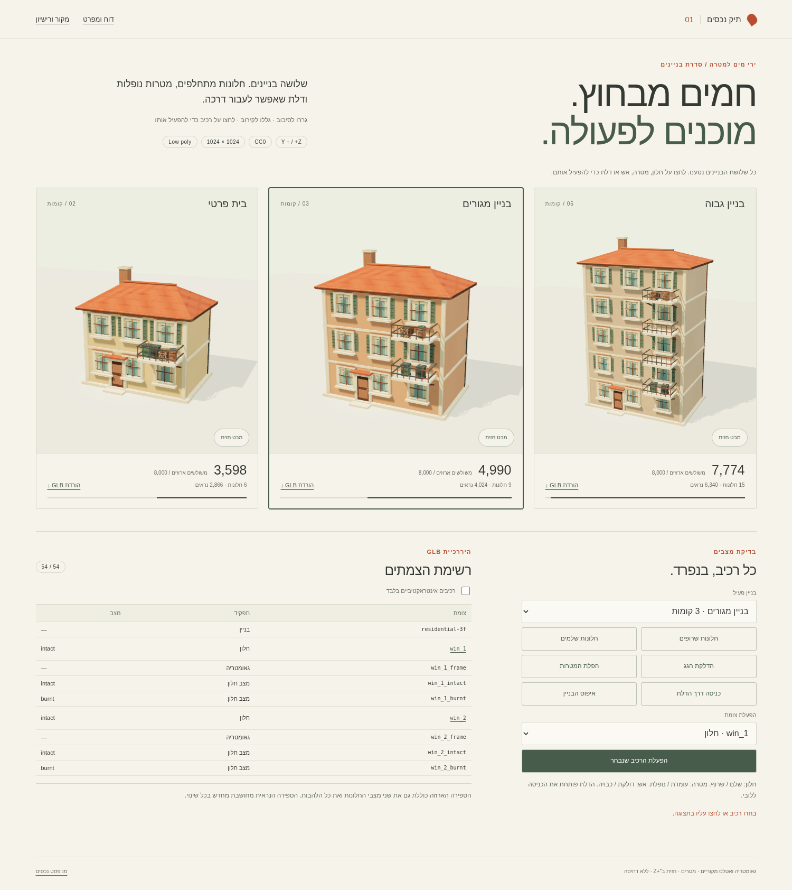
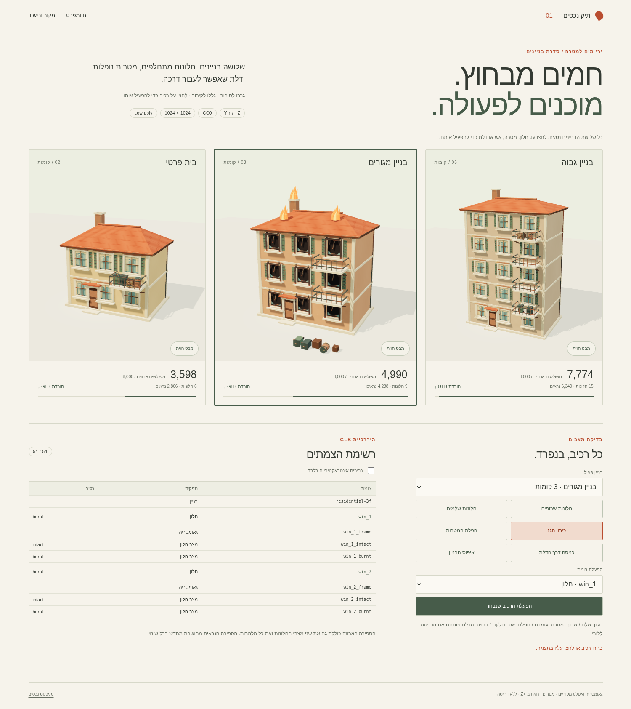
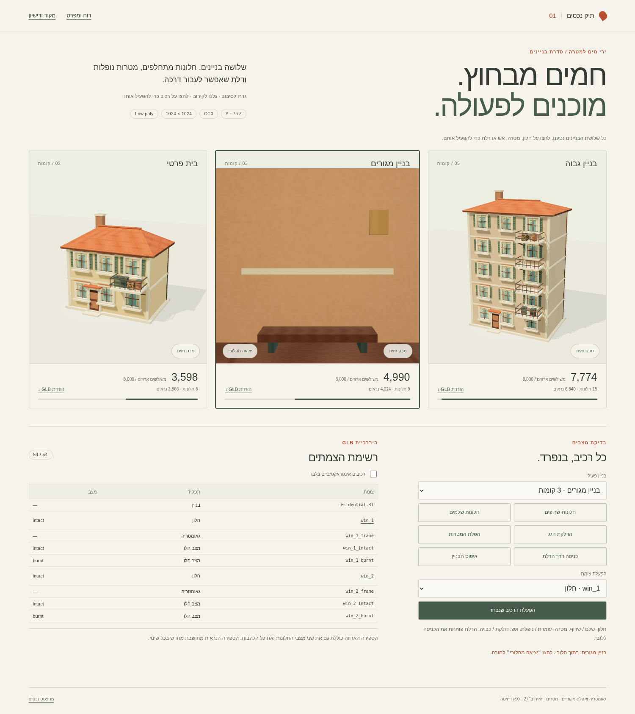
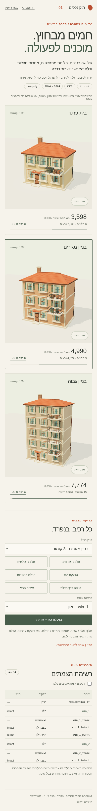

# בנייני כיבוי — fire-building-v1

שלושה בנייני GLB מקוריים ומוכנים לבחינת נכסים: בית פרטי בן שתי קומות, בניין מגורים בן שלוש קומות ובניין גבוה בן חמש קומות. החבילה כוללת חלונות עם שני מצבי גאומטריה, מטרות עם אנימציות נפילה, גגות עם ארובה ומוקדי אש, דלת כניסה ולובי קטן. כל הקבצים החדשים ברישיון CC0-1.0; המקורות מפורטים ב־[LICENSES.md](LICENSES.md).

תאריך: 13 בנובמבר 2026. בסיס הענף: `main`, קומיט `9c8ee743d3af5b27c3f6556f7bd2cb411b8b710b`. ענף: `codex/fire-building-v1`.

## פתיחת התצוגה

1. משורש עותק מקומי של המאגר, הפעילו שרת:

```sh
python3 -m http.server 8765
```

2. פתחו את [התצוגה המקומית](http://localhost:8765/workout/island/design/fire-building-v1/preview.html). שלושת הבניינים מוצגים יחד; הבניין האמצעי פעיל כברירת מחדל.
3. לחצו על חלון כדי להחליף מצב, על חפץ כדי להפיל אותו ועל הדלת כדי להיכנס. בלוח ההפעלה אפשר לבחור כל רכיב גם בלי לפגוע בו בעכבר, להדליק את הגג ולאפס את הבניין. גרירה מסובבת, גלילה מקרבת, ומקשי החצים פועלים כאשר הקנבס ממוקד. יציאה מהלובי זמינה בכפתור או במקש Escape.

הדף משתמש רק בקובצי החבילה ובספריות הקיימות במאגר, בלי בקשות ל־CDN. יש לפתוח אותו דרך HTTP כדי לטעון מודולים וקבצים בינריים. כל GLB ניתן להורדה בנפרד מתוך הדף וכולל את האטלס בתוכו.



## מידות ותקציב

| נכס | קומות | חלונות חזית | משולשים בתחילת התצוגה | משולשים ארוזים, כל המצבים | גודל בבתים | צמתים / אנימציות |
| --- | ---: | ---: | ---: | ---: | ---: | ---: |
| [private-2f.glb](private-2f.glb) | 2 | 6 | 2,866 | **3,598** | 981,588 | 42 / 30 |
| [residential-3f.glb](residential-3f.glb) | 3 | **9** | 4,024 | **4,990** | 1,092,580 | 54 / 36 |
| [highrise-5f.glb](highrise-5f.glb) | 5 | 15 | 6,340 | **7,774** | 1,315,328 | 78 / 48 |

הספירה המחמירה כוללת כל מופע mesh, את שני מצבי כל חלון, מרפסות, שני פחים, שני ארגזים, חבית, דלת, לובי ו־264 משולשי להבות בכל בניין. גם הבניין הגבוה עומד ברף 8,000 עם 226 משולשים פנויים. שני מצבי החלון מכילים אותו מספר משולשים, ולכן החלפתם אינה משנה את הספירה הנראית. הדלקת שלוש הלהבות מוסיפה 264 משולשים נראים.

| נכס | מעטפת נראית בברירת מחדל, X × Y × Z במטרים | גובה קומה | מרפסות |
| --- | --- | ---: | ---: |
| בית פרטי | 9.96 × 9.73 × 8.69 | 3.20 | 1 |
| מגורים | 11.76 × 12.73 × 9.29 | 3.20 | 2 |
| גבוה | 12.36 × 18.78 × 9.69 | 3.20 | 4 |

המידות כוללות בליטות גג, ארובה, בסיס ומרפסות; להבות כבויות ומסלולי נפילה אינם נכללים במעטפת ההתחלתית. האטלס המשותף הוא PNG RGB בגודל **1024 × 1024**, ‏676,932 בתים, עם 16 אריחים ו־8 פיקסלים של שוליים לכל אריח. [atlas.json](atlas.json) מתאר את אזורי ה־UV. שני החומרים בכל GLB משתמשים באותה תמונה; חומר הלהבות כולל גם emissive.

מטר אחד במודל הוא מטר בעולם. ציר **Y כלפי מעלה**, החזית פונה ל־**+Z**, מרכז הבניין ב־X/Z הוא הראשית, ותחתית הבסיס ב־Y=0. הנכסים אינם כוללים מצלמות, אורות, שלד או דחיסת גאומטריה. הם אינם משתמשים ב־Draco או בהרחבת glTF כלשהי.

## חוזה הצמתים

השמות ייחודיים בתוך כל GLB וניתנים לאיתור באמצעות `getObjectByName`. רשימת כל הצמתים והאנימציות נמצאת ב־[manifest.json](manifest.json), ומוצגת גם בטבלת הצמתים בדף. האינטראקציות מתועדות ב־`node.extras`: סוג, פעולה, מצב התחלתי, שמות אנימציות ואזור פגיעה מקומי כאשר הוא מתאים.

| שם | מבנה ומצבים | שימוש |
| --- | --- | --- |
| `win_<n>` | קבוצת חלון עם `<name>_frame`, ‏`<name>_intact`, ‏`<name>_burnt` | כל חלון מטרה נפרדת. שלם: זיגוג אטום מסוגנן, מוטות עץ ווילונות גאומטריים מקופלים. שרוף: פיח, שברי זיגוג, מוט שבור ושאריות בד. המסגרת נשארת קבועה. |
| `fire_roof_1` עד `fire_roof_3` | נקודות חיבור מעל שני אזורי גג ומעל הארובה, עם ילד `<name>_flame` | מוקדי כיבוי ואפקט חלופי מקורי. `direction: [0,1,0]`, ‏`radius: 0.65`. בתחילה הלהבות כבויות. |
| `door_main` | mesh של הדלת, ראשית בציר השמאלי; `closed` / `open` | לחיצה יכולה לפתוח את הדלת ולהעביר מצלמה או שחקן לנקודת הכניסה. קיים פתח ממשי בקיר. |
| `entry_spawn`, `entry_focus` | צמתי מיקום ריקים | נקודת עיניים בתוך הלובי ויעד מבט פנימה. בתצוגה הדלת פותחת כניסה למצלמה. |
| `target_bin_green`, `target_bin_ash` | שני פחים נפרדים | `upright` / `fallen`. |
| `target_crate`, `target_crate_small` | שני ארגזי עץ נפרדים, בגדלים שונים | `upright` / `fallen`. |
| `target_barrel` | חבית נפרדת | `upright` / `fallen`. |
| `building_shell`, `balconies`, `roof_chimney` | גאומטריה קבועה | מעטפת עם פתחים אמיתיים, רצפות פנימיות, מרפסות עם מעקות וגג רעפים עם ארובה חלולה. |

מספור החלונות מתחיל בקומה התחתונה, מ־X שלילי ל־X חיובי, ואז עולה קומה. בבניין הראשי: `win_1`–`win_3` למטה, `win_4`–`win_6` באמצע, `win_7`–`win_9` למעלה. בכל שלוש הגרסאות יש שלושה חלונות בכל קומת חזית. אין חלונות נוספים בצדדים או מאחור.

כל חמש המטרות מתחילות על מרפסת. בבית הפרטי הן חולקות מרפסת אחת; במגורים ובגבוה הפחים בקומה השנייה, והארגזים והחבית במרפסת העליונה. הארגז הקטן נמצא בשורה אחורית כדי למנוע חפיפה. במצב `fallen` המטרות פרושות בנקודות נחיתה נפרדות בחזית, עם מרווח 0.90 מטר בציר X, והתחתית שלהן 0.025 מטר מעל הקרקע.

## הפעלת המצבים

אלה אנימציות glTF 2.0 רגילות, ולא מידע שמובן רק לדף התצוגה:

- חלון: `win_<n>__burnt` ו־`win_<n>__intact`. ערוצי `scale` באינטרפולציית `STEP` מחליפים בין `[1,1,1]` ו־`[0,0,0]` בשני ילדי המצב. אורך כל מעבר 0.12 שניות. מצב התחלתי: `intact`.
- מטרה: `target_<name>__fall` מפעיל תנועה וסיבוב לאורך 1.35 שניות. המסלול עולה מעל המעקה, נופל ומגיע לתנוחת `fallen`; ‏`target_<name>__upright` מחזיר למיקום ולסיבוב המקוריים. תנוחות הקצה המלאות נמצאות גם ב־`extras.states`.
- דלת: `door_main__open` / `door_main__close`, סיבוב 105 מעלות בציר Y לאורך 0.65 שניות. מצב התחלתי: סגור.
- גג: `fire_roof_<n>__on` / `fire_roof_<n>__off`, החלפת `scale` של ילד הלהבה. מצב התחלתי: כבוי. צומת החיבור נשאר פעיל גם כאשר הלהבה כבויה.

לטוען המשחק: להפעיל קליפ פעם אחת עם שמירת הפריים האחרון, ולעצור את הפעולה הקודמת של אותו רכיב לפני החלפה. ב־Three.js משתמשים ב־`LoopOnce` וב־`clampWhenFinished = true`. אפשר להפעיל רכיבים שונים במקביל. אין למזג או להסיר צמתים בעלי קנה מידה אפס במהלך הכנת הנכס, משום שהם מכילים את המצבים החלופיים. ספירת משולשים נראים צריכה לכבד גם קנה מידה אפס אצל הורה.

התצוגה מחליפה חלונות ולהבות מיידית ומנגנת את נפילת המטרות. היא מכבדת העדפת תנועה מופחתת. `hitBox` במרחב המקומי נועד לחיבור לפגיעות מים; הלחיצה בתצוגה משתמשת ב־raycast בגאומטריה ובעלייה להורה האינטראקטיבי. במימוש המשחק יש לסנן גם צמתים בקנה מידה אפס ולהתחשב בחסימה על ידי קיר או מעקה.

מסלול הנפילה ארוז מראש לצורך הדגמה ושימוש כאנימציה; הוא אינו מנוע פיזיקה. קוד המשחק, ניקוד, התנגשות שחקן ומעבר שלבים אינם משתנים בחבילה זו.





## אימות

- **Khronos glTF Validator, גרסה `2.0.0-dev.3.10`:** אפס שגיאות, אזהרות, הודעות מידע או רמזים בכל שלושת קובצי ה־GLB. זוהתה תמונה מוטמעת אחת בגודל 1024 × 1024 בכל קובץ, ושתי הגדרות חומר.
- **Chromium עם WebGL/SwiftShader:** שלושת הקבצים נטענו יחד. הספירה מתוך `BufferGeometry` התאימה למניפסט, כולל משולשי מצבים מוסתרים. לא התקבלו שגיאות JavaScript או טעינה בקונסולה.
- **מצבים חוזרים:** כל אחד מ־30 החלונות בכל שלוש הגרסאות עבר ארבע החלפות, עם אימות קנה המידה של שני ילדי המצב. כל אחת מ־15 המטרות עברה נפילה/איפוס חוזרים, עם אימות מיקום, סיבוב ומרווח הקרקע לפי הקודקודים בפועל. כל תשעת מוקדי האש עברו הדלקה/כיבוי חוזרים; הדלתות עברו פתיחה/סגירה וכניסה/יציאה. איפוס החזיר את הספירות ההתחלתיות.
- **פעולות בתצוגה:** לחיצה על גאומטריית חלון ועל גאומטריית דלת, החלפות גורפות, נפילה מונפשת, בחירת בניין, סינון טבלת צמתים, הפעלת מטרה מתוך הרשימה וסיבוב במקלדת.
- **פריסות:** שולחן עבודה 1500 × 1100, טלפון 390 × 844 וטלפון לרוחב 844 × 390. אין גלילה אופקית של המסמך. שלושת הדגמים ממוסגרים במלואם, כולל מקום ללהבות ולנחיתה. הבדיקה מדמה גדלי מסך; אין כאן מדידת קצב פריימים בטלפון פיזי.
- **מקור ורישיון:** הגאומטריה והאטלס נוצרו מקומית, בלי נכסי צד שלישי ובלי כיתוב או מותגים על הבניינים. הספריות הקיימות של התצוגה מפורטות בנפרד ב־`LICENSES.md`.



## בנייה חוזרת וקבצים

משורש המאגר:

```sh
python3 workout/island/design/fire-building-v1/build_assets.py
```

הסקריפט משתמש רק בספרייה התקנית של Python 3. הוא מפיק את שלושת ה־GLB, האטלס ושני קובצי ה־JSON; אין צורך ב־Blender או בחבילות התקנה. הוא מאכף את רף 8,000 המשולשים בזמן הבנייה. חתימות SHA-256 של הנכסים ושל האטלס נמצאות ב־`manifest.json`.

הקבצים החדשים נמצאים כולם תחת `workout/island/design/fire-building-v1/`. אין שינויים בקוד קיים, בקובצי גרסה, בתגי מטמון, ב־`CLAUDE.md`, ב־`ops` או בקובצי בדיקות. התצוגה היא מסירת נכסים לבחינה; החיבור למשחק נשאר מחוץ ל־PR הזה.
