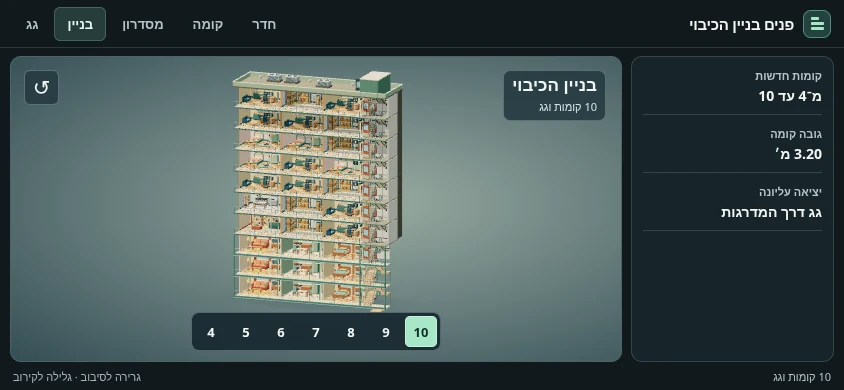

# פנים בניין הכיבוי · גרסה 3

18 בנובמבר 2026 · ענף `codex/fire-interiors-v3` מעל `codex/fire-multifloor-v2` בקומיט `8979e555`.

החבילה מוסיפה שבע קומות, גג, שישה סוגי חדרים ומצבי שריפה לתצוגת בניין הכיבוי של האי. התצוגה מרכיבה את קומות 1–3 מגרסה 2 עם ההרחבה. השינויים כוללים תוספות בלבד בתיקיית החבילה. [מניפסט](manifest.json) · [קובץ התצוגה](preview.html) · [רישיונות](LICENSES.md).



## מבנה וחדרים

| קומה | אגפים ממערב למזרח |
|---|---|
| 4 | חנות, מחסן, משרד |
| 5 | מטבח מסעדה, מחסן, משרד |
| 6 | משרד, משרד, מחסן |
| 7 | חדר ילדים, משרד, חדר ילדים |
| 8 | חדר ילדים, חדר ילדים, מחסן |
| 9 | משרד, משרד, מחסן |
| 10 | משרד, מחסן, משרד |

בכל קומה מסדרון ברוחב 2.20 מטר, שלוש דלתות לחדרים ודלת אש אל חדר המדרגות. שמונה מקטעי מדרגות מחברים את קומה 3 עד הגג בגובה 32 מטר. בכל מקטע 16 מדרגות, שני גרמים עם מעקות ומשטח סיבוב. דלת היציאה בגג מובילה לרחבת כינוס מסומנת. [מסדרון](evidence/corridor-844x390.webp) · [גג](evidence/roof-844x390.webp).

פיר המעלית משרת את קומות 4–10. התא חונה בקומה 4, שם אפשר לפתוח את דלתותיו בתצוגה. בעירה פעילה באחת הקומות סוגרת את התא ונועלת את הכפתור. נתיב היציאה עובר במדרגות. [תא המעלית הפתוח](evidence/elevator-844x390.webp).

| חדר | פריטים עם מצבי שריפה | משולשים בקובץ, כולל נזק | קובץ | צילום |
|---|---:|---:|---|---|
| חדר ילדים | 8 | 5,340 | [דגם](models/kids-room.glb) | [תצוגה](evidence/kids-room-844x390.webp) |
| משרד | 8 | 4,812 | [דגם](models/office.glb) | [תצוגה](evidence/office-844x390.webp) |
| חנות | 9 | 5,588 | [דגם](models/shop.glb) | [תצוגה](evidence/shop-844x390.webp) |
| מטבח מסעדה | 8 | 5,648 | [דגם](models/restaurant-kitchen.glb) | [תצוגה](evidence/restaurant-kitchen-844x390.webp) |
| מחסן | 8 | 4,912 | [דגם](models/storage.glb) | [תצוגה](evidence/storage-844x390.webp) |
| חדר מדרגות | 3 | 2,334 | [דגם](models/stairwell.glb) | [תצוגה](evidence/stairwell-844x390.webp) |

44 הפריטים בקובצי החדרים כוללים חלופות גאומטריות לנזק. אפשר להחליף מצב לחפץ יחיד או לחדר שלם. עשן קל מופיע בשכבת התקרה, בינוני גם בגובה האמצעי וכבד גם סמוך לרצפה. ההצפה עולה ומתנקזת לפי גובה שנבחר עד 32 ס״מ, ומציגה אדוות מתחת לרהיטים ובשטח הפנוי. [עשן כבד](evidence/smoke-heavy-844x390.webp) · [הצפה](evidence/flood-844x390.webp).

## הרצה מקומית

1. משורש המאגר מפעילים שרת קבצים.

   ```sh
   python3 -m http.server 8765
   ```

2. פותחים את [התצוגה המקומית](http://localhost:8765/workout/island/design/fire-interiors-v3/preview.html) בחלון 844×390. התצוגה נפתחת בחדר הילדים בקומה 7.
3. בוחרים מספר קומה ובוחרים מבט חדר, קומה, מסדרון, בניין או גג. בחדר או בקומה אפשר לבחור חפץ, מצב שריפה, עשן וגובה הצפה. במסדרון אפשר לסגור את הדלתות או להתמקד במעלית.
4. גוררים את המבנה לסיבוב ומשתמשים בגלגלת לקירוב. גם מקשי החיצים, פלוס ומינוס פועלים כשהקנבס ממוקד. מקש הבית מאפס את המצלמה.

## חוזה חיבור

- היחידות הן מטרים, Y למעלה ו־Z לחזית. המעטפת העליונה כוללת את הצמתים `shell_floor_4` עד `shell_floor_10` בגובה `(floor - 1) * 3.2`. מציבים את מופעי החדרים ואת גרמי המדרגות לפי `translation` במניפסט. המניפסט כולל את הספים, נקודות החילוץ, משטחי הסיבוב והדרך מקומה 3 עד נקודת הכינוס בגג.
- הצומת `burn_<name>` כולל שלושה ילדים ישירים. `intact_<name>` מוצג מלכתחילה, `burnt_<name>` נשמר בסקאלה אפס, ו־`fire_<name>` הוא עוגן מקומי. בעירה משתמשת בגאומטריה השלמה ובאפקט האש. במצב מפויח מסתירים את השלם ומשחזרים את הסקאלה של המפויח ל־`[1,1,1]`. חיפוש שמות מתבצע בתוך מופע החדר.
- בתצוגה חתוכה משתמשים בצמתים בעלי קידומת `cutaway_`. בזמן הרכבה מסתירים את `stair_top_landing` של מודול המדרגות ומקבלים במקומו את משטח הכניסה של הקומה הבאה או של הגג. במקטע מקומה 3 מסתירים גם את `stair_front_landing` כדי להשתמש במשטח הקיים של גרסה 2.
- האפקטים קוראים את מיקומי `smoke_ceiling`, `smoke_mid`, `smoke_low` ו־`flood_surface` ואת מידותיהם. מצב המעלית מוגדר ב־`building.elevator` וכן בנתוני הסף והדלתות בכל קומה. [מניפסט](manifest.json) · [מודול אפקטים](effects.mjs).

## אימות ומדידה

| בדיקה | תוצאה |
|---|---|
| תקציב החבילה | 2,789,333 בתים מתוך 8,000,000. שמונת הדגמים החדשים תופסים 2,275,516 בתים. |
| טעינת התצוגה | 6,311,763 בתים ייחודיים בטעינה, כולל התלויות המקומיות ונכסי גרסה 2. אפס פניות חיצוניות. |
| Khronos glTF Validator | שמונה דגמים חדשים וארבעה דגמי בסיס. אפס שגיאות, אזהרות, רמזים והודעות מידע. |
| פורמט | קובצי GLB עם גאומטריה בינארית רגילה ואפס הרחבות דחיסה. אפס קריאות ל־WebAssembly בבדיקה שבה הממשק הושבת. |
| גאומטריה | 212 נקודות דריכה ותמיכה נבדקו מול פאות הדגמים, לרבות 128 שלחים והמעבר לגג. |
| דפדפן | 62 בדיקות עברו ב־Chromium עם SwiftShader ובמידות 844×390 ו־390×844. נבדקו 88 מעברי חפצים, שלוש שכבות העשן בפיקסלים, הצפה וניקוז, נעילת המעלית, מקלדת ומגע. אפס תקלות ריצה, משאבים חסרים או חריגות ממדיניות האבטחה. |
| רגרסיית מאגר | `npm test` עם Chromium מותקן במערכת. 4,262 עברו, 64 דולגו, 0 נכשלו. |
| שחזור | בנייה חוזרת יצרה תשע טביעות SHA-256 זהות עבור שמונת הדגמים והמניפסט. |

[תוצאות Khronos](evidence/khronos.json) · [תוצאות הדפדפן והצילומים](evidence/browser.json).

המחולל משתמש ב־Python 3 ובקוד הגאומטריה הקיים במאגר. המאמת הרשמי מותקן מחוץ למאגר ואת נתיב המודול שלו מעבירים לסקריפט.

```sh
python3 -B workout/island/design/fire-interiors-v3/source/build.py
node workout/island/design/fire-interiors-v3/source/validate.mjs /path/to/gltf-validator/module.mjs
```
