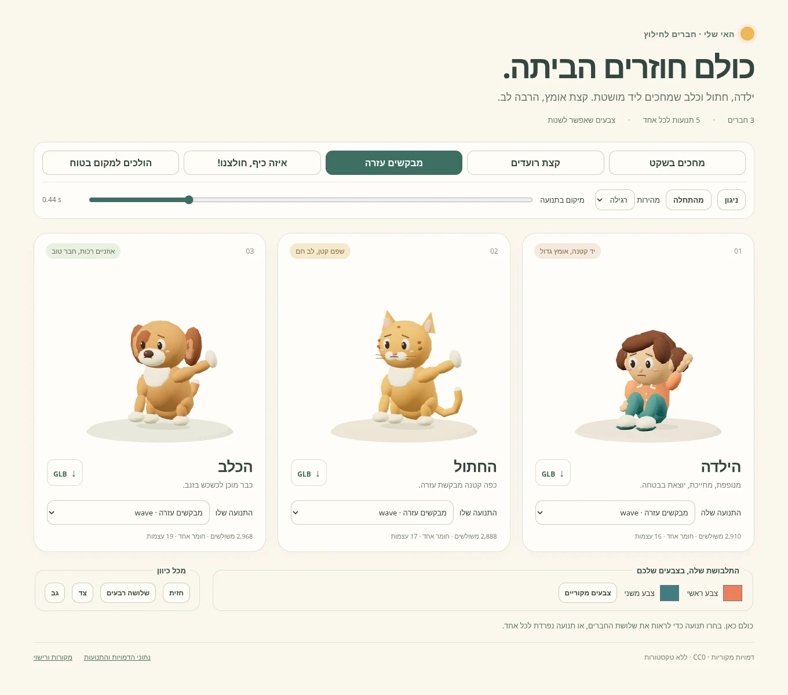
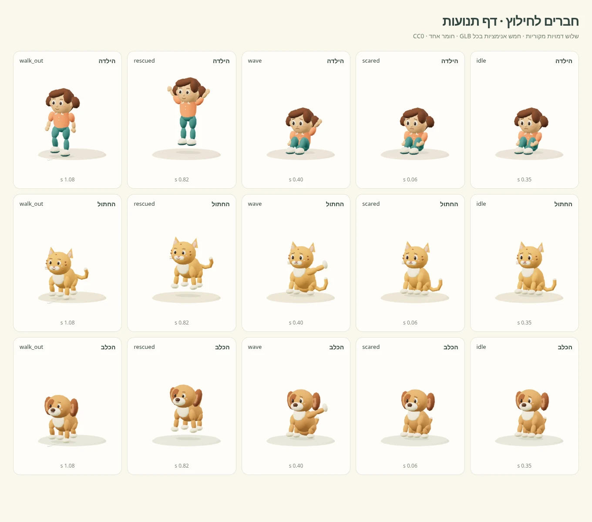

# חברים לחילוץ — Fire Rescue v1

שלוש דמויות מקוריות לילדים: ילדה בתלבושת אלמוג וטורקיז, חתול ג׳ינג׳י וכלב
בצבע דבש עם אוזניים שמוטות. פרופורציות רכות, עיניים חמות, חשש עדין והבעה שמחה
לאחר החילוץ. כל הגאומטריה, הצבעים, השלדים והאנימציות מקוריים וברישיון
[CC0-1.0](LICENSES.md).



## קבצים ותקציב

הנתונים נספרו מתוך ה־GLB המיוצא, כולל הפנים, השיער, השפם, הזנבות וכל פרטי
הלבוש. עצמות כוללות את `Root`. כל מודל הוא mesh אחד ו־primitive אחד.

| דמות וקובץ | משולשים | קודקודים | חומרים | עצמות | טקסטורות | גודל |
| --- | ---: | ---: | ---: | ---: | ---: | ---: |
| [ילדה — girl.glb](girl.glb) | 2,910 | 1,547 | 1 | 16 | 0 | 252,816 bytes / 246.89 KiB |
| [חתול — cat.glb](cat.glb) | 2,888 | 1,550 | 1 | 17 | 0 | 245,004 bytes / 239.26 KiB |
| [כלב — dog.glb](dog.glb) | 2,968 | 1,558 | 1 | 19 | 0 | 256,372 bytes / 250.36 KiB |

שלושתם מתחת ל־3,000 משולשים. צבעי `COLOR_0` במרחב linear RGB, חומר PBR אטום
יחיד בעל roughness של 0.86 ו־metallic של 0. אין תמונות, טקסטורות, Draco או
הרחבות glTF נדרשות. הנתונים אינם דחוסים. ספירות, משכים, גדלים ו־SHA-256
של קובצי המסירה נמצאים גם ב־[manifest.json](manifest.json).

## קליפים

כל חמשת הקליפים מוטמעים **בכל אחד משלושת קובצי ה־GLB**, באותם שמות בדיוק.

| קליפ | משך בכל דמות | ניגון | התנועה |
| --- | ---: | --- | --- |
| `idle` | 2.40 שניות | לולאה | ישיבה מכונסת, נשימה קטנה והטיית ראש; הילדה אוספת את ברכיה |
| `scared` | 1.50 שניות | לולאה | אותה ישיבה, רעד עדין של 4 מ״מ לצדדים ותנועת כתפיים וראש קטנה |
| `wave` | 2.00 שניות | לולאה | נשארים בישיבה ומנופפים ביד שמאל או בכפה קדמית לעזרה |
| `rescued` | 2.40 שניות | פעם אחת | קמים, מחייכים וקופצים פעמיים; זנבות מכשכשים, הילדה מרימה ידיים |
| `walk_out` | **1.50 שניות** | פעם אחת | קימה במשך 0.32 שניות ואחריה צעדים קדימה למקום בטוח |

`idle`, `scared` ו־`wave` נסגרים באותה תנוחה. ב־`rescued` וב־`walk_out` יש
להשתמש בניגון חד־פעמי ולשמור את פריים הסיום (`LoopOnce` ו־`clampWhenFinished`
ב־Three.js). הפעלת לולאה ב־`walk_out` תחזיר את הדמות לנקודת ההתחלה.

ב־`walk_out` תנועת ההתקדמות מוטמעת בעצם `Root`, בכיוון **+Z**:
הילדה מתקדמת **0.90 מ׳**, והחתול והכלב **0.76 מ׳** כל אחד. בעת חיבור למשחק,
יש לבחור אם להשתמש בתנועה המוטמעת או לחלץ אותה לתנועת הישות, כדי לא להכפיל
את מרחק ההליכה. `rescued` כולל ניתורים אנכיים של כ־0.15 מ׳ ב־`Root`.



## מערכת צירים ושלד

הקבצים במטרים, **Y למעלה**, פנים ב־**+Z**, קנה מידה 1 וללא סיבוב תיקון
בצומת ה־mesh. הרצפה היא Y=0. בתנוחת העמידה גובה הילדה כ־1.39 מ׳,
החתול עד קצות האוזניים כ־1.08 מ׳ והכלב כ־1.00 מ׳, בפרופורציות צעצוע מכוונות.

- ילדה: `Root → Hips → Spine → Head`, עם זרוע, אמה וכף יד לכל צד, וירך,
  שוק וכף רגל לכל צד.
- חיות: `Root → Hips → Spine → Head`, ארבע שרשראות רגל/שוק/כפה וזנב.
  לכלב שתי עצמות נוספות לאוזניים הרכות.
- Skin פשוט עם משקל מלא לעצם אחת בכל קודקוד, המתאים לחלקי הצעצוע המעוגלים.
  התנועות נאפו ב־24 דגימות לשנייה, עם אינטרפולציה `LINEAR`.
- שני morph targets, בשם `joy` ו־`blink`, מפעילים חיוך, הרפיית גבות ומצמוץ.
  גם הם מונפשים בתוך הקליפים. אין צורך בריג חיצוני או בקובצי אנימציה נפרדים.

## צבעי התלבושת של הילדה

הצבעים כבר נמצאים ב־`COLOR_0`. שתי מסכות קודקודים בלתי חופפות מאפשרות
להחליפם בלי להוסיף חומר ובלי להסתמך על התאמת גוון משוערת.

| אזור | מאפיין glTF | צבע התחלתי sRGB | קודקודים |
| --- | --- | --- | ---: |
| `uniform_primary` | `_UNIFORM_PRIMARY` | `#EC805E` — אלמוג | 116 |
| `uniform_secondary` | `_UNIFORM_SECONDARY` | `#417E83` — טורקיז | 238 |

השמות והצבעים נשמרים גם ב־`meshes[0].extras.colorRegions` ובמניפסט.
ה־GLTFLoader הקיים ממפה את המאפיינים לשמות `_uniform_primary` ו־
`_uniform_secondary` בתוך `BufferGeometry`. כל ערך מסכה הוא 0 או 1.

הכלי [recolor.js](recolor.js) מקבל צבעי sRGB, ממיר אותם ל־linear RGB ומעדכן
רק את האזור הנבחר. שאר **1,193** קודקודי הילדה שומרים על צבעיהם המקוריים.
הוא אינו משנה את החומר או את מספר הקריאות לציור.

```js
import {applyUniform} from './recolor.js';

applyUniform(gltf.scene, {
  uniform_primary: '#EA7652',
  uniform_secondary: '#347C83'
});

// החזרת שני האזורים לצבעים המקוריים:
applyUniform(gltf.scene);
```

## פתיחת התצוגה

1. מתוך שורש המאגר, הפעילו שרת HTTP מקומי:

   ```sh
   python3 -m http.server 8765
   ```

2. פתחו את [preview.html בשרת המקומי](http://localhost:8765/workout/island/design/fire-rescue-v1/preview.html).
3. בחרו אחד מחמשת כפתורי התנועה כדי להפעילו בכל שלוש הדמויות. אפשר לבחור
   תנועה שונה בכל כרטיס, להשהות, להזיז את ציר הזמן, להאט, לצפות מהצד ומהגב
   ולשנות את שני צבעי התלבושת. קישורי GLB בכרטיסים מורידים את אותם קבצים
   שמוצגים על המסך.

התצוגה טוענת את ה־GLB בפועל ואת ספריות Three.js שכבר קיימות במאגר.
היא פועלת גם ללא חיבור חיצוני לאחר הגשת המאגר משרת מקומי. במצב מערכת
`prefers-reduced-motion: reduce` היא מתחילה מושהית. קבצי התצוגה נפרדים
מקוד המשחק ומותאמים גם למסך ברוחב 390 פיקסלים.

## מקור ושחזור

[source/build_assets.py](source/build_assets.py) מכיל את הגאומטריה, הריגים,
הצבעים, ההבעות, פתרון הרגליים, נתוני התנועה וייצוא ה־GLB. נדרש Python 3
עם הספרייה התקנית בלבד. ליצירה מחדש, מתוך שורש המאגר:

```sh
python3 workout/island/design/fire-rescue-v1/source/build_assets.py
```

הפקודה יוצרת מחדש את שלושת קובצי ה־GLB ואת המניפסט. היצירה דטרמיניסטית,
בלי הורדות, חותמות זמן משתנות או נתונים אישיים. הרישיונות והמקורות לכל
קובץ בחבילה מפורטים ב־[LICENSES.md](LICENSES.md).

## אימות המסירה — 2026-11-13

- Khronos glTF Validator, גרסה `2.0.0-dev.3.10`: **0 שגיאות, 0 אזהרות,
  0 הערות ו־0 רמזים** בכל אחד משלושת קובצי ה־GLB.
- Chromium 151 עם WebGL: כל שלוש הדמויות וכל 15 שילובי דמות/קליפ נטענו
  והוערכו לאורך ציר הזמן. בכל הדגימות בדף שולחן העבודה כל הקודקודים נשארו
  בתוך המסגרת. סטיית מטריצות העצמות בין קצות הלולאות קטנה מ־0.000006.
- נבדקו שינויי צבע בשני האזורים: **0 שינויים בקודקודים מחוץ למסכות**,
  שגיאת צבע קטנה מ־0.00000003 והחזרה מדויקת לצבעי הבסיס.
- נבדקו גלילה ומבנה מסך ברוחב 390 פיקסלים, ללא גלילה אופקית, התחלה מושהית
  בהעדפת תנועה מופחתת וגרירת ציר הזמן אחרי סיום קליפ חד־פעמי.
- שינוי גודל מעדכן את התמונה גם כשהניגון מושהה. נבדקו טעינה ללא בקשות
  שנכשלו וללא שגיאות JavaScript. [תצוגה כללית](overview.webp) ו־
  [דף התנועות](motion-sheet.webp) צולמו מהמודלים שנמסרו.
- יצירה חוזרת של שלושת המודלים והמניפסט הפיקה קבצים זהים בבייטים.
- `npm test`: מתוך 3,951 בדיקות, 3,886 עברו ו־64 דולגו. בדיקת הדפדפן הקיימת
  ב־`tests/workout-royiki.test.mjs` נכשלה בהפעלת Playwright משום שקובץ
  `chromium_headless_shell-1234` אינו מותקן בסביבה. כל חמש הבדיקות באותו
  קובץ, כולל בדיקת הדפדפן, **עברו בהרצה נפרדת עם Chromium המערכתי**, באמצעות
  מתאם `ISLAND_PLAYWRIGHT` זמני מחוץ למאגר. לא נערכו קובצי בדיקות או קוד קיים.
- נשמרה מסגרת העבודה: קבצים חדשים בלבד תחת `workout/island/design/fire-rescue-v1/`.
