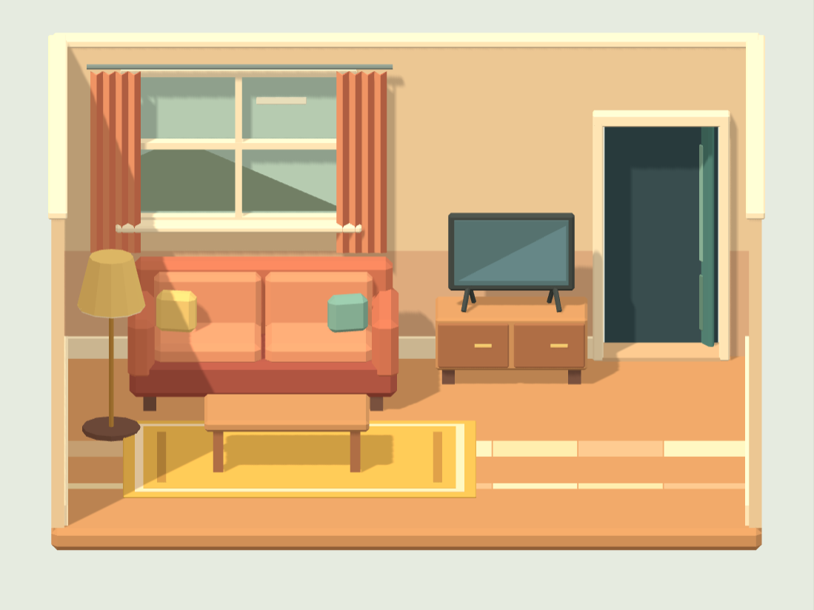
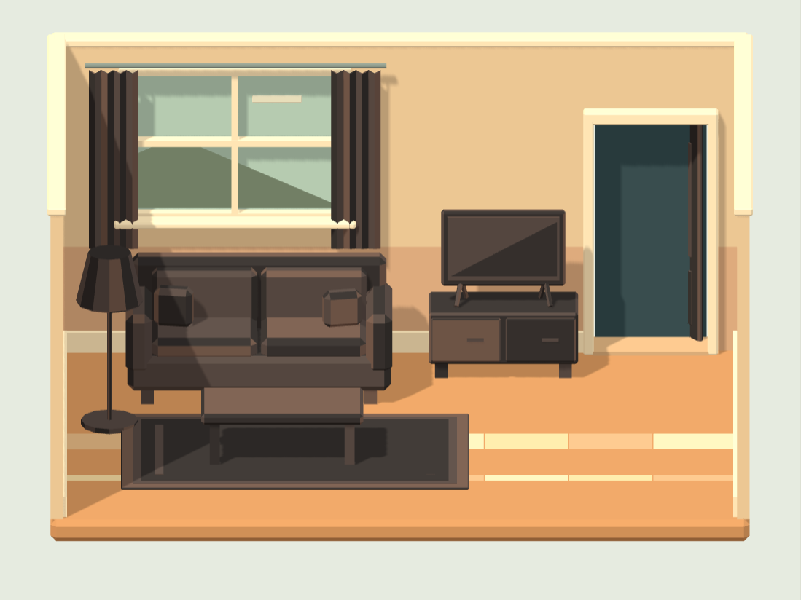
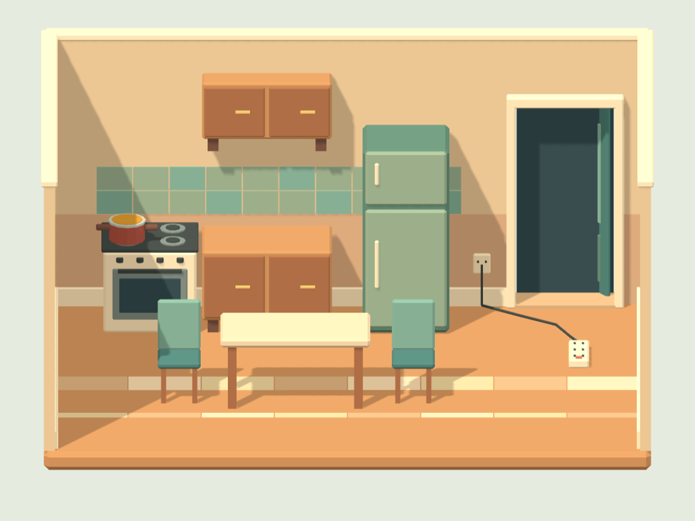
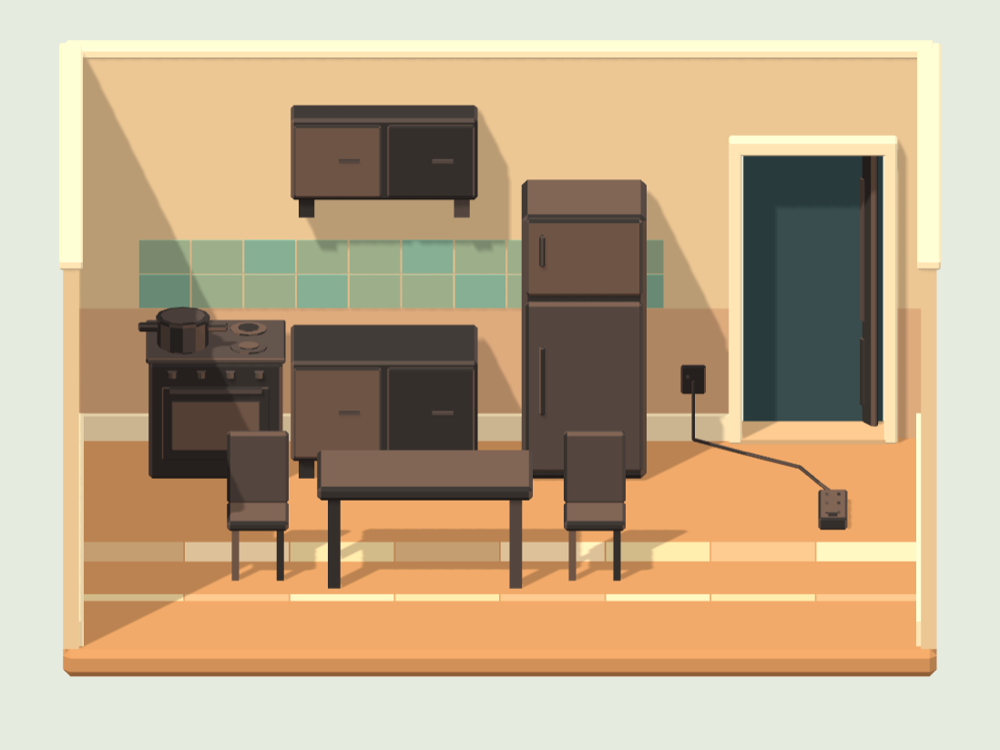
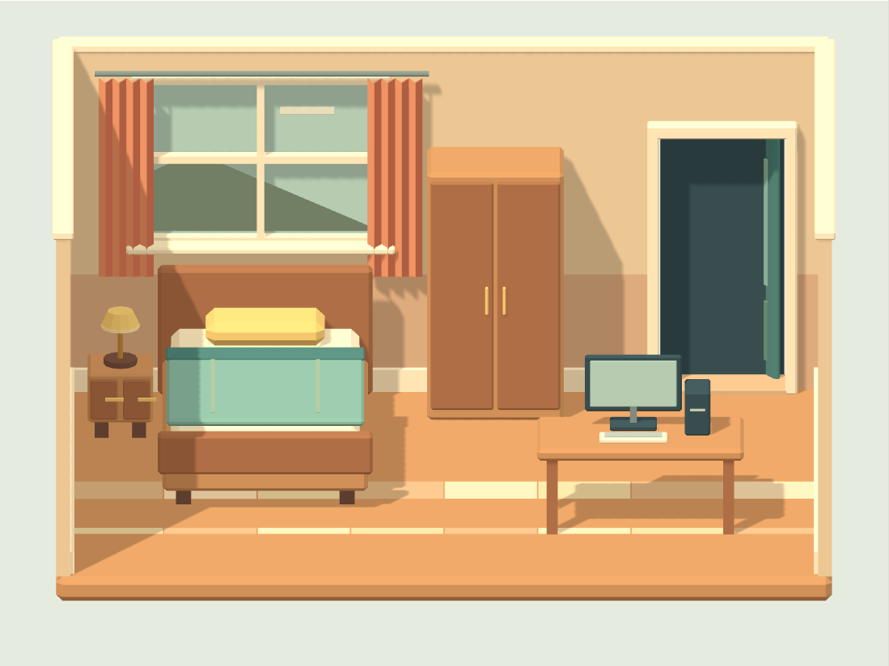
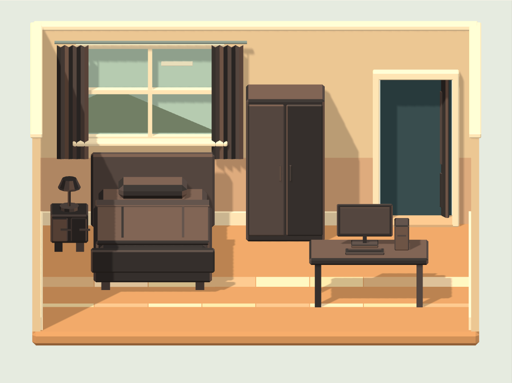

# חדרי כיבוי v1 — דוח מסירה

13 בנובמבר 2026 · ענף `codex/fire-rooms-v1` · בסיס `main` בקומיט `9c8ee743`.

שלושה חדרי GLB מקוריים בסגנון low poly חם, בצבעים שטוחים, למסך קבוע בתוך בניין. לכל חדר חזית פתוחה, מצלמה אורתוגרפית כלולה, חפצים נפרדים עם מצב שלם ומצב מפויח, מוקדי אש ונקודות חילוץ ויציאה. כל הקבצים החדשים בחבילה ברישיון CC0-1.0; המקורות מפורטים ב־[LICENSES.md](LICENSES.md).

## קבצים ותקציב

| חדר | קובץ | משולשים במצב פעיל | משולשים בקובץ, כולל שני המצבים | צמתי `burn_` | כלל הצמתים | גודל GLB |
|---|---|---:|---:|---:|---:|---:|
| סלון | [living-room.glb](living-room.glb) | 2,696 | 4,173 | 9 | 41 | 321,004 בתים / 313.5 KiB |
| מטבח | [kitchen.glb](kitchen.glb) | 3,352 | 5,604 | 11 | 49 | 419,632 בתים / 409.8 KiB |
| חדר שינה | [bedroom.glb](bedroom.glb) | 2,871 | 4,523 | 12 | 53 | 355,096 בתים / 346.8 KiB |

התקציב של 6,000 משולשים נבדק מול **כל הגאומטריה בכל קובץ**, כולל אדריכלות ושני עותקי המצב של כל חפץ. במצב רגיל רק עותק אחד של כל חפץ מוצג. פיח מחליף צבעים באמצעות UV לאותו אטלס ושומר על הצורה; אין אנימציות הרס או להבות אפויות.

אטלס יחיד משותף: [palette-1024.png](palette-1024.png), בגודל 1024×1024, RGB אטום, 10,403 בתים. זהו לוח צבעים שטוחים עם דגימת nearest, ללא צילומים, כיתוב, אותיות או מותגים. לכל חדר חומר glTF אחד, roughness של 1 ו־metallic של 0. כל הגאומטריה, UV והנורמלים נשמרים כנתונים רגילים ללא Draco, Meshopt, KTX או הרחבות נדרשות.

**יש לשמור את `palette-1024.png` באותה תיקייה של שלושת קובצי ה־GLB.** הגאומטריה מוטמעת בכל GLB, והתמונה מופנית ב־URI יחסי כדי לא לשכפל את האטלס בשלושה קבצים. הורדת GLB בודד מחייבת גם את הורדת האטלס.

## תכולת החדרים

| חדר | חפצים וצמתי הורה |
|---|---|
| סלון | `burn_sofa`, `burn_coffee_table`, `burn_tv_console`, `burn_television`, `burn_curtain_left`, `burn_curtain_right`, `burn_floor_lamp`, `burn_rug`, `burn_door` |
| מטבח | `burn_stove`, `burn_oil_pot`, `burn_base_cabinet`, `burn_wall_cabinet`, `burn_kitchen_table`, `burn_refrigerator`, `burn_chair_left`, `burn_chair_right`, `burn_electrical_outlet`, `burn_power_strip`, `burn_door` |
| חדר שינה | `burn_bed`, `burn_mattress`, `burn_wardrobe`, `burn_desk`, `burn_computer`, `burn_curtain_left`, `burn_curtain_right`, `burn_blanket`, `burn_pillow`, `burn_nightstand`, `burn_bedside_lamp`, `burn_door` |

בסלון ובחדר השינה יש חלון אחורי עם מסגרת מתכת, נוף גאומטרי ושני וילונות נפרדים. במטבח נבחרו שקע ומפצל חשמל עם כבל. סיר השמן הוא חפץ נפרד מהכיריים. בחדר השינה המזרן נפרד ממסגרת המיטה, וגם הכרית והשמיכה נפרדות. לרהיטים צלליות עם פאות משופעות, קפלי וילון וגופי תאורה מצולעים; אין טקסטורות תאורה אפויות.

המעטפת הקבועה היא אבן, טיח ומסגרות מתכת, בצומת `architecture_stone_plaster_metal`. הדלת היא חפץ דליק נפרד ונפתחת אל המסדרון שמעבר לקיר האחורי. המעבר ליציאה ונקודת החילוץ פנויים מרהיטים. מוקדי החשמל והשמן מסומנים במטא־נתונים כ־`electrical` ו־`cooking_oil`; החבילה מספקת נכסים בלבד ואינה קובעת כללי כיבוי.

## מידות ומצלמה

| שדה | ערך |
|---|---|
| יחידות | מטרים |
| צירים | Y למעלה, חזית פתוחה ב־+Z, קיר אחורי ב־−Z |
| נקודת האפס | מרכז הרצפה, `[0, 0, 0]`; פני הרצפה ב־Y=0 |
| שטח פנימי | רוחב 6.4 מטר, עומק 4.6 מטר |
| גובה קירות | 3.12 מטר; תקרה וחזית פתוחות למצלמה |
| `camera_game` | מצלמה אורתוגרפית קבועה בכל GLB |
| מיקום מצלמה | `[0, 5.4, 11]` |
| יעד | `[0, 1.35, 0]`, ללא סיבוב לצדדים |
| הטיה כלפי מטה | כ־20.21 מעלות |
| מסגור | יחס 4:3; גובה 5.7 מטר; `near=0.1`, `far=40` |

ה־preview משתמש ישירות במצלמה הכלולה בכל GLB. אין OrbitControls או שינוי זווית בהגדלה; הגדלה וטלפון שומרים על יחס 4:3 ועל אותו מסגור. זו מצלמת המסירה למסך הפנים החדש; לא שונה הקוד או המצלמה של משחק הכבאית הקיים.

| חדר | `rescue_spot` | `door_exit` |
|---|---|---|
| סלון | `[1.77, 0, 1.08]` | `[2.38, 0, -2.42]` |
| מטבח | `[2.18, 0, 1.32]` | `[2.38, 0, -2.42]` |
| חדר שינה | `[0.15, 0, 1.55]` | `[2.38, 0, -2.42]` |

שתי הנקודות הן צמתים ריקים, ללא mesh. `rescue_spot` כולל `clearRadius: 0.35`; `door_exit` מציין את סף הדלת ואת הכיוון החוצה `[0,0,-1]`. הנקודות מיועדות להצבת ילד/חיה ולחיבור יציאה; דמויות אינן כלולות.

## חוזה צמתים ומצבים

דוגמה בסלון:

```text
room_living-room
  burn_sofa
    intact_sofa   [mesh]
    burnt_sofa    [mesh; scale = 0,0,0 כברירת מחדל]
    fire_sofa     [empty; מיקום מקומי של האש]
  ...
  architecture_stone_plaster_metal
  rescue_spot     [empty]
  door_exit       [empty]
  camera_game     [camera]
```

לכל אחד מ־32 החפצים הדליקים יש הורה ייחודי `burn_<name>` ושלושה ילדים ישירים: `intact_<name>`, `burnt_<name>` ו־`fire_<name>`. שמות הצמתים ייחודיים בתוך כל GLB. `extras` של ההורה כוללים `label`, `category`, `intactNode`, `burntNode`, `fireNode` ו־`defaultState`. מטא־נתונים אלה נטענים ל־`Object3D.userData` ב־three.js.

ב־glTF אין דגל visibility תקני. לכן שני המצבים נכללים בקובץ, והצומת המפויח נשמר ב־scale אפס כדי שהחדר ייפתח שלם גם בטעינה רגילה. להפעלת המצב המפויח יש להחזיר אותו ל־`[1,1,1]` ולהסתיר את המצב השלם. `extras.restScale` של הצומת המפויח מכיל את הסולם לשחזור. ב־preview המצב הלא פעיל מקבל גם `visible=false`, ולכן אינו נכנס למונה המשולשים המוצגים.

```js
const item = room.getObjectByName('burn_sofa');
const intact = item.getObjectByName(item.userData.intactNode);
const burnt = item.getObjectByName(item.userData.burntNode);
intact.visible = false;
burnt.scale.fromArray(burnt.userData.restScale);
burnt.visible = true;

room.updateMatrixWorld(true);
const fireWorld = new THREE.Vector3();
item.getObjectByName(item.userData.fireNode).getWorldPosition(fireWorld);
```

`fire_<name>` אינו mesh ואין לו ילדים; המיקום שלו יחסי להורה `burn_`. הוא אינו זז כאשר מחליפים את מצב הרהיט. [manifest.json](manifest.json) כולל לכל חפץ את מיקום האש המקומי והעולמי ואת ספירת המשולשים למצב.

## פתיחת התצוגה

1. משורש המאגר מריצים שרת קבצים:

   ```sh
   python3 -m http.server 8765
   ```

2. פותחים את [preview.html בשרת המקומי](http://localhost:8765/workout/island/design/fire-rooms-v1/preview.html).
3. שלושת החדרים אמורים להופיע, עם מונה משולשים פעילים, מונה כולל, מספר חפצים ורשימת כל הצמתים. אפשר להחליף מצב לכל חדר, לכל החדרים, בלחיצה על חפץ או דרך רשימת הצמתים. סימון נקודות מציג אש, חילוץ ויציאה; רשת משולשים מסייעת לביקורת גאומטריה.

הדף משתמש ב־three.js וב־GLTFLoader הקיימים ב־`../../vendor/`, ללא CDN, import map, Draco או WebAssembly. מדיניות CSP מקומית מגבילה סקריפטים וחיבורים ל־self ואינה מתירה eval או wasm. אין לולאת אנימציה; רינדור מתבצע בטעינה, בשינוי מצב ובשינוי גודל.

## אימות

| בדיקה | תוצאה |
|---|---|
| Khronos glTF Validator `2.0.0-dev.3.10` | שלושת הקבצים: 0 שגיאות, 0 אזהרות |
| הודעת מידע של המאמת | `URI_GLB`, אחת לחדר: האטלס חיצוני במכוון; אין כשל תאימות |
| תקציב ורכיבים | ספירת משולשים מה־accessors, חומר אחד, תמונה משותפת, מצלמה ו־32 קבוצות מצב — עבר |
| צמתים ריקים | 32 מוקדי אש, שלוש נקודות חילוץ ושלושה ספי יציאה — עבר |
| Chromium `151.0.7922.173` | שלושת החדרים נטענו; הספירות המוצגות שוות לספירות הרינדור בפועל |
| מעברים פרטניים | 64 מעברים: שלם → מפויח → שלם לכל 32 החפצים — עבר |
| תפעול | בחירה בקנבס, מצבים כלליים, הגדלה, נקודות עזר ורשת משולשים — עבר |
| מסגור | 1440×1000, 390×844 ו־844×390; ללא גלילה אופקית; יחס 4:3 נשמר |
| CSP ורשת | 0 הפרות CSP, 0 שגיאות דפדפן, 0 תגובות HTTP כושלות, 0 פניות חיצוניות |
| WebAssembly | מתודות compile/instantiate הושבתו בזמן ההרצה; 0 קריאות וכל החדרים פעלו |
| רינדורים | שש תמונות של הקנבס בלבד, שלם ומפויח לכל חדר; ללא כיתוב, אותיות או מותגים |
| שחזור | המקור מייצר את שלושת ה־GLB, האטלס והמניפסט באופן דטרמיניסטי; SHA-256 במניפסט |
| בדיקות המאגר הקיימות | `node --test tests/*.mjs`: עברו 3,886, דולגו 64, כשל אחד בגלל Chromium של Playwright שאינו מותקן בסביבה |
| בירור והרצה חוזרת | `tests/workout-royiki.test.mjs` הורץ שוב עם Chromium המותקן במערכת דרך `ISLAND_PLAYWRIGHT`: עברו כל 5 הבדיקות, כולל בדיקת הדפדפן שנחסמה; 0 כישלונות |

תוצאות המדידה מפורטות ב־[verification.json](verification.json). הכשל היחיד בהרצה הכללית היה בעת הפעלת דפדפן, לפני ניווט למסך האימון הקיים. ההרצה החוזרת השתמשה במתאם סביבתי זמני מחוץ למאגר וב־`/usr/bin/chromium`; לא שונו בדיקות או קוד יישום. בדיקות העזר של הנכסים הורצו גם הן מחוץ למאגר. בדיקת טלפון פיזי וחיבור ללוגיקת המשחק אינם חלק ממסירת הנכסים הזאת.

## רינדורים מהמצלמה הכלולה

| חדר | שלם | מפויח |
|---|---|---|
| סלון |  |  |
| מטבח |  |  |
| חדר שינה |  |  |

## מקור והיקף שינוי

לשחזור הנכסים, מכל תיקייה:

```sh
python3 /path/to/Bakasun/workout/island/design/fire-rooms-v1/source/build_rooms.py
```

נוספו קבצים רק בתוך `workout/island/design/fire-rooms-v1/`. קוד קיים, `release.json`, תגי גרסה, `CLAUDE.md`, `ops/` וקובצי הבדיקות לא שונו. התלות המקומית של three.js נשארת ברישיון MIT המקורי שלה ומוזכרת בקובץ הרישיונות. המסירה מיועדת ל־PR טיוטה אל `main`.
