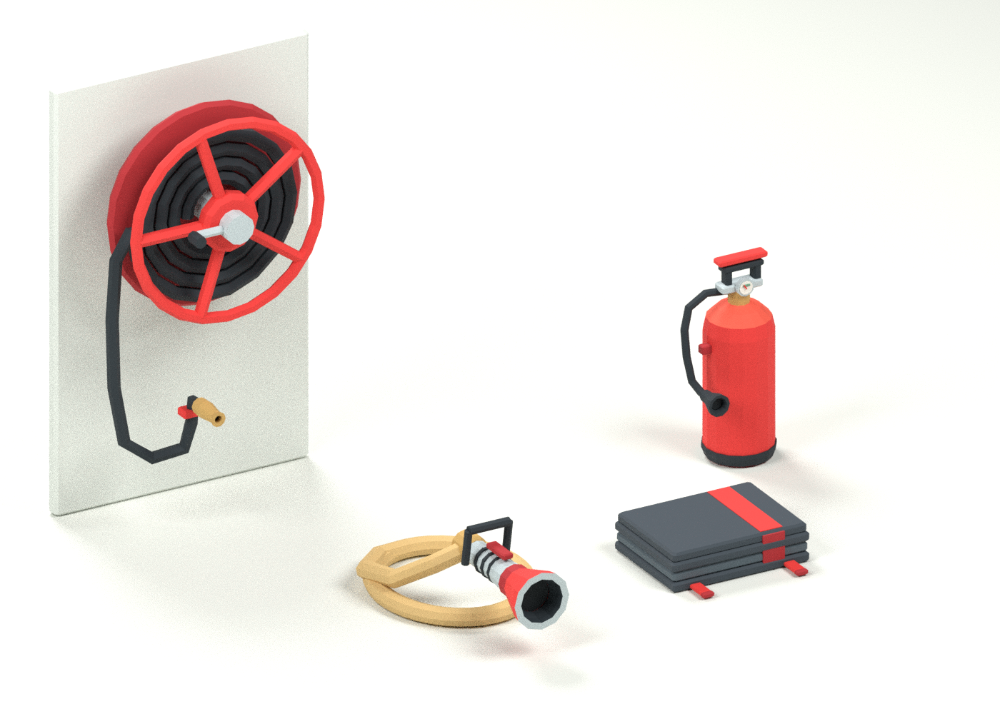
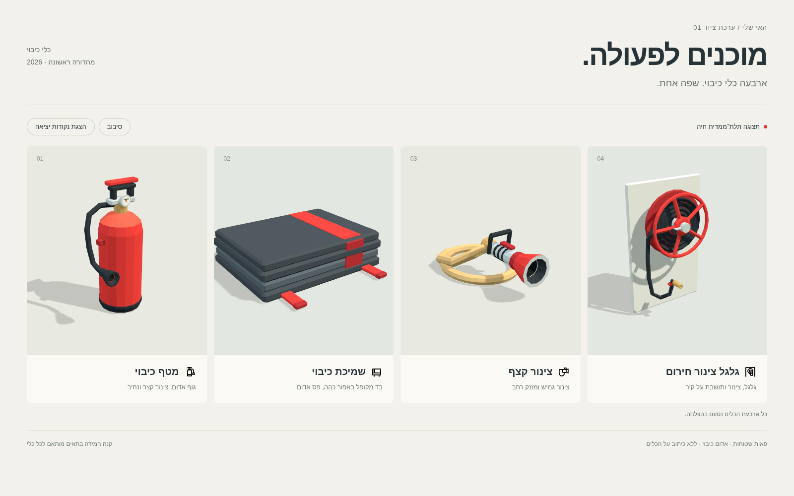

# כלי כיבוי · האי שלי

ארבעה נכסים מקוריים, אייקוני כפתורים ותצוגת ביקורת. נוצרו ב־12.11.2026 בענף `codex/fire-tools-v1`, מבסיס `main` בקומיט `51f4faab518c695672efaf6323a8b72f239a2b84`. החבילה מוסיפה קבצים רק בתיקייה זו.

| נושא | תג | מוכן כש… |
|---|---|---|
| ציוד כיבוי לאי | `fire-tools-v1` | ארבעה GLB עד 150,000 בתים ו־3,000 משולשים, אטלס יחיד, עוגני יציאה, ארבעה SVG, צילומים, תיעוד וטיוטת PR |

## תכולה ומידות

כל המידות במטרים. סדר המידות הוא רוחב × גובה × עומק, כולל הצינור, הלשוניות או מקטע הקיר. הגודל נמדד בקובץ הסופי, כולל האטלס המוטמע; KB בטבלה הוא 1,000 בתים.

| כלי וקובץ | משולשים | בתים | KB | מידות במטרים |
|---|---:|---:|---:|---|
| [מטף אדום](fire-extinguisher.glb) | 1,064 | 72,360 | 72.36 | 0.306 × 0.617 × 0.288 |
| [שמיכה מקופלת](fire-blanket.glb) | 660 | 46,652 | 46.65 | 0.442 × 0.121 × 0.418 |
| [צינור קצף ומזנק רחב](foam-hose.glb) | 1,288 | 89,180 | 89.18 | 0.474 × 0.300 × 0.798 |
| [גלגל צינור על קיר](wall-hose-reel.glb) | 2,108 | 145,184 | 145.18 | 0.820 × 1.320 × 0.447 |

כל כלי מכיל רשת אחת, primitive אחד, חומר אחד ואטלס צבע אחד. אין כיתוב, אותיות, מספרים, לוגואים, אנימציות, מצלמות או אורות במודלים. מד הלחץ במטף הוא דיסק עם מחוג גאומטרי בלבד. קטע הקיר והתושבת בגלגל הם חלק מהמודל ומתקציבו.

## מקור הסגנון והאטלס

הסגנון הוא **low poly**, עם פאות שטוחות ופלטה של אדום כיבוי, גומי כהה, אפור, שנהב ופליז. הרפרנס החזותי הוא הכבאית הקיימת של Meshy ב־[`../../assets/models/fire-truck-512.glb`](../../assets/models/fire-truck-512.glb), כפי שהיא בבסיס הרשום למעלה: גופים פשוטים, צבעים קריאים ופרטים מצומצמים. נבדק האטלס הקיים כרפרנס לצבע ולסגנון בלבד. הגאומטריה, האטלס והאייקונים כאן חדשים; לא הועתקו רשת או פיקסלים מהכבאית. מקור הכבאית נשאר לפי [`../../ASSETS.md`](../../ASSETS.md).

[`fire-tools-atlas.png`](fire-tools-atlas.png) הוא האטלס היחיד: PNG אטום 512×512, עם 16 אריחי צבע שטוח בגודל 128×128. כל פאה דוגמת את מרכז האריח שלה. אין מפות נוספות ואין צבעי קודקודים. גווני הפאות מתקבלים מהגאומטריה, מהתאורה ומצבעים קבועים באותו אטלס.

אותם בייטים של האטלס מוטמעים בכל ארבעת קובצי ה־GLB. כך כל GLB עצמאי, ללא בקשת תמונה חיצונית. קובץ ה־PNG הוא עותק המקור המשותף, לא אטלס נוסף. התאמה מלאה של התמונה המוטמעת בכל כלי נבדקת אוטומטית. בטעינה משותפת אפשר למחזר את טקסטורת הבסיס בזיכרון בין ארבעת החומרים, אם נדרש.

## צירים ועוגנים

- יחידה אחת היא מטר; `+Y` למעלה; היציאה פונה ל־`−Z`.
- הגאומטריה אפויה בקואורדינטות האלה. צומת השורש ללא סיבוב, הזזה או שינוי קנה מידה.
- נקודת האפס היא בגובה הרצפה `Y=0`, במרכז גבולות הכלי על צירי X/Z. גם מקטע הקיר מגיע לרצפה.
- לכל מודל צומת ריק יחיד בשם `nozzle`, אח של צומת הגאומטריה תחת השורש. אין בו רשת או סיבוב. כיוון היציאה המקומי שלו הוא `(0, 0, -1)`.

| כלי | מיקום `nozzle` במטרים, X / Y / Z | משמעות |
|---|---|---|
| מטף | 0.119 / 0.260 / −0.144 | מרכז שפת הנחיר הפתוח |
| שמיכה | 0.000 / 0.062 / −0.131 | מרכז קצה הפריסה הקדמי; עוגן פריסה בלבד, ללא פליטת נוזל |
| צינור קצף | 0.000 / 0.176 / −0.398932 | מרכז שפת המזנק הרחב |
| גלגל צינור | 0.112 / 0.400 / −0.223250 | מרכז שפת נחיר הפליז בקצה הצינור החופשי |

לשילוב עתידי: טוענים באמצעות `GLTFLoader` רגיל, מאתרים `scene.getObjectByName('nozzle')`, ומחשבים מיקום עולמי בעזרת `getWorldPosition`. את כיוון הפליטה `(0,0,-1)` מסובבים בקווטרניון העולמי של העוגן. לשמיכה מפעילים פריסה במקום אפקט סילון.

אין Draco, Meshopt, KTX2 או הרחבות glTF אחרות. אין מפענח, תלות ב־WebAssembly או שינוי CSP. חיבור למשחק, קטלוג ציוד או עדכון גרסת האפליקציה אינם חלק מחבילת הנכסים.

## אייקונים ותצוגה

ארבעת הקבצים ב־[`icons/`](icons/) תואמים לשמות המודלים. כולם SVG בגודל 24×24, בקו אחיד 1.75, עם `currentColor`, ללא מילוי ועם רכיב `path` אחד. לשינוי צבע באמצעות CSS יש לשלב את ה־SVG inline; שימוש ב־`img` מציג את צבע הקו המוגדר כברירת מחדל בדפדפן.

[`preview.html`](preview.html) טוען את קובצי ה־GLB הסופיים דרך ספריות Three.js המקומיות הקיימות במאגר. ניתן להציג את נקודות היציאה ולסובב את הכלים. התאמת המצלמה בכל תא נועדה להראות את הפרטים; מידות התאים אינן השוואת קנה מידה.

- [`all-tools.png`](all-tools.png): הארבעה יחד, בקנה מידה אמיתי של 1:1, לאחר ייבוא חוזר של קובצי ה־GLB הסופיים ל־Blender. רצפת התצוגה, התאורה והמצלמה אינם כלולים ב־GLB.
- [`overview.png`](overview.png): צילום מסך של ארבעת המודלים והאייקונים בדפדפן, 1600×1000.
- [`nozzles.png`](nozzles.png): אותו צילום עם סימוני נקודות היציאה, המתווספים בתצוגה בלבד.
- [`mobile.png`](mobile.png): צילום מסך ברוחב 390 פיקסלים.





## אימות ושחזור

[`manifest.json`](manifest.json) מכיל מידות, גבולות, עוגנים וגיבובי SHA-256. [`validation.json`](validation.json) נוצר מקריאה עצמאית של הבינארי ובודק גדלים, משולשים, צירים, UV, נורמלים, משולשים תקינים, אטלס זהה, עצמאות הקובץ וחוזה האייקונים. [`gltf-validation.json`](gltf-validation.json) הוא פלט Khronos glTF Validator לכל הארבעה: אפס שגיאות ואפס אזהרות. [`browser-validation.json`](browser-validation.json) מתעד טעינה ב־Chromium תחת CSP שחוסם WebAssembly, בדיקת כפתורים, היעדר בקשות למפענחים והיעדר גלילה אופקית בטלפון.

הרצה משורש המאגר:

```sh
python -m venv /tmp/fire-tools-venv
/tmp/fire-tools-venv/bin/pip install -r workout/island/design/fire-tools/source/requirements.txt
/tmp/fire-tools-venv/bin/python workout/island/design/fire-tools/source/build.py
/tmp/fire-tools-venv/bin/python workout/island/design/fire-tools/source/verify.py
npm install --prefix /tmp/fire-tools-validator --cache /tmp/fire-tools-npm-cache gltf-validator@2.0.0-dev.3.10
node workout/island/design/fire-tools/source/validate.mjs /tmp/fire-tools-validator/node_modules/gltf-validator/index.js
```

תצוגת דפדפן: מפעילים שרת משורש המאגר ופותחים את הדף:

```sh
python3 -m http.server 8765 --bind 127.0.0.1
```

```text
http://127.0.0.1:8765/workout/island/design/fire-tools/preview.html
```

בטרמינל נוסף, עם Chromium מותקן:

```sh
CHROMIUM_PATH=/usr/bin/chromium /tmp/fire-tools-venv/bin/python workout/island/design/fire-tools/source/browser_check.py
blender -b -t 4 --python workout/island/design/fire-tools/source/render_group.py
```

הפקת התמונה המשותפת נבדקה ב־Blender 4.3.2. אין תלות ב־Blender ליצירת המודלים עצמם. קובצי המקור כותבים מחדש רק את תוצרי החבילה הזו. תנאי המקור מפורטים ב־[`LICENSES.md`](LICENSES.md).
