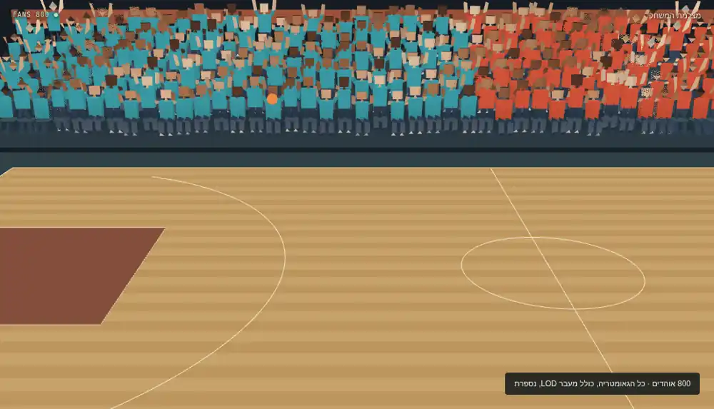
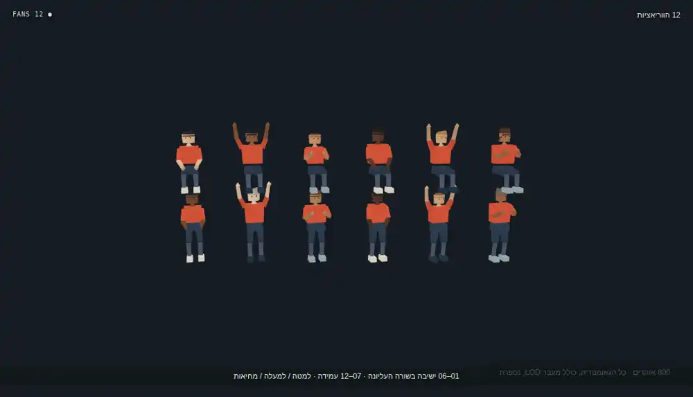
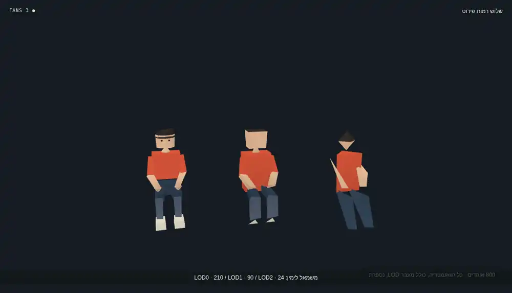

# קהל כדורסל תלת־ממדי v1

14 בנובמבר 2026. ענף `codex/hoops-crowd-3d-v1`, מבסיס main בקומיט `d759582c171600dd7c7df7906c2fb38ae7f8b88a`.

36 GLB: 12 וריאציות בשלוש רמות פירוט, בסגנון קהל הטניס הקיים. שישה אוהדים יושבים ושישה עומדים; בכל תנוחה שתי דמויות עם ידיים למטה, שתיים עם ידיים למעלה ושתיים מוחאות. החבילה מדגימה 800 אוהדים, חולצות לפי קבוצה, ראשים שעוקבים אחר הכדור וקפיצה בסל. כל השינוי הוא קבצים חדשים בתיקייה זו. החיבור למשחק לא נעשה כאן.



## צפייה

מגישים את שורש המאגר:

```sh
python3 -m http.server 8765
```

1. פותחים את [preview.html](http://127.0.0.1:8765/workout/island/design/hoops-crowd-3d-v1/preview.html). ״מצלמת המשחק״ משתמשת במצלמה המתאימה לרוחב או לאורך הקנבס. אפשר לבחור גם אולם מלא, צד ומאחור.
2. מחליפים בין ״לפני״ ל״קהל תלת־ממדי״, משנים צבעי בית/חוץ ולוחצים על חגיגת סל. בוחרים מחיאות כפיים או ידיים למעלה; ״השהיה״ מקפיאה את הזמן.
3. בוחרים ״12 הווריאציות״ או ״שלוש רמות פירוט״. בחירת וריאציה פותחת את שלוש הרמות באותו קנה מידה; מחוון הסיבוב מציג צד וגב.
4. כפתור מדידת FPS מריץ ABBA ומאפשר להוריד JSON מקומי. המדידות המצורפות להלן הן הרצת תוכנה נפרדת, ברזולוציות טלפון מדויקות.

התוצאה הרצויה: בכל מבט אולם נשמרים 800 אוהדים, מונה הקהל נשאר עד 70,000 גם בזמן מעבר, והתנועה נראית בלי טעינת מפענח או שירות חיצוני.



## מודלים וגודל

| רמה | משולשים בכל GLB | סך 12 הקבצים, בתים | מבנה |
|---|---:|---:|---|
| LOD0 | 210, מתחת לתקרת 220 | 187,740 | גוף וגפיים בעלי נפח, ראש מפוסל, שיער, עיניים, אף, כפות ידיים ונעליים |
| LOD1 | 90 | 103,536 | ראש וגוף בעלי נפח וגפיים עם מרפקים/ברכיים; פרטי פנים מופשטים |
| LOD2 | 24 | 53,652 | כמו בטניס: גוף טריז וראש אוקטהדרלי בעלי נפח, גפיים דקות דו־צדדיות המיועדות למרחק |
| כל GLB | 36 קבצים | 344,928 | ללא דחיסה, מרקמים או buffers חיצוניים |

**כל עץ החבילה, כולל מקור, תמונות, מדידות ודוח: 498292 בתים, מתחת ל־500,000.** נפח ההורדה של Three.js ושל אטלס ההשוואה הקיימים במאגר אינו חלק מהנכסים החדשים; הם לא הועתקו לכאן.

כל מודל מכיל primitive וחומר יחידים, צבעי RGBA8 ליניאריים ו־`KHR_materials_unlit`. `_PART` הוא VEC4 לא מנורמל: X מסמן ראש, Y מסמן חולצה; Z/W שמורים. החולצה הנייטרלית נצבעת בחומר לפי `seat.team`, בלי לשנות צבעי עור או שיער. צבעי הבית/חוץ הם הגדרות, ללא סמל קבוצה.

שלושה morph targets: `arms-up`, `clap-open`, `clap-close`; לכל GLB שני קליפים תקניים, `celebrate` ו־`clap`. קודקודים זהים מוזגו והדלתאות נשמרות כ־sparse accessors תקניים. מעקב הראש והקפיצה ממומשים במתאם ה־InstancedMesh, ולא דורשים שלד או AnimationMixer לכל אוהד. צירים: מטרים, Y למעלה, Z קדימה, כפות רגליים ב־Y=0. לכל וריאציה נקודת ציר ראש משותפת בין הרמות.

LOD2 הוא הפשטה למרחק. הגפיים שלו דקות ויכולות להצטמצם במבט צד; הוא אינו מיועד לתקריב ואינו מודל אנושי סגור בכל חלקיו. הראש והגוף עצמם תלת־ממדיים. הגלריה מציגה את ההבדל בגלוי.



## LOD ותקציב

`lod-config.json` מגדיר ספים של 16 ו־34 מטר, וחפיפות ברוחב 20%: 14.4–17.6 ו־30.6–37.4 מטר. החומרים אטומים, כותבים עומק ומשתמשים במסכות screen-door משלימות עם smoothstep. שתי הגאומטריות במעבר נספרות במלואן; משקל קטן אינו מפחית את ספירת המשולשים. הגרעיניות במעבר עשויה להיראות לעין.

`cameraForward` אופציונלי נותן עדיפות לאזור שהמצלמה מביטה אליו: המרחק האפקטיבי גדל ברציפות עד פי 2.5 מחוץ לכיוון המרכזי, לפי הקוסינוסים 0.97–0.80. כך היציע הקרוב שמתחת למצלמה אינו צורך את רוב האיכות. כל 800 האוהדים עדיין נשלחים לציור, ללא הסתרה של בנקים או culling של מופעי קהל. בלי הכיוון, המדיניות משתמשת במרחק בלבד.

שומר התקציב מקטין יחד את הספים והחפיפות לפי עתודה מונוטונית של 24 → 114 → 300 משולשים למושב. העתודה כוללת גם את שני ה־LOD במעבר ונשמרת עד הרחבת הספים הבאה. אין העלאה אוטומטית מעל תקציב 70,000. טלפורט של מצלמה עדיין עשוי לשנות איכות מיד.

| מצלמה | מופעים פעילים LOD0 / 1 / 2 | אוהדים במעבר | משולשי קהל |
|---|---:|---:|---:|
| משחק · רוחב | 63 / 370 / 480 | 113 | 58,050 |
| משחק · אורך | 0 / 308 / 604 | 112 | 42,216 |
| אולם מלא | 0 / 23 / 800 | 23 | 21,270 |
| צד | 34 / 140 / 716 | 90 | 36,924 |
| מאחור | 42 / 150 / 670 | 62 | 38,400 |

סכום המופעים הפעילים גדול מ־800 בזמן חפיפה. מספר המושבים וה־LOD הדומיננטיים נשאר בדיוק 800. הספירה אומתה גם בציור הקהל לבדו דרך `renderer.info.render`, מעבר לחישוב המדיניות. 500 מיקומי מצלמה ומקרי תקציב נוספים מתועדים ב־`verification.json`, כולל מצלמה/מושבים באותה נקודה וקרבה שמפעילה את שומר התקציב.

## מצלמה והשוואת תוכנה

המצלמות נגזרות מ־`minigames/hoops-view.mjs:cameraFor` ומ־`data/config.json:minigames.streetSlam.view` בבסיס המצוין לעיל. ברוחב: כדור/מחזיק נייח ב־X=Z=0 והתקפה לכיוון +X; המצלמה ב־`[4,6.4,-14.62]`, מביטה אל `[4,1.45,0]`, עם FOV שמחושב מ־bSpan=8.2. לאורך: מצלמת חצי מגרש ב־`[-1.375,6,-2.667]`, יעד `[10.525,1.1,0]`, FOV=52. אלה דגימות של מצלמות המשחק, ללא סימולציית שחקנים או ריפליי.

שני המצבים משתמשים באותה סצנת ביקורת ובאותם 800 מושבים. ״לפני״ משחזר את קהל v8 הקיים: מישור 0.66×1.10, אטלס `assets/hoops-v8/arena/crowd.webp`, אותם UV, חומר ותנועת חגיגה. ״אחרי״ משתמש ב־GLB ובמתאם החדש. הפריסה החדשה מבוססת על מידות היציע התחתון של v8: 560 מושבים לאורך ו־240 בקצוות, חמש שורות. היא אינה מדידת כל 2,084 האוהדים של אולם המשחק הקיים.

| קנבס | מצב | משולשי קהל | קריאות קהל | משולשי סצנה | קריאות סצנה | FPS תוכנה |
|---|---|---:|---:|---:|---:|---:|
| 844×390 | לפני | 1,600 | 1 | 12,212 | 27 | 27.59 |
| 844×390 | אחרי | 58,050 | 36 | 68,662 | 62 | 21.56 |
| 390×844 | לפני | 1,600 | 1 | 12,156 | 28 | 35.29 |
| 390×844 | אחרי | 42,216 | 24 | 52,772 | 51 | 32.73 |

Chromium 151.0.7922.173, ANGLE / Vulkan SwiftShader, ללא GPU חומרתי, DPR=1. בכל מידה: לפני → אחרי → אחרי → לפני, עשרה פריימים לחימום ו־60 הפרשי RAF לכל סבב; 480 הפרשי פריימים בסך הכול. תנועת הכדור, המחיאות וסל בשנייה 0.4 משתמשים באותו ציר זמן קבוע בכל סבב. FPS משוקלל הוא מספר הפריימים בשני הסבבים חלקי סכום הזמנים שלהם. הגרסה, המעבד הגרפי, חציון, p95, זמני submit וכל דגימות ה־RAF נמצאים ב־`measurements.json`.

ה־3D איטי יותר מהאטלס בהשוואה זו: כ־21.9% ברוחב ו־7.3% לאורך. זו עלות נוספת עבור הנפח והתנועה. המדידה כוללת update, ציור ועדכון המונים בדף; submit הוא זמן CPU ולא זמן GPU. אין כאן מדידת טלפון או הבטחת FPS למשחק המלא. מגבלת 70,000 חלה על הקהל; שחקנים, הצללות, השתקפויות ושאר המשחק דורשים תקציב משלהם בחיבור.

## חיבור עתידי

```js
const fans = await createHoopsCrowd({T, GLTFLoader, seats, base: packageURL,
  teamColors: ['#e55b3e', '#40aab6']});
scene.add(fans.root);
fans.update({seconds: elapsed, ballPosition: [ball.x, ball.y, ball.z],
  cameraPosition: camera.position.toArray(),
  cameraForward: camera.getWorldDirection(direction).toArray(),
  reducedMotion: false});
// פעם אחת באירוע סל, על אותו שעון elapsed:
fans.onBasket({seconds: elapsed, team: 0});
// בפירוק:
fans.dispose();
```

`base` הוא URL של תיקייה זו. `seats` כולל 1–800 רשומות עם `{id,x,y,z,yaw}`, מזהים ייחודיים ומספרים סופיים; אופציונלית `variant` בטווח 0–11 ו־`team` של 0 או 1. בחבילה יש 12 וריאציות ולא 12 בכל תנוחה. הכדור, המצלמה, הכיוון והמושבים נמסרים במערכת המקומית של `fans.root`; אם root מוזז/מסובב/מוגדל, יש להמיר גם את הקלטים אליו.

סיבוב הראש מוגבל ל־±0.87 רדיאן בצידוד ו־±0.32 בהגבהה. באירוע סל אוהדי הקבוצה מקבלים תגובה מדורגת וקפיצה עד 0.16 מטר למשך 3.2 שניות; `team:-1` מריע עם כולם. מחיאות מופעלות בפאזות שונות. תנועה מופחתת מקפיאה מחיאות ותנודת גוף ומבטלת קפיצה. החלפת צבעים דרך `setTeamColors(home,away)`. תנוחת ביקורת כפויה דרך `pose:0|1|2`; ברירת המחדל ‎-1 משאירה את ערבוב הווריאציות.

במצלמה קבועה אין שינוי מטריצות או גאומטריה בכל פריים: מתעדכנים uniforms בלבד. שינוי מיקום/כיוון המצלמה מחשב חלוקה ומעלה נתוני מופעים. `metrics` מפריד בין אנשים, מופעים בחפיפה, משולשים, קריאות ועתודת התקציב. `dispose()` משחרר גם את מקורות ה־GLB ואת משאבי ה־InstancedMesh.

## אימות ושחזור

- 36/36 GLB עברו Khronos Validator עם אפס שגיאות ואפס אזהרות; חתימות SHA-256 ונפחים ב־`assets.json`.
- 36 קבצים נטענו גם דרך GLTFLoader, ו־72 קליפים הופעלו ב־AnimationMixer. שינויי ראש וחגיגת סל אומתו בתמונת WebGL, והבקרים ותצוגת 390×844 נבדקו ללא גלילה אופקית.
- אין שגיאות דפדפן, בקשות חיצוניות או טעינות שנכשלו. CSP חוסם הידור WASM; התצוגה והמודלים פועלים תחתיו.
- `npm test`: ‏3,905 עברו, 64 דולגו ואחת נכשלה כי Playwright חיפש Chromium headless shell שאינו מותקן. התהליך שנותר עם שרת פתוח אחרי הכשל הופסק. קובץ `tests/workout-royiki.test.mjs` הורץ מחדש עם hook ה־`ISLAND_PLAYWRIGHT` הקיים ומתאם זמני ב־`/tmp` אל `/usr/bin/chromium`: כל 5 הבדיקות עברו. הסוויטה המקורית אינה מוצגת כאילו עברה במלואה.
- לא נערכו קוד קיים, בדיקות, ops, CLAUDE.md, release.json או תגי גרסה. לא נוסף vendor או מפענח.

```sh
python3 workout/island/design/hoops-crowd-3d-v1/source/build.py
node workout/island/design/hoops-crowd-3d-v1/source/measure.mjs /tmp/hoops-crowd-tools/node_modules/gltf-validator
```

כלי המדידה דורש שרת שורש פעיל, Playwright, Chromium ו־Pillow. המאמת הרשמי מותקן מחוץ למאגר; בלעדיו אפשר להשמיט את הארגומנט, אך אז שדות האימות מסומנים null. `CHROMIUM_PATH` ו־`PLAYWRIGHT_MODULE` מאפשרים לבחור התקנות מקומיות. הכלי משחזר מדידות, תמונות ואימות; FPS עשוי להשתנות בין הרצות.

כל התוספות CC0, עם מקורות ופירוט ב־[LICENSES.md](LICENSES.md). אין שינוי ברישיון התלויות הקיימות.
