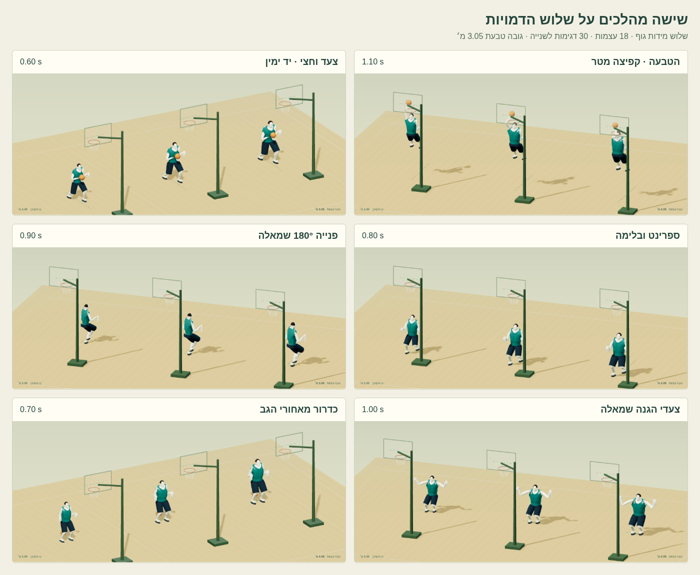
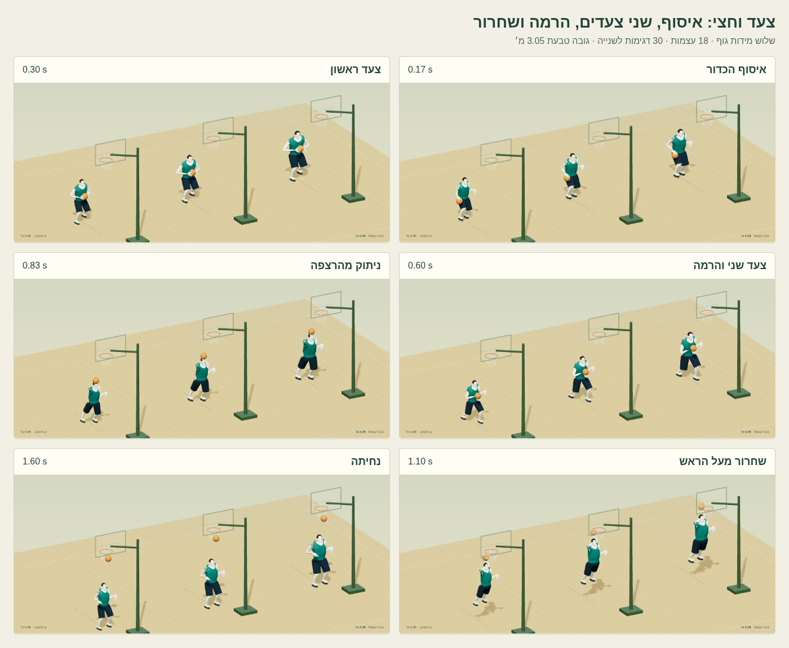

# דוח מסירה — תנועות כדורסל v10

נמסרו 18 מהלכים מקוריים × שלוש דמויות גבוהות = 54 ביצועים ב־30Hz, כל אחד כנתוני JSON וכ־GLB של אנימציה. בסיס הענף הוא main בקומיט e8145727d343adfa6bfa06f0c1a3287ab2ac6c1b. כל הקבצים חדשים תחת workout/island/design/hoops-motion-v10/ בלבד. הדמויות נכללות בחבילה; התצוגה משתמשת בספריות Three שכבר נמצאות ב־v8. לא חובר קוד משחק.

## תוצאה מדודה

| בדיקה | תוצאה | סף |
|---|---|---|
| החלקת סוליה מרבית בעולם, כולל בין פריימים | 0.476 ס״מ | עד 2 ס״מ |
| שגיאת מגע כף יד מול מעטפת הכדור בדגימות האפויות | 0.007 ס״מ | עד 2 ס״מ |
| קבצים שעברו glTF Validator | 57 | כל 54 האנימציות ו־3 הדמויות |
| שגיאות / אזהרות glTF | 0 / 0 | 0 / 0 |
| סטיית ערוץ GLB מול JSON | 1.361e-7 | עד 0.00002 |
| טעינה וניגון בדפדפן | 54 אנימציות, 54 קובצי נתונים, 3 דמויות | הכול נטען |
| שגיאות HTTP / עמוד / בקשות | 0 / 0 / 0 | 0 |
| הוכחת חסימת WASM | WebAssembly.compile נחסם בפועל על ידי CSP | התצוגה והאנימציות ממשיכות לעבוד |

## הטבעות מול טבעת 3.05 מטר

שתי עוצמות הניתור משתמשות באותה טבעת תקנית. המדידה מוגבלת לזמן שבו היד הפעילה נוגעת בכדור, לפני השחרור. בנוסף לסמן כף היד, נמדדה נקודת המשטח האמיתית בעלת משקל היד ב־mesh של כל דמות. עליית האגן נמדדת ביחס לאגן המנוחה של הפרופיל, ולא לתחתית הכריעה.

| קליפ | דמות | עליית אגן (מ׳) | כף יד (מ׳) | מעל הטבעת (ס״מ) | כף יד במשטח (מ׳) | מרחק אופקי מהטבעת (מ׳) |
|---|---|---:|---:|---:|---:|---:|
| `dunk_low` | guard | 0.940 | 3.320 | 27.000 | 3.320 | 0.144 |
| `dunk_low` | wing | 0.940 | 3.320 | 27.000 | 3.320 | 0.144 |
| `dunk_low` | center | 0.940 | 3.320 | 27.000 | 3.320 | 0.144 |
| `dunk_high` | guard | 1.000 | 3.380 | 33.000 | 3.380 | 0.144 |
| `dunk_high` | wing | 1.000 | 3.380 | 33.000 | 3.380 | 0.144 |
| `dunk_high` | center | 1.000 | 3.380 | 33.000 | 3.380 | 0.144 |

הכדור עולה מול פתח הטבעת, נשאר בתוך המרווח האופקי, ומשתחרר למטה בזמן 1.20 שניות. אין הרמה של כל הדמות בתצוגה לצורך מעבר הבדיקה: הרמת האגן נמצאת בנתונים ובערוץ האנימציה שנמסרו.

## צעד וחצי אמיתי

בכל שלוש הדמויות האיסוף הוא בזמן 0.167 שניות; הנטיעות שאחריו בזמן 0.300 ו־0.600 שניות מתחלפות בין הרגליים. אחר כך ניתוק מהקרקע, הרמת הכדור ביד הסיום ושחרור ב־1.100 שניות. הגו נוטה קדימה בגישה. המהלך כולל גם מסלול עולם קדימה, ולכן הוא מובחן מזריקה בעמידה.

| קליפ | דמות | שתי הנטיעות אחרי האיסוף | זמן שחרור (ש׳) |
|---|---|---|---:|
| `layup_left` | guard | LeftFoot 0.300 → RightFoot 0.600 | 1.100 |
| `layup_left` | wing | LeftFoot 0.300 → RightFoot 0.600 | 1.100 |
| `layup_left` | center | LeftFoot 0.300 → RightFoot 0.600 | 1.100 |
| `layup_right` | guard | RightFoot 0.300 → LeftFoot 0.600 | 1.100 |
| `layup_right` | wing | RightFoot 0.300 → LeftFoot 0.600 | 1.100 |
| `layup_right` | center | RightFoot 0.300 → LeftFoot 0.600 | 1.100 |

## נטיעה, קצב צעדים ותנועה בעולם

כל ערך בטבלה הוא שגיאת העוגן המרבית בס״מ, בחישוב תלת־ממדי. החישוב כולל תנועת שורש וסיבוב עולם פעם אחת. קצב הצעדים נמדד מהתחלות מגע, ללא ספירת נחיתה בו־זמנית בשתי רגליים כשני צעדים עוקבים. בספרינט חלון הגישה הוא 0–0.8 שניות והיעד 3.75 צעדים לשנייה. בשאר הפעולות זה קצב המגעים לאורך המהלך, ולא יעד ריצה אחיד.

| קליפ | משך (ש׳) | רכז | קיצוני | סנטר | קצב מגעים מדוד (צעדים/ש׳) | מסלול שורש (מ׳) |
|---|---:|---:|---:|---:|---:|---:|
| `dunk_low` | 2.20 | 0.468 | 0.444 | 0.424 | 2.000 | 2.300 |
| `dunk_high` | 2.20 | 0.468 | 0.444 | 0.424 | 2.000 | 2.300 |
| `layup_left` | 2.00 | 0.289 | 0.273 | 0.259 | 2.143 | 2.200 |
| `layup_right` | 2.00 | 0.289 | 0.273 | 0.259 | 2.143 | 2.200 |
| `sprint_brake` | 1.60 | 0.476 | 0.451 | 0.428 | 4.000 | 2.160 |
| `sprint_brake_ball` | 1.60 | 0.476 | 0.451 | 0.428 | 4.000 | 2.160 |
| `turn_90_left` | 1.80 | 0.040 | 0.039 | 0.039 | 2.857 | 1.596 |
| `turn_90_right` | 1.80 | 0.114 | 0.115 | 0.115 | 2.857 | 1.596 |
| `turn_180_left` | 1.80 | 0.135 | 0.135 | 0.135 | 2.857 | 1.595 |
| `turn_180_right` | 1.80 | 0.308 | 0.306 | 0.305 | 2.857 | 1.595 |
| `defensive_stance` | 2.00 | 0.000 | 0.000 | 0.000 | — | 0.000 |
| `defensive_slide_left` | 2.00 | 0.014 | 0.013 | 0.012 | 2.045 | 0.950 |
| `defensive_slide_right` | 2.00 | 0.014 | 0.013 | 0.012 | 2.045 | 0.950 |
| `defensive_block` | 1.80 | 0.000 | 0.000 | 0.000 | — | 0.000 |
| `dribble_behind_back` | 1.40 | 0.000 | 0.000 | 0.000 | — | 0.000 |
| `pivot` | 1.60 | 0.012 | 0.012 | 0.012 | — | 0.252 |
| `shot_start` | 1.60 | 0.029 | 0.028 | 0.028 | — | 0.000 |
| `stop_two_feet` | 1.40 | 0.138 | 0.129 | 0.122 | 2.000 | 0.840 |

פניות 90° ו־180° מכילות שלב נטיעה ארוך בזמן הסיבוב. הציר המוגן מסובב את האגן סביב עוגן רגל שמאל. צעדי ההגנה נמוכים: גובה הנפת הסוליה עד 4 ס״מ, עם בסיס רחב וללא הצלבת רגליים. חסימת ההגנה מושיטה יד גבוהה מתוך בסיס נמוך. ב־stop_two_feet שתי הרגליים נוחתות יחד לאחר האיסוף, ונשארות נעולות בסיום.

## שלד, מגעים ושחרור

בכל פרופיל נשמרו 18 העצמות וההיררכיה הקנוניות, אורכי האיברים המקוריים, סיבובי קשירה בזהות וסקאלה 1. לא הונפשה סקאלה ולא הוחלפו אורכי מפרקים. האגן בלבד מקבל היסט מהמנוחה. נבדקו קווטרניונים מנורמלים, אורך כל מקטע, ונתוני GLB בפועל מול JSON. שגיאת אורך העצם המרבית היא 7.216e-16 מטר.

מגעי הרגליים כוללים מצב נטיעה ועוגן בעולם בכל דגימה. לכל יד שדה touching מפורש; מגע אמיתי נבדק מול רדיוס הכדור 0.12 מטר. אירועי hand_ball_contact ו־hand_ball_release מציינים שינויי מגע; ball_gather ו־ball_release מציינים איסוף ושחרור קליעה. זמן שחרור הוא null בקליפ ללא שחרור קליעה. לא נשאר מגע מדווח אחרי שחרור. כל האירועים הם לצורך המחשה; סמכות בעלות בכדור ותוצאת זריקה נשארת אצל המשחק.

השורש הקנוני Root נשאר בזהות. רק קבוצת Motion נעה ומסתובבת בעולם; JSON מכיל שדות translation ו־quaternion נפרדים ותיאור applyExactlyOnce. הגוף והכדור נמסרים במרחב המקומי של אותה קבוצה. ערוצי GLB משתמשים בזמן בשניות; JSON בזמן מנורמל. כל הדגימות כוללות נקודת סיום ב־30Hz ומשתמשות ב־LINEAR/SLERP ללא easing נוסף בזמן הניגון.

## טעינה, משטח ומדיניות תוכן

כל 57 קובצי GLB נמסרים ללא Draco וללא meshopt; אין צורך במפענח, worker או WebAssembly. המודלים זהים בבתים לעותקי runtime של hoops-tall-v1, קומיט cfd4215c314fb673a6585f7a482ac4fb5ea3cbaa. 54 האנימציות מפנות לפרופורציות של הדמות המתאימה, והגאומטריה המשותפת נטענת פעם אחת לכל פרופיל.

בדיקת המשטח הפעילה את משקולות העור של המודלים בפועל בתשע פוזות לכל ביצוע. כל הקואורדינטות נשארו סופיות. יחס מתיחת הקצה באחוזון 99 המרבי היה 1.771, והקצה המרבי 6.013; ספי זיהוי השחתה היו 3 ו־8. אלו ספי השחתה רחבים של ה־mesh, ולא מדידה של אנטומיה או הוכחה להעדר כל חדירה עצמית. בדיקות המפרקים עצמן מחמירות בנפרד לגבי אורכים, סקאלה וסיבובים.

בדיקת Chromium מפעילה בפועל את ה־GLB שנמסר על שלוש הדמויות בחמישה זמנים לכל קליפ וגם בניגון מתקדם. שולחן העבודה נבדק ב־1440×1000 והטלפון ב־390×844, ללא גלילה אופקית. החסימה של WASM נבדקה באמצעות ניסיון קומפילציה אמיתי תחת script-src 'self'. הרינדור משתמש ב־SwiftShader; אין כאן טענה לקצב פריימים על חומרת טלפון.

## שחזור וגבולות

הוראות ב־[source/README.md](source/README.md). source/verify.mjs קורא כל קובץ בחבילה, מפענח JSON ותמונות, בודק תחביר JavaScript, קורא ערוצי GLB ומריץ glTF Validator. המדידה העצמאית אינה מייבאת את המחולל. מגעי רגל נמדדים גם בין פריימים ב־120Hz רק כאשר שתי הדגימות השכנות מצהירות על אותו עוגן; מגעי יד נבדקים בדגימות האפויות ב־30Hz.

האימות מתייחס לקליפים שנמסרו. חיבור שרירותי בין קליפים דורש יישור שורש ושימור עוגן פעיל, ולעיתים IK אחרי ערבוב. זו חבילת נכסים, ללא שינוי מנוע המשחק או בדיקות המאגר הקיימות. רוב הקליפים חד־פעמיים; החזרה בתצוגה היא איפוס סקירה, לא לולאת תנועה רציפה. עמדת ההגנה בלבד מסומנת loop.

תוצאות מלאות: [measurements.json](verification/measurements.json), [gltf-validation.json](verification/gltf-validation.json), [browser.json](verification/browser.json). [LICENSES.md](LICENSES.md) מונה רישיון ומקור לכל קובץ.
