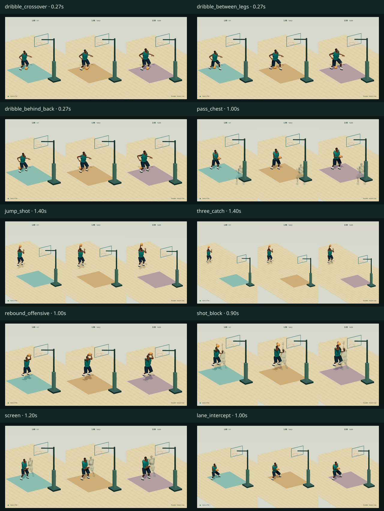

# דוח מסירה — תנועות כדורסל v11

נמסרו 30 מהלכים מקוריים × 3 דמויות גבוהות = 90 ביצועים ב־30Hz, כל אחד כנתוני JSON וכ־GLB של אנימציה. רכז 1.88 מ׳, קיצוני 1.98 מ׳ וסנטר 2.08 מ׳. בסיס הענף הוא main בקומיט ae09529bc8fc9ff42f6aa76b8e79e7f760992f62. כל השינויים הם קבצים חדשים מקוריים/CC0 תחת workout/island/design/hoops-motion-v11/ בלבד. המודלים והתצוגה נכללים בתיקייה; הניגון בתוך המאגר משתמש בשלוש ספריות תוכנה קיימות מתיקיית v8, ללא CDN. לא נוספו עותקי תוכנה חדשים. קוד המשחק לא חובר ולא השתנה.

המספרים בדוח נוצרו מ־[measurements.json](verification/measurements.json), [gltf-validation.json](verification/gltf-validation.json) ו־[browser.json](verification/browser.json). המחולל של הדוח מסרב להפיק מסירת הצלחה כאשר חסרה מדידה, כאשר אחד מ־90 הביצועים נכשל או כאשר אין הוכחת חסימת WASM בדפדפן.

## תוצאה מדודה

| בדיקה | תוצאה | תנאי מעבר |
|---|---|---|
| החלקת סוליה מרבית בעולם, כולל בין דגימות | 0.399 ס״מ | עד 2 ס״מ |
| שגיאת מגע כף יד מול מעטפת הכדור, דגימות 30Hz | 0.000 ס״מ | עד 2 ס״מ |
| שגיאת מגע כף יד בין דגימות, 120Hz | 1.093 ס״מ | עד 2 ס״מ בחלון מגע תואם |
| חזרת כדרור לכף היד | 0.000 ס״מ | עד 2 ס״מ בכל חזרה |
| גובה מרכז הכדור במגע רצפה ביחס לרדיוס | 0.000 ס״מ | עד 2 ס״מ בכל הקפצה |
| מחזורי כדרור שנבדקו בנפרד | 117 | דחיפה → רצפה → חזרה עם אותו bounceIndex |
| קובצי GLB שעברו glTF Validator | 93 | 90 אנימציות + 3 דמויות |
| שגיאות / אזהרות glTF | 0 / 0 | 0 / 0 |
| סטיית ערוץ GLB מול JSON | 4.578e-7 | עד 0.00002 |
| טעינה וניגון בדפדפן | 90 אנימציות, 90 נתוני JSON, 3 דמויות | כל הקבצים נטענים |
| שגיאות HTTP / עמוד / בקשות / תצוגה | 0 / 0 / 0 / 0 | 0 |
| קובצי תוכנה משותפים קיימים שנטענו | 3 | שלושה קובצי JavaScript קיימים ב־main, HTTP 200 |
| בקשות ריצה ל־Draco / meshopt / WASM | 0 | 0 |
| חסימת WebAssembly בפועל | עבר | ניסיון קומפילציה נדחה ב־CSP והניגון ממשיך |

## כיסוי המהלכים

| מהלך | שם | משפחה | משך (ש׳) | חזרה |
|---|---|---|---:|---|
| `dribble_crossover` | קרוסאובר | dribble | 2.40 | מחזור סגור |
| `dribble_between_legs` | בין הרגליים | dribble | 2.40 | מחזור סגור |
| `dribble_behind_back` | מאחורי הגב | dribble | 2.40 | מחזור סגור |
| `dribble_hesitation` | השהיה והאצה | dribble | 2.40 | חד־פעמי; איפוס סקירה |
| `dribble_step_back` | כדרור ונסיגה | dribble | 2.40 | חד־פעמי; איפוס סקירה |
| `dribble_jab_step` | צעד הטעיה וכדרור | dribble | 2.40 | חד־פעמי; איפוס סקירה |
| `dribble_spin` | סיבוב עם כדור | dribble | 2.40 | חד־פעמי; איפוס סקירה |
| `dribble_sprint` | כדרור בספרינט | dribble | 2.40 | חד־פעמי; איפוס סקירה |
| `dribble_protective` | כדרור מוגן | dribble | 2.40 | מחזור סגור |
| `pass_chest` | מסירת חזה | pass | 2.40 | חד־פעמי; איפוס סקירה |
| `pass_bounce` | מסירת קרקע | pass | 2.40 | חד־פעמי; איפוס סקירה |
| `pass_overhead` | מסירה מעל הראש | pass | 2.40 | חד־פעמי; איפוס סקירה |
| `pass_behind_back` | מסירה מאחורי הגב | pass | 2.40 | חד־פעמי; איפוס סקירה |
| `pass_jump` | מסירה בקפיצה | pass | 2.40 | חד־פעמי; איפוס סקירה |
| `pass_alley_oop` | מסירת אלי־הופ | pass | 2.40 | חד־פעמי; איפוס סקירה |
| `jump_shot` | זריקה בקפיצה | shot | 3.60 | חד־פעמי; איפוס סקירה |
| `fadeaway` | זריקה בנסיגה | shot | 3.60 | חד־פעמי; איפוס סקירה |
| `floater` | פלואטר | shot | 3.60 | חד־פעמי; איפוס סקירה |
| `hook_shot` | זריקת וו | shot | 3.60 | חד־פעמי; איפוס סקירה |
| `three_off_dribble` | שלוש מכדרור | shot | 3.60 | חד־פעמי; איפוס סקירה |
| `three_catch` | שלוש מקבלה | shot | 3.60 | חד־פעמי; איפוס סקירה |
| `shot_under_pressure` | זריקה בלחץ הגנה | shot | 3.60 | חד־פעמי; איפוס סקירה |
| `rebound_offensive` | ריבאונד התקפה | rebound | 2.40 | חד־פעמי; איפוס סקירה |
| `rebound_defensive` | ריבאונד הגנה | rebound | 2.40 | חד־פעמי; איפוס סקירה |
| `shot_block` | חסימת זריקה | contact | 2.40 | חד־פעמי; איפוס סקירה |
| `body_block` | חסימת גוף ובוקס־אאוט | contact | 2.40 | חד־פעמי; איפוס סקירה |
| `screen` | אקרן | contact | 2.40 | חד־פעמי; איפוס סקירה |
| `close_guard` | הגנה צמודה | defense | 2.40 | מחזור סגור |
| `steal` | חטיפה | defense | 2.40 | חד־פעמי; איפוס סקירה |
| `lane_intercept` | חציית מסלול מסירה | defense | 2.40 | חד־פעמי; איפוס סקירה |

## נטיעה ומגע כדור — כל 90 הביצועים

כל שגיאה בטבלה בס״מ; מסלול השורש במטרים. נטיעה היא המרחק התלת־ממדי של סמן הסוליה מעוגן העולם. שגיאת יד היא הערך המוחלט של מרחק סמן כף היד ממרכז הכדור פחות רדיוס הכדור (0.12 מ׳), רק כאשר היד מדווחת במגע. מקף מציין שאין מגע מדווח או שאין חלון אינטרפולציה מתאים. screen ו־close_guard הם שני מהלכים ללא כדור אצל המבצע; מגע/קליטת כדור אינם חלים עליהם ואין בהם אירוע קליטה מלאכותי. תנועת השורש וסיבובו נכללים בחישוב פעם אחת.

| קליפ | דמות | נטיעה מרבית (ס״מ) | מגע יד 30Hz (ס״מ) | מגע יד 120Hz (ס״מ) | מסלול שורש (מ׳) | צעד שורש מרבי ב־30Hz (מ׳) | תוצאה |
|---|---|---:|---:|---:|---:|---:|---|
| `dribble_crossover` | רכז | 0.005 | 0.000 | 0.021 | 0.680 | 0.015 | עבר |
| `dribble_crossover` | קיצוני | 0.004 | 0.000 | 0.025 | 0.680 | 0.015 | עבר |
| `dribble_crossover` | סנטר | 0.004 | 0.000 | 0.021 | 0.680 | 0.015 | עבר |
| `dribble_between_legs` | רכז | 0.000 | 0.000 | 0.387 | 0.000 | 0.000 | עבר |
| `dribble_between_legs` | קיצוני | 0.000 | 0.000 | 0.349 | 0.000 | 0.000 | עבר |
| `dribble_between_legs` | סנטר | 0.000 | 0.000 | 0.334 | 0.000 | 0.000 | עבר |
| `dribble_behind_back` | רכז | 0.000 | 0.000 | 1.093 | 0.000 | 0.000 | עבר |
| `dribble_behind_back` | קיצוני | 0.000 | 0.000 | 0.965 | 0.000 | 0.000 | עבר |
| `dribble_behind_back` | סנטר | 0.000 | 0.000 | 0.868 | 0.000 | 0.000 | עבר |
| `dribble_hesitation` | רכז | 0.095 | 0.000 | 0.063 | 1.700 | 0.070 | עבר |
| `dribble_hesitation` | קיצוני | 0.088 | 0.000 | 0.061 | 1.700 | 0.070 | עבר |
| `dribble_hesitation` | סנטר | 0.083 | 0.000 | 0.052 | 1.700 | 0.070 | עבר |
| `dribble_step_back` | רכז | 0.056 | 0.000 | 0.027 | 1.570 | 0.088 | עבר |
| `dribble_step_back` | קיצוני | 0.053 | 0.000 | 0.030 | 1.570 | 0.088 | עבר |
| `dribble_step_back` | סנטר | 0.049 | 0.000 | 0.024 | 1.570 | 0.088 | עבר |
| `dribble_jab_step` | רכז | 0.002 | 0.000 | 0.027 | 0.140 | 0.010 | עבר |
| `dribble_jab_step` | קיצוני | 0.002 | 0.000 | 0.030 | 0.140 | 0.010 | עבר |
| `dribble_jab_step` | סנטר | 0.002 | 0.000 | 0.024 | 0.140 | 0.010 | עבר |
| `dribble_spin` | רכז | 0.281 | 0.000 | 0.027 | 0.880 | 0.034 | עבר |
| `dribble_spin` | קיצוני | 0.282 | 0.000 | 0.030 | 0.880 | 0.034 | עבר |
| `dribble_spin` | סנטר | 0.283 | 0.000 | 0.024 | 0.880 | 0.034 | עבר |
| `dribble_sprint` | רכז | 0.399 | 0.000 | 0.169 | 10.080 | 0.140 | עבר |
| `dribble_sprint` | קיצוני | 0.368 | 0.000 | 0.169 | 10.080 | 0.140 | עבר |
| `dribble_sprint` | סנטר | 0.341 | 0.000 | 0.158 | 10.080 | 0.140 | עבר |
| `dribble_protective` | רכז | 0.000 | 0.000 | 0.383 | 0.000 | 0.000 | עבר |
| `dribble_protective` | קיצוני | 0.000 | 0.000 | 0.082 | 0.000 | 0.000 | עבר |
| `dribble_protective` | סנטר | 0.000 | 0.000 | 0.063 | 0.000 | 0.000 | עבר |
| `pass_chest` | רכז | 0.004 | 0.000 | 0.009 | 0.150 | 0.015 | עבר |
| `pass_chest` | קיצוני | 0.004 | 0.000 | 0.009 | 0.150 | 0.015 | עבר |
| `pass_chest` | סנטר | 0.004 | 0.000 | 0.010 | 0.150 | 0.015 | עבר |
| `pass_bounce` | רכז | 0.004 | 0.000 | 0.015 | 0.150 | 0.015 | עבר |
| `pass_bounce` | קיצוני | 0.004 | 0.000 | 0.015 | 0.150 | 0.015 | עבר |
| `pass_bounce` | סנטר | 0.004 | 0.000 | 0.016 | 0.150 | 0.015 | עבר |
| `pass_overhead` | רכז | 0.004 | 0.000 | 0.105 | 0.150 | 0.015 | עבר |
| `pass_overhead` | קיצוני | 0.004 | 0.000 | 0.157 | 0.150 | 0.015 | עבר |
| `pass_overhead` | סנטר | 0.004 | 0.000 | 0.205 | 0.150 | 0.015 | עבר |
| `pass_behind_back` | רכז | 0.018 | 0.000 | 0.083 | 0.150 | 0.015 | עבר |
| `pass_behind_back` | קיצוני | 0.018 | 0.000 | 0.094 | 0.150 | 0.015 | עבר |
| `pass_behind_back` | סנטר | 0.018 | 0.000 | 0.111 | 0.150 | 0.015 | עבר |
| `pass_jump` | רכז | 0.001 | 0.000 | 0.004 | 0.350 | 0.022 | עבר |
| `pass_jump` | קיצוני | 0.001 | 0.000 | 0.004 | 0.350 | 0.022 | עבר |
| `pass_jump` | סנטר | 0.001 | 0.000 | 0.004 | 0.350 | 0.022 | עבר |
| `pass_alley_oop` | רכז | 0.004 | 0.000 | 0.105 | 0.150 | 0.015 | עבר |
| `pass_alley_oop` | קיצוני | 0.004 | 0.000 | 0.157 | 0.150 | 0.015 | עבר |
| `pass_alley_oop` | סנטר | 0.004 | 0.000 | 0.205 | 0.150 | 0.015 | עבר |
| `jump_shot` | רכז | 0.074 | 0.000 | 0.249 | 0.000 | 0.000 | עבר |
| `jump_shot` | קיצוני | 0.073 | 0.000 | 0.284 | 0.000 | 0.000 | עבר |
| `jump_shot` | סנטר | 0.072 | 0.000 | 0.312 | 0.000 | 0.000 | עבר |
| `fadeaway` | רכז | 0.074 | 0.000 | 0.271 | 0.600 | 0.037 | עבר |
| `fadeaway` | קיצוני | 0.073 | 0.000 | 0.301 | 0.600 | 0.037 | עבר |
| `fadeaway` | סנטר | 0.072 | 0.000 | 0.323 | 0.600 | 0.037 | עבר |
| `floater` | רכז | 0.079 | 0.000 | 0.232 | 1.250 | 0.039 | עבר |
| `floater` | קיצוני | 0.073 | 0.000 | 0.283 | 1.250 | 0.039 | עבר |
| `floater` | סנטר | 0.072 | 0.000 | 0.320 | 1.250 | 0.039 | עבר |
| `hook_shot` | רכז | 0.129 | 0.000 | 0.298 | 0.300 | 0.025 | עבר |
| `hook_shot` | קיצוני | 0.128 | 0.000 | 0.311 | 0.300 | 0.025 | עבר |
| `hook_shot` | סנטר | 0.127 | 0.000 | 0.333 | 0.300 | 0.025 | עבר |
| `three_off_dribble` | רכז | 0.074 | 0.000 | 0.249 | 0.450 | 0.045 | עבר |
| `three_off_dribble` | קיצוני | 0.073 | 0.000 | 0.284 | 0.450 | 0.045 | עבר |
| `three_off_dribble` | סנטר | 0.072 | 0.000 | 0.312 | 0.450 | 0.045 | עבר |
| `three_catch` | רכז | 0.074 | 0.000 | 0.249 | 0.000 | 0.000 | עבר |
| `three_catch` | קיצוני | 0.073 | 0.000 | 0.284 | 0.000 | 0.000 | עבר |
| `three_catch` | סנטר | 0.072 | 0.000 | 0.312 | 0.000 | 0.000 | עבר |
| `shot_under_pressure` | רכז | 0.074 | 0.000 | 0.249 | 0.280 | 0.028 | עבר |
| `shot_under_pressure` | קיצוני | 0.073 | 0.000 | 0.284 | 0.280 | 0.028 | עבר |
| `shot_under_pressure` | סנטר | 0.072 | 0.000 | 0.312 | 0.280 | 0.028 | עבר |
| `rebound_offensive` | רכז | 0.082 | 0.000 | 0.030 | 0.650 | 0.028 | עבר |
| `rebound_offensive` | קיצוני | 0.080 | 0.000 | 0.038 | 0.650 | 0.028 | עבר |
| `rebound_offensive` | סנטר | 0.078 | 0.000 | 0.046 | 0.650 | 0.028 | עבר |
| `rebound_defensive` | רכז | 0.049 | 0.000 | 0.079 | 0.220 | 0.024 | עבר |
| `rebound_defensive` | קיצוני | 0.048 | 0.000 | 0.081 | 0.220 | 0.024 | עבר |
| `rebound_defensive` | סנטר | 0.048 | 0.000 | 0.084 | 0.220 | 0.024 | עבר |
| `shot_block` | רכז | 0.024 | 0.000 | — | 0.220 | 0.020 | עבר |
| `shot_block` | קיצוני | 0.023 | 0.000 | — | 0.220 | 0.020 | עבר |
| `shot_block` | סנטר | 0.023 | 0.000 | — | 0.220 | 0.020 | עבר |
| `body_block` | רכז | 0.267 | 0.000 | 0.005 | 0.000 | 0.000 | עבר |
| `body_block` | קיצוני | 0.267 | 0.000 | 0.007 | 0.000 | 0.000 | עבר |
| `body_block` | סנטר | 0.267 | 0.000 | 0.010 | 0.000 | 0.000 | עבר |
| `screen` | רכז | 0.008 | — | — | 0.220 | 0.022 | עבר |
| `screen` | קיצוני | 0.007 | — | — | 0.220 | 0.022 | עבר |
| `screen` | סנטר | 0.007 | — | — | 0.220 | 0.022 | עבר |
| `close_guard` | רכז | 0.001 | — | — | 0.280 | 0.006 | עבר |
| `close_guard` | קיצוני | 0.001 | — | — | 0.280 | 0.006 | עבר |
| `close_guard` | סנטר | 0.001 | — | — | 0.280 | 0.006 | עבר |
| `steal` | רכז | 0.017 | 0.000 | 0.178 | 0.640 | 0.029 | עבר |
| `steal` | קיצוני | 0.016 | 0.000 | 0.185 | 0.640 | 0.029 | עבר |
| `steal` | סנטר | 0.015 | 0.000 | 0.190 | 0.640 | 0.029 | עבר |
| `lane_intercept` | רכז | 0.070 | 0.000 | 0.007 | 0.975 | 0.061 | עבר |
| `lane_intercept` | קיצוני | 0.064 | 0.000 | 0.007 | 0.975 | 0.061 | עבר |
| `lane_intercept` | סנטר | 0.059 | 0.000 | 0.007 | 0.975 | 0.061 | עבר |

## כדרור — חזרה מלאה ליד בכל מחזור

לכל הקפצה נבדק הסדר ball_release → ball_floor_contact → ball_return עם bounceIndex תואם. החזרה נמדדת בזמן האירוע מול היד המצוינת, ונדרש שמצב המגע יחזור להיות פעיל. שגיאת הרצפה נמדדת מול y=0.12 מ׳ במרחב העולם. הטווח ממרכז הכדור לכף היד הקרובה לאורך כדרור כולל את שלב המעוף, שבו הכדור מרוחק מהיד בכוונה; תנאי המגע חל ברגעי המגע והחזרה. נתוני כל מחזור וזמניו נמצאים בשדה dribble.bounces של המדידות.

| קליפ | דמות | הקפצות | שגיאת חזרה (ס״מ) | שגיאת רצפה (ס״מ) | מרחק כף היד הקרובה–מרכז כדור, מינ׳–מקס׳ (מ׳) |
|---|---|---:|---:|---:|---:|
| `dribble_crossover` | רכז | 4 | 0.000 | 0.000 | 0.120–0.972 |
| `dribble_crossover` | קיצוני | 4 | 0.000 | 0.000 | 0.120–1.030 |
| `dribble_crossover` | סנטר | 4 | 0.000 | 0.000 | 0.120–1.088 |
| `dribble_between_legs` | רכז | 4 | 0.000 | 0.000 | 0.120–1.004 |
| `dribble_between_legs` | קיצוני | 4 | 0.000 | 0.000 | 0.120–1.060 |
| `dribble_between_legs` | סנטר | 4 | 0.000 | 0.000 | 0.120–1.116 |
| `dribble_behind_back` | רכז | 4 | 0.000 | 0.000 | 0.120–1.140 |
| `dribble_behind_back` | קיצוני | 4 | 0.000 | 0.000 | 0.120–1.190 |
| `dribble_behind_back` | סנטר | 4 | 0.000 | 0.000 | 0.120–1.241 |
| `dribble_hesitation` | רכז | 4 | 0.000 | 0.000 | 0.120–0.882 |
| `dribble_hesitation` | קיצוני | 4 | 0.000 | 0.000 | 0.120–0.936 |
| `dribble_hesitation` | סנטר | 4 | 0.000 | 0.000 | 0.120–0.989 |
| `dribble_step_back` | רכז | 4 | 0.000 | 0.000 | 0.120–0.877 |
| `dribble_step_back` | קיצוני | 4 | 0.000 | 0.000 | 0.120–0.930 |
| `dribble_step_back` | סנטר | 4 | 0.000 | 0.000 | 0.120–0.983 |
| `dribble_jab_step` | רכז | 4 | 0.000 | 0.000 | 0.120–0.877 |
| `dribble_jab_step` | קיצוני | 4 | 0.000 | 0.000 | 0.120–0.930 |
| `dribble_jab_step` | סנטר | 4 | 0.000 | 0.000 | 0.120–0.983 |
| `dribble_spin` | רכז | 4 | 0.000 | 0.000 | 0.120–0.877 |
| `dribble_spin` | קיצוני | 4 | 0.000 | 0.000 | 0.120–0.930 |
| `dribble_spin` | סנטר | 4 | 0.000 | 0.000 | 0.120–0.983 |
| `dribble_sprint` | רכז | 6 | 0.000 | 0.000 | 0.120–0.932 |
| `dribble_sprint` | קיצוני | 6 | 0.000 | 0.000 | 0.120–0.984 |
| `dribble_sprint` | סנטר | 6 | 0.000 | 0.000 | 0.120–1.036 |
| `dribble_protective` | רכז | 4 | 0.000 | 0.000 | 0.120–0.798 |
| `dribble_protective` | קיצוני | 4 | 0.000 | 0.000 | 0.120–0.848 |
| `dribble_protective` | סנטר | 4 | 0.000 | 0.000 | 0.120–0.897 |
| `three_off_dribble` | רכז | 1 | 0.000 | 0.000 | — |
| `three_off_dribble` | קיצוני | 1 | 0.000 | 0.000 | — |
| `three_off_dribble` | סנטר | 1 | 0.000 | 0.000 | — |

## קליטה, מסירה והדיפה

ball_catch, ball_gather ו־ball_deflect נמדדים מול כפות הידיים של המבצע בזמן האירוע. ball_target_catch הוא יעד מקבל חיצוני: נמדדת הגעת מרכז הכדור לנקודה המוצהרת, ולא קליטה של דמות שנייה. האירועים משמשים לתזמון המחשה. קביעת בעלות בכדור, תוצאת משחק, עבירה וחוקיות חסימה שייכות למנוע המשחק.

| קליפ | דמות | אירועי קליטה/איסוף/הדיפה שנמדדו | שגיאת יד מרבית באירועים (ס״מ) | זמן שחרור (ש׳) | שגיאת הגעה למקבל (ס״מ) |
|---|---|---:|---:|---:|---:|
| `pass_chest` | רכז | 2 | 0.000 | 1.000 | 0.000 |
| `pass_chest` | קיצוני | 2 | 0.000 | 1.000 | 0.000 |
| `pass_chest` | סנטר | 2 | 0.000 | 1.000 | 0.000 |
| `pass_bounce` | רכז | 2 | 0.000 | 1.000 | 0.000 |
| `pass_bounce` | קיצוני | 2 | 0.000 | 1.000 | 0.000 |
| `pass_bounce` | סנטר | 2 | 0.000 | 1.000 | 0.000 |
| `pass_overhead` | רכז | 2 | 0.000 | 1.000 | 0.000 |
| `pass_overhead` | קיצוני | 2 | 0.000 | 1.000 | 0.000 |
| `pass_overhead` | סנטר | 2 | 0.000 | 1.000 | 0.000 |
| `pass_behind_back` | רכז | 2 | 0.000 | 1.000 | 0.000 |
| `pass_behind_back` | קיצוני | 2 | 0.000 | 1.000 | 0.000 |
| `pass_behind_back` | סנטר | 2 | 0.000 | 1.000 | 0.000 |
| `pass_jump` | רכז | 2 | 0.000 | 1.100 | 0.000 |
| `pass_jump` | קיצוני | 2 | 0.000 | 1.100 | 0.000 |
| `pass_jump` | סנטר | 2 | 0.000 | 1.100 | 0.000 |
| `pass_alley_oop` | רכז | 2 | 0.000 | 1.000 | 0.000 |
| `pass_alley_oop` | קיצוני | 2 | 0.000 | 1.000 | 0.000 |
| `pass_alley_oop` | סנטר | 2 | 0.000 | 1.000 | 0.000 |
| `jump_shot` | רכז | 2 | 0.000 | 1.400 | — |
| `jump_shot` | קיצוני | 2 | 0.000 | 1.400 | — |
| `jump_shot` | סנטר | 2 | 0.000 | 1.400 | — |
| `fadeaway` | רכז | 2 | 0.000 | 1.400 | — |
| `fadeaway` | קיצוני | 2 | 0.000 | 1.400 | — |
| `fadeaway` | סנטר | 2 | 0.000 | 1.400 | — |
| `floater` | רכז | 2 | 0.000 | 1.400 | — |
| `floater` | קיצוני | 2 | 0.000 | 1.400 | — |
| `floater` | סנטר | 2 | 0.000 | 1.400 | — |
| `hook_shot` | רכז | 2 | 0.000 | 1.400 | — |
| `hook_shot` | קיצוני | 2 | 0.000 | 1.400 | — |
| `hook_shot` | סנטר | 2 | 0.000 | 1.400 | — |
| `three_off_dribble` | רכז | 1 | 0.000 | 1.400 | — |
| `three_off_dribble` | קיצוני | 1 | 0.000 | 1.400 | — |
| `three_off_dribble` | סנטר | 1 | 0.000 | 1.400 | — |
| `three_catch` | רכז | 2 | 0.000 | 1.400 | — |
| `three_catch` | קיצוני | 2 | 0.000 | 1.400 | — |
| `three_catch` | סנטר | 2 | 0.000 | 1.400 | — |
| `shot_under_pressure` | רכז | 2 | 0.000 | 1.400 | — |
| `shot_under_pressure` | קיצוני | 2 | 0.000 | 1.400 | — |
| `shot_under_pressure` | סנטר | 2 | 0.000 | 1.400 | — |
| `rebound_offensive` | רכז | 2 | 0.000 | — | — |
| `rebound_offensive` | קיצוני | 2 | 0.000 | — | — |
| `rebound_offensive` | סנטר | 2 | 0.000 | — | — |
| `rebound_defensive` | רכז | 2 | 0.000 | — | — |
| `rebound_defensive` | קיצוני | 2 | 0.000 | — | — |
| `rebound_defensive` | סנטר | 2 | 0.000 | — | — |
| `shot_block` | רכז | 1 | 0.000 | — | — |
| `shot_block` | קיצוני | 1 | 0.000 | — | — |
| `shot_block` | סנטר | 1 | 0.000 | — | — |
| `body_block` | רכז | 2 | 0.000 | — | — |
| `body_block` | קיצוני | 2 | 0.000 | — | — |
| `body_block` | סנטר | 2 | 0.000 | — | — |
| `steal` | רכז | 3 | 0.000 | — | — |
| `steal` | קיצוני | 3 | 0.000 | — | — |
| `steal` | סנטר | 3 | 0.000 | — | — |
| `lane_intercept` | רכז | 2 | 0.000 | — | — |
| `lane_intercept` | קיצוני | 2 | 0.000 | — | — |
| `lane_intercept` | סנטר | 2 | 0.000 | — | — |

## זריקות מול טבעת תקנית

הטבעת בכל מסלול בגובה 3.05 מ׳. המדידה מחפשת מעבר יורד של הכדור בגובה הטבעת ומוודאת שמרכזו עובר בתוך הפתח עם מרווח לרדיוס הכדור. שתי זריקות השלוש נבדקות למרחק אופקי של 6.75 מ׳ לפחות בנקודת השחרור. המסלול הוא אנימציה מודגמת; תוצאת זריקה במשחק נקבעת בנפרד.

| קליפ | דמות | מרחק שחרור אופקי (מ׳) | זמן חציית טבעת בירידה (ש׳) | סטיית מרכז הכדור ממרכז הטבעת (ס״מ) |
|---|---|---:|---:|---:|
| `jump_shot` | רכז | 3.833 | 2.300 | 0.000 |
| `jump_shot` | קיצוני | 3.796 | 2.300 | 0.000 |
| `jump_shot` | סנטר | 3.768 | 2.300 | 0.000 |
| `fadeaway` | רכז | 4.155 | 2.300 | 0.000 |
| `fadeaway` | קיצוני | 4.130 | 2.300 | 0.000 |
| `fadeaway` | סנטר | 4.113 | 2.300 | 0.000 |
| `floater` | רכז | 2.560 | 2.300 | 0.000 |
| `floater` | קיצוני | 2.501 | 2.300 | 0.000 |
| `floater` | סנטר | 2.458 | 2.300 | 0.000 |
| `hook_shot` | רכז | 2.530 | 2.300 | 0.000 |
| `hook_shot` | קיצוני | 2.585 | 2.300 | 0.000 |
| `hook_shot` | סנטר | 2.632 | 2.300 | 0.000 |
| `three_off_dribble` | רכז | 7.382 | 2.600 | 0.000 |
| `three_off_dribble` | קיצוני | 7.344 | 2.600 | 0.000 |
| `three_off_dribble` | סנטר | 7.315 | 2.600 | 0.000 |
| `three_catch` | רכז | 6.932 | 2.600 | 0.000 |
| `three_catch` | קיצוני | 6.894 | 2.600 | 0.000 |
| `three_catch` | סנטר | 6.866 | 2.600 | 0.000 |
| `shot_under_pressure` | רכז | 3.855 | 2.300 | 0.000 |
| `shot_under_pressure` | קיצוני | 3.819 | 2.300 | 0.000 |
| `shot_under_pressure` | סנטר | 3.793 | 2.300 | 0.000 |

## ביקורת רציפות נוספת

[audit-motion.mjs](source/audit-motion.mjs) משחזר FK באופן עצמאי מנתוני ה־JSON שנמסרו, בלי לייבא את המחולל, מאמת הנכסים או פונקציות המתמטיקה של החבילה. הוא סוקר 90 ביצועים ב־30Hz; לכל שורה ב־[motion-continuity.json](verification/motion-continuity.json) גיבוב SHA-256 של קובץ הדגימות שנמדד.

| מדד | תוצאה מדודה | מקום המדידה |
|---|---:|---|
| מהירות כף יד מרבית | 6.401 מ׳/ש׳ | dribble_sprint / guard, 2.000 ש׳ |
| שינוי סיבוב עצם בעולם בין שתי דגימות | 36.864° | pass_overhead / center, LeftForeArm, 0.533 ש׳ |
| זווית מרפק פנימית מזערית | 20.898° | כל 90 הביצועים |
| זווית מרפק ימין ברגע שחרור זריקה | 157.007–157.007° | 21 זריקות על שלושת הפרופילים |

אלה מדדי סקירה נוספים של הפרשים בין דגימות, ואינם תנאי מוכנות חדש או גבולות פיזיולוגיים. המהירות היא מיתר בין פוזות ב־30Hz ואינה שיא מהירות רציף. שינוי הסיבוב נמדד בזווית הקצרה בין קווטרניונים, ולא בפיתול אנטומי סביב מפרק יחיד. מדדים אלה מסייעים לחשוף קפיצות יד או נעל, אך אינם מוכיחים העדר כל קפיצה בין הדגימות או ריאליזם של תנועת גוף.

זווית המרפק בשחרור מחושבת ממיקומי הכתף, המרפק ושורש כף יד ימין ב־FK בזמן אירוע ball_release שאינו כדרור. היא נמדדת בנפרד מהזווית המזערית לאורך המהלך, כדי להבחין בין הכנת הזריקה לבין הושטת היד בשחרור; גם היא מדד סקירה ולא תנאי מעבר נוסף.

## שלד, תנועת שורש ומשטח

הדמויות ונתוני הקשירה הועתקו מ־hoops-tall-v1 בקומיט cfd4215c314fb673a6585f7a482ac4fb5ea3cbaa. נשמרו 18 העצמות, ההיררכיה, אורכי האיברים והסקאלה המקוריים של כל פרופיל. שגיאת אורך עצם מרבית שנמדדה: 1.026e-7 מ׳. Root נשאר בזהות; Motion הוא טרנספורם העולם היחיד, ו־Hips מקבל היסט ביחס למנוחת הפרופיל. אין שכפול תנועת שורש בתצוגה. נתוני GLB נבדקו מול נתוני JSON שנמסרו.

בדיקת משטח העור מפעילה את משקולות המודלים בפועל בתשע פוזות לכל ביצוע. יחס מתיחת קצה באחוזון 99 המרבי: 1.835; מתיחת קצה מרבית: 5.704. אלה מדדי זיהוי השחתה מדגמיים, ואינם הוכחה לאנטומיה מושלמת או להעדר כל חדירה עצמית.

## טעינה, CSP וקריאת כל הקבצים

כל 93 קובצי ה־GLB נמסרים ללא KHR_draco_mesh_compression וללא EXT_meshopt_compression. כל נכסי המודלים והתנועה נמצאים תחת runtime/ של v11; אין קובץ GLB דחוס שמחייב מפענח או עותק ריצה נוסף. התצוגה אינה מגדירה DracoLoader או MeshoptDecoder, ואינה פותחת worker. היא משתמשת ב־three.module.js, GLTFLoader.js ו־BufferGeometryUtils.js הקיימים תחת hoops-motion-v8/runtime/vendor. לא נוסף להם עותק חדש והם נשארים ברישיון MIT הקיים, מחוץ לתיקיית v11. העמוד מוגש עם script-src 'self' ו־worker-src 'none', ללא היתר WASM.

glTF Validator בגרסה 2.0.0-dev.3.10 בדק את כל המודלים והאנימציות. המאמת קורא כל קובץ חדש בחבילה, מפענח GLB/JSON ותמונות ובודק תחביר JavaScript. שרת בדיקת הדפדפן מגיש את תיקיית v11 ואת שלושת קובצי התוכנה המשותפים המותרים בלבד; נתיב, רישיון ו־SHA-256 של כל תלות משותפת נרשמים ב־browser.json. ספריית הריצה מזוהה לפי REVISION 160 וקומיט main הקפוא; אין הנחה שהיא זהה בבתים לחבילת three של כלי הפיתוח. כל נכסי v11 נטענים מתוך v11; אין CDN או תלות בשירות חיצוני. הבדיקה טוענת את כל 90 הביצועים על שלוש הדמויות ודוגמת חמש נקודות זמן לכל קליפ. נבדק גם ניגון מתקדם. ניסיון WebAssembly.compile נדחה בפועל תחת CSP בזמן שהניגון ממשיך.

תצוגת מחשב: 1440×1050; תצוגת טלפון: 390×844. פרטי גלילה, בדיקות משטחי עור, שגיאות וטעינות ב־browser.json. רינדור האימות משתמש ב־SwiftShader; אין כאן מדידת FPS או הבטחת ביצועים בחומרת טלפון.

## גבולות המדידה ושחזור

נטיעה נמדדת ב־120Hz רק כאשר שתי הדגימות השכנות מדווחות על אותו עוגן. מגע יד בין דגימות נמדד רק כאשר שתי הדגימות השכנות מדווחות על אותה יד במגע; רגעי מעבר מגע נבדקים בזמן האירועים. חזרת כדרור, קליטה והדיפה נמדדות בזמן האירוע על ערוצי ה־GLB. המדידה מתייחסת לסמני הסוליה וכף היד המוגדרים בפרופיל; בדיקת משטח מדגמית נפרדת מזהה השחתה רחבה.

העמידה והמסלולים תוכננו לכל פעולה, אך מדדי מגע ותקינות glTF לבדם אינם ציון לריאליזם. התצוגה והצילומים מיועדים לביקורת תנועה. מקבל מסירה ולחץ הגנתי מיוצגים כסמני יעד/הקשר; החבילה אינה סימולציית מגע בין שחקנים. חיבור בין קליפים דורש יישור שורש ושימור עוגן אחרי ערבוב, ולעיתים IK נוסף. חזרת מהלך חד־פעמי בתצוגה היא איפוס סקירה ואינה מעבר חלק בעולם.

הוראות שחזור וגרסאות הכלים ב־[source/README.md](source/README.md), כולל פקודת sparse-checkout לתוכנה המשותפת הקיימת. אחרי יצירת הדוח יש להריץ שוב source/verify.mjs כדי לקרוא גם את כל קובצי התיעוד והרישוי הסופיים. [LICENSES.md](LICENSES.md) מונה מקור ורישיון לכל קובץ חדש. כל הקבצים החדשים מקוריים/CC0; תלויות התוכנה Three.js כבר נמצאות ב־main מחוץ לתיקיית המסירה, ברישיון MIT הקיים. מקורותיהן בקומיט הבסיס והודעת הרישיון החיצונית מפורטים במסמך הרישיונות.
