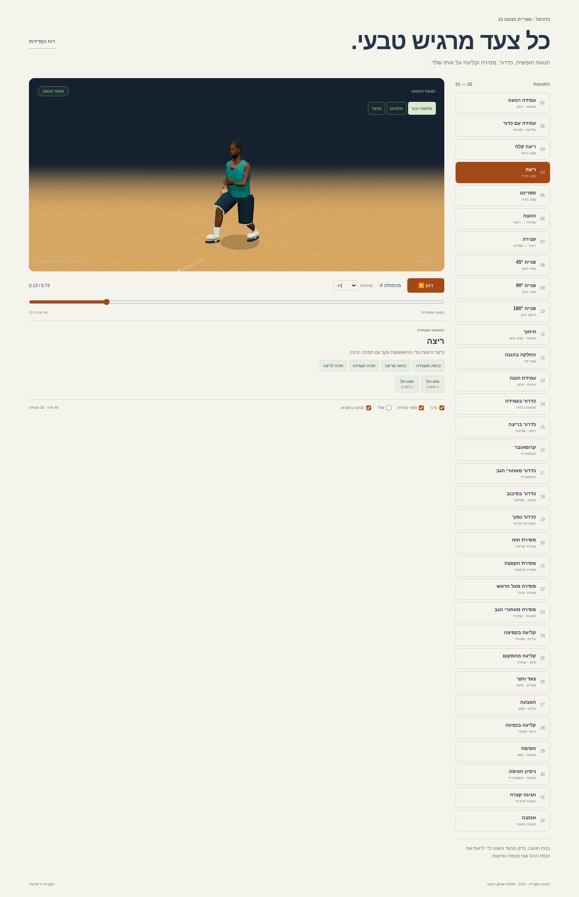

# כדורסל — תנועה טבעית v13

חבילת סקירה בענף `codex/hoops-motion-v13`, מבוססת על `main` בקומיט `19d9cdc5e3718236df5a2fc4d8b8c26c72007575`. כל התוספות נמצאות בתיקייה זו בלבד. **32 קליפים מלאים ב־24 משפחות**, שלד קנוני של 18 עצמות, 30Hz, ללא Draco. כל השמות בבקשה מכוסים, כולל idle עם כדור ובלעדיו. המספר 24 בבקשה אינו תואם את הפירוט; לא הושמטה פעולה כדי להתאים אליו.

[תצוגה חיה](preview.html) · [QA מדורג](verification/qa/report.html) · [כל הדרישות והראיות](verification/requirements.json) · [רישיונות](LICENSES.md)

## תוצאה מדודה

| תנאי | תוצאה |
|---|---|
| ציון בכלי המקורי motion-qa-v1 | מינימום **88.3**, ממוצע **94.1**, כל 32 הקליפים ≥88 |
| מדדים אדומים | **0** |
| מדדי QA ישימים | כיסוי מלא בכל קליפ; ללא נתונים חסרים במסך הציון |
| החלקת רגל נטועה | מרבית **8.01 מ״מ**, לעומת רף 20 מ״מ; נבדק מרחק תלת־ממדי בעולם ולא רק מהירות RMS |
| שלד וקצב | 18 שמות/הורים/מיקומי מנוחה תואמי athletes-core; ערוצי GLB אמיתיים ב־30Hz |
| ATHLETE_STANDARD | כל בדיקות העמידה והריצות הישימות עברו: זרועות נגדיות, טווח נדנוד, מרפקים ונטייה לפי מהירות |
| רציפות idle/run | 512/512 גשרים עברו C0/C1, כולל קטיעת מעבר; 4/4 חיבורי האצה/עצירה ישירים עברו |
| קידוד tall v12 | 32 קליפים עברו בדיקת round-trip; שגיאת אגן מרבית 0.067 מ״מ |
| תצוגה | גיליון רינדור 8 פריימים לכל קליפ, צילום מחשב ונייד, ראיות ב־browser.json |

ה־QA נקרא מהקומיט הקבוע `5eb4f093bc22523ee417a7f2345c3b813bffba24`. `measure.mjs` מפעיל את `workout/island/design/motion-qa-v1/run.mjs` המקורי בתיקייה זמנית. רק inventory הקלט מוחלף באמצעות Node hook; הרץ, המדדים והספים נשארים ללא שינוי. SHA-256 של קובצי הכלי ושל הנכסים נרשמים בדוח. הרפרנס soccer-locomotion-v2 נקרא מהקומיט `ec6c73949fb5820826b4c082972f5d4f1136641f`, משום ששתי התיקיות אינן קיימות בבסיס main זה.

## מה השתנה בתנועה

הריצות משתמשות בצעדים שמתחילים מעוגני תמיכה בעולם, עם התאוששות כף רגל, תנועה נגדית של הזרועות ונטייה גוברת לפי המהירות. העמידות כוללות נשימה והעברת משקל. פניות, חיתוך וצעדי הגנה משמרים חלונות תמיכה, וכל כדרור כולל מסלול כדור ו־bounce ברצפה. במסירות ובקליעות יש שחרור, ובחסימה ובחטיפה מגע מתוזמן. הקליעות כוללות הכנה ברגליים, ניתור כשנדרש, המשך תנועת שורש כף היד ונחיתה עם ספיגה.

הגשרים מספקים רציפות פוזה ומהירות בין כל קליפ ל־idle ול־run. המדידה נעשית מה־FLOAT accessors הסופיים של ה־GLB, ולא רק מפוזות המקור. [פירוט כל המעברים](verification/transitions.json).

## כל הקליפים

החלקה בטבלה היא הסטייה המרחבית המרבית לאורך חלון תמיכה מוצהר. האירועים נמדדים בזמנם המדויק. גיליונות התמונה מרנדרים את אותו GLB שממנו מופקים המדדים.

| קליפ | ציון | החלקה מרבית, מ״מ | אירועים | גיליון |
|---|---:|---:|---|---|
| idle | 96.6 | 0.00 | — | [8 פריימים](verification/sheets/idle.png) |
| idle_ball | 97.0 | 0.00 | — | [8 פריימים](verification/sheets/idle_ball.png) |
| jog | 90.4 | 0.92 | footstrike | [8 פריימים](verification/sheets/jog.png) |
| run | 91.3 | 1.52 | footstrike | [8 פריימים](verification/sheets/run.png) |
| sprint | 89.2 | 3.26 | footstrike | [8 פריימים](verification/sheets/sprint.png) |
| accelerate | 89.1 | 5.17 | — | [8 פריימים](verification/sheets/accelerate.png) |
| stop | 88.3 | 8.01 | — | [8 פריימים](verification/sheets/stop.png) |
| turn_45 | 91.0 | 1.65 | footstrike | [8 פריימים](verification/sheets/turn_45.png) |
| turn_90 | 90.1 | 2.53 | footstrike | [8 פריימים](verification/sheets/turn_90.png) |
| turn_180 | 90.0 | 1.17 | footstrike | [8 פריימים](verification/sheets/turn_180.png) |
| cross | 90.7 | 1.03 | footstrike | [8 פריימים](verification/sheets/cross.png) |
| defensive_slide | 93.1 | 0.22 | footstrike | [8 פריימים](verification/sheets/defensive_slide.png) |
| defense_stance | 95.1 | 0.00 | — | [8 פריימים](verification/sheets/defense_stance.png) |
| dribble_stand | 95.4 | 0.00 | contact, bounce | [8 פריימים](verification/sheets/dribble_stand.png) |
| dribble_run | 92.2 | 1.52 | contact, bounce | [8 פריימים](verification/sheets/dribble_run.png) |
| dribble_cross | 95.2 | 0.00 | contact, bounce | [8 פריימים](verification/sheets/dribble_cross.png) |
| dribble_behind | 94.2 | 0.00 | contact, bounce | [8 פריימים](verification/sheets/dribble_behind.png) |
| dribble_spin | 93.8 | 1.14 | contact, bounce | [8 פריימים](verification/sheets/dribble_spin.png) |
| dribble_low | 95.4 | 0.00 | contact, bounce | [8 פריימים](verification/sheets/dribble_low.png) |
| pass_chest | 98.1 | 0.04 | release, contact | [8 פריימים](verification/sheets/pass_chest.png) |
| pass_bounce | 98.1 | 0.04 | release, contact, bounce | [8 פריימים](verification/sheets/pass_bounce.png) |
| pass_overhead | 93.1 | 0.04 | release, contact | [8 פריימים](verification/sheets/pass_overhead.png) |
| pass_behind | 96.1 | 0.09 | release | [8 פריימים](verification/sheets/pass_behind.png) |
| jump_shot | 96.4 | 0.54 | release, takeoff, land | [8 פריימים](verification/sheets/jump_shot.png) |
| set_shot | 96.3 | 0.72 | release | [8 פריימים](verification/sheets/set_shot.png) |
| layup | 96.0 | 2.04 | release, takeoff, land | [8 פריימים](verification/sheets/layup.png) |
| dunk | 94.7 | 2.04 | release, takeoff, land | [8 פריימים](verification/sheets/dunk.png) |
| fadeaway | 96.4 | 0.54 | release, takeoff, land | [8 פריימים](verification/sheets/fadeaway.png) |
| block | 96.6 | 0.54 | contact, takeoff, land | [8 פריימים](verification/sheets/block.png) |
| steal_reach | 97.7 | 0.73 | contact | [8 פריימים](verification/sheets/steal_reach.png) |
| celebrate_short | 95.6 | 0.01 | — | [8 פריימים](verification/sheets/celebrate_short.png) |
| disappointed | 98.9 | 0.06 | — | [8 פריימים](verification/sheets/disappointed.png) |

## תצוגה וביקורת



[תצוגת נייד](verification/preview-mobile.png) · [ראיות דפדפן](verification/browser.json) · [תנועת מפרקים בזמן ניגון אמיתי](verification/playback.json) · [מקור והתאמת דמות הכדורסל](verification/model-provenance.json)

הדמות היא נכס כדורסל בדיוני CC0 קיים. הטופולוגיה, המרקם ומשקלי העור נשמרו; פוזת המנוחה הותאמה לשלד הקנוני. המודל משותף ל־32 קליפי אנימציה, ולכן אין שכפול mesh בכל GLB. אנימציות התצוגה אינן דמויות שמצוירות בקוד.

## חיבור ומגבלות

- זו חבילת נכסים וסקירה; קוד המשחק הקיים לא השתנה. מיזוג ה־PR וחיבור למשחק הם שלבים נפרדים.
- מבנה `runtime/motion.json` תואם לקידוד tall v12, אך פרופיל החבילה הוא `canonical`. שלושת הגופים המקוריים guard/wing/center דורשים retargeting לפרופורציותיהם; לא נטען שנבדקו כאן. יש להשתמש ב־reference/athlete.glb המצורף כדי לקבל את הפוזות שנמדדו.
- Root נשאר באפס. מסלול השחקן והכיוון מוחלים פעם אחת דרך `referenceTravel`. במשחק יש להתאים תנועה, מהירות וקצב לאותו תרחיש. גשר C1 לבדו אינו מבטיח נעילת רגל בזמן מסלול שרירותי; החיבור צריך לשמר עוגני תמיכה עד ההרמה.
- קידוד Int16 של כדור מיועד לעמידה עם כדור ולכדרורים. מסלולי שחרור ומגע הגנתי נשמרים במלואם ב־motions/catalog, ו־ball:null ב־motion.json מונע גלישת טווח בקידוד; הסימולציה אחראית למעוף אחרי האירוע.
- ציון QA הוא אבחון הנדסי של שלד ונקודות מגע מוצהרות. הוא אינו בדיקת כל קודקודי הנעל, תפיסה אנושית, התנגשות גוף־כדור או מכשיר טלפון אמיתי. הבדיקה הוויזואלית נעשתה בדפדפן ממוחשב.

## שחזור

```sh
node workout/island/design/hoops-motion-v13/source/build.mjs
node workout/island/design/hoops-motion-v13/measure.mjs
node workout/island/design/hoops-motion-v13/source/verify-transitions.mjs
node workout/island/design/hoops-motion-v13/source/verify-pack.mjs
node workout/island/design/hoops-motion-v13/source/capture.mjs
node workout/island/design/hoops-motion-v13/source/report.mjs
```

כל הנכסים והתוספות מקוריים או CC0 עם מקור מפורש. אין שינוי בקובץ קיים, ב־release.json, בתגי גרסה, ב־CLAUDE.md, ב־ops או בבדיקות המאגר.
