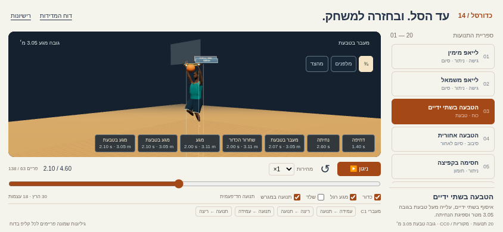

# ספריית תנועות כדורסל v14

**20 קליפים חדשים ב־30Hz על השלד הקנוני בן 18 עצמות**, מעל [v13 בקומיט f97bf53b](https://github.com/roynaor-work/Bakasun/commit/f97bf53bf2a933c2a5411fa542aeee02d7059156), בענף `codex/hoops-motion-v14`. כל השינויים הם קבצים חדשים בתוך `workout/island/design/hoops-motion-v14/`.

[תצוגה 844×390](preview.html) · [קטלוג](catalog.json) · [דוח QA](verification/qa/report.html) · [ראיות מלאות](verification/requirements.json) · [רישיונות](LICENSES.md)

## תוצאות

| דרישה | תוצאה מדודה |
|---|---|
| motion-qa-v1, כל קליפ מעל 88 | מינימום **90.6**, ממוצע **94.8**; 20/20 עברו |
| החלקת כף רגל מתחת ל־2 ס״מ | מרבית **3.26 מ״מ**; נמדד מרחק תלת־ממדי לאורך כל חלון תמיכה |
| שלד וקצב | שמות, הורים ומנוחה קנוניים; ערוצי FLOAT אמיתיים ב־GLB ב־30Hz |
| C1 לעמידה ולריצה | **320/320** גשרים עברו, כולל קטיעה באמצע מעבר |
| קידוד compact | 20/20 קליפים עברו round-trip; שגיאת אגן מרבית 0.067 מ״מ |
| גיליונות | 20 גיליונות × 8 פריימים מה־GLB שנמסרים; SHA-256 תואם לקטלוג |
| בדיקת דפדפן | תצוגת 844×390, ניגון מפרקים אמיתי וגשרי idle/run; ללא שגיאות |
| בדיקות מאגר | 4018 עברו, 0 נכשלו, 64 דולגו |

בסוויטת המאגר 4,017 בדיקות עברו ו־64 דולגו; בדיקת דפדפן קיימת אחת נתקעה מפני שבינארי Chromium ברירת המחדל של Playwright חסר, והבדיקה השאירה שרת פתוח כשפתיחת הדפדפן נכשלה. לאחר אבחון הופסק העובד התקוע, וקובץ הבדיקה הורץ מחדש ללא שינוי מול Chromium המותקן: 5/5 עברו, כולל הבדיקה שנתקעה. התוצאה המאוחדת היא 4,018 שעברו ו־64 דילוגים. פרטי ההרצה המקורית והחוזרת והחתימות נשמרים ב־[regression.json](verification/regression.json).

כלי motion-qa-v1 מחולץ מהקומיט הקבוע `5eb4f093bc22523ee417a7f2345c3b813bffba24`. הרץ, נוסחאות המדדים והספים נשארים ללא שינוי; מתאם inventory מחבר אליו את קובצי v14. שני קליפי העמידה והריצה של v13 משמשים כרפרנס בלבד ומסומנים `sourceReference` בתוצאת הכלי המקורית; הם אינם חלק מ־20 קליפי המסירה. ציוני החבילה נמדדים על GLB סופיים ב־120Hz. מספר המדדים האדומים המקוריים: **3** — השוואת קצות שלבי העונשין לעמידה רגילה. פוזות ביניים אלה שייכות לרצף העונשין, וחיבוריהן הישירים נבדקו בנפרד ב־C0/C1; ציוני הכלי המקורי נשמרו ללא תיקון כלפי מעלה.

## הקליפים

כל לייאפ מכיל גישה, ניתור וסיומת מלאה. העונשין מחולק להכנה, שחרור והמשך תנועה; שלושת השלבים נועדו להתנגן ברצף. שתי ההטבעות, שתי החסימות ושלוש המסירות הן קליפים נפרדים.

| קליפ | ציון | החלקה מרבית במ״מ | גיליון |
|---|---:|---:|---|
| לייאפ מימין — `layup_right` | 95.3 | 2.04 | [8 פריימים](verification/sheets/layup_right.png) |
| לייאפ משמאל — `layup_left` | 95.3 | 2.04 | [8 פריימים](verification/sheets/layup_left.png) |
| הטבעה בשתי ידיים — `dunk_two_hand` | 92.6 | 2.04 | [8 פריימים](verification/sheets/dunk_two_hand.png) |
| הטבעה אחורית — `dunk_reverse` | 93.5 | 2.04 | [8 פריימים](verification/sheets/dunk_reverse.png) |
| חסימה בקפיצה — `block_jump` | 96.6 | 0.54 | [8 פריימים](verification/sheets/block_jump.png) |
| חסימה בשלוחת יד — `block_reach` | 96.6 | 0.54 | [8 פריימים](verification/sheets/block_reach.png) |
| גנבה בשיא ריצה — `steal_sprint` | 90.6 | 3.26 | [8 פריימים](verification/sheets/steal_sprint.png) |
| עונשין — הכנה — `free_throw_prepare` | 91.4 | 0.03 | [8 פריימים](verification/sheets/free_throw_prepare.png) |
| עונשין — שחרור — `free_throw_release` | 92.0 | 0.06 | [8 פריימים](verification/sheets/free_throw_release.png) |
| עונשין — המשך התנועה — `free_throw_follow` | 91.9 | 0.01 | [8 פריימים](verification/sheets/free_throw_follow.png) |
| זריקה בנפילה אחורה — `fadeaway` | 96.4 | 0.54 | [8 פריימים](verification/sheets/fadeaway.png) |
| מסירה מעל הראש — `pass_overhead` | 95.1 | 0.07 | [8 פריימים](verification/sheets/pass_overhead.png) |
| מסירה מהחזה — `pass_chest` | 98.1 | 0.04 | [8 פריימים](verification/sheets/pass_chest.png) |
| מסירה עם קפיצה — `pass_jump` | 96.2 | 0.50 | [8 פריימים](verification/sheets/pass_jump.png) |
| כדרור מאחורי הגב — `dribble_behind` | 92.8 | 0.01 | [8 פריימים](verification/sheets/dribble_behind.png) |
| כדרור בין הרגליים — `dribble_between` | 91.0 | 0.01 | [8 פריימים](verification/sheets/dribble_between.png) |
| סיבוב על רגל ציר — `pivot` | 97.0 | 0.09 | [8 פריימים](verification/sheets/pivot.png) |
| חגיגת סל — `celebrate_score` | 95.6 | 0.01 | [8 פריימים](verification/sheets/celebrate_score.png) |
| התאכזבות — `disappointed` | 98.9 | 0.06 | [8 פריימים](verification/sheets/disappointed.png) |
| עזרה לשחקן לקום — `help_up` | 98.5 | 0.14 | [8 פריימים](verification/sheets/help_up.png) |

## מגעים לפי גובה

סימוני כדור וטבעת נפרדים. לכל אירוע בעל עצם יש נקודת מגע מקומית, מיקום בעולם ו־`heightMeters` ביחס לרצפה y=0; הטבעת מסומנת בגובה 3.05 מ׳. מגע רצפה בכדרור מסומן בגובה 0, ומרכז הכדור נשמר בנפרד בגובה רדיוסו. הנתונים נמצאים גם ב־`contactMarkers` ובתצוגה.

| קליפ | אירוע | זמן בשניות | עצם | גובה מגע במטרים |
|---|---|---:|---|---:|
| layup_right | release | 1.800 | RightHand | 2.369 |
| layup_left | release | 1.800 | LeftHand | 2.369 |
| dunk_two_hand | release | 2.000 | RightHand | 3.113 |
| dunk_two_hand | contact | 2.000 | LeftHand | 3.113 |
| dunk_two_hand | rim_contact | 2.100 | LeftHand | 3.050 |
| dunk_two_hand | rim_contact | 2.100 | RightHand | 3.050 |
| dunk_reverse | release | 2.000 | RightHand | 3.083 |
| dunk_reverse | rim_contact | 2.100 | RightHand | 3.050 |
| block_jump | contact | 1.900 | RightHand | 2.165 |
| block_reach | contact | 1.900 | RightHand | 1.745 |
| steal_sprint | contact | 1.500 | RightHand | 0.891 |
| free_throw_prepare | contact | 0.600 | RightHand | 0.947 |
| free_throw_prepare | contact | 1.800 | LeftHand | 1.400 |
| free_throw_release | release | 0.850 | RightHand | 1.680 |
| fadeaway | release | 1.800 | RightHand | 2.027 |
| pass_overhead | release | 1.500 | RightHand | 1.530 |
| pass_overhead | contact | 1.500 | LeftHand | 1.530 |
| pass_chest | release | 1.200 | RightHand | 1.100 |
| pass_chest | contact | 1.200 | LeftHand | 1.100 |
| pass_jump | release | 1.300 | RightHand | 1.561 |
| pass_jump | contact | 1.300 | LeftHand | 1.561 |
| dribble_behind | contact | 0.000 | RightHand | 1.060 |
| dribble_behind | contact | 0.800 | LeftHand | 1.060 |
| dribble_behind | contact | 1.600 | RightHand | 1.060 |
| dribble_behind | contact | 2.400 | LeftHand | 1.060 |
| dribble_behind | contact | 3.200 | RightHand | 1.060 |
| dribble_between | contact | 0.000 | RightHand | 1.060 |
| dribble_between | contact | 0.800 | LeftHand | 1.060 |
| dribble_between | contact | 1.600 | RightHand | 1.060 |
| dribble_between | contact | 2.400 | LeftHand | 1.060 |
| dribble_between | contact | 3.200 | RightHand | 1.060 |
| help_up | assist_contact | 1.300 | RightHand | 0.750 |

## תצוגה ואימות



[בדיקות דפדפן](verification/browser.json) · [ניגון מפרקים](verification/playback.json) · [מעברי C1 וחיבורי העונשין](verification/transitions.json) · [קידוד](verification/pack.json) · [מקור הדמות](verification/model-provenance.json)

הדמות היא נכס כדורסל בדיוני CC0 קיים, עם אותה התאמת מנוחה קנונית כמו v13. קובץ הדמות משותף לכל האנימציות; ה־GLB של הקליפים מכיל ערוצי שלד ללא שכפול mesh וללא דחיסה.

## חיבור ושחזור

`catalog.json` בשורש החבילה מכיל נתיבי נכסים יחסיים לשורש; `runtime/catalog.json` מכיל אותם נתונים עם נתיבים יחסיים ל־runtime. `runtime/motions.json` שומר פוזות מלאות, מסלולי כדור ואירועים; `runtime/motion.json` מכיל קידוד tall v12 בפרופיל canonical. Root נשאר באפס, והתנועה והכיוון בעולם מוחלים פעם אחת דרך `referenceTravel`. גשר C1 מבטיח רציפות פוזה ומהירות; בעת חיבור למשחק יש לשמר עוגני רגל עד ההרמה.

`runtime/player.mjs` מספק `makeClipBridge`, `interruptBridge` ו־`eventsBetween`, באותו חוזה כמו v13. הפניות idle/run מגיעות מהתיקייה הקיימת של v13. שינוי פרופורציות לדגמי guard/wing/center דורש retargeting; המדידה כאן מתייחסת לשלד הקנוני ולדמות המצורפת.

הסימולציה אחראית למעוף אחרי שחרור ולמשתתף השני בעזרה לקום. זהו אימות נכסים בדפדפן ממוחשב, ולא בדיקת חיבור במשחק או במכשיר טלפון. בדיקות המגע וההחלקה מודדות סמנים מוגדרים בשלד, ולא כל קודקוד בנעל או התנגשות mesh מלאה.

```sh
node workout/island/design/hoops-motion-v14/source/build.mjs
node workout/island/design/hoops-motion-v14/measure.mjs
node workout/island/design/hoops-motion-v14/source/verify-transitions.mjs
node workout/island/design/hoops-motion-v14/source/verify-pack.mjs
node workout/island/design/hoops-motion-v14/source/capture.mjs
node workout/island/design/hoops-motion-v14/source/regression.mjs
node workout/island/design/hoops-motion-v14/source/report.mjs
```

לפי ההוראה המפורשת של המשימה לא נערכו קבצים קיימים, לרבות ops/CONTROL.md, גרסאות, קוד משחק ותלויות. קריטריון הסיום: 20 GLB, קטלוג, גיליונות, תצוגה, רישיונות ודוח, QA מעל 88 והחלקה מתחת ל־20 מ״מ, ודחיפה לענף החדש.
