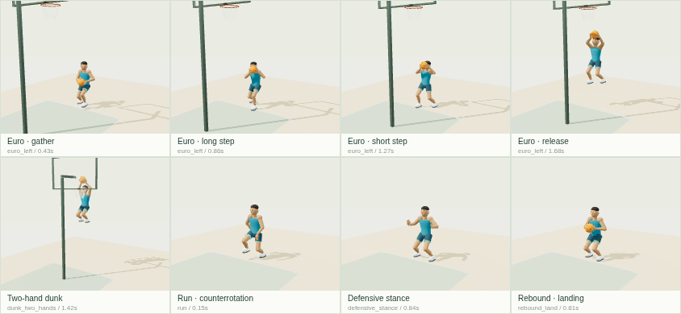

# ספריית תנועה 3 לכדורסל — v9

83 ביצועים מקוריים ב־30Hz, GLB עם Draco ו־JSON דחוס, על שלד motion2 הקנוני של 18 עצמות. הנתונים והדמות המקורית CC0. בסיס: main, commit d1af33d98b73b4763a399c260fcaa3621fc1792f. ענף מסירה: codex/hoops-motion-v9.

תשעת הקליפים המוזכרים במשימה הם בסיס motion2; ב־runtime של v8 יש כבר 15. v9 אינו מעתיק אף אחד מהם. הוא מספק וריאציות מקוריות, וביניהן ציר אחורי מוגן, חסימה בשתי ידיים ונגיעה לחטיפה, לצד שאר פעולות הקטלוג.

## צפייה

מהשורש של המאגר:

```sh
python3 -m http.server 8765
```

פתחו [preview.html](preview.html) דרך השרת בנתיב workout/island/design/hoops-motion-v9/preview.html. בחרו קליפ או סינון קבוצה; כל קליפ מתנגן שוב ושוב, וניתן לעצור, לגרור זמן ולשנות מהירות. קליפ חד פעמי חוזר בהשמעה רק לאחר עצירת הסיום; זהו reset של התצוגה, ולא לולאת אנימציה סגורה.



## ממשק

אותו מבנה של v8: runtime/catalog.mjs, runtime/library.mjs, runtime/state-machine.mjs. loadClip(id) מחזיר gzip מפוענח; loadClip(id,{format:'glb'}) מחזיר גם scene ו־AnimationClip אמיתי של Three. אין חיבור למשחק או עריכה שלו. אירועים הם presentation בלבד.

Root נשאר זהות. תנועת העולם שייכת למארח; referenceRootTranslationMeters הוא מסלול ייחוס למדידות ולתצוגה בלבד. סגירת לולאה נבדקת בפוזה המקומית. מדידת החלקה בעולם מחברת את מסלול הייחוס; יש לשמור עוגני רגליים וליישם IK אחרי ערבוב כאשר מחברים למארח.

נקודת סוליה [0,-.08,0], מדריך כף יד [0,-.08,.025], רדיוס כדור .12 מטר. סמני מגע אינם מעניקים החזקה או קולעים סל; רק epoch סמכותי חדש יכול לשחרר את נעילת סוף הכדרור.

## בדיקות ושחזור

הבדיקות פועלות על הנכסים שנמסרו ללא npm install:

```sh
node --test workout/island/design/hoops-motion-v9/tests/*.mjs
```

[REPORT.md](REPORT.md) מכיל שיטות מדידה, טבלה לכל קליפ, מגבלות ופלט אימות. [LICENSES.md](LICENSES.md) מפרט מקור ורישיון לכל קליפ. [TRANSITIONS.md](TRANSITIONS.md) מפרט את מדיניות המעברים.

כלי בנייה מותקנים ב־/tmp בלבד. הוראות תלויות ופקודות שחזור ב־[source/README.md](source/README.md).
