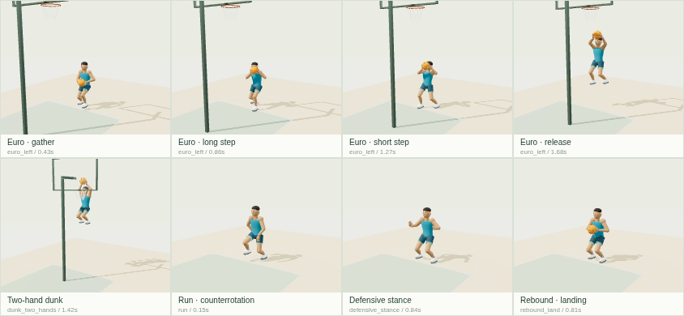

# ספריית תנועה 3 לכדורסל — דוח קבלה v9

הושלמו **83 קליפים מקוריים**, כולם PASS במדידות ה־GLB המפוענח. 48 תנועה חופשית וכדרור, 16 התקפה, 19 הגנה/ריבאונד/כדור חופשי/חגיגות. כל הקבצים חדשים תחת hoops-motion-v9 בלבד.

בסיס: main, commit d1af33d98b73b4763a399c260fcaa3621fc1792f. ענף codex/hoops-motion-v9. בתיקיית motion2 יש תשעה קליפים; ב־runtime של v8 יש 15. כל אלה נשארו לקריאה בלבד. אין שינוי בקוד משחק, release.json, release.mjs, תגי גרסה, CLAUDE.md, ops או בדיקות קיימות.

## תוצאות עיקריות

| בדיקה | תוצאה נמדדת |
|---|---|
| טעינה ב־GLTFLoader עם מפענח Draco מקומי | 83/83, שגיאות דפדפן/WebGL: 0 |
| בדיקת Khronos glTF validator | 83 קבצים; 0 שגיאות ו־0 אזהרות |
| גודל GLB | 81.7–117.7 KB; תקרה 1,500 KB לקובץ |
| רשת דגימה | 30Hz בדיוק בכל הערוצים; מדידה ב־120Hz וגבולות מגע |
| החלקת נקודת סוליה בנטיעה | לכל היותר 1.63 ס״מ; תקרה 2 ס״מ |
| שגיאת קצב מול מהירות | לכל היותר 4.17%; תקרה 10% |
| שגיאת כף יד לפני הכדור בזמן מגע | לכל היותר 0.98 ס״מ; תקרה 2 ס״מ |
| גובה כף יד לעומת החזה בזמן נשיאה/איסוף | מקסימום 12.83 ס״מ; תקרה +15 ס״מ |
| פרקי גוף | 18 עצמות מדויקות, אורך עצמות קבוע, ללא הפרות במעטפות האנטומיות המפורטות |
| לולאות | כל 29 הלולאות נסגרות באותה פוזה בדיוק; חד־פעמיים שומרים פוזת סיום |
| מקוריות | השוואת מסלולי גוף לכל 15 קליפי v8 ולתשעת קליפי motion2; אין כפילות מדודה |

## שיטת מדידה והיקף

מדידות source/measure.mjs אינן מייבאות את מחוללי הביצוע. כל GLB נטען בפועל דרך GLTFLoader ו־Draco, ונמדד באמצעות AnimationMixer וטרנספורמציות העולם של העצמות. המדידה נפרדת מ־FK של JSON, ונבדקת גם התאמה ביניהם. נמדדות נקודת הסוליה [0,-.08,0] ומדריך כף היד [0,-.08,.025], ולא רק מיקום האגן או שורש כף היד.

החלקה היא המרחק התלת־ממדי המרבי מעוגן תחילת כל חלון נטיעה שלם. מחברים לפוזה את referenceRootTranslationMeters, בהתאם לחוזה in-place של v8. המסלול הוא ייחוס מדידה תיאורי בלבד; המארח אחראי לתנועת העולם ול־IK אחרי ערבוב. חלונות התמיכה חייבים לכסות רגליים המגיעות לקרקע; קיטוע חלון במעבר לולאה אינו נחשב חלון קצר מלאכותי.

זיהוי צעדים משתמש בהיסטרזיס גובה סוליה מה־GLB, ללא הסתמכות על שמות אירועים או על הצהרת מספר הצעדים. יעדי הקצב הוגדרו לפני חיבור התנועה: הליכה 1.35 מ׳/ש׳→1.8 צעדים/ש׳, ג׳וג 2.7→2.5, ריצה 4.6→3.0, ספרינט 6.8→3.6; כדרור הליכה 1.2→1.667; כדרור כיווני 1.05→1.667; החלקת הגנה .55→1.429. אורך הלולאה מעוגל למספר זוגי של פריימים כדי ששתי נטיעות חוזרות תיפולנה על רשת 30Hz. השגיאה נבדקת ביחס למהירות הייחוס שנמדדה.

יד מול חזה נמדדת בשלבי carry/held/gather. העלאת יד מכוונת בזריקה, הטבעה וריבאונד נבדקת בנפרד כנגד המגע והיעד. בדיקות מגע אינן מסתפקות בסמן: הן בודקות את פני הכדור שנמדדו מול מדריך כף היד. זריקה מחייבת מגע רציף עם היד הראשית עד השחרור ו־follow-through אחריו.

נטייה נבדקת כנגד תאוצה אופקית מסוננת בחלון 100ms, כאשר לפחות רגל אחת תומכת בקרקע והתאוצה מעל .4 מ׳/ש׳². נדרשת התאמה של לפחות 90% מהדגימות האלה. אין דרישת נטייה לכיוון תאוצה אופקית באוויר; מסלולי הגמר של ההתקפה נעים במהירות אופקית קבועה בזמן האוויר. בריצה נמדדות אמפליטודות סיבוב כתפיים/ירכיים ומתאם שלילי, ולא רק סיבוב גוף משותף.

הבדיקות האנטומיות משתמשות בכיפוף גאומטרי של הברך והמרפק, ציר hinge חתום ובדיקת סיבוב מחוץ לציר, swing/twist בירך ובכתף, קרסול מול כיוון השוק, שורש כף היד ו־forearm pronation, וטווחים במפרקי עמוד השדרה והראש. מסגרת הזרוע מכוונת כך שכיפוף מרפק קדימה הוא סביב −X, לעומת +X בברך; הדבר אינו משנה את מבנה השלד או את מיקומי העצמות. מעטפות הגבול המלאות נשמרות ב־verification/measurements.json. פירוק סיבוב כתף נעשה סינגולרי ליד הושטת זרוע מלאה מעל הראש; מספר הדגימות האלה מתועד בנפרד ולא מוצג כאומדן מדויק של סיבוב צירי.

לרשת 30Hz יש שגיאת מסלול סוליה בין מפתחות. המחולל כולל תיקון גובה נקודת סוליה של 1–16 מ״מ לפי הפעולה, בתוך רצועת המגע של 2 ס״מ; נמדדים שוב ההחלקה והגובה הממשיים לאחר SLERP. זהו תיקון דגימה מפורש, ללא שינוי סף הקבלה.

## טבלת מדידות לכל קליפ

מקף פירושו שהמדד אינו חל על הפעולה. עמודת Hip/shoulder מציגה אמפליטודות ומתאם. Crouch מציגה ירידת אגן לפני הקפיצה ואחרי הנחיתה. טבלת JSON המלאה כוללת זמני שיא והפרות, כיסוי מגעים, זוויות ציריות וגבולות לכל מפרק.

| Clip | GLB KB | Plant cm | Speed m/s · steps/s · error % | Carry palm−chest cm | Lean aligned % | Hip/shoulder ° · corr | Brake air ms | Knee/elbow/ankle/wrist max ° | Loop | Palm max m | Crouch before/after cm | Arm follow ms | Nearest new pose RMS cm | Result |
|---|---:|---:|---:|---:|---:|---:|---:|---:|---|---:|---:|---:|---:|---|
| idle_relaxed | 108.4 | 0.00 | 0.00 · — · — | — | — | 1.0/0.5 · -1.00 | — | 50.5/76.7/29.6/39.9 | exact | 0.75 | — | — | 0.73 | PASS |
| idle_relaxed_ball | 113.6 | 0.00 | 0.00 · — · — | -9.00 | — | 1.0/0.5 · -1.00 | — | 50.5/120.1/29.6/54.2 | exact | 1.08 | — | — | 0.96 | PASS |
| idle_weight_shift | 108.5 | 0.00 | 0.00 · — · — | — | — | 1.0/0.4 · -1.00 | — | 50.7/76.9/29.7/40.9 | exact | 0.75 | — | — | 0.73 | PASS |
| idle_weight_shift_ball | 113.7 | 0.00 | 0.00 · — · — | -9.00 | — | 1.0/0.4 · -1.00 | — | 50.7/121.0/29.7/58.6 | exact | 1.08 | — | — | 1.47 | PASS |
| idle_ready | 108.4 | 0.00 | 0.00 · — · — | — | — | 1.0/0.5 · -1.00 | — | 49.4/77.1/29.1/39.3 | exact | 0.75 | — | — | 0.95 | PASS |
| idle_ready_ball | 113.5 | 0.00 | 0.00 · — · — | -8.98 | — | 1.0/0.5 · -1.00 | — | 49.4/121.8/29.1/54.9 | exact | 1.08 | — | — | 0.96 | PASS |
| walk | 90.6 | 0.61 | 1.35 · 1.76 · 1.96 | — | — | 2.6/3.2 · -1.00 | — | 79.0/77.9/54.8/46.2 | exact | 0.71 | — | — | 4.18 | PASS |
| walk_ball | 97.9 | 0.61 | 1.35 · 1.76 · 1.96 | — | — | 2.6/3.2 · -1.00 | — | 79.0/112.8/54.8/84.4 | exact | 0.93 | — | 196 | 0.51 | PASS |
| jog | 85.4 | 1.63 | 2.70 · 2.50 · 0.00 | — | — | 2.6/3.2 · -1.00 | — | 103.1/77.9/61.5/48.5 | exact | 0.69 | — | — | 3.72 | PASS |
| jog_ball | 89.6 | 1.63 | 2.70 · 2.50 · 0.00 | — | — | 2.6/3.2 · -1.00 | — | 103.1/115.5/61.5/83.6 | exact | 0.95 | — | 196 | 3.66 | PASS |
| run | 83.4 | 1.10 | 4.60 · 3.00 · 0.00 | — | — | 4.9/5.5 · -1.00 | — | 119.0/77.8/61.5/49.5 | exact | 0.70 | — | — | 3.72 | PASS |
| run_ball | 87.3 | 1.10 | 4.60 · 3.00 · 0.00 | — | — | 4.9/5.5 · -1.00 | — | 119.0/119.3/61.5/83.3 | exact | 0.95 | — | 195 | 3.66 | PASS |
| sprint | 81.7 | 1.37 | 6.80 · 3.75 · 4.17 | — | — | 4.9/5.5 · -1.00 | — | 128.7/78.6/61.4/50.2 | exact | 0.71 | — | — | 4.52 | PASS |
| sprint_ball | 85.2 | 1.37 | 6.80 · 3.75 · 4.17 | — | — | 4.9/5.5 · -1.00 | — | 128.7/120.3/61.4/82.6 | exact | 0.95 | — | 192 | 4.50 | PASS |
| brake | 101.8 | 0.54 | 1.38 · — · — | — | 100 | 0.0/2.3 · — | 0 | 110.0/78.3/61.5/49.8 | one-shot | 0.74 | — | — | 7.53 | PASS |
| brake_ball | 109.1 | 0.54 | 1.38 · — · — | -8.14 | 100 | 0.0/2.3 · — | 0 | 110.0/119.8/61.5/85.0 | one-shot | 1.06 | — | 199 | 11.13 | PASS |
| cut_45_left | 98.8 | 0.25 | 1.31 · — · — | — | 95 | 22.5/24.8 · 1.00 | — | 96.7/80.6/61.5/51.7 | one-shot | 0.68 | — | — | 5.21 | PASS |
| cut_45_left_ball | 107.1 | 0.25 | 1.31 · — · — | — | 95 | 22.5/24.8 · 1.00 | — | 96.7/112.6/61.5/85.1 | one-shot | 0.93 | — | 196 | 7.61 | PASS |
| cut_45_right | 98.9 | 0.25 | 1.31 · — · — | — | 95 | 22.5/24.8 · 1.00 | — | 97.0/82.0/61.5/49.4 | one-shot | 0.68 | — | — | 5.23 | PASS |
| cut_45_right_ball | 107.3 | 0.25 | 1.31 · — · — | — | 95 | 22.5/24.8 · 1.00 | — | 97.0/114.5/61.5/84.3 | one-shot | 0.93 | — | 196 | 7.62 | PASS |
| cut_90_left | 98.8 | 0.26 | 1.31 · — · — | — | 95 | 45.0/47.3 · 1.00 | — | 96.7/83.8/61.5/55.6 | one-shot | 0.68 | — | — | 5.21 | PASS |
| cut_90_left_ball | 106.8 | 0.26 | 1.31 · — · — | — | 95 | 45.0/47.3 · 1.00 | — | 96.7/115.8/61.5/85.1 | one-shot | 0.93 | — | 196 | 7.60 | PASS |
| cut_90_right | 98.9 | 0.25 | 1.31 · — · — | — | 95 | 45.0/47.3 · 1.00 | — | 97.5/86.1/61.5/50.2 | one-shot | 0.68 | — | — | 5.23 | PASS |
| cut_90_right_ball | 106.9 | 0.25 | 1.31 · — · — | — | 95 | 45.0/47.3 · 1.00 | — | 97.5/118.1/61.5/84.3 | one-shot | 0.93 | — | 196 | 7.62 | PASS |
| cut_135_left | 98.9 | 0.30 | 1.31 · — · — | — | 95 | 67.5/69.8 · 1.00 | — | 96.7/87.0/61.5/57.6 | one-shot | 0.68 | — | — | 5.21 | PASS |
| cut_135_left_ball | 107.2 | 0.30 | 1.31 · — · — | — | 95 | 67.5/69.8 · 1.00 | — | 96.7/117.7/61.5/85.1 | one-shot | 0.93 | — | 196 | 7.60 | PASS |
| cut_135_right | 98.9 | 0.25 | 1.31 · — · — | — | 95 | 67.5/69.8 · 1.00 | — | 96.7/90.0/61.5/51.3 | one-shot | 0.68 | — | — | 5.24 | PASS |
| cut_135_right_ball | 107.3 | 0.25 | 1.31 · — · — | — | 95 | 67.5/69.8 · 1.00 | — | 96.7/120.0/61.5/84.3 | one-shot | 0.93 | — | 196 | 7.62 | PASS |
| cut_180_left | 98.9 | 0.35 | 1.31 · — · — | — | 95 | 90.0/92.3 · 1.00 | — | 96.7/89.3/61.5/57.6 | one-shot | 0.68 | — | — | 5.21 | PASS |
| cut_180_left_ball | 106.8 | 0.35 | 1.31 · — · — | — | 95 | 90.0/92.3 · 1.00 | — | 96.7/117.7/61.5/85.1 | one-shot | 0.93 | — | 196 | 7.60 | PASS |
| cut_180_right | 98.9 | 0.27 | 1.31 · — · — | — | 95 | 90.0/92.3 · 1.00 | — | 96.7/90.3/61.5/52.7 | one-shot | 0.68 | — | — | 5.24 | PASS |
| cut_180_right_ball | 106.9 | 0.27 | 1.31 · — · — | — | 95 | 90.0/92.3 · 1.00 | — | 96.7/120.0/61.5/84.3 | one-shot | 0.93 | — | 196 | 7.62 | PASS |
| pivot_reverse_left | 101.2 | 0.02 | 0.00 · — · — | -8.98 | — | 49.3/49.7 · 1.00 | — | 82.1/119.5/47.0/59.2 | one-shot | 1.04 | — | — | 14.93 | PASS |
| pivot_reverse_right | 101.3 | 0.02 | 0.00 · — · — | -8.98 | — | 49.3/49.7 · 1.00 | — | 82.1/119.5/47.0/59.2 | one-shot | 1.04 | — | — | 14.50 | PASS |
| dribble_walk_left | 98.9 | 0.47 | 1.20 · 1.67 · 0.02 | — | — | 2.6/3.2 · -1.00 | — | 78.8/112.8/54.4/84.4 | exact | 0.93 | — | 199 | 5.35 | PASS |
| dribble_walk_right | 99.0 | 0.47 | 1.20 · 1.67 · 0.02 | — | — | 2.6/3.2 · -1.00 | — | 78.8/112.8/54.4/84.4 | exact | 0.93 | — | 199 | 0.51 | PASS |
| dribble_forward | 99.0 | 0.43 | 1.05 · 1.67 · 0.02 | — | — | 2.6/3.2 · -1.00 | — | 78.9/112.8/53.6/84.4 | exact | 0.93 | — | 199 | 0.92 | PASS |
| dribble_backward | 99.0 | 0.43 | 1.05 · 1.67 · 0.02 | — | — | 2.6/3.2 · -1.00 | — | 78.9/112.8/53.3/84.4 | exact | 0.93 | — | 199 | 4.93 | PASS |
| dribble_left | 98.8 | 0.43 | 1.05 · 1.67 · 0.02 | — | — | 2.6/3.2 · -1.00 | — | 79.4/112.8/42.7/84.4 | exact | 0.93 | — | 199 | 4.93 | PASS |
| dribble_right | 98.9 | 0.43 | 1.05 · 1.67 · 0.02 | — | — | 2.6/3.2 · -1.00 | — | 79.4/112.8/42.7/84.4 | exact | 0.93 | — | 199 | 4.93 | PASS |
| dribble_forward_left | 99.5 | 0.43 | 1.05 · 1.67 · 0.02 | — | — | 2.6/3.2 · -1.00 | — | 79.2/112.8/50.0/84.4 | exact | 0.93 | — | 199 | 4.93 | PASS |
| dribble_forward_right | 99.6 | 0.43 | 1.05 · 1.67 · 0.02 | — | — | 2.6/3.2 · -1.00 | — | 79.2/112.8/50.3/84.4 | exact | 0.93 | — | 199 | 4.93 | PASS |
| dribble_backward_left | 99.5 | 0.43 | 1.05 · 1.67 · 0.02 | — | — | 2.6/3.2 · -1.00 | — | 79.2/112.8/50.3/84.4 | exact | 0.93 | — | 199 | 4.93 | PASS |
| dribble_backward_right | 99.6 | 0.43 | 1.05 · 1.67 · 0.02 | — | — | 2.6/3.2 · -1.00 | — | 79.3/112.8/50.0/84.4 | exact | 0.93 | — | 199 | 4.93 | PASS |
| dribble_crossover_left | 99.8 | 0.00 | 0.00 · — · — | — | — | 2.9/6.0 · 0.11 | — | 81.6/110.7/51.7/30.2 | one-shot | 0.93 | — | 125 | 6.49 | PASS |
| dribble_crossover_right | 99.9 | 0.00 | 0.00 · — · — | — | — | 2.9/6.0 · 0.11 | — | 80.9/110.4/51.8/30.0 | one-shot | 0.93 | — | 125 | 6.58 | PASS |
| dribble_between_legs_left | 100.1 | 0.00 | 0.00 · — · — | — | — | 2.9/6.0 · 0.11 | — | 81.6/116.4/51.7/58.5 | one-shot | 0.94 | — | 108 | 6.49 | PASS |
| dribble_between_legs_right | 100.1 | 0.00 | 0.00 · — · — | — | — | 2.9/6.0 · 0.11 | — | 80.9/124.8/51.8/73.6 | one-shot | 0.94 | — | 108 | 6.58 | PASS |
| dribble_hesitation_left | 99.8 | 0.20 | 0.00 · — · — | — | — | 2.9/6.0 · 0.11 | — | 93.4/125.3/54.7/30.0 | one-shot | 1.03 | — | 200 | 8.58 | PASS |
| dribble_hesitation_right | 99.9 | 0.20 | 0.00 · — · — | — | — | 2.9/6.0 · 0.11 | — | 91.8/128.4/51.5/34.5 | one-shot | 1.03 | — | 200 | 8.30 | PASS |
| euro_left | 117.6 | 0.12 | 0.56 · — · — | 12.83 | 100 | 1.7/3.0 · -0.15 | — | 111.1/131.0/56.1/65.8 | one-shot | 2.33 | 11.0/14.9 | 192 | 2.86 | PASS |
| euro_right | 117.7 | 0.12 | 0.56 · — · — | 12.83 | 100 | 1.7/3.0 · -0.15 | — | 111.1/131.0/56.1/66.7 | one-shot | 2.31 | 11.0/14.9 | 192 | 2.85 | PASS |
| layup_left | 117.4 | 0.12 | 0.49 · — · — | 12.74 | 100 | 1.7/2.7 · 0.03 | — | 107.5/129.2/57.3/64.0 | one-shot | 2.38 | 8.5/14.9 | 192 | 2.86 | PASS |
| layup_right | 117.6 | 0.12 | 0.49 · — · — | 12.74 | 100 | 1.7/2.7 · 0.03 | — | 107.5/129.2/57.3/63.1 | one-shot | 2.36 | 8.5/14.9 | 192 | 2.85 | PASS |
| floater | 109.6 | 0.17 | 0.24 · — · — | 3.83 | 100 | 1.7/2.7 · 0.04 | — | 93.3/127.4/61.1/76.5 | one-shot | 2.05 | 11.0/15.0 | 200 | 11.80 | PASS |
| jump_shot | 109.0 | 0.13 | 0.00 · — · — | 3.87 | — | 1.7/2.7 · 0.04 | — | 92.4/129.2/57.4/88.6 | one-shot | 1.88 | 11.0/15.0 | 200 | 11.80 | PASS |
| free_throw | 115.1 | 0.01 | 0.00 · — · — | 3.12 | — | 1.7/2.7 · 0.04 | — | 76.4/126.4/47.2/76.4 | one-shot | 1.62 | — | 200 | 13.46 | PASS |
| three_point | 112.7 | 0.11 | 0.00 · — · — | 4.23 | — | 1.7/2.7 · 0.04 | — | 92.4/128.0/57.5/56.1 | one-shot | 1.92 | 11.0/15.0 | 200 | 20.53 | PASS |
| dunk_one_hand | 117.2 | 0.11 | 0.34 · — · — | -5.40 | 100 | 1.7/2.7 · 0.04 | — | 101.6/137.7/62.3/90.0 | one-shot | 3.42 | 11.0/15.0 | 192 | 8.40 | PASS |
| dunk_two_hands | 117.0 | 0.11 | 0.34 · — · — | -13.18 | 100 | 1.7/2.7 · 0.04 | — | 101.6/125.8/62.3/90.9 | one-shot | 3.40 | 11.0/15.0 | 192 | 8.40 | PASS |
| screen_set | 108.3 | 0.00 | 0.00 · — · — | — | — | 0.0/0.0 · — | — | 71.3/69.0/36.8/43.6 | exact | 0.67 | — | — | 5.25 | PASS |
| basket_cut_left | 102.2 | 0.27 | 2.04 · — · — | — | 100 | 17.8/20.0 · 0.99 | — | 97.4/84.1/61.5/55.2 | one-shot | 0.68 | — | — | 6.00 | PASS |
| basket_cut_right | 102.3 | 0.22 | 2.04 · — · — | — | 100 | 17.8/18.9 · 0.99 | — | 98.2/86.3/61.5/50.2 | one-shot | 0.68 | — | — | 6.00 | PASS |
| defensive_stance | 108.5 | 0.00 | 0.00 · — · — | — | — | 0.0/0.0 · — | — | 81.8/90.8/45.4/77.5 | exact | 1.02 | — | — | 4.00 | PASS |
| defensive_slide_left | 94.9 | 0.03 | 0.55 · 1.43 · 0.03 | — | — | 0.0/2.3 · — | — | 104.5/108.3/55.9/59.1 | exact | 0.81 | — | — | 6.12 | PASS |
| defensive_slide_right | 95.0 | 0.03 | 0.55 · 1.43 · 0.03 | — | — | 0.0/2.3 · — | — | 104.5/108.3/55.9/59.1 | exact | 0.81 | — | — | 6.06 | PASS |
| closeout | 102.0 | 0.06 | 0.50 · — · — | — | 100 | 0.0/3.1 · — | — | 94.5/133.2/57.6/44.6 | one-shot | 1.33 | — | — | 7.67 | PASS |
| block_two_hands | 100.9 | 0.13 | 0.00 · — · — | — | — | 0.0/0.0 · — | — | 91.4/127.4/51.7/42.3 | one-shot | 2.10 | 11.0/16.0 | — | 15.31 | PASS |
| steal_poke | 97.1 | 0.01 | 0.00 · — · — | — | — | 0.0/4.5 · — | — | 94.5/102.8/57.2/77.7 | one-shot | 1.06 | — | — | 4.00 | PASS |
| pass_deflect_left | 97.3 | 0.00 | 0.00 · — · — | — | — | 0.0/5.5 · — | — | 79.0/105.8/44.3/80.1 | one-shot | 1.20 | — | — | 5.19 | PASS |
| pass_deflect_right | 97.3 | 0.00 | 0.00 · — · — | — | — | 0.0/5.5 · — | — | 79.0/105.8/46.5/80.1 | one-shot | 1.20 | — | — | 5.28 | PASS |
| rebound_jump | 105.2 | 0.13 | 0.00 · — · — | -1.82 | — | 0.0/0.0 · — | — | 91.4/143.4/51.7/70.2 | one-shot | 2.05 | 11.8/16.0 | — | 26.59 | PASS |
| rebound_land | 96.9 | 0.09 | 0.00 · — · — | -10.86 | — | 0.0/0.0 · — | — | 92.1/118.1/52.5/56.3 | one-shot | 1.32 | — | — | 7.62 | PASS |
| loose_ball_dive_left | 116.0 | 0.01 | 0.36 · — · — | -16.29 | 100 | 13.6/13.3 · 1.00 | — | 100.3/118.2/53.6/79.7 | one-shot | 0.96 | 9.0/1.0 | — | 32.60 | PASS |
| loose_ball_dive_right | 116.2 | 0.01 | 0.36 · — · — | -16.29 | 100 | 13.6/13.3 · 1.00 | — | 93.8/118.2/53.6/79.7 | one-shot | 0.96 | 9.0/1.0 | — | 32.60 | PASS |
| get_up_front | 114.7 | 0.00 | 0.00 · — · — | — | — | 1.5/1.9 · 0.97 | — | 128.7/101.6/57.8/54.6 | one-shot | 0.74 | — | — | 24.71 | PASS |
| get_up_back | 114.7 | 0.01 | 0.00 · — · — | — | — | 9.7/11.1 · 0.97 | — | 131.0/84.7/50.6/56.0 | one-shot | 0.74 | — | — | 23.45 | PASS |
| celebrate_fist | 108.6 | 0.00 | 0.00 · — · — | — | — | 0.0/3.1 · — | — | 62.1/144.6/36.3/40.1 | one-shot | 1.49 | — | — | 3.87 | PASS |
| celebrate_jump | 109.2 | 0.08 | 0.00 · — · — | — | — | 0.0/3.1 · — | — | 92.0/148.9/51.6/38.7 | one-shot | 2.06 | 12.5/16.0 | — | 15.31 | PASS |
| celebrate_chest | 108.8 | 0.00 | 0.00 · — · — | — | — | 0.0/3.1 · — | — | 65.0/127.8/37.9/34.4 | one-shot | 1.20 | — | — | 5.01 | PASS |
| celebrate_point | 108.6 | 0.00 | 0.00 · — · — | — | — | 0.0/3.4 · — | — | 62.1/104.1/36.3/59.3 | one-shot | 1.30 | — | — | 3.87 | PASS |
| disappointed | 114.2 | 0.00 | 0.00 · — · — | — | — | 0.0/0.0 · — | — | 74.0/67.9/42.0/34.1 | one-shot | 0.69 | — | — | 4.50 | PASS |
| hands_on_hips | 108.4 | 0.00 | 0.00 · — · — | — | — | 0.0/0.0 · — | — | 57.0/74.4/34.0/22.8 | exact | 0.72 | — | — | 3.36 | PASS |

## זריקות, יורו והטבעות מול יעד קבוע

מיקום הטבעת נשמר ב־courtTarget לפני חישוב מסלול הכדור. התצוגה מציבה את הטבעת מהנתון הקבוע, ואינה מתאימה אותה לתוצאה. גובה הטבעת 3.05 מ׳, רדיוס .2286 מ׳ ורדיוס הכדור .12 מ׳. בדיקת הפגיעה מחייבת חצייה בירידה במרחק אופקי של עד .1086 מ׳ מהמרכז. בהטבעות נבדקת גם כף היד בעת השחרור בסביבת אותה טבעת.

| קליפ | מרחק חציית כדור ממרכז הטבעת, ס״מ | כף יד בשחרור, מ׳ | צעדי יורו ארוך/קצר, מ׳ |
|---|---:|---:|---|
| euro_left | 0.084 | — | 0.739 / 0.320 |
| euro_right | 0.084 | — | 0.580 / 0.320 |
| layup_left | 0.079 | — | — |
| layup_right | 0.079 | — | — |
| floater | 0.119 | — | — |
| jump_shot | 0.103 | — | — |
| free_throw | 0.057 | — | — |
| three_point | 0.167 | — | — |
| dunk_one_hand | 0.046 | 3.394 | — |
| dunk_two_hands | 0.019 | 3.350 | — |

## מעבר מריצה לבלימה

נמדד מעבר בפועל על סצנות GLB מפוענחות, ללא תנועת Root מובנית. בקשה בזמן אוויר ממתינה לנחיתת הרגל הבאה; הקליפ החדש מתחיל ברגל התואמת, עם ערבוב quintic C1 של עד 180ms, נעילת סוליה ו־IK, והתאמת קצב ההשמעה למהירות הכניסה. הספרינט משתמש בערבוב קצר יותר לפי זמן התמיכה. סטטוס ההמתנה ומסלול ייחוס רציף זמינים ב־controller.transition וב־referenceRootTranslationMeters.

| מקור → בלימה | המתנה למגע ms | ערבוב ms | החלקה בזמן נעילה cm | שינוי מהירות אגן בכניסה m/s | אוויר חדש ms |
|---|---:|---:|---:|---:|---:|
| run → brake | 233.3 | 180.0 | 0.000000 | 0.000001 | 0.0 |
| run → brake | 93.3 | 180.0 | 0.000000 | 0.000001 | 0.0 |
| run_ball → brake_ball | 93.3 | 180.0 | 0.000000 | 0.000001 | 0.0 |
| sprint → brake | 116.7 | 90.0 | 0.000000 | 0.000014 | 0.0 |
| sprint_ball → brake_ball | 116.7 | 90.0 | 0.000000 | 0.000014 | 0.0 |

נתונים ושיטת דגימה מלאה: [verification/run-to-brake.json](verification/run-to-brake.json).

## בדיקות, תצוגה ומעברים

כל 24 בדיקות node --test עברו. פלט ההרצה נשמר ב־[verification/tests.txt](verification/tests.txt). בקרות שליליות משנות את ה־GLB המפוענח בפועל: החלקת אגן, כדור מחוץ ליד, רגלי ריצה קפואות, יד הפוכה, לולאה שבורה, סיבוב צירי אסור בברך עם פיצוי בכף הרגל, ומסלול קליעה שזז מהטבעת. בשתי האחרונות משנים גם את JSON כדי ששגיאת התאמה לבדה לא תוכל לחשוף את התקלה.

מפת 84 המצבים ומדיניות ההחזקה: [TRANSITIONS.md](TRANSITIONS.md), [runtime/transition-map.json](runtime/transition-map.json). רק epoch סמכותי חדש מהמארח משחרר נעילת כדרור. אירועי תצוגה אינם משנים החזקה, ניקוד או חוקי משחק.

בדיקות דפדפן אמיתיות: [verification/browser.json](verification/browser.json), מסך [844×390](verification/preview-844x390.png) ומסך [390×844](verification/preview-390x844.png). גיליון [contact-sheet.png](contact-sheet.png) הוא 844×390; גיליונות לכל קליפ נמצאים ב־verification/sheets. סמני תצוגה נבדקו גם בהשמעה רציפה, חזרה של קליפ חד־פעמי וסגירת לולאה.

## מקורות ומגבלות

כל קליפ והמקור שלו מופיעים ב־[LICENSES.md](LICENSES.md). הדמות והכדור הם גאומטריה מקורית, ללא נכסי שיער/נעליים מרישוי לא מאומת. Three נשאר MIT ומפענח Draco נשאר Apache-2.0. אין נתוני אנשים אמיתיים.

הספרייה היא ביצוע פרוצדורלי על השלד הקומפקטי הקבוע של הפרויקט, ולא צילום תנועה אנושי. גובה ההטבעה מחייב קפיצה חריגה ביחס לגובה השלד; גובה כף היד, עליית האגן וזמן האוויר נמסרים בפועל בנתוני המדידה. מדידות הטווחים הן מעטפות הנדסיות מפורשות, ולא אימות רפואי או הבטחה שכל ערבוב עתידי יישאר אנטומי. החיבור למשחק דורש שימור עוגנים, ערבוב ו־IK על פי המפה; לא נערך קוד משחק במשימה זו.

פקודות שחזור: [source/README.md](source/README.md). SHA-256 של מקורות הבנייה והנכסים: [verification/build.json](verification/build.json), [verification/manifest.json](verification/manifest.json).
