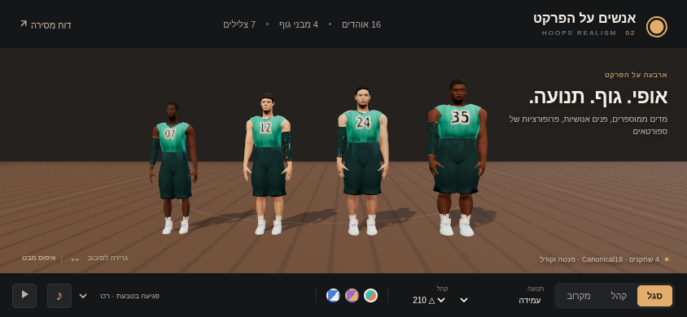
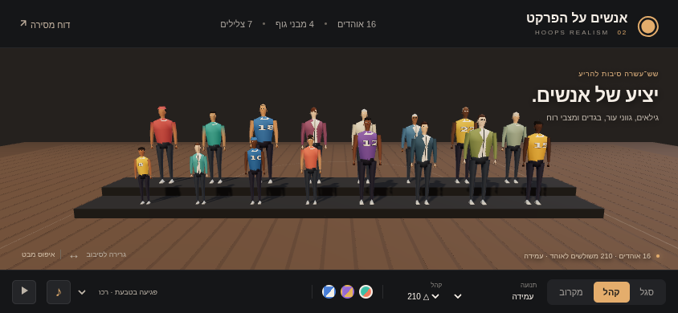
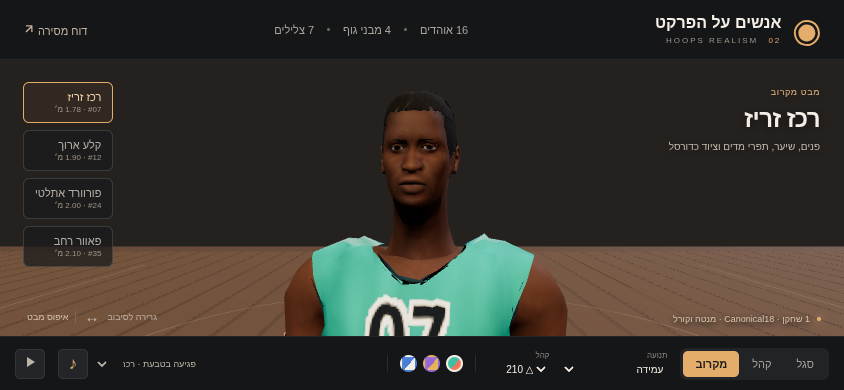

# hoops-realism-v2 · דוח מסירה

17.11.2026 · מאגר `roynaor-work/Bakasun` · ענף `codex/hoops-realism-v2`.
בסיס: `43b27dc235387e3cb737aee9558cdf9d5fd5a262` (`main` שנמשך בתחילת העבודה).

נמסרה חבילת נכסים בתיקייה חדשה בלבד. המשחק, קבצי המקור הקיימים, תגי גרסה ו־`ops/CONTROL.md` לא נערכו. זהו השלב להכנת נכסים ולסקירה; החיבור למשחק נשאר שלב נפרד בהתאם לבקשה.

## התוצאה

| רכיב | תכולה מדודה |
|---|---|
| קהל | 16 זהויות, כל אחת ב־3 קובצי GLB עצמאיים; 210/90/24 משולשים בדיוק |
| גיוון | 4 ילדים, 8 מבוגרים, 4 זקנים; 16 גוני עור, 8 תסרוקות, 4 סוגי לבוש, 2 כובעים, 5 זוגות משקפיים |
| הנפשת קהל | `sit`, `stand`, `clap`, `jump`, `disappointed`, `shout`; שישה קליפים בכל LOD, בסך הכול 288 קליפים מוטבעים |
| שחקנים | 4 מבני גוף אנושיים, פנים בהבעה מרוכזת, שיער, גופיות ומכנסיים, מספרים 07/12/24/35 ונעלי כדורסל |
| צבעי קבוצה | 4 מסכות RGB, עם הגנה על הספרות; שלוש פלטות בתצוגה, וקוד צביעה לשימוש בצבעים נוספים |
| סאונד | 3 וריאציות פגיעה בטבעת, רשת, לוח, כדור על פרקט וחריקת נעליים; 7 אפקטים × OGG ו־MP3 |
| תקציב | כל תיקיית המסירה, לרבות מקורות, תיעוד, צילומים ודוחות, נבדקת מול 6,000,000 bytes; המצאי הסופי ב־`manifest.json` |

48 קובצי הקהל שוקלים **1,503,780 bytes**. ארבעת השחקנים והמסכות שוקלים **2,041,245 bytes**. כל 14 קובצי השמע שוקלים **63,354 bytes**; הגדול **6,614 bytes**, מתחת לתקרה של 40,000 לכל קובץ. כל GLB עצמאי, ללא הורדת טקסטורות וללא צורך במפענח Draco או Meshopt.

## מה השתנה במראה

הקהל נבנה מחדש ברטופולוגיה מצומצמת עם ראש ולסת, צוואר קצר, כתפיים משופעות, גו שמצטמצם במותן, ירכיים וגפיים נפרדות. סבב הסקירה הראשון חשף צוואר ארוך, שיער דמוי כובע וחיבורי גפיים נוקשים; הם תוקנו, יחד עם נעליים בעלות נפח וחיבורי מרפק וברך רציפים. אטלסים קטנים כוללים פנים, משקפיים, צווארון, מספרי חולצות ופתיחת ג׳קט. ברמה האמצעית תוקנו פאות חופפות שגרמו להבהוב.

בסיס השחקנים הוא האנטומיה האנושית המפורטת שכבר קיימת ב־v7. הרשת הועברה מתנוחת הקשירה הישנה למנוחה הקנונית הפעילה, עם מרווח נוסף בין הזרוע לגוף, ארבע וריאציות רוחב ועומק, שינוי עדין בגבות ובפה, מדים ממוספרים ומפת אריג מרוסנת. הגאומטריה בפנים נשמרה מפורטת יותר מהגוף. לכל שחקן כ־11.5–12.5 אלף משולשים.

## תאימות ומסכות

לשחקנים בדיוק 18 העצמות של `minigames/athletes-core.mjs:CANON_BONES`: אותם שמות, סדר, הורים, תרגומי מנוחה, סיבובי זהות וקנה מידה. מטריצות inverse-bind נוצרו מחדש ונבדקו מול מטריצות העולם; ההשוואה אינה מסתפקת בשמות העצמות. אין צורך במתאם מתנוחת v7 בעת ניגון קליפים קנוניים.

`players/rig.json` ו־`players/catalog.json` מתעדים את החוזה, מידות, גיבובי מקור וגובה מועדף. הגבהים 1.78/1.90/2.00/2.10 מטר מתקבלים באמצעות `scaleToPreferredHeight` על מעטפת השחקן; יש להחיל `groundOffsetMeters` על קבוצת הנכס לפני ההגדלה. עצמות בודדות נשארות בקנה מידה 1.

מסכות `players/masks/*-team.png` הן נתוני RGB ליניאריים: R לגופייה, G למכנסיים ו־B לגימור. `source/players-apply-team.mjs` טוען אותן עם `flipY=false` ו־`NoColorSpace`; `applyTeam()` מחזיר `setColors()` ו־`dispose()`. השינוי פועל על חומרי המדים בתצוגה. המספר, הפנים ושאר האזורים נשמרים. GLB שמוצג ללא ה־helper עדיין כולל צבעי ברירת מחדל תקינים.

## בדיקות וראיות

- **Khronos:** כל 52 קובצי GLB עוברים אימות ללא החרגות: אפס שגיאות, אזהרות, הודעות מידע או רמזים; סיכום ושיוך גיבובים ב־[verification/validation.json](verification/validation.json).
- **חוזי נכסים:** ספירת משולשים, שלוש רמות לכל זהות, שישה קליפים ומשך חיובי, תחילת לולאה שווה לסופה, משקלים מנורמלים, טווחי מפרקים, גאומטריה סופית ומשאבים מוטבעים; התאמה מדויקת לשלד השחקנים וארבע רשתות שונות.
- **תנועה:** 288 קליפים נבדקו ב־65 זמנים לכל אחד. מרווח מרכזי הידיים במחיאה 13–21 מ״מ, קרבת משטחי הידיים 0.027–1.20 מ״מ וניתור בגובה 138–241 מ״מ; ללא חדירת רצפה ובסטיית לולאה אפס. IK דו־מפרקי הוחלף במקום כיוון משוער של המרפק. השיטה, הספים והמדידות לכל 16 הזהויות ולכל LOD ב־[verification/crowd-motion.json](verification/crowd-motion.json).
- **דפדפן:** 26 בדיקות עברו: תצוגות סגל/קהל/פנים, כל צירופי הקליפ וה־LOD, ארבע בחירות שחקן, שינוי פיקסלים בשלוש פלטות, פענוח כל 14 קובצי השמע, ללא בקשות חיצוניות וללא גלילה אופקית. נבדקו גם פקדים לפני סיום טעינה ובקשת LOD ישנה שמסתיימת לאחר בחירה חדשה. תוצאות ב־[verification/browser.json](verification/browser.json).
- **שמע:** כל קובץ פוענח ב־FFmpeg ובדפדפן. מונו 44.1kHz, ללא clipping, ללא הטיית DC משמעותית ועם זנב קצר. פגיעות הטבעת שונות ביחסי התדרים ובדעיכה; 95% מהאנרגיה מגיעה בתוך 51–68ms. מקור הסינתזה, המדדים וגיבובים ב־`audio/catalog.json`. הבדיקה היא בדיקת אות וספקטרום; לא נטען שנערכה האזנה תפיסתית.
- **מאגר:** `npm test` סיים עם 4,261 בדיקות שעברו, 64 דילוגים וכשל תשתית יחיד: גרסת Chromium שמצפה לה Playwright אינה מותקנת. בדיקת האימון גם השאירה שרת פתוח לאחר כשל ההפעלה; הסתיים רק ה־worker התקוע של הרצה זו. בהרצה ממוקדת של ששת קובצי הסיום עם Chromium המערכתי עברו כל 58 הבדיקות, כולל בדיקת הדפדפן שנכשלה קודם, ללא דילוגים. בדיקות וקבצי מאגר לא שונו. אין כשל ידוע שנותר אחרי תיקון תצורת הדפדפן; הפקודה המקורית עצמה יצאה בקוד 1 ואינה מדווחת כעוברת. סיכום, פקודות והמתאם המדויק ב־[verification/repository-tests.json](verification/repository-tests.json).
- **גבולות השינוי:** בדיקת Git לפני commit מוודאת שכל הקבצים שנוספו תחת `workout/island/design/hoops-realism-v2/`, ללא שינוי בקובץ קיים. `source/build-manifest.py --check` מאמת את כל הגיבובים ואת תקציב כל התיקייה.







## פתיחה ושחזור

יש להגיש את **שורש המאגר** ב־HTTP ולפתוח [preview.html](preview.html). התצוגה מיועדת ל־844×390, ונבדקת גם ב־390×844. היא משתמשת רק ב־Three.js וב־loader המקומיים הקיימים במאגר; אין CDN. גרירה מסובבת, גלגלת מקרבת, וכפתורי התחתית מחליפים תצוגה, תנועה, LOD, קבוצה וצליל. כפתור ההשהיה מאפשר בדיקה של פריים קבוע.

```sh
python3 -m http.server 8765
```

כלי ההפקה מותקנים בתיקיית כלים **מחוץ למאגר** מתוך `source/package.json` ו־`source/requirements.txt`. נדרשים גם FFmpeg/FFprobe ו־Chromium. מ־`workout/island/design/hoops-realism-v2/`:

```sh
python3 source/crowd-build.py
HOOPS_REALISM_TOOLS=/tmp/hoops-realism-tools node source/players-build.mjs
python3 source/build-audio.py
HOOPS_TOOLS_DIR=/tmp/hoops-realism-tools node source/validate.mjs
PREVIEW_TOOLS_DIR=/tmp/hoops-preview-tools node source/check-preview.mjs
HOOPS_PREVIEW_TOOLS=/tmp/hoops-preview-tools node source/verify-crowd-motion.mjs
python3 source/build-manifest.py
python3 source/build-manifest.py --check
```

המחוללים משתמשים בקלטי המאגר הקיימים ובתלויות המתועדות, וכותבים בתיקיית המסירה. בדיקת התנועה משתמשת גם ב־`SkeletonUtils.js` הקיים במאגר. לאחר שינוי תוצרים יש להריץ מחדש גם בדיקת תנועה, אימות נכסים, צילומים ומצאי; גיבובי הדוחות חייבים להתאים לנכסים הסופיים. צילומי `verification/players-{three-quarter,raised-arm}.png` מתעדים בדיקת עור מזווית ¾ ובהרמת הזרועות; הפוזה הפעילה הוזרקה בדפדפן לצורך הבדיקה בלבד.

## מגבלות למסירת המשך

הקהל הוא ייצוג אנושי דל־משולשים ליציע. LOD0 נועד למרחק קרוב יחסית, LOD1 לביניים, ו־LOD2 הוא צללית מונפשת דו־צדדית ב־24 משולשים למרחק בלבד. רמת 24 אינה מודל פנים תלת־ממדי לצילום קרוב. הקטלוג מציע מעבר ב־12 ו־25 מטר; המרחקים דורשים כיול מול מצלמת המשחק. יש להשתמש בהיסטרזיס ובאיגוד מופעים/פוזות כשמחברים קהל גדול; תצוגת הסקירה אינה מדידת עומס של אלפי צופים.

בדיקת הדפדפן רצה ב־Chromium עם SwiftShader. לא נמדד FPS בטלפון פיזי ולא נטען לשיפור ביצועי המשחק המחובר. לשחקנים הבעה גאומטרית קבועה ועדינה; לא נמסר ריג נפרד להנפשת פנים.

מקור האנטומיה של השחקנים מתועד כ־MakeHuman/MPFB. נשמרה ההסתייגות הקיימת בדבר היעדר אישור נפרד לכל חבילת שיער ונעליים; אין הצהרת רישוי חדשה לגביהם. פירוט היצירה המקורית, המקורות והתנאים ב־[LICENSES.md](LICENSES.md).
