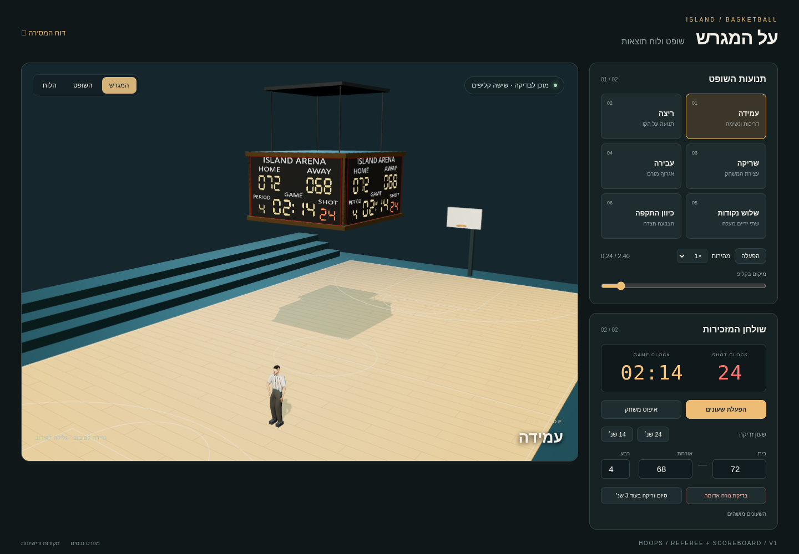

# שופט כדורסל ולוח תוצאות · v1

החבילה כוללת שופט בחולצת פסים שחור־לבן, מכנסיים ונעליים שחורים, שריקה ולולאת צוואר; שישה קליפים מקוריים ב־30Hz; ולוח תוצאות תלת־ממדי תלוי בעל ארבע פאות, שעוני משחק וזריקה, ניקוד, רבע ונורת סיום אדומה. כל הקבצים חדשים ונמצאים בתיקייה זו בלבד.

| פריט | תוצאה |
|---|---|
| ענף | `codex/hoops-ref-scoreboard-v1` |
| בסיס | `19d9cdc5e3718236df5a2fc4d8b8c26c72007575` מתוך main |
| שופט | 1225 משולשים, כולל השריקה והלולאה; 18 עצמות קנוניות; 562,524 בתים, כולל שש האנימציות והאטלס |
| לוח | 344 משולשים; 134,424 בתים; ארבע פאות ו־52 משטחי ספרות |
| ספרות | שני משולשים לכל ספרה, טקסטורת PNG משותפת אחת; עדכון UV בעת שינוי ספרה |
| תלייה | בית הלוח בגובה מקומי 0.065–2.25 מ׳; כבלים עד 4.2 מ׳. בתצוגה בסיסו ב־4.75 מ׳ מעל המגרש |
| טעינה | מודלים וטקסטורות מוטבעים, ללא תלות ב־CDN או מפענחי דחיסה |

## תוצאות motion-qa-v1

הופעל הכלי המקורי ללא שינוי במדדים או בספים, מקומיט `5eb4f093bc22523ee417a7f2345c3b813bffba24` בענף `codex/motion-qa-v1`, לפי הנתיב שתועד בדוחות הקודמים. מתאם הקלט מחליף רק את רשימת הנכסים. הכלי דוגם ישירות את שש האנימציות מתוך `models/referee.glb` הסופי, עם בדיקה צפופה ב־120Hz; קובצי ההנפשה עצמם מכילים דגימות ב־30Hz. לכל קליפ ציון גדול מ־88, כיסוי מלא וללא מדד אדום או חסר.

| קליפ | שניות | פריימים כולל קצוות | ציון | כיסוי |
|---|---:|---:|---:|---:|
| עמידה / `idle` | 2.4 | 73 | 100 | 100% |
| ריצה / `run` | 0.8 | 25 | 92.4 | 100% |
| שריקה / `whistle` | 2.4 | 73 | 96.8 | 100% |
| סימון עבירה / `foul` | 2.8 | 85 | 96.2 | 100% |
| שלוש נקודות / `three_points` | 3.2 | 97 | 96.7 | 100% |
| הצבעה על כיוון / `direction` | 2.8 | 85 | 95.6 | 100% |

[הדוח האינטראקטיבי](verification/motion-qa/output/report.html) · [תוצאות גולמיות](verification/motion-qa/output/report.json) · [פקודה, גיבובי הכלי והסיכום](verification/motion-qa/summary.json). בדיקות נוספות מאמתות זהות בין זרמי התנועה המבודדים וה־GLB המשולב, שלד מנוחה מדויק, קווטרניונים מנורמלים, קצב דגימה וקצוות הלולאות.

## אימות חזותי וטכני

- [בדיקת הנכסים](verification/assets.json): Khronos glTF Validator ללא שגיאות או אזהרות; מיפוי משקולות, מטריצות inverse bind, משטחי הספרות והטקסטורה נבדקו. כל 1,062 קודקודי השופט המונפש נדגמו ב־120Hz ובגבולות המגע, בנוסף למדידת השלד הרשמית: ללא חדירה לרצפה; סוליות תומכות בריצה בגובה 2.238–3.985 מ״מ ובמחוות בגובה 3.500 מ״מ. בלוח קיימות 20 הערות מידע בלבד על UV שאינו נחוץ לחלק ממשטחי הרקע.
- [בדיקת דפדפן](verification/browser.json): 26 בדיקות עברו ב־Chromium עם WebGL/SwiftShader; הפעלת כל קליפ וגרירת הזמן, שעונים, עצירה, איפוס, עדכון ספרות ונורה אדומה. מידות 1440×1000, 390×844 ו־844×390; ללא שגיאות JavaScript או בקשות נכשלות.
- [בדיקת לוח](verification/scoreboard-browser.json): ארבע הפאות נבדקו חזותית, והניקוד משתקף בכל הספרות. `node --test source/scoreboard.test.mjs` בודק דיוק תזמון, גבולות, איפוסים, השהיה, סיום מוקדם ושחרור משאבים.
- [בדיקות המאגר](verification/repository-tests.json): 4,018 בדיקות עברו, 64 דולגו, 0 נכשלו; npm test עם דפדפן Chromium המותקן דרך מתאם ISLAND_PLAYWRIGHT. קוד המשחק הקיים לא שונה.
- חבילת המקור ומצב הסשן מתועדים כאן; `ops/CONTROL.md` נשאר ללא שינוי בהתאם להנחיית קבצים חדשים בלבד.

## צפייה

1. מתוך שורש המאגר הפעילו `python -m http.server 8765 --bind 127.0.0.1`.
2. פתחו [את התצוגה המקומית](http://127.0.0.1:8765/workout/island/design/hoops-ref-scoreboard-v1/preview.html).
3. בחרו ״השופט״ להפעלת ששת הקליפים, או ״הלוח״ לבדיקת שעונים, ניקוד ונורת סיום. התוצאה הצפויה: דמות יציבה, מחוות נבדלות, ספרות קריאות בכל פאה ואור אדום בעת אפס.



## חוזה חיבור ומגבלות

- צירים: ‎+Y למעלה, ‎+Z קדימה, ‎+X שמאל אנטומי; יחידות מטר. השלד תואם בדיוק את חוזה 18 העצמות של motion2, כולל שמות, היררכיה ומיקומי מנוחה.
- הריצה כוללת התקדמות Root אמיתית של 1.28 מ׳ במחזור 0.8 שנ׳, שהם 1.6 מ׳/ש׳. בחיבור למשחק יש לחלץ התקדמות זו לתנועת הדמות; בתצוגה היא מוסרת כדי להציג ריצה במקום. מעבר מריצה לעמידה דורש blend קצר; מדד רציפות המעבר בבודק צהוב, ללא השפעה על סף המעבר. המחוות החד־פעמיות חוזרות לאותה עמידת מנוחה.
- `createScoreboard({THREE,root,initial,onEvent})` מתוך `runtime/scoreboard.mjs` קושר את סצנת ה־GLB. קראו `tick(dt)` עם זמן סימולציה בשניות. המארח אחראי להשהיה כשהאפליקציה ברקע. סיום אחד השעונים עוצר את שניהם ומפעיל נורה אדומה לשתי שניות; ניקוד בטווח 0–999, רבע 1–9, שעון משחק עד 99:59.
- תקציב כ־1,200 משולשים מגביל פרטי פנים ואצבעות; קריאות המחוות נשענת על תנוחת הזרועות והגוף. לולאת הצוואר אינה חבל מדומה. אין שמע שריקה או חיבור ללוגיקת המשחק בחבילה זו.
- נבדק בדפדפן שולחני עם SwiftShader. בדיקת טלפון פיזי טרם בוצעה. קבצי המקור, הרישיונות וגיבובי הנכסים מצורפים.

## שחזור

```sh
node workout/island/design/hoops-ref-scoreboard-v1/source/build-referee.mjs
python workout/island/design/hoops-ref-scoreboard-v1/source/build-scoreboard.py
node workout/island/design/hoops-ref-scoreboard-v1/source/author-motion.mjs
node workout/island/design/hoops-ref-scoreboard-v1/source/assemble.mjs
node workout/island/design/hoops-ref-scoreboard-v1/source/run-motion-qa.mjs
node workout/island/design/hoops-ref-scoreboard-v1/source/verify-motion.mjs
node workout/island/design/hoops-ref-scoreboard-v1/source/validate-assets.mjs
node --test workout/island/design/hoops-ref-scoreboard-v1/source/scoreboard.test.mjs
python workout/island/design/hoops-ref-scoreboard-v1/source/verify-browser.py
ISLAND_PLAYWRIGHT="$PWD/workout/island/design/hoops-ref-scoreboard-v1/source/system-chromium.mjs" npm test
node workout/island/design/hoops-ref-scoreboard-v1/source/build-delivery.mjs
```

יש להפעיל שרת HTTP לפני בדיקת הדפדפן. תלות כלי ההפקה הזמנית מפורטת בראש `source/build-referee.mjs`; בודק הנכסים משתמש ב־`gltf-validator` שב־`/tmp/hoops-ref-validation`. גופן Open Sans מותקן נדרש רק לבניית אטלס התוויות מחדש. להפעלת התצוגה אין צורך בכלי הפקה.
