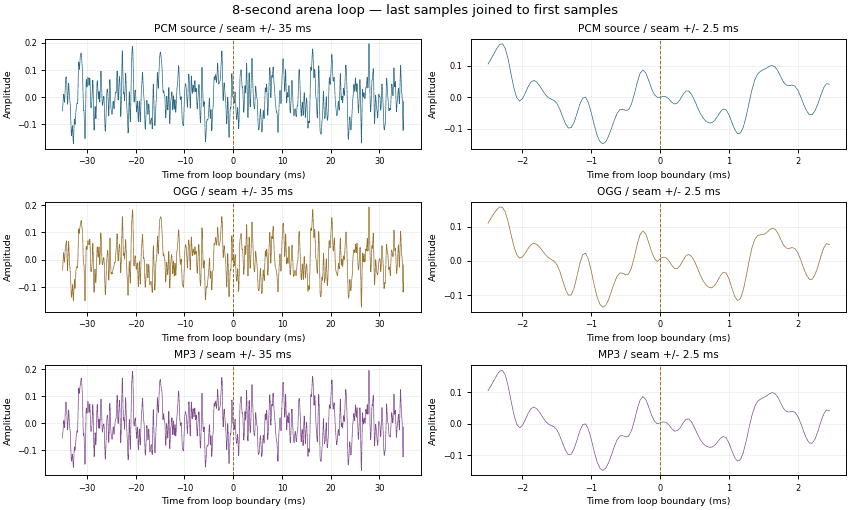

# צלילי כדורסל — שופט, קהל ואולם

תאריך: 14/11/2026. ענף: `codex/hoops-referee-audio-v1`.
בסיס: `19d9cdc5e3718236df5a2fc4d8b8c26c72007575`. חבילה עצמאית לסקירה עבור ״העיר שלי״.

## תוצרים ומקור

14 צלילים, כל אחד בשני קובצי שמע: OGG/Vorbis ו־MP3, מונו, 24,000 הרץ.
כל הגלים נוצרים ב־`synthesize.py` ממתנדים ומרעש פסאודו־אקראי עם זרעים קבועים.
אין הורדות, הקלטות, דגימות חיצוניות, מודלי דיבור, מוזיקה, קריאות מותג או חיקוי קריין.
הקהל הוא מקהלת קולות סינתטיים באמצעות פורמנטים, לא בני אדם מוקלטים.
הרישיון המקומי הוא CC0-1.0, לרבות קוד הסינתזה והצלילים; ראו [LICENSE.txt](LICENSE.txt).

| צליל | מזהה | שניות | לופ | עוצמת ניגון מומלצת | בתים: OGG / MP3 |
|---|---|---:|---|---:|---:|
| שריקה קצרה — חטיפה | `whistle-steal-short` | 0.55 | לא | 0.46 | 5,424 / 3,792 |
| שריקה ארוכה — עבירה | `whistle-foul-long` | 1.45 | לא | 0.46 | 9,032 / 9,264 |
| שריקת פתיחת רבע | `whistle-quarter-start` | 0.95 | לא | 0.48 | 7,054 / 6,240 |
| שריקת סיום רבע | `whistle-quarter-end` | 1.75 | לא | 0.48 | 10,497 / 10,992 |
| רחש אולם ספורט | `arena-ambience-loop` | 8.00 | כן | 0.14 | 36,122 / 48,576 |
| קהל אוּוּ אחרי החטאה | `crowd-miss-ooh` | 2.10 | לא | 0.43 | 11,936 / 13,152 |
| שמחת קהל אחרי סל | `crowd-basket-cheer` | 2.65 | לא | 0.55 | 16,701 / 16,464 |
| רחש רשת — סווש | `net-swish` | 0.65 | לא | 0.55 | 6,206 / 4,512 |
| כדור על פרקט — חלש | `ball-parquet-soft` | 0.60 | לא | 0.32 | 5,125 / 4,080 |
| כדור על פרקט — בינוני | `ball-parquet-medium` | 0.60 | לא | 0.48 | 5,441 / 4,080 |
| כדור על פרקט — חזק | `ball-parquet-hard` | 0.65 | לא | 0.68 | 5,524 / 4,512 |
| חריקת נעל — סיבוב קצר | `shoe-squeak-01` | 0.60 | לא | 0.36 | 6,151 / 4,080 |
| חריקת נעל — בלימה | `shoe-squeak-02` | 0.75 | לא | 0.36 | 6,950 / 5,088 |
| חריקת נעל — שינוי כיוון | `shoe-squeak-03` | 0.75 | לא | 0.36 | 7,061 / 5,088 |

שריקת הפתיחה היא זוג נשיפות; שריקת הסיום היא שתי קצרות ואחריהן ארוכה.
הן אותות שופט גנריים, ללא מנגינה או צופר. שלוש מכות הכדור שונות בגוון,
בחלק ההתקפי ובדעיכה; שלוש החריקות שונות בתוואי הגובה ובמספר החיכוכים.

## נרמול ובדיקות שמע

- נרמול תפיסתי משותף: יעד -23 LUFS באמצעות מדידת BS.1770 של מסנן
  `loudnorm` ב־FFmpeg. שינוי עוצמה קבוע לכל גל, ללא נרמול אוטומטי בזמן הניגון.
- כיול נפרד לכל קודק לפי הקובץ המפוענח; עמודי OGG קצרים שומרים על משך מדויק
  גם באפקטים קצרים משנייה. לא הוסתרו דגימות ריפוד באמצעות חיתוך בזמן הבדיקה.
- 28 קבצים פוענחו מחדש ונמדדו לאחר הדחיסה: -23.09 עד -22.91 LUFS.
  סבילות: ±0.5 LU. הפסגה האמיתית המרבית שנמדדה:
  -2.27 dBTP, תקרה: ‎−2 dBTP.
- נבדקו פענוח תקין, קודק, ערוץ יחיד, קצב דגימה, משך לפי מספר הדגימות,
  היעדר דגימות לא־סופיות, היעדר חיתוך, היסט DC וקצוות שקטים לאפקטים חד־פעמיים.
- מגבלת כל קובץ בחבילה, כולל מסמכים וגרף: 60,000 בתים (גם פחות מ־60 KiB).
  קובץ השמע הגדול ביותר: 48,576 בתים.
- [verification.json](verification.json) כולל תוצאות לכל קובץ, אורכי מכולה,
  אורכי פענוח וחתימות SHA-256. אורך מכולת MP3 כולל השהיית מקודד; לאחר
  הסרתה על ידי מפענח שמכבד Xing/LAME, אורך הלופ הוא 8 שניות בדיוק.

העוצמות המומלצות במניפסט הן מקדמי הגבר ליניאריים 0–1 לאחר הנרמול.
כך כל הקבצים באותה עוצמה תפיסתית בבדיקה, ורחש האולם נשאר שקט בתמהיל.
מכות הכדור החלשה/בינונית/חזקה משתמשות ב־0.32/0.48/0.68 בנוסף לשוני בגוון.

## בדיקת חיבור הלופ בגרף

הלופ נבנה מרעש ספקטרלי מחזורי וממלמולים מעגליים. זנב ההדהוד נעטף לתחילה;
אין שקט מלאכותי או דעיכת קצוות. נקודת חיבור טבעית נבחרת לפני הקידוד.
נבדקו המקור ושני הפורמטים המפוענחים, בחיבור סוף→תחילה ללא חיתוך או תיקון.



כל שורה בגרף היא מקור או קובץ מפוענח. הקו המקווקו הוא החיבור. עמודה שמאלית:
±35 מ״ש; ימנית: ±2.5 מ״ש, להצגת הדגימות הבודדות.

| קודק | קפיצה בחיבור | סף קפיצה | אי־רציפות שיפוע | RMS מקומי / כללי | תוצאה |
|---|---:|---:|---:|---:|---|
| vorbis | 0.0090240 | 0.0749425 | 0.0126638 | 0.951 | עבר |
| mp3 | 0.0026721 | 0.0721726 | 0.0109350 | 0.979 | עבר |

תנאי מעבר: קפיצה ≤ המרבי מבין 0.003 ו־4×RMS של הפרשי הדגימות;
אי־רציפות שיפוע ≤ המרבי מבין 0.006 ו־6×אותו RMS; אנרגיה סביב החיבור
(50 מ״ש מכל צד) בטווח 0.65–1.45 מה־RMS הכללי. אלה בדיקות לרציפות ולא
הבטחת שמיעה סובייקטיבית. התוצאות והגרף מתייחסים לקבצים הדחוסים עצמם.

## האזנה ושילוב עתידי

פתחו את [listen.html](listen.html). הדף עצמאי ופועל גם ישירות מהדיסק;
המניפסט מוטמע בו באופן אוטומטי. ניתן להחליף פורמט, להאזין בעוצמה המומלצת
או בעוצמה המנורמלת, לעצור הכול ולהפעיל לופ. אין ניגון אוטומטי בפתיחה.
בלחיצה ראשונה נעשה שימוש ב־Web Audio ובמקור לולאה מתוזמן, כדי למנוע
רווחי תזמון של תגית שמע. במצב קובץ מקומי, אם טעינה נחסמת, קיימים נגנים
מובנים לכל צליל; ללופ רציף מומלץ להגיש דרך שרת מקומי.

```sh
cd workout/island/design/hoops-referee-audio-v1
python3 -m http.server 8765
```

פתחו `http://localhost:8765/listen.html`, לחצו על רחש האולם, ואפשרו לו לעבור
כמה מחזורים. הגרף מופיע גם בדף. לשילוב במשחק יש לטעון מראש, לפענח פעם אחת,
ליצור מקור חדש לכל אירוע ולהחיל את `recommended_volume`. לופ: להשתמש
ב־AudioBufferSourceNode עם `loop = true`, התחלה 0 וסוף ב־8 שניות.
אין לחבר אירוע `ended` להפעלה מחודשת של MP3, כי תזמון כזה עלול להוסיף פער.

## שחזור ובדיקה חוזרת

נדרשים Python 3.11+, NumPy, SciPy, Matplotlib ו־FFmpeg/ffprobe עם libvorbis ו־libmp3lame.
הגרסאות ששימשו מופיעות ב־[verification.json](verification.json).

```sh
python3 synthesize.py
python3 synthesize.py --verify-only
```

הרצה רגילה מייצרת את קובצי השמע, המניפסט, תוצאות המדידה, הגרף ודוח זה,
ויוצרת גם את דף ההאזנה והרישיון מהתבניות המובנות בסקריפט. מצב האימות אינו משנה קבצים.
אין תלות בקבצי פרויקט או בגישה לרשת. שחזור בינארי דורש אותן גרסאות כלים.

## גבולות העבודה

כל התוצרים והראיות נמצאים רק בתיקייה החדשה. בהתאם לבקשה המפורשת,
לא נערכו `ops/CONTROL.md`, קובצי גרסה או קובצי משחק. קריטריון הסיום כאן:
14 זוגות שמע, פחות מ־60,000 בתים לכל קובץ, נרמול אחיד, לופ תקין בגרף,
דף האזנה תקין, תיעוד בדיקות ודחיפה לענף המבוקש.
אין בחבילה חיבור למשחק; בדיקת מכשיר פיזי והאזנה אנושית טרם בוצעו.

## אימות נוסף

- בדיקת Chromium: כל 28 הקבצים פוענחו ונוגנו דרך הדף; שני הפורמטים
  של הלופ רונדרו בפועל לשני מחזורים רציפים (16 שניות) ועברו שוב בדיקת חיבור.
  נבדקו עוצמות, החלפת פורמט, עצירה, לחיצה חוזרת, Escape, סיום אפקט וביטול טעינה.
  נבדקו 390×844, 844×390 ו־1440×900: ללא גלילה אופקית וכפתורי האזנה בגובה 44 פיקסלים לפחות.
  נגן הגיבוי נבדק בכשל טעינה יזום. פתיחה ישירה דרך file:// נחסמה במדיניות
  הדפדפן המנוהל ולכן לא אומתה בפועל; הרצה דרך שרת מקומי עברה.
  תוצאות: [browser-check.json](browser-check.json). שחזור: `python3 check-listen.py`.
- בדיקת שחזור: שחזור בתיקייה ריקה מסקריפט יחיד יצר את כל 35 קובצי הליבה; 28 קובצי השמע וחמשת קובצי הליווי שנבדקו זהים בינארית. [נתונים](rebuild-check.json).
- בדיקות המאגר: ההרצה הרגילה: 4,017 עברו, 64 דולגו, בדיקת דפדפן קיימת אחת נכשלה מחוסר Chromium Headless Shell; אותה בדיקה וארבע בדיקות הקובץ עברו בהרצה חוזרת עם Chromium המותקן, ללא עריכת קבצים קיימים. [נתונים](repository-check.json).
