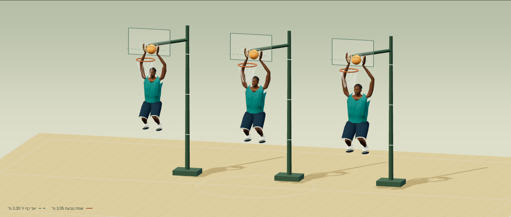
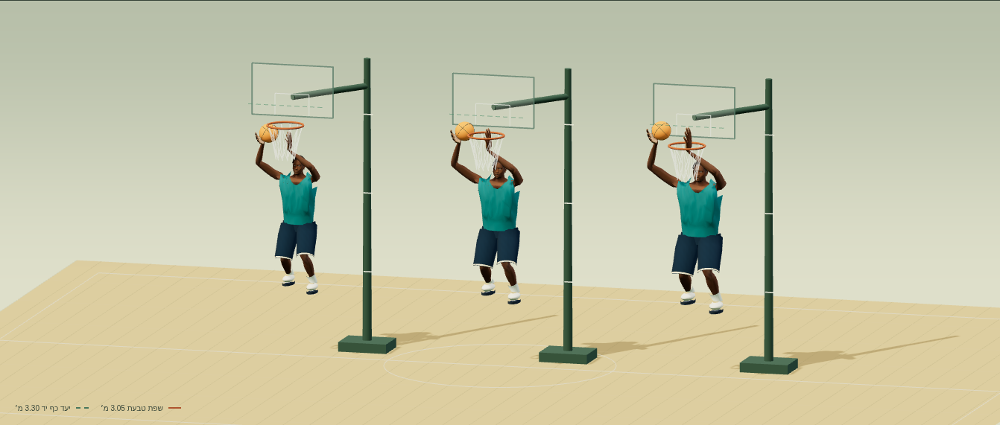
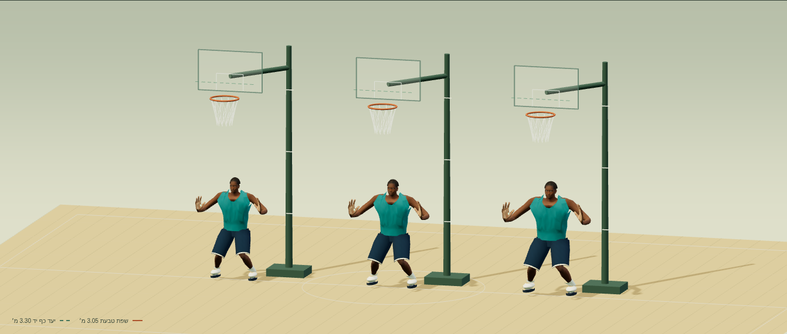
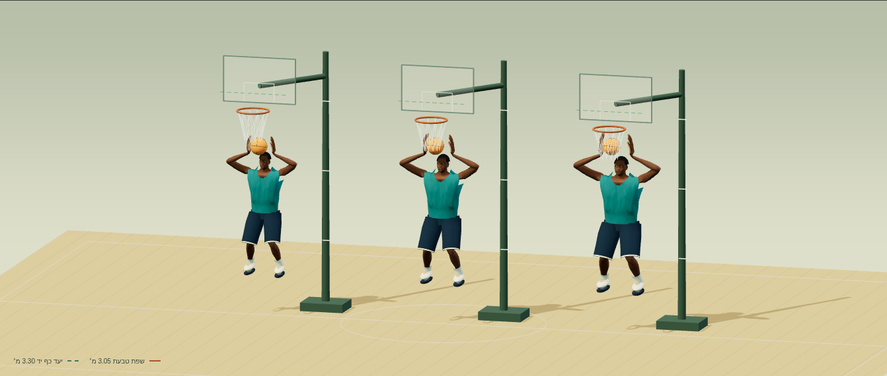

# דוח מסירה — דמויות כדורסל גבוהות v1

שלוש הדמויות נטענות ומנגנות את 83 קליפי v9 ואת 15 קליפי v8. בכל שש בדיקות ההטבעה כף היד הפיזית ברשת עוברת את שפת הטבעת ב־25 ס״מ לפחות, ועליית האגן המרבית נמוכה ממטר. בהטבעה בשתי ידיים נמדדת הנמוכה מבין שתי כפות הידיים באותו פריים.

**הבחנה הכרחית:** בקובצי v9 המקוריים כבר מוטמעת עליית אגן של 1.548686 מ׳. שינוי דמות בלבד לא יכול להקטין ערוץ הזזה זה. קובצי הקליפים נשמרו בבתים זהים; מתאם חדש מכייל במפורש את עוצמת העלייה החיובית. סיבובי המפרקים, אורכי העצמות של כל דמות, תנוחת הכיווץ ותזמון המקור נשמרים. מצב ״ניתור המקור״ בתצוגה מציג את העלייה המקורית. הפעלה ישירה של כל ערוצי ה־GLB במערבל אנימציה, בלי התאמת אגן, אינה עומדת בדרישת המטר.

## מידות ותוצאות ההטבעה

מטרים, למעט עמודת המרווח בס״מ. גובה נמדד מגאומטריית הריצה מהסוליה עד קצה הראש במנוחה. אורך הזרוע הוא אורך זרוע עליונה + אמה + רכיב האורך המקומי עד מרכז כף היד, ללא אצבעות. תוספת אורך הזרוע לקיצוני ולסנטר נמדדת יחסית לרכז לאחר נרמול לפי גובה: 8% ו־12%.

| דמות | גובה | אורך זרוע | יחס זרוע לפי גובה | קליפ | עליית אגן מרבית נדרשת | גובה כף יד פיזית | מרווח מעל הטבעת בס״מ |
|---|---:|---:|---:|---|---:|---:|---:|
| רכז | 1.88 | 0.821 | 1.00 | `dunk_one_hand` | 0.898 | 3.305 | 25.5 |
| רכז | 1.88 | 0.821 | 1.00 | `dunk_two_hands` | 0.966 | 3.305 | 25.5 |
| קיצוני | 1.98 | 0.934 | 1.08 | `dunk_one_hand` | 0.702 | 3.305 | 25.5 |
| קיצוני | 1.98 | 0.934 | 1.08 | `dunk_two_hands` | 0.779 | 3.305 | 25.5 |
| סנטר | 2.08 | 1.018 | 1.12 | `dunk_one_hand` | 0.534 | 3.305 | 25.5 |
| סנטר | 2.08 | 1.018 | 1.12 | `dunk_two_hands` | 0.618 | 3.305 | 25.5 |

ב־v8 אין קליפ הטבעה; שני קליפי ההטבעה לעיל הם כל קליפי ההטבעה ב־v9. שיא המדידה נמצא בזמן מנורמל 0.5694444444, כלומר 1.366667 שניות. תנועת השחקן בעולם אינה מוסיפה גובה למדידה.

## שיטת המדידה

1. קוראים את ששת קובצי ה־GLB שנמסרו ומפענחים בפועל גם את עותקי Draco בכלי הפיתוח. מאמתים שמות והורים של 18 עצמות, סיבובי קשירה זהות, מטריצות קשירה הפוכות, משקולות, גבהים וטקסטורות.
2. קוראים ומפענחים את כל 98 קובצי gzip, ומאמתים SHA-256 מול הקטלוג. העותקים נלקחו ישירות מקומיטי המקור הקפואים בעזרת Git. דוגמים את הסיבובים המקוריים ב־FK עצמאי, ללא שימוש בקוד ה־FK של המתאם.
3. בכל פריים מועמד של ההטבעה מחשבים את גובה כף היד ללא הרכיב החיובי של הזזת האגן. מחפשים את מכפיל מעטפת הניתור המקורית הנמוך ביותר המביא את כף היד ל־3.305 מ׳; בהטבעה כפולה משתמשים בשתי הידיים. מכפיל זה מוחל על כל העלייה החיובית, ולא על פריים בודד. גובה האגן המדווח הוא השינוי ממצב המנוחה, ולא הגובה המוחלט שלו מעל הרצפה.
4. נקודת כף היד נבחרה מקודקוד עור ממשי במרכז כף היד ומזוהה ב־`rig.json`. מאמתים גם את מיקומו אחרי skinning של הרשת בפועל. גובה כף היד הפיזית הנמוך ביותר הוא 3.30499998 מ׳.

## תקציב הנכסים

| דמות | משולשים | GLB ריצה ללא דחיסה, בתים | GLB עם Draco, בתים | טקסטורה |
|---|---:|---:|---:|---|
| רכז | 6,226 | 1,030,508 | 788,564 | 1024×1024 |
| קיצוני | 6,226 | 1,030,504 | 788,612 | 1024×1024 |
| סנטר | 6,226 | 1,030,504 | 788,588 | 1024×1024 |

פריסת UV, סדר הפרימיטיבים והטופולוגיה זהים בדיוק בין שלוש דמויות הריצה. שני מערכי הצבעים הם לגונה וגחלת; שלושת חומרי המדים נצבעים לפי הצבעים המתועדים ב־`rig.json`. אין לוגואים, סמלים או דיוקנאות של אנשים אמיתיים. הגוף והעיניים הם ליבת MakeHuman ברישיון CC0; גזרת הגופייה היא גאומטריה מקורית של המאגר שהותאמה לגוף החדש. שיער, נעליים ומדים חיצוניים לא מאומתים הוסרו. [LICENSES.md](LICENSES.md) מפרט מקור ורישיון לכל קובץ.

## בדיקות שבוצעו

- `node --test workout/island/design/hoops-tall-v1/tests/*.mjs`: שבע בדיקות עוברות. כל קובץ בחבילה נקרא; כל ששת ה־GLB וכל 98 הקליפים נטענים ומפוענחים.
- אימות glTF: 0 שגיאות ו־0 אזהרות בששת קובצי ה־GLB.
- 19,650 הערכות FK על כל פריימי המקור בכל שלוש הדמויות. שגיאת אורך עצם מרבית 2.03e-8 מ׳; ההפרש המרבי מול המתאם 3.16e-8 מ׳. האינטרפולציה תואמת LINEAR/SLERP של המקור.
- skinning ממשי בשישה קליפי v9: כדרור, צעד וחצי, שתי הטבעות, הגנה וריבאונד, בכל שלוש הדמויות ובשישה זמנים לכל קליפ. כל הקודקודים סופיים. אחוזון 99 המרבי של יחס אורך צלע הוא 1.686; יחס הצלע המרבי 5.794. ספי איתור כשל גס נקבעו מראש ל־3 ו־8; צלעות מנוחה קטנות מ־5 מ״מ אינן נכללות במדד.
- דפדפן Chromium 156.0.8078.79: 294 טעינות דמות/קליפ ו־1,764 דגימות תצוגה. אפס שגיאות JavaScript/טעינה, ללא בקשות חיצוניות וללא בקשת WASM. ה־API של WebAssembly הוסר מראש, וב־CSP אין היתר ל־wasm-unsafe-eval.
- תצוגת מחשב 1440×1100 וטלפון 390×844; ללא גלילה אופקית. שתי התלבושות ומצב ניתור המקור נבדקו.

פלטים: [metrics.json](verification/metrics.json), [gltf-validation.json](verification/gltf-validation.json), [browser.json](verification/browser.json). [הוראות שחזור](source/README.md).

## צילומי סקירה

## גבולות האימות

שמירת אורכי עצמות, בדיקות צלעות וצפייה בפוזות שנדגמו אינן הוכחה להיעדר כל חדירת עור/בגד בכל רצף אפשרי. המתאם אינו פותר נעילת רגליים, מגעי כדור או שילובי קליפים במשחק. כדור התצוגה הוא מדריך כף יד; תנועתו אינה מסלול פיזיקלי מאומת. כיול הניתור הוא התאמת מעטפת תצוגה ושומר את משך הקליפ, ואינו פותר בליסטיקה. בדיקת הדפדפן משתמשת ב־SwiftShader; לא נמדדו ביצועי GPU או טלפון פיזי.

כל קובצי השינוי חדשים בתוך `workout/island/design/hoops-tall-v1/`. אין שינוי באפליקציה, בקבצים קיימים, בבדיקות קיימות, ב־ops או בגרסאות. ענף הבסיס הוא main בקומיט `bd4d3600692b14be8881d2ba50a2b96485f3119e`; מקור v9 הוא `6dd1675ded8ef2c9d361821aa1642ab75de90541` (PR #336). החבילה כוללת את הקליפים הנדרשים בלי לכלול את תיקיית v9 בענף המסירה.
