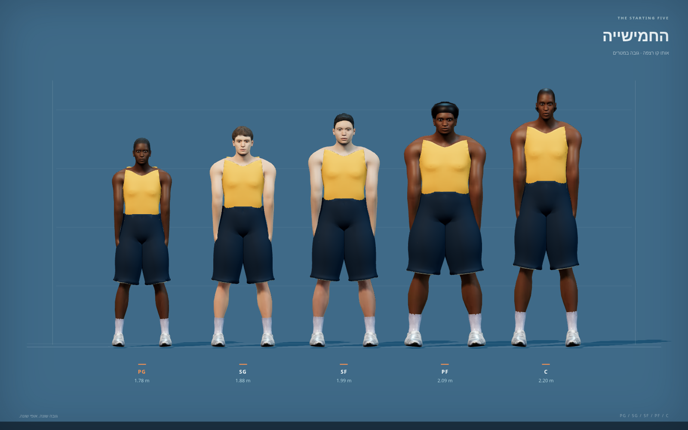

# כדורסל v4 · חמישייה ואולם

חבילת נכסים עצמאית למסירה ולשילוב: חמש עמדות כדורסל בעלות גבהים ומבני גוף שונים, שתי תלבושות המבוססות על צבע בלבד, אולם עם יציע וקהל, כדור וסל נפרדים. כל קובצי המשימה נמצאים בתיקייה זו.

[תצוגה אינטראקטיבית](preview.html) · [אימות ומדידות](VALIDATION.md) · [מקורות ורישיונות](LICENSES.md) · [רשימת נכסים](manifest.json)



| עמדה | גובה יעד | מבנה |
| --- | --- | --- |
| PG | 1.78 מ׳ | נמוך וצר, רכז זריז |
| SG | 1.88 מ׳ | גבוה ורחב יותר מהרכז |
| SF | 1.99 מ׳ | מבנה כנף מאוזן |
| PF | 2.09 מ׳ | כתפיים וגוף חזקים |
| C | 2.20 מ׳ | הגבוה בחמישייה, גפיים ארוכות ומבנה צר יותר מה־PF |

המודלים מבוססים על דמויות MakeHuman הקיימות במאגר. כל דמות כוללת שלד וקליפים מוטבעים: `dribble`, `shoot`, `steal`, `block`, `run`. המדים אינם כוללים שם, מספר או סמל; חומרי `team_primary`, `team_secondary`, `team_trim` משמשים להחלפת קבוצות ללא החלפת רשת או מרקם.

## פתיחה

1. מפעילים שרת משורש המאגר:

   ```sh
   python3 -m http.server 8765
   ```

2. פותחים את [תצוגת הכדורסל המקומית](http://localhost:8765/workout/island/design/hoops-v4/preview.html).
3. במצב ״חמישייה״ משווים את חמש הדמויות על רצפה משותפת ובאותו קנה מידה. בוחרים דמות ופעולה לצפייה מקרוב, מחליפים צבעי קבוצה, משהים ומזיזים את ציר הזמן. במצב ״אולם״ בודקים את המגרש והיציעים עם הקהל; במצב ״אביזרים״ בודקים את הכדור והסל כקבצים נפרדים.

ההגשה המקומית נדרשת לטעינת ES modules ו־GLB. התצוגה משתמשת בקבצים ובספריות מקומיים במאגר. היא אינה מחוברת ללוגיקת המשחק.

תנאי המסירה המשותפים אותרו בהודעת משימה 1: כל GLB נטען בדפדפן, עד 1.5MB לקובץ עם Draco, טקסטורות עד 1024, דוח ספירת משולשים ו־viewer ללא שגיאות קונסול. נוסף כאן צילום של חמש הדמויות זו לצד זו. המדידות והתוצאות בפועל מפורטות ב־[VALIDATION.md](VALIDATION.md).
