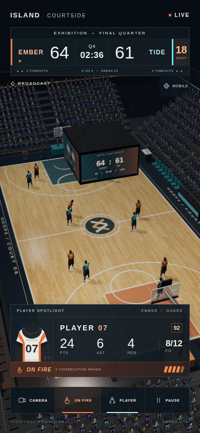
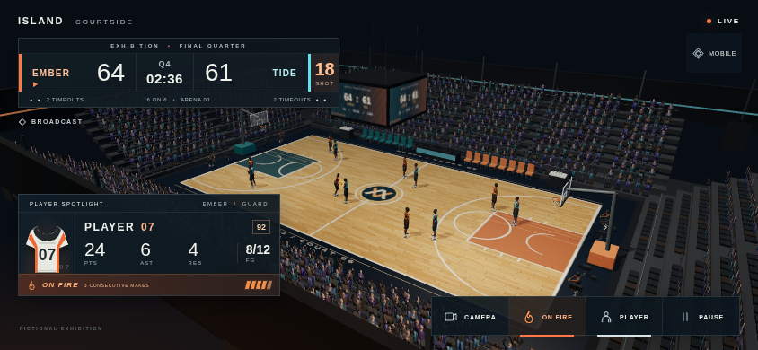

# דוח מסירה — אולם כדורסל וממשק שידור v6

תאריך: 04/11/2026. ענף: `codex/hoops-arena-v6-20261104`.

נוצרו קבצים חדשים בלבד תחת `hoops-v6/arena/` ו־`hoops-v6/hud/`. נבנו פרקט עם אלבדו, נורמל, חספוס ולכלוך עדין; ברק לכה והחזרי תאורת תקרה; שני לוחות שקופים עם טבעות ורשתות פתוחות בגובה 3.05 מ׳; ספסלים, עמדת שיפוט, מצלמות וארבעה צלמים כורעים; יציעים עם 1,368 צופים מונפשים; תאורת אולם וקוביית וידאו בעלת ארבע פאות. ממשק השידור כולל לוח תוצאות, שעון זריקה, כרטיס שחקן, סטטיסטיקות, מצב בוער ופקדי מצלמה/כרטיס/השהיה/איכות. הקבוצות, השחקנים והנתונים בדיוניים; אין סמלי מועדונים, מותגים או דמויות של שחקנים אמיתיים.

## תקציב גאומטריה וקבצים

MB מחושב כ־1,000,000 בתים.

| רכיב | משולשים | גודל / שיטת רינדור |
|---|---:|---|
| `arena-shell.glb` — מעטפת סטטית כולל גג | 9,400 | 0.181496MB, Draco |
| `actors/actor-lod0.glb` | 5,260 לשחקן | 0.658408MB, Draco, רשת וחומר יחידים |
| `actors/actor-lod1.glb` | 2,361 לשחקן | 0.630708MB, Draco, רשת וחומר יחידים |
| אולם מלא במודול, כולל מושבים וקהל | 31,308 | קהל: 1,368 מופעים בקריאת ציור אחת; מושבים בקריאה נוספת |
| ארבעה צלמים | 9,444 | InstancedMesh אחד, גאומטריה נגזרת מ־LOD1 |
| תצוגה מלאה, 6 מול 6 ב־LOD1 | 67,796 | 44 קריאות ציור מדווחות, בשתי המידות |

כל GLB קטן מ־1.5MB. כל הטקסטורות עד 1024 בכל ציר: פרקט 1024×1024, אטלסי שחקן 1024×1024, קהל 896×1008, וידאו 768×384. לכל שחקן אטלס צבע אחד ומפת נורמל באותה פריסת UV. טקסטורת הקהל היא 0.185384MB; צילומי התצוגה הם 0.390403MB ו־0.353924MB. רשימת קבצים מלאה עם בתים ו־SHA-256 נמצאת ב־[inventory.json](inventory.json).

ברירת המחדל מכוונת לטלפון: LOD1, DPR עד 1, ניסיון ציור מוגבל ל־30Hz, מפת צל אחת של 1024, קהל ומושבים ב־instancing, וקוביית וידאו המתעדכנת ב־6Hz. החזרי הפרקט משתמשים בסביבת תאורה ובשכבת ברק אפויה, ללא רינדור מראה נוסף. מיתרי התלייה נשמרים; קורות הגג הקרובות מוסתרות במצלמת השידור כדי להשאיר את המגרש גלוי.

## איך נבדק

- שלושת קובצי ה־GLB עברו Khronos glTF Validator: אפס שגיאות ואפס אזהרות. הערות מידע על Draco שאינו מפוענח ב־validator ונתוני fallback נשמרו בדוח; הנכסים פוענחו גם בדפדפן עם המפענח המקומי.
- Chromium/WebGL בשני מסכים, 390×844 ו־844×390: טעינה של 12 שחקנים וארבעה צלמים, ללא שגיאות JavaScript, בקשות שנכשלו או בקשות רשת חיצוניות. נבדקו ספירות המשולשים, החלפת LOD, כל חמשת הפקדים, העדר גלישה ושטחי לחיצה של 44×44 לפחות.
- הצילומים נשמרו כ־PNG בגודל המקורי, ללא חיתוך או שינוי גודל, ונבדקו חזותית. נבדקו גם צבעי הקבוצות, קנה המידה מול הסלים, הקהל, הווידאו והפריסה.
- בדיקות המאגר הקיימות הורצו ללא עריכתן: 262 מתוך 266 קובצי בדיקה עברו בריצה הראשונה; ארבעה נעצרו בגלל הרשאות תהליכים/שרת מקומי ודפדפן חסר. ארבעתם עברו בהרצה חוזרת עם הרשאות מקומיות ובחירת Chromium המותקן: 20 בדיקות עברו ואחת דולגה במכוון. פירוט ב־[repository-checks.json](verification/repository-checks.json).

הבדיקה הגרפית רצה ב־SwiftShader, רינדור תוכנה בענן: חציון מרווחי הפריימים היה כ־383ms לאורך וכ־433ms לרוחב. זו אינה הוכחה ל־30fps בטלפון. יעד 30fps במכשיר בינוני נשאר לאימות במכשיר פיזי לאחר חיבור; לא בוצעה בדיקת טלפון.

## תנועה ומקורות

לצורך העומס נוצרו שני LOD חדשים מהשחקן הריאליסטי הקיים, עם איחוד תשעת החלקים המקוריים לרשת אחת, אטלס אחיד, שלד בן 52 עצמות ושישה קליפים קיימים. בתצוגה יש כדרור ומעברים בני 0.32 שניות בין עמידה לניסיון חטיפה. זו הדגמת אולם ושידור עם תנועה קיימת; לא נוצרה מערכת משחק או ספריית mocap חדשה. מקור התנועה וייחוס CMU, וכן תנאי נכסי השיער והנעליים שירש המקור, מתועדים ב־[actors/README.md](actors/README.md).

קובץ המעטפת הוא רכיב סטטי בלבד. הקהל, המושבים, האנימציה והתאורה משוחזרים ב־`createArena`, ולכן חיבור מלא משתמש במודול ולא ב־GLB לבדו. קוד המשחק הקיים לא חובר לתוצרים במסגרת משימה זו.

## תצוגה מלאה

נתוני האימות וספירות מפורטות: [verification/validation.json](verification/validation.json).
