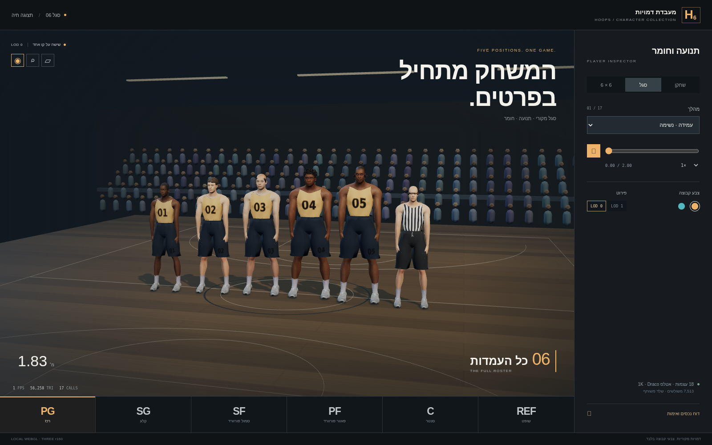

# כדורסל v6 — דמויות

חבילת נכסים עצמאית: PG, SG, SF, PF, C ושופט; שני LOD לכל דמות, שלד משותף בן 18 עצמות, אטלס PBR ומספרי חולצה. הדמויות בדויות. שתי הקבוצות נבדלות בצבע בלבד.

[תצוגה אינטראקטיבית](preview.html) · [דוח מסירה ומדידות](REPORT.md) · [מקורות ורישיונות](LICENSES.md) · [נתוני הנכסים](asset-metadata.json) · [שלד](rig.json)



## פתיחה מקומית

1. משורש הריפו מפעילים:

   ```sh
   python3 -m http.server 8765
   ```

2. פותחים את [התצוגה המקומית](http://localhost:8765/workout/island/design/hoops-v6/characters/preview.html).
3. בוחרים דמות, פעולה, קבוצה ו־LOD. אפשר לסובב את המצלמה, לעצור ולגרור את ציר הזמן. מצב שש מול שש מציג 12 שחקנים ושופט לבדיקת עומס.

זמן הריצה משתמש ב־three.js r160, ב־GLTFLoader ובמפענח Draco המקומיים בריפו. אין התקנה, build או שירות חיצוני בזמן צפייה. יש להגיש את הדף דרך HTTP עבור ES modules ו־GLB.

## חוזה שילוב

כל הדגמים משתמשים באותו שלד מנוחה ובאותן מטריצות bind. שמות העצמות: `Root`, `Hips`, `Spine`, `Chest`, `Neck`, `Head`, ושלוש עצמות לכל זרוע (`Arm`, `ForeArm`, `Hand`) ולכל רגל (`UpLeg`, `Leg`, `Foot`), עם קידומות `Left` ו־`Right`.

הגאומטריה מיוצאת במטרים, Y למעלה ו־Z קדימה. גובה שלד המנוחה המשותף מנורמל ל־1.95 מ׳. מידות הדמות לשילוב נמצאות ב־`asset-metadata.json`: מחשבים `h = heightMeters / 1.95` ומחילים על קבוצת השורש קנה מידה `(h * widthScale, h, h)`, בלי לשנות את מטריצות העצמות. כך אפשר לשתף את הקליפים בין כל הדמויות.

לכל דמות חומר יחיד ואטלס UV אחד עם שלוש מפות תואמות: base color ב־sRGB, נורמל משיק OpenGL ו־ORM ליניארי. מפות המקור נמצאות ב־`textures/`; ב־GLB מוטבעות מפות דחוסות. זהו סט אטלס אחד, ללא טקסטורה נפרדת לכל חלק גוף. מיפוי האריחים ב־[tiles.json](textures/tiles.json). החלפת צבע המדים בתצוגה נעשית במסכת UV, תוך שמירה על עור, שיער ומספרים.

הקליפים מוטבעים בכל GLB. רשימת הקליפים, אורכם, מקורם וסמני האירועים נמצאים במטא־דאטה וב־[תיעוד התנועה](tools/ANIMATIONS.md). מעבר בין פעולות נעשה ב־AnimationMixer עם crossfade. הכדור בתצוגה הוא אביזר הדגמה; אירועי השחרור והקפיצה נועדו לסייע לחיבור למערכת המשחק.

## הפקה חוזרת

כלי המקור ב־`tools/` קוראים נכסים קיימים בלבד וכותבים לחבילה זו ולתיקיות זמניות. נדרשים Blender 4.3.2, Python עם Pillow ו־NumPy, ו־Node עם glTF Transform, Draco ו־sharp. הוראות מדויקות ותוצאות האימות ב־[דוח המסירה](REPORT.md).

בדיקות Chromium בענן אינן מדידת FPS בטלפון פיזי. היעד הוא 30fps; תוצאת טלפון בינוני מחייבת מדידה במכשיר לאחר שילוב.
