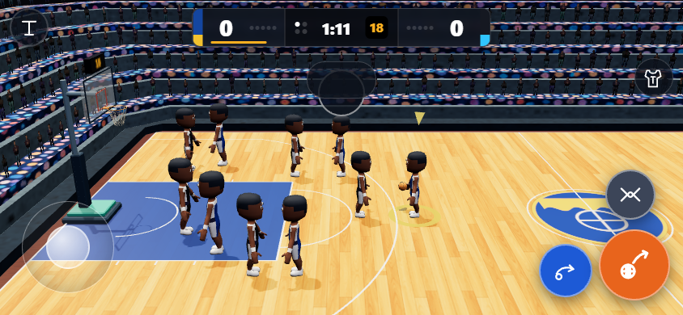
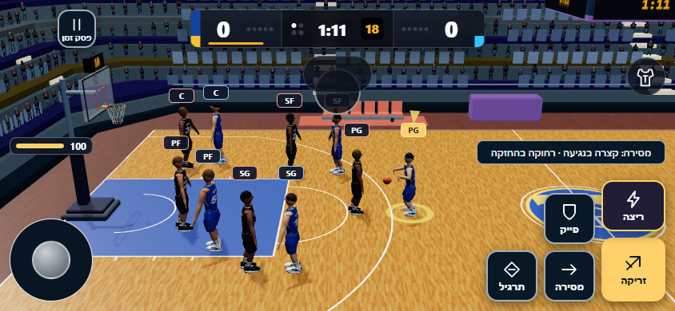
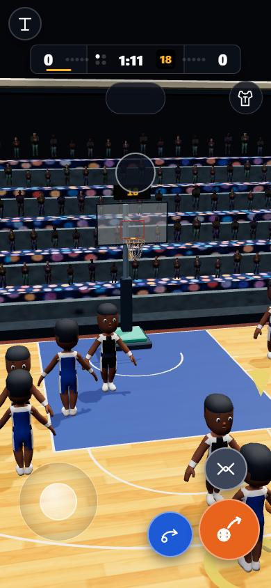
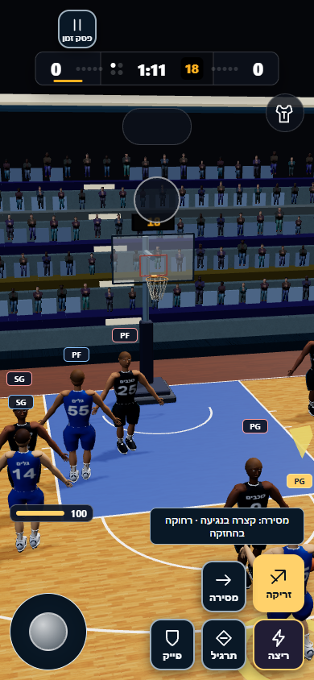

# כדורסל v2 — השוואה ובדיקות

בסיס main: `1b3df2a1`. גרסת הקוד שנבדקה: `260dcae3`.
הצילומים נעשו באותה מצלמה, אותן עמדות שחקנים ואותו מצב משחק.
זו השוואה מבוקרת בכלי הביצועים; [משחק חי לרוחב](live/844x390-5-on-5-roles.png),
[לאורך](live/390x844-5-on-5-roles.png), [קבוצה לרוחב](live/844x390-club-abilities.png)
ו[קבוצה לאורך](live/390x844-club-abilities.png) צולמו דרך index המקורי.

| טלפון | לפני | אחרי |
| --- | --- | --- |
| 844x390 |  |  |
| 390x844 |  |  |

| גודל | p95 לפני, ms | p95 אחרי, ms | שינוי |
| --- | ---: | ---: | ---: |
| 844x390 | 300.0 | 200.0 | -33.3% |
| 390x844 | 266.6 | 200.0 | -25.0% |

כלי `tools/perf-hoops.html`, שלושים שניות בכל כיוון, איכות 2 ו-DPR1 בשתי הגרסאות,
seed4242, quick וחזרה פעילה. Chrome SwiftShader במחשב; זו אינה מדידת טלפון פיזי.
אין נסיגה במדידה. נתוני המקור נמצאים ב-[לפני](before/perf.json) וב-[אחרי](after/perf.json).

הוחלפו הדמות והאולם בנכסי v2. כל 25 הקליפים מתיקיית motion2/hoops נטענים לצד 10 בסיסיים.
אפיית AO/תאורה מועברת לשלושת החלקים התואמים של האולם; הסטטיקה החדשה משתמשת ב-AO של v2,
והפרקט במרקם ובחומר Standard. לדמויות 6,381 משולשים עם פנים וידיים מפורטות.
פרופילי PG/SG/SF/PF/C משפיעים על שש יכולות והחלטות AI, עם שמות מלאים בעברית בקבוצה.
נתוני tactics, controls, hud-kit ו-feel מחוברים בפועל. נגיעה מוסרת קצר, החזקה מ-320ms מוסרת ארוך,
עם תווית ופס גלויים; בהגנה יש חסימה, חטיפה והחלפה.

פשרת המראה והביצועים מפורשת: מפות הצל ירדו 2048→1024, והדמויות משתמשות ב-Phong כולל עור ושיער.
DPR ואיכות 2 נשמרו. Skinning מדלג רק על משקלי עצם אפסיים; אין הסתרת דמויות, הורדת קליפים או שינוי זמני המנוע.

133 בדיקות כדורסל עברו. שלוש סוויטות דפדפן עברו בשני הכיוונים תחת CSP המקורי
`script-src 'self'`, כולל ניטור workers,40 פריסות, טקסט עברי גלוי ויעדי מגע 48px.
נבדקו חזותית חמש פעולות מנוע: שתי מסירות, דאנק, לייאפ ופייק; זמינות 35 הקליפים ותנוחותיהם נבדקו בנפרד.
שישה כשלים של חבילת המאגר המלאה שוחזרו גם על main נקי ב-Windows; פרטים וספירות ב-[validation.json](validation.json).
בדיקת שרת CSP הורצה גם בנפרד עם גישה ל-loopback. לא הוחלשו בדיקות.

חוזי תוצאה ושמירה נשמרו. השינוי העצמי נוגע לקובצי כדורסל בלבד. לא שונו release.json, release.mjs או ערכי?v=.
אחרי המיזוג נדרשת העלאת גרסה מרכזית נפרדת ועדכון תגי המטמון/נתונים כדי להפיץ לטלפונים; אין הגירת שמירה.
הענף מיועד לבקשת מיזוג אל main, ללא מיזוג עצמי.
