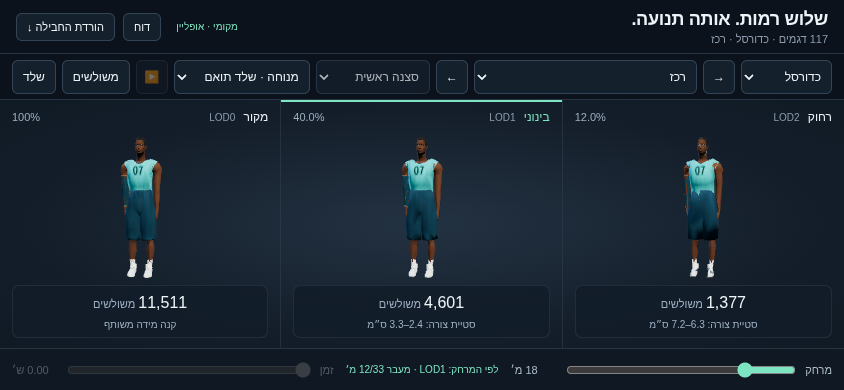
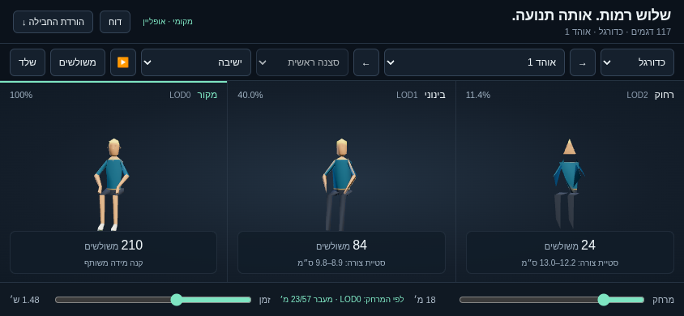
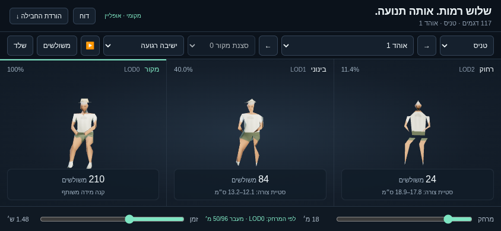
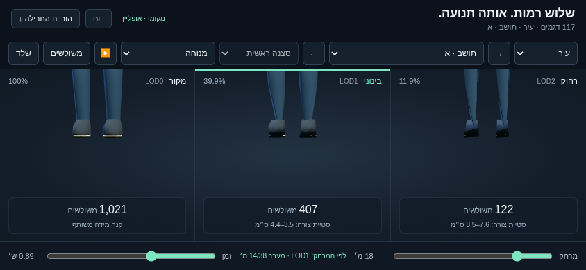
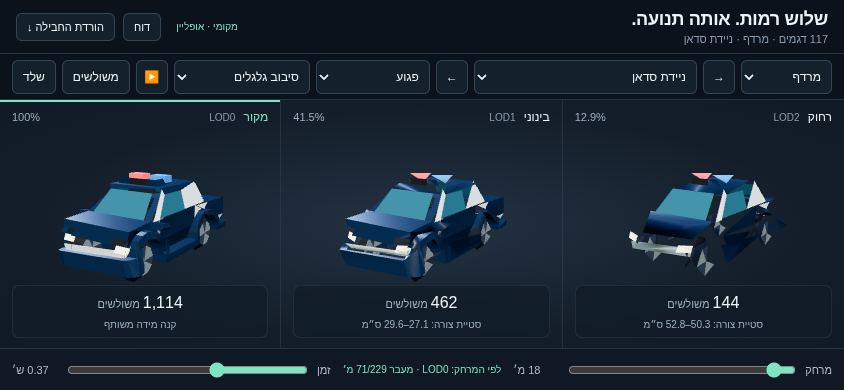
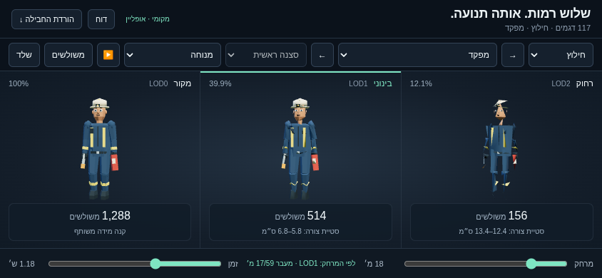

# דוח מסירה — צינור רמות פירוט

תאריך: 2026-11-17. מאגר: roynaor-work/Bakasun. ענף: `codex/lod-pipeline-v1`.

נוצרו **117 דגמי מקור עם LOD1 ו־LOD2**, כלומר 351 קובצי GLB לתצוגה: 117 עותקי LOD0 נעולים בגיבוב ו־234 תוצרים. נוספו 64 עותקי GLB של טופולוגיית קהל קיימת כקלטי בנייה; אלה אינם דגמים נוספים במשחק. ענף החייזרים כולל ספרייטים בלבד, ולכן אין בו דגם לעיבוד במסגרת ״דגמים בלבד״.

| מדד, בסצנה הראשית של כל דגם | מקור | LOD1 | LOD2 |
|---|---:|---:|---:|
| משולשים בסך הכול | 128,269 | 51,307 | 15,477 |
| שיעור מהמקור | 100% | 40.00% | 12.07% |
| יעד | 100% | כ־40% | כ־12% |

כל 234 הרמות החדשות נמצאות עד שלוש נקודות אחוז מהיעד של הדגם שלהן. כל המספרים המדויקים בטבלה בהמשך ובמניפסט.

| קבוצת מקור | דגמים | מקור | LOD1 | LOD2 |
|---|---:|---:|---:|---:|
| hoops-realism-v2 | 20 | 51,549 | 20,606 (39.97%) | 6,156 (11.94%) |
| soccer-crowd-people-v2 | 16 | 3,360 | 1,344 (40.00%) | 399 (11.88%) |
| tennis-crowd-people-v2 | 14 | 2,940 | 1,172 (39.86%) | 336 (11.43%) |
| city-citizens-v1 | 42 | 43,411 | 17,345 (39.96%) | 5,197 (11.97%) |
| catch-vehicles-v2 | 14 | 14,017 | 5,650 (40.31%) | 1,831 (13.06%) |
| fire-rescue-people-v2 | 11 | 12,992 | 5,190 (39.95%) | 1,558 (11.99%) |

קובצי GLB לתצוגה שוקלים 20.66 MB למקורות ו־26.51 MB לשתי הרמות החדשות יחד. האנימציות והטקסטורות נשמרות ולכן הפחתת משולשים אינה הפחתה באותו יחס בגודל ההורדה. [ארכיון האופליין](https://github.com/roynaor-work/Bakasun/raw/refs/heads/codex/lod-pipeline-v1/workout/island/design/lod-pipeline-v1/bakasun-lod-pipeline-v1.zip) כולל גם את קלטי הבנייה, הספריות, הכלים והתיעוד. הגיבוב והגודל הסופיים של הארכיון נמצאים לצד ההורדה ב־`verification/delivery.json`, שאינו נכלל בעצמו בארכיון.

## שימוש ושחזור

1. חלצו את הארכיון ופתחו את [preview.html](preview.html).
2. בפתיחה מקומית, בחרו את תיקיית החבילה באמצעות הכפתור בראש הדף. הדגמים נטענים מהתיקייה שנבחרה.
3. בחרו דגם ותנועה; אפשר לסובב את שלוש הרמות יחד, להציג משולשים ושלד, ולבחור מצב נזק ברכב. המסגור והזמן משותפים לשלוש הרמות. המרחק מסמן את הרמה המומלצת ואינו משנה את הזום של ההשוואה.

לחלופין, מתוך התיקייה, `node tools/serve.mjs` פותח שרת מקומי בכתובת [התצוגה המקומית](http://127.0.0.1:8765/preview.html). [README](README.md) כולל את פקודות השחזור. כלי ההפחתה, האימות והאריזה דורשים Node.js 20 ומעלה; אין התקנת חבילות או גישה לרשת.

## שמירת הצורה, השלד והתנועה

`tools/lod.mjs` קורא תמיד עותקי קלט הנעולים ב־SHA-256; הוא אינו משנה אותם ואינו מפשט את LOD1 כדי ליצור LOD2. כל הפלטים נשארים בתיקיית החבילה. אין WASM, Draco, meshopt או KTX2. התוצרים הם glTF 2.0 רגיל, עם טקסטורות מוטמעות. דחיסת ZIP משמשת לאריזת ההורדה בלבד.

ל־71 הדגמים שאינם קהל משמש פישוט קצוות לפי שגיאה ריבועית, ב־JavaScript. קודקודים שנשארו שומרים את כל נתוני המקור שלהם, כולל צבע, UV, נורמל, כל השפעות העצמות ודלתאות מצבי הנזק. נבדקים היפוך פאות, קישוריות ברמה הבינונית, שימור רכיבים נפרדים והשפעה של כל עצם ששימשה במקור. ברמה הרחוקה מוגנים רכיבי הראש והגו העיקריים מקריסה לפאות כפולות; פרטים קטנים יכולים להפוך לצלליות. תקציב המשולשים מחולק מחדש כאשר חלק קטן או חומר נפרד מחייבים רצפה. מקטעי נתונים בינאריים זהים חולקים אחסון glTF רגיל, לאחר בדיקת זהות של כל זרמי הגאומטריה ונתוני האנימציה; אין שינוי בערכים ואין מפענח נוסף.

ל־46 דגמי הקהל משמשות גם טופולוגיות שכבר נכתבו בענפי המקור. הן נקלטות רק אחרי התאמה מדויקת של השלד, מטריצות הקישור והקליפים. כאשר רמה קיימת השמיטה השפעה של עצם, מצורפים משולשים ללא שינוי מ־LOD0 כדי לשמר אותה. גם כאן כל משקל עצם מגיע בשלמותו מקלט נעול; אין חישוב משקלים מחדש. טופולוגיית הרמה הבינונית מופחתת מעט כדי להתקרב ל־40%.

בקהל הטניס יש שלוש סצנות ושלושה שלדים בקובץ המקור. כולם נשמרו עם כל ערוצי האנימציה. בכל GLB חדש, שלוש הסצנות משתמשות בגאומטריה של הרמה החדשה, עם מאגרי קודקודים משותפים. לכן המניפסט מפריד בין מספר המשולשים הפעיל בסצנה, סכום ההפניות מכל ה־meshes ומספר המשולשים בגאומטריה הייחודית. ההשוואה הראשית היא מול סצנת LOD0 של המקור.

נבדקו 9,526 דגימות תנוחה ו־2,975,048 השוואות קודקודים. הסטייה המרבית מול קודקוד הקלט התואם, לאחר הנפשה, היא **0 מטר**. בקהל ההשוואה היא לקודקודי הטופולוגיה המקורית המתאימה ולמשולשי התמיכה מ־LOD0; בפישוט הרגיל לקודקודי LOD0 שנשמרו. בנפרד, כל הבתים של דגימות האנימציה, האינטרפולציה, מטריצות הקישור, היררכיית העצמות, הסצנות, המשקלים ברמת node/mesh, החומרים ומזהי החלקים נבדקו מול המקור. ארבעת שחקני הכדורסל אינם מכילים קליפים; השלד שלהם נשמר לשימוש בהנפשה חיצונית.

## מדידת Hausdorff ומרחקי מעבר

המדידה נעשית על משטחי המשולשים במטרים עולמיים, בשני הכיוונים. חיפוש הנקודה הקרובה מתבצע מול משולשים באמצעות BVH; המקסימום תחום באמצעות חלוקה אדפטיבית של המשולש וקבוע ליפשיץ 1 של פונקציית המרחק. התוצאה היא **תחום תחתון–עליון נומרי**, כולל פנים הפאות, ולא מרחק בין קודקודים בלבד.

נמדדו 346 זוגות משטחים בסצנות המנוחה ובמצבי הנזק המוגדרים. יעד דיוק התחום הוא 0.5% מאלכסון המקור, עם תקציב 40,000 שאילתות לכל כיוון, או דגימת הפתיחה אם היא גדולה יותר. 0 מדידות מנוחה לא סגרו את התחום לדיוק זה; התחום הרחב בפועל נשמר ולא מוצג כמדידה מדויקת יותר.

נוסף לכך נמדדו 3672 משטחים מונפשים ב־25% וב־75% מכל קליפ, עם תקציב מדידה קטן יותר. התאמת קודקודים נבדקה גם ב־0%, 50% ו־100%. תחומי המשטח המונפש נשמרים במניפסט, כולל מצבים שבהם תקציב הדגימה מגביל את הדיוק. אין כאן הוכחה לסטיית משטח בכל רגע שבין הדגימות; שמירת נתוני האנימציה עצמם נבדקה במלואה.

[lod-config.json](lod-config.json) כולל ספי מרחק לכל דגם, בנוסף לפרופילי ברירת מחדל ולהיסטרזיס של 10%. הספים מכוילים לפי הגבול העליון של סטיית משטחי המנוחה בכל הסצנות, למסך בגובה 390 פיקסלים ושדה ראייה אנכי של 38 מעלות: עד 3 פיקסלים ל־LOD1 ועד 1.5 פיקסלים ל־LOD2 במשטחי הייחוס. הנוסחה היא `D >= 2R + f*e/p`, כש־R מכיל גם את שגיאת המשטח; הספים מפצים גם על טווח השימור של ההיסטרזיס. הכיול מתייחס למצלמה המכוונת למרכז מעטפת הדגם ולממדי GLB המקוריים. זו מעטפת גאומטרית לתנוחות הייחוס; היא אינה חסם לשינויי הצללה, טקסטורה או לכל תנוחות הביניים. במבט שאינו ממורכז, בקנה מידה אחר, בשדה ראייה או בגובה מסך אחרים יש לכייל מחדש. [כלי הכיול](tools/calibrate-policy.mjs) מצורף.

בעת החלפת רמה במארח, שומרים את שם הקליפ, זמנו המקומי, מהירותו, משקלי ערבוב הפעולות, הסצנה, משקלי הנזק ובחירת הציוד. בהנפשה חיצונית שומרים גם את שינויי העצמות של המארח. הקליפ אינו מתחיל מחדש. חיבור למשחקים לא בוצע במסגרת החבילה.

## בדיקות ותיחום השינוי

| בדיקה | תוצאה | ראיות |
|---|---|---|
| בדיקות הצינור | 15 מתוך 15, 0 נכשלו | [TAP](verification/pipeline-tests.tap) |
| Khronos glTF Validator, JavaScript מקומי | 415 GLB, 0 שגיאות, 0 אזהרות; כולל 64 קלטי טופולוגיה | [דוח אימות](verification/gltf-validation.json) |
| תצוגה ב־844×390 | 117 דגמים / 351 GLB / 173 סצנות / 642 קליפים; 0 שגיאות | [דוח דפדפן](verification/browser.json) |
| שלד ומצבי נזק בדפדפן | אפס סטייה במטריצות העצמות ובמשקלי morph בכל הרמות | [דוח דפדפן](verification/browser.json) |
| אופליין לאחר בחירת תיקייה | 6 דגמים / 18 GLB, רשת מנותקת, 0 בקשות HTTP, WASM מושבת | [בדיקת אופליין](verification/offline.json) |
| בדיקות כלליות של המאגר | לא הושלמה נקי: 4,111 עברו, כשל אחד, ביטול אחד, 64 דולגו; נעצרה אחרי 600 שניות | [פירוט סביבת הבדיקה](verification/repository-tests.json) |

בדיקות התצוגה השתמשו ב־Chromium עם ANGLE/SwiftShader וב־WebAssembly מושבת. אלו בדיקות דפדפן בסביבת הענן, ולא מדידת ביצועים בטלפון. ניווט ישיר ל־`file://` חסום בסביבת Chromium המנוהלת ב־ERR_BLOCKED_BY_ADMINISTRATOR; לכן זרימת בחירת התיקייה נבדקה באותו HTML מקומי, לאחר ניתוק רשת הדפדפן ולפני קריאת הקבצים. שרת Node המקומי הוא דרך צפייה נוספת כאשר מדיניות דפדפן חוסמת פתיחת HTML ישירה.

כל התוספות נמצאות תחת `workout/island/design/lod-pipeline-v1/`. קבצים קיימים וענפי המקור נקראו בלבד. בפרט, קובץ הבקרה הקיים לא עודכן בהתאם לאילוץ התיקייה היחידה; קריטריון הסיום של מסירה זו הוא GLB, מדידות, תצוגה, שחזור אופליין, אימות ודחיפת הענף.

## קלטים נעולים

בסיס הענף: `43b27dc235387e3cb737aee9558cdf9d5fd5a262`.

| ענף מקור | קומיט שנקרא | דגמי LOD0 |
|---|---|---:|
| [codex/hoops-realism-v2](https://github.com/roynaor-work/Bakasun/tree/823cf024a577e7eedd92b5dc6245702cc8921267) | `823cf024a577e7eedd92b5dc6245702cc8921267` | 20 |
| [codex/soccer-crowd-people-v2](https://github.com/roynaor-work/Bakasun/tree/faba2bf9a4696320da7503198072d787ea51c3da) | `faba2bf9a4696320da7503198072d787ea51c3da` | 16 |
| [codex/tennis-crowd-people-v2](https://github.com/roynaor-work/Bakasun/tree/2e3ef931771e6a4d06fd3c99907ba2ee8faf9eb6) | `2e3ef931771e6a4d06fd3c99907ba2ee8faf9eb6` | 14 |
| [codex/city-citizens-v1](https://github.com/roynaor-work/Bakasun/tree/9eca44477b005772cbd1379831a069c68a17b9a5) | `9eca44477b005772cbd1379831a069c68a17b9a5` | 42 |
| [codex/catch-vehicles-v2](https://github.com/roynaor-work/Bakasun/tree/1e18fbe32309ab149c13bd2cc69efba7d8be012f) | `1e18fbe32309ab149c13bd2cc69efba7d8be012f` | 14 |
| [codex/fire-rescue-people-v2](https://github.com/roynaor-work/Bakasun/tree/b9d55deb01efa52bac616b8a9566c85d73468835) | `b9d55deb01efa52bac616b8a9566c85d73468835` | 11 |
| [codex/alien-enemies-v2](https://github.com/roynaor-work/Bakasun/tree/edfdb66e3710146375471d6c8b9cad388a5d0651) | `edfdb66e3710146375471d6c8b9cad388a5d0651` | 0 |

המקור, הרישיון, הקומיט וגיבוב כל קלט מופיעים ב־[source-lock.json](source-lock.json). [רישיונות וייחוסים](LICENSES.md) משמרים את תנאי המקור, כולל הסתייגות המקור לגבי אישורי חבילות השיער והנעליים של שחקני הכדורסל. המניפסט כולל מלאי קבצים וגיבובי SHA-256, למעט עצמו והארכיון כדי למנוע תלות מעגלית.

## טבלת מדידה לכל דגם

ספירת המשולשים והסטייה בטבלה זו מתייחסות לסצנה הראשית במנוחה. תחום Hausdorff בסנטימטרים; הספים במטרים. כל הסצנות והדגימות המונפשות נמצאות במניפסט וב־`verification/*.json`.

| דגם | מקור | LOD1 | LOD2 | סטייה LOD1, ס״מ | סטייה LOD2, ס״מ | מעבר LOD1 / LOD2, מ׳ |
|---|---:|---:|---:|---:|---:|---:|
| `hoops-realism-v2/crowd/fan-01` | 210 | 84 (40.00%) | 25 (11.90%) | 4.53–5.13 | 7.67–8.29 | 13 / 37 |
| `hoops-realism-v2/crowd/fan-02` | 210 | 84 (40.00%) | 25 (11.90%) | 8.32–8.98 | 12.32–12.97 | 21 / 57 |
| `hoops-realism-v2/crowd/fan-03` | 210 | 84 (40.00%) | 25 (11.90%) | 5.29–6.01 | 10.22–10.93 | 15 / 48 |
| `hoops-realism-v2/crowd/fan-04` | 210 | 84 (40.00%) | 25 (11.90%) | 5.49–6.23 | 9.30–10.04 | 15 / 45 |
| `hoops-realism-v2/crowd/fan-05` | 210 | 84 (40.00%) | 25 (11.90%) | 6.94–7.88 | 11.76–12.70 | 19 / 56 |
| `hoops-realism-v2/crowd/fan-06` | 210 | 84 (40.00%) | 25 (11.90%) | 8.83–9.71 | 14.86–15.70 | 23 / 69 |
| `hoops-realism-v2/crowd/fan-07` | 210 | 84 (40.00%) | 25 (11.90%) | 7.17–8.15 | 12.16–13.13 | 20 / 58 |
| `hoops-realism-v2/crowd/fan-08` | 210 | 84 (40.00%) | 25 (11.90%) | 6.71–7.61 | 11.36–12.26 | 19 / 54 |
| `hoops-realism-v2/crowd/fan-09` | 210 | 84 (40.00%) | 25 (11.90%) | 6.86–7.79 | 11.73–12.66 | 19 / 56 |
| `hoops-realism-v2/crowd/fan-10` | 210 | 84 (40.00%) | 25 (11.90%) | 9.86–10.73 | 14.59–15.43 | 25 / 68 |
| `hoops-realism-v2/crowd/fan-11` | 210 | 84 (40.00%) | 25 (11.90%) | 7.06–8.02 | 11.96–12.92 | 20 / 57 |
| `hoops-realism-v2/crowd/fan-12` | 210 | 84 (40.00%) | 25 (11.90%) | 6.78–7.70 | 11.50–12.41 | 19 / 55 |
| `hoops-realism-v2/crowd/fan-13` | 210 | 84 (40.00%) | 25 (11.90%) | 6.63–7.52 | 11.22–12.12 | 19 / 54 |
| `hoops-realism-v2/crowd/fan-14` | 210 | 84 (40.00%) | 25 (11.90%) | 8.33–9.18 | 13.96–14.75 | 22 / 65 |
| `hoops-realism-v2/crowd/fan-15` | 210 | 84 (40.00%) | 25 (11.90%) | 6.82–7.74 | 11.55–12.48 | 19 / 55 |
| `hoops-realism-v2/crowd/fan-16` | 210 | 84 (40.00%) | 25 (11.90%) | 6.35–7.21 | 10.76–11.62 | 18 / 51 |
| `hoops-realism-v2/players/guard` | 11511 | 4601 (39.97%) | 1377 (11.96%) | 2.40–3.27 | 6.31–7.18 | 12 / 33 |
| `hoops-realism-v2/players/power` | 12149 | 4855 (39.96%) | 1454 (11.97%) | 2.19–3.12 | 7.98–8.90 | 12 / 40 |
| `hoops-realism-v2/players/shooter` | 12054 | 4818 (39.97%) | 1444 (11.98%) | 1.89–2.78 | 5.51–6.39 | 12 / 29 |
| `hoops-realism-v2/players/wing` | 12475 | 4988 (39.98%) | 1481 (11.87%) | 2.09–2.99 | 7.39–8.28 | 12 / 37 |
| `soccer-crowd-people-v2/fan-01` | 210 | 84 (40.00%) | 24 (11.43%) | 8.93–9.78 | 12.16–12.98 | 23 / 57 |
| `soccer-crowd-people-v2/fan-02` | 210 | 84 (40.00%) | 25 (11.90%) | 10.30–11.28 | 14.20–15.17 | 27 / 67 |
| `soccer-crowd-people-v2/fan-03` | 210 | 84 (40.00%) | 25 (11.90%) | 12.03–13.18 | 16.58–17.72 | 31 / 78 |
| `soccer-crowd-people-v2/fan-04` | 210 | 84 (40.00%) | 25 (11.90%) | 11.81–12.93 | 16.28–17.40 | 31 / 76 |
| `soccer-crowd-people-v2/fan-05` | 210 | 84 (40.00%) | 25 (11.90%) | 13.18–14.46 | 18.17–19.44 | 34 / 85 |
| `soccer-crowd-people-v2/fan-06` | 210 | 84 (40.00%) | 25 (11.90%) | 12.39–13.56 | 17.08–18.25 | 32 / 80 |
| `soccer-crowd-people-v2/fan-07` | 210 | 84 (40.00%) | 25 (11.90%) | 12.68–13.90 | 17.48–18.70 | 33 / 82 |
| `soccer-crowd-people-v2/fan-08` | 210 | 84 (40.00%) | 25 (11.90%) | 12.10–13.25 | 16.68–17.82 | 31 / 78 |
| `soccer-crowd-people-v2/fan-09` | 210 | 84 (40.00%) | 25 (11.90%) | 13.61–14.93 | 18.77–20.08 | 35 / 88 |
| `soccer-crowd-people-v2/fan-10` | 210 | 84 (40.00%) | 25 (11.90%) | 11.60–12.71 | 15.99–17.10 | 30 / 75 |
| `soccer-crowd-people-v2/fan-11` | 210 | 84 (40.00%) | 25 (11.90%) | 12.89–14.14 | 17.77–19.03 | 33 / 84 |
| `soccer-crowd-people-v2/fan-12` | 210 | 84 (40.00%) | 25 (11.90%) | 11.89–13.03 | 16.38–17.51 | 31 / 77 |
| `soccer-crowd-people-v2/fan-13` | 210 | 84 (40.00%) | 25 (11.90%) | 12.53–13.74 | 17.28–18.48 | 32 / 81 |
| `soccer-crowd-people-v2/fan-14` | 210 | 84 (40.00%) | 25 (11.90%) | 11.38–12.47 | 15.69–16.78 | 29 / 74 |
| `soccer-crowd-people-v2/fan-15` | 210 | 84 (40.00%) | 25 (11.90%) | 12.25–13.41 | 16.88–18.06 | 32 / 79 |
| `soccer-crowd-people-v2/fan-16` | 210 | 84 (40.00%) | 25 (11.90%) | 11.24–12.31 | 15.49–16.56 | 29 / 73 |
| `tennis-crowd-people-v2/fan-01` | 210 | 84 (40.00%) | 24 (11.43%) | 12.11–13.20 | 17.79–18.89 | 50 / 96 |
| `tennis-crowd-people-v2/fan-02` | 210 | 83 (39.52%) | 24 (11.43%) | 11.12–12.10 | 14.98–15.97 | 36 / 70 |
| `tennis-crowd-people-v2/fan-03` | 210 | 84 (40.00%) | 24 (11.43%) | 12.28–13.39 | 18.18–19.31 | 42 / 84 |
| `tennis-crowd-people-v2/fan-04` | 210 | 84 (40.00%) | 24 (11.43%) | 19.64–20.54 | 17.01–17.97 | 46 / 79 |
| `tennis-crowd-people-v2/fan-05` | 210 | 83 (39.52%) | 24 (11.43%) | 17.52–18.64 | 20.20–21.33 | 45 / 93 |
| `tennis-crowd-people-v2/fan-06` | 210 | 84 (40.00%) | 24 (11.43%) | 15.36–16.37 | 15.18–16.21 | 42 / 80 |
| `tennis-crowd-people-v2/fan-07` | 210 | 84 (40.00%) | 24 (11.43%) | 14.17–15.23 | 18.70–19.78 | 43 / 86 |
| `tennis-crowd-people-v2/fan-08` | 210 | 83 (39.52%) | 24 (11.43%) | 12.88–13.85 | 16.56–17.55 | 44 / 85 |
| `tennis-crowd-people-v2/fan-09` | 210 | 84 (40.00%) | 24 (11.43%) | 14.93–15.93 | 13.84–14.84 | 37 / 65 |
| `tennis-crowd-people-v2/fan-10` | 210 | 84 (40.00%) | 24 (11.43%) | 11.59–12.47 | 15.65–16.62 | 36 / 73 |
| `tennis-crowd-people-v2/fan-11` | 210 | 83 (39.52%) | 24 (11.43%) | 18.97–19.99 | 18.63–19.79 | 45 / 87 |
| `tennis-crowd-people-v2/fan-12` | 210 | 84 (40.00%) | 24 (11.43%) | 13.22–14.27 | 16.71–17.76 | 43 / 82 |
| `tennis-crowd-people-v2/fan-13` | 210 | 84 (40.00%) | 24 (11.43%) | 12.76–13.79 | 17.18–18.19 | 42 / 80 |
| `tennis-crowd-people-v2/fan-14` | 210 | 84 (40.00%) | 24 (11.43%) | 19.39–20.41 | 17.66–18.69 | 49 / 95 |
| `city-citizens-v1/animals/bird` | 576 | 230 (39.93%) | 68 (11.81%) | 2.06–2.36 | 4.79–5.09 | 8 / 23 |
| `city-citizens-v1/animals/butterfly` | 326 | 130 (39.88%) | 38 (11.66%) | 0.69–0.83 | 2.41–2.56 | 8 / 20 |
| `city-citizens-v1/animals/cat` | 814 | 326 (40.05%) | 98 (12.04%) | 6.46–6.87 | 8.63–9.05 | 16 / 40 |
| `city-citizens-v1/animals/dog` | 800 | 320 (40.00%) | 96 (12.00%) | 3.56–4.03 | 6.79–7.27 | 10 / 32 |
| `city-citizens-v1/animals/fish` | 350 | 140 (40.00%) | 42 (12.00%) | 3.23–3.42 | 3.32–3.51 | 8 / 20 |
| `city-citizens-v1/animals/pigeon` | 636 | 254 (39.94%) | 76 (11.95%) | 2.06–2.37 | 4.79–5.10 | 8 / 23 |
| `city-citizens-v1/people/adult-man-a` | 1021 | 407 (39.86%) | 122 (11.95%) | 3.53–4.44 | 7.58–8.49 | 14 / 38 |
| `city-citizens-v1/people/adult-man-b` | 1021 | 407 (39.86%) | 122 (11.95%) | 3.53–4.44 | 7.58–8.49 | 14 / 38 |
| `city-citizens-v1/people/adult-man-c` | 1021 | 407 (39.86%) | 122 (11.95%) | 3.53–4.44 | 7.58–8.49 | 14 / 38 |
| `city-citizens-v1/people/adult-woman-a` | 1113 | 445 (39.98%) | 134 (12.04%) | 2.84–3.75 | 7.77–8.68 | 14 / 39 |
| `city-citizens-v1/people/adult-woman-b` | 1113 | 445 (39.98%) | 134 (12.04%) | 2.84–3.75 | 7.77–8.68 | 14 / 39 |
| `city-citizens-v1/people/adult-woman-c` | 1113 | 445 (39.98%) | 134 (12.04%) | 2.84–3.75 | 7.77–8.68 | 14 / 39 |
| `city-citizens-v1/people/boy-a` | 1021 | 407 (39.86%) | 122 (11.95%) | 3.53–4.44 | 7.58–8.49 | 14 / 38 |
| `city-citizens-v1/people/boy-b` | 1021 | 407 (39.86%) | 122 (11.95%) | 3.53–4.44 | 7.58–8.49 | 14 / 38 |
| `city-citizens-v1/people/boy-c` | 1021 | 407 (39.86%) | 122 (11.95%) | 3.53–4.44 | 7.58–8.49 | 14 / 38 |
| `city-citizens-v1/people/cleaner-a` | 1153 | 461 (39.98%) | 138 (11.97%) | 4.00–4.91 | 6.19–7.10 | 14 / 32 |
| `city-citizens-v1/people/cleaner-b` | 1153 | 461 (39.98%) | 138 (11.97%) | 4.00–4.91 | 6.19–7.10 | 14 / 32 |
| `city-citizens-v1/people/cleaner-c` | 1153 | 461 (39.98%) | 138 (11.97%) | 4.00–4.91 | 6.19–7.10 | 14 / 32 |
| `city-citizens-v1/people/courier-a` | 1135 | 453 (39.91%) | 136 (11.98%) | 3.42–4.36 | 7.73–8.68 | 14 / 39 |
| `city-citizens-v1/people/courier-b` | 1135 | 453 (39.91%) | 136 (11.98%) | 3.42–4.36 | 7.73–8.68 | 14 / 39 |
| `city-citizens-v1/people/courier-c` | 1135 | 453 (39.91%) | 136 (11.98%) | 3.42–4.36 | 7.73–8.68 | 14 / 39 |
| `city-citizens-v1/people/elder-man-a` | 1048 | 418 (39.89%) | 126 (12.02%) | 2.60–3.50 | 7.58–8.48 | 14 / 38 |
| `city-citizens-v1/people/elder-man-b` | 1048 | 418 (39.89%) | 126 (12.02%) | 2.60–3.50 | 7.58–8.48 | 14 / 38 |
| `city-citizens-v1/people/elder-man-c` | 1048 | 418 (39.89%) | 126 (12.02%) | 2.60–3.50 | 7.58–8.48 | 14 / 38 |
| `city-citizens-v1/people/elder-woman-a` | 1087 | 435 (40.02%) | 130 (11.96%) | 2.60–3.51 | 7.58–8.49 | 14 / 38 |
| `city-citizens-v1/people/elder-woman-b` | 1087 | 435 (40.02%) | 130 (11.96%) | 2.60–3.51 | 7.58–8.49 | 14 / 38 |
| `city-citizens-v1/people/elder-woman-c` | 1087 | 435 (40.02%) | 130 (11.96%) | 2.60–3.51 | 7.58–8.49 | 14 / 38 |
| `city-citizens-v1/people/firefighter-a` | 1165 | 465 (39.91%) | 140 (12.02%) | 4.86–5.80 | 7.58–8.52 | 15 / 39 |
| `city-citizens-v1/people/firefighter-b` | 1165 | 465 (39.91%) | 140 (12.02%) | 4.86–5.80 | 7.58–8.52 | 15 / 39 |
| `city-citizens-v1/people/firefighter-c` | 1165 | 465 (39.91%) | 140 (12.02%) | 4.86–5.80 | 7.58–8.52 | 15 / 39 |
| `city-citizens-v1/people/gardener-a` | 1133 | 453 (39.98%) | 136 (12.00%) | 2.92–3.87 | 7.58–8.52 | 14 / 39 |
| `city-citizens-v1/people/gardener-b` | 1133 | 453 (39.98%) | 136 (12.00%) | 2.92–3.87 | 7.58–8.52 | 14 / 39 |
| `city-citizens-v1/people/gardener-c` | 1133 | 453 (39.98%) | 136 (12.00%) | 2.92–3.87 | 7.58–8.52 | 14 / 39 |
| `city-citizens-v1/people/girl-a` | 1093 | 437 (39.98%) | 130 (11.89%) | 2.84–3.76 | 7.78–8.69 | 14 / 39 |
| `city-citizens-v1/people/girl-b` | 1093 | 437 (39.98%) | 130 (11.89%) | 2.84–3.76 | 7.78–8.69 | 14 / 39 |
| `city-citizens-v1/people/girl-c` | 1093 | 437 (39.98%) | 130 (11.89%) | 2.84–3.76 | 7.78–8.69 | 14 / 39 |
| `city-citizens-v1/people/maintenance-a` | 1157 | 463 (40.02%) | 139 (12.01%) | 2.87–3.81 | 7.58–8.52 | 14 / 39 |
| `city-citizens-v1/people/maintenance-b` | 1157 | 463 (40.02%) | 139 (12.01%) | 2.87–3.81 | 7.58–8.52 | 14 / 39 |
| `city-citizens-v1/people/maintenance-c` | 1157 | 463 (40.02%) | 139 (12.01%) | 2.87–3.81 | 7.58–8.52 | 14 / 39 |
| `city-citizens-v1/people/police-a` | 1177 | 471 (40.02%) | 140 (11.89%) | 3.42–4.36 | 7.87–8.81 | 14 / 40 |
| `city-citizens-v1/people/police-b` | 1177 | 471 (40.02%) | 140 (11.89%) | 3.42–4.36 | 7.87–8.81 | 14 / 40 |
| `city-citizens-v1/people/police-c` | 1177 | 471 (40.02%) | 140 (11.89%) | 3.42–4.36 | 7.87–8.81 | 14 / 40 |
| `catch-vehicles-v2/fugitive-classic` | 1038 | 428 (41.23%) | 142 (13.68%) | 29.30–31.97 | 46.12–48.78 | 75 / 212 |
| `catch-vehicles-v2/fugitive-motorcycle` | 658 | 262 (39.82%) | 86 (13.07%) | 13.29–14.80 | 27.82–29.33 | 36 / 133 |
| `catch-vehicles-v2/fugitive-scooter` | 660 | 260 (39.39%) | 78 (11.82%) | 13.36–14.66 | 37.01–38.29 | 36 / 165 |
| `catch-vehicles-v2/fugitive-sport` | 1079 | 436 (40.41%) | 142 (13.16%) | 28.00–30.54 | 51.77–54.28 | 71 / 235 |
| `catch-vehicles-v2/fugitive-suv` | 1138 | 466 (40.95%) | 159 (13.97%) | 29.45–32.23 | 45.48–47.85 | 81 / 210 |
| `catch-vehicles-v2/fugitive-taxi` | 1094 | 449 (41.04%) | 149 (13.62%) | 29.04–31.75 | 49.22–51.94 | 74 / 226 |
| `catch-vehicles-v2/fugitive-truck` | 1079 | 440 (40.78%) | 138 (12.79%) | 24.02–26.92 | 46.04–48.95 | 65 / 213 |
| `catch-vehicles-v2/fugitive-van` | 1080 | 440 (40.74%) | 136 (12.59%) | 26.76–29.36 | 50.99–53.68 | 69 / 233 |
| `catch-vehicles-v2/police-dirt-bike` | 852 | 328 (38.50%) | 106 (12.44%) | 13.13–14.66 | 31.56–33.06 | 35 / 143 |
| `catch-vehicles-v2/police-luxury` | 1091 | 443 (40.60%) | 145 (13.29%) | 28.22–30.93 | 51.02–53.52 | 73 / 232 |
| `catch-vehicles-v2/police-sedan` | 1114 | 462 (41.47%) | 144 (12.93%) | 26.98–29.42 | 50.09–52.70 | 71 / 229 |
| `catch-vehicles-v2/police-suv` | 1198 | 470 (39.23%) | 162 (13.52%) | 27.55–30.28 | 43.85–46.13 | 71 / 204 |
| `catch-vehicles-v2/police-touring-bike` | 796 | 302 (37.94%) | 98 (12.31%) | 22.86–24.34 | 28.31–29.82 | 56 / 134 |
| `catch-vehicles-v2/police-van` | 1140 | 464 (40.70%) | 146 (12.81%) | 27.51–30.40 | 68.11–70.99 | 72 / 306 |
| `fire-rescue-people-v2/baby-stroller` | 1272 | 508 (39.94%) | 156 (12.26%) | 3.22–3.87 | 16.93–17.54 | 12 / 76 |
| `fire-rescue-people-v2/boy` | 1044 | 418 (40.04%) | 124 (11.88%) | 2.63–3.29 | 5.66–6.32 | 12 / 29 |
| `fire-rescue-people-v2/captain` | 1288 | 514 (39.91%) | 156 (12.11%) | 5.76–6.76 | 12.37–13.37 | 17 / 59 |
| `fire-rescue-people-v2/father` | 1076 | 430 (39.96%) | 128 (11.90%) | 4.12–5.09 | 9.15–10.13 | 14 / 45 |
| `fire-rescue-people-v2/female-firefighter` | 1300 | 518 (39.85%) | 156 (12.00%) | 5.63–6.58 | 11.78–12.73 | 17 / 56 |
| `fire-rescue-people-v2/girl` | 1164 | 466 (40.03%) | 140 (12.03%) | 3.23–3.87 | 7.06–7.69 | 12 / 34 |
| `fire-rescue-people-v2/grandfather` | 1160 | 464 (40.00%) | 138 (11.90%) | 3.77–4.65 | 8.38–9.26 | 12 / 42 |
| `fire-rescue-people-v2/grandmother` | 1212 | 484 (39.93%) | 144 (11.88%) | 4.49–5.35 | 8.04–8.90 | 14 / 40 |
| `fire-rescue-people-v2/mother` | 1124 | 450 (40.04%) | 134 (11.92%) | 3.62–4.53 | 8.28–9.19 | 12 / 41 |
| `fire-rescue-people-v2/panicked-man` | 1076 | 430 (39.96%) | 128 (11.90%) | 3.54–4.50 | 8.29–9.25 | 12 / 42 |
| `fire-rescue-people-v2/young-firefighter` | 1276 | 508 (39.81%) | 154 (12.07%) | 5.70–6.68 | 10.98–11.96 | 17 / 53 |

