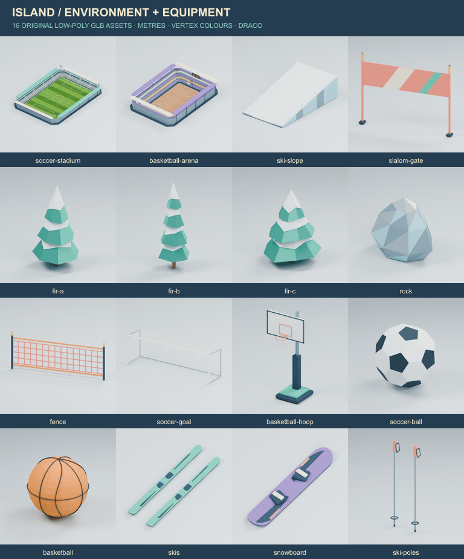

# האי שלי · מודלי סביבה וציוד

16 מודלי GLB מקוריים בסגנון low-poly, עם צבעי קודקודים ופלטת מנטה, קורל, סגול, ענבר ונייבי התואמת לחבילת [הדמויות](../characters/README.md). הגאומטריה נבנתה ב־Blender במיוחד לחבילה; לא הועתקו מודלים או גאומטריית דמויות. אין שמות, לוגואים או מותגים אמיתיים על הנכסים.

[תצוגה של כל החבילה](overview.png) · [בדיקות ומשקלים מדודים](VALIDATION.md) · [מקורות ורישיונות](LICENSES.md) · [סיכום בדיקות לקריאת מכונה](validation.json)

## קובצי המסירה

לכל נכס GLB עצמאי, תצוגת PNG וקובץ `authoring.json` עם שמות הרכיבים, נקודות העוגן והערות המידות. תמונות ה־PNG מופקות לאחר ייבוא חוזר של קובצי ה־GLB הדחוסים.

| נכס | GLB | תצוגה | חוזה הנכס |
| --- | --- | --- | --- |
| אצטדיון כדורגל: יציעים, קורות, גג היקפי ותאורה | [soccer-stadium.glb](soccer-stadium.glb) | [PNG](soccer-stadium.png) | [JSON](soccer-stadium.authoring.json) |
| אולם כדורסל: יציעים, לוח תוצאה ושתי מסגרות סל | [basketball-arena.glb](basketball-arena.glb) | [PNG](basketball-arena.png) | [JSON](basketball-arena.authoring.json) |
| מקטע מדרון סקי | [ski-slope.glb](ski-slope.glb) | [PNG](ski-slope.png) | [JSON](ski-slope.authoring.json) |
| שער סלאלום | [slalom-gate.glb](slalom-gate.glb) | [PNG](slalom-gate.png) | [JSON](slalom-gate.authoring.json) |
| אשוח א׳: רחב ושכבתי | [fir-a.glb](fir-a.glb) | [PNG](fir-a.png) | [JSON](fir-a.authoring.json) |
| אשוח ב׳: גבוה וצר | [fir-b.glb](fir-b.glb) | [PNG](fir-b.png) | [JSON](fir-b.authoring.json) |
| אשוח ג׳: נמוך ומלא | [fir-c.glb](fir-c.glb) | [PNG](fir-c.png) | [JSON](fir-c.authoring.json) |
| סלע | [rock.glb](rock.glb) | [PNG](rock.png) | [JSON](rock.authoring.json) |
| מקטע גדר בטיחות | [fence.glb](fence.glb) | [PNG](fence.png) | [JSON](fence.authoring.json) |
| שער כדורגל עם רשת | [soccer-goal.glb](soccer-goal.glb) | [PNG](soccer-goal.png) | [JSON](soccer-goal.authoring.json) |
| סל עצמאי עם לוח, טבעת ורשת | [basketball-hoop.glb](basketball-hoop.glb) | [PNG](basketball-hoop.png) | [JSON](basketball-hoop.authoring.json) |
| כדור כדורגל | [soccer-ball.glb](soccer-ball.glb) | [PNG](soccer-ball.png) | [JSON](soccer-ball.authoring.json) |
| כדור כדורסל | [basketball.glb](basketball.glb) | [PNG](basketball.png) | [JSON](basketball.authoring.json) |
| זוג מגלשיים עם תושבות | [skis.glb](skis.glb) | [PNG](skis.png) | [JSON](skis.authoring.json) |
| גלשן שלג עם תושבות | [snowboard.glb](snowboard.glb) | [PNG](snowboard.png) | [JSON](snowboard.authoring.json) |
| זוג מקלות סקי | [ski-poles.glb](ski-poles.glb) | [PNG](ski-poles.png) | [JSON](ski-poles.authoring.json) |

כל אולם הוא קליפה בקובץ GLB אחד, עם מספר קטן של רכיבים בעלי שמות. הגג המרכזי פתוח בכוונה כדי שהמגרש והשחקנים יישארו גלויים במצלמה מוגבהת בטלפון. השער והסל העצמאיים הם נכסים נפרדים לשימוש במשחקים.

## יחידות, מידות ועוגנים

ב־GLB: היחידה היא מטר, מעלה הוא `+Y`, קדימה הוא `+Z`; השורש `asset_root` נמצא בבסיס ובעל הזזה וסיבוב אפס וקנה מידה 1. העוגן המשותף `anchor_origin` נמצא בראשית. נקודות העוגן הן nodes ללא גאומטריה, ונשמרות גם כשמשנים או מחליפים חומר.

הערכים במילון `anchors` בקובצי `authoring.json` הם כבר קואורדינטות glTF הסופיות, לפי הסדר `[x, y, z]`. השדה `bounds_blender` מתעד בנפרד את גבולות היצירה ב־Blender, שם ציר מעלה הוא Z; אין להעתיקו כמיקום glTF.

| נכס / מידה | חוזה |
| --- | --- |
| שחקן ייחוס | 1.80 מ׳. הדמויות הקיימות מתועדות כ־1.60 מ׳; בשלב שילוב עתידי נדרש להן קנה מידה `1.125` כדי להגיע ל־1.80 מ׳. קובצי הדמויות לא משתנים בחבילה זו. |
| שער כדורגל | פתח פנימי 7.32×2.44 מ׳; המדידה היא בין הדפנות הפנימיות ומתחת לקורה. `anchor_goal_center` במרכז הפתח; `anchor_goal_line_left/right` בקצות הקו; `anchor_ball_spot` הוא מרכז כדור בגובה 0.11 מ׳, במרחק 11 מ׳ לפני קו השער. |
| סל עצמאי | `anchor_rim_center` בגובה 3.05 מ׳; קוטר פנימי של הטבעת 0.45 מ׳; לוח 1.80×1.05 מ׳. `anchor_backboard_center` ו־`anchor_mount` מסמנים את הלוח ואת נקודת התמיכה. |
| כדורים | `anchor_ball_center` נמצא במרכז הכדור; השורש בבסיס. `anchor_ball_spot` מסמן את נקודת ההנחה. כדורגל בקוטר 0.22 מ׳, כדורסל בקוטר גוף 0.24 מ׳ עם תפרים גאומטריים. |
| אצטדיון | משטח מגרש 68×105 מ׳; `anchor_field_center`, `anchor_ball_spot`, `anchor_goal_north/south`, `anchor_ball_spot_north/south`. העוגנים על פני המשטח; יש להוסיף את רדיוס הכדור כשמציבים את מרכזו. |
| אולם כדורסל | מגרש 15×28 מ׳; `anchor_rim_center_north/south` בגובה 3.05 מ׳ ביחס לבסיס; `anchor_free_throw_north/south`, `anchor_scoreboard_center`, `anchor_ball_spot`. עוגני ההנחה על המשטח. |
| מדרון | מקטע 14×24 מ׳, ירידה של 6 מ׳. `anchor_route_start/end/mid` על השלג; כיוון `+Z` ב־glTF הוא במורד. `anchor_gate_center` מסייע להצבת שער. |
| שער סלאלום | 3 מ׳ בין מרכזי המוטות, גובה 2.35 מ׳; `anchor_gate_center`, `anchor_pole_left/right`, `anchor_banner_center`. |
| אשוחים וסלע | `anchor_trunk_base`, `anchor_tree_tip` בכל אשוח; `anchor_rock_top` בסלע. |
| גדר | 3 מ׳ בין `anchor_connect_left/right`, גובה 1.20 מ׳; `anchor_fence_center` במרכז הרשת. |
| מגלשיים | אורך 1.70 מ׳; `anchor_boot_left/right`, `anchor_mount_left/right`. |
| גלשן ומקלות | גלשן 1.50 מ׳ עם `anchor_boot_front/rear`; מקלות 1.20 מ׳ עם `anchor_grip_left/right`. |

שמות שימושיים כוללים `rim`, `net`, `goal_post`, `crossbar`, `backboard`, `scoreboard`, `ski_left/right`, `pole_left/right`. הרשימה המדויקת לכל קובץ נמצאת בשדה `objects` של חוזה הנכס. שינוי רכיב נעשה לפי שמו, בלי להסתמך על סדר הרשתות בקובץ.

## חומרים, UV ודשא

המודלים שומרים צבע ב־`COLOR_0`, ללא טקסטורות מוטבעות וללא קובצי תמונה הנדרשים לטעינה. חלקים ללא טקסטורה משתמשים באטלס UV ארוז עם איים נפרדים; נתוני `TEXCOORD_0` נשמרים גם כשהחומר משתמש רק בצבעי הקודקודים.

באצטדיון `pitch_surface` הוא משטח שטוח ללא גאומטריית דשא. יש לו UV מלא בטווח 0–1 וחומר נפרד `pitch_surface_material`; שדה `suggested_texture` מפנה אל `../environment/textures/grass-mown.webp` לשלב השילוב. ה־GLB עצמו אינו טוען או מטמיע את התמונה. בתצוגת האצטדיון בלבד נעשה שימוש באריח הקיים לצפייה; מקורו ורישיונו מופיעים ב־[רישיונות הסביבה](../environment/LICENSES.md).

## פתיחה ושימוש

1. פותחים את [overview.png](overview.png) להשוואת כל הנכסים, או PNG של נכס מסוים לבדיקת הצורה והצבעים.
2. מייבאים את ה־GLB הרצוי ל־Blender או ל־loader תומך Draco. כל הקבצים דורשים פענוח `KHR_draco_mesh_compression`; בקוד המשחק הקיים טרם הוגדר מפענח זה, ולכן חיבור למשחק דורש שלב שילוב נפרד ומפענח המוגש מקומית.
3. משאירים את השורש בקנה מידה 1, מאתרים רכיבים ועוגנים לפי השמות בחוזה הנכס, ובודקים מול דמות ייחוס בגובה 1.80 מ׳.
4. באצטדיון בלבד, אם רוצים דשא, מחברים בשלב השילוב את אריח הסביבה לחומר המשטח. מציבים שערים, כדורים או ציוד באמצעות העוגנים המתאימים.

התוצאה הצפויה: מודל צבעוני ללא משאבי תמונה חיצוניים, עם רכיבים שניתן לבחור לפי שם, שער בעל פתח 7.32×2.44 מ׳ וטבעת בגובה 3.05 מ׳. הבדיקות והמשקלים בפועל מתועדים ב־[VALIDATION.md](VALIDATION.md), לרבות glTF Validator על הקובץ הדחוס ועל עותק שפוענח באופן עצמאי.

תקרות החבילה הן 250,000 bytes לכל אחד משלושת המודלים הגדולים, 60,000 bytes לכל נכס ציוד וסך 2,000,000 bytes. התיעוד המדוד קובע את התוצאה, כולל אופן חישוב משקל החבילה.

## קובצי יצירה ובדיקה

`source/common.py` מכיל את הפלטה, כלי הגאומטריה, אריזת UV וייצוא Draco; `source/build.py` מפעיל את שלושת בוני הנכסים; `source/render.py` מייבא את קובצי המסירה ומרנדר תצוגות; `source/optimize-previews.mjs` מצמצם PNG ומרכיב את גיליון התצוגה; `source/validate.mjs` מפענח ובודק. קובצי `validation/compressed/*.json` ו־`validation/decoded/*.json` שומרים את פלט ה־Validator. הוראות שחזור וגרסאות: [source/README.md](source/README.md).

זוהי חבילת נכסים לשילוב עתידי. השינוי מוגבל לתיקיית `models/`: ללא שינוי בקובצי לוגיקת המשחק, תגי `?v=` או תיקיות העיצוב הקיימות.
