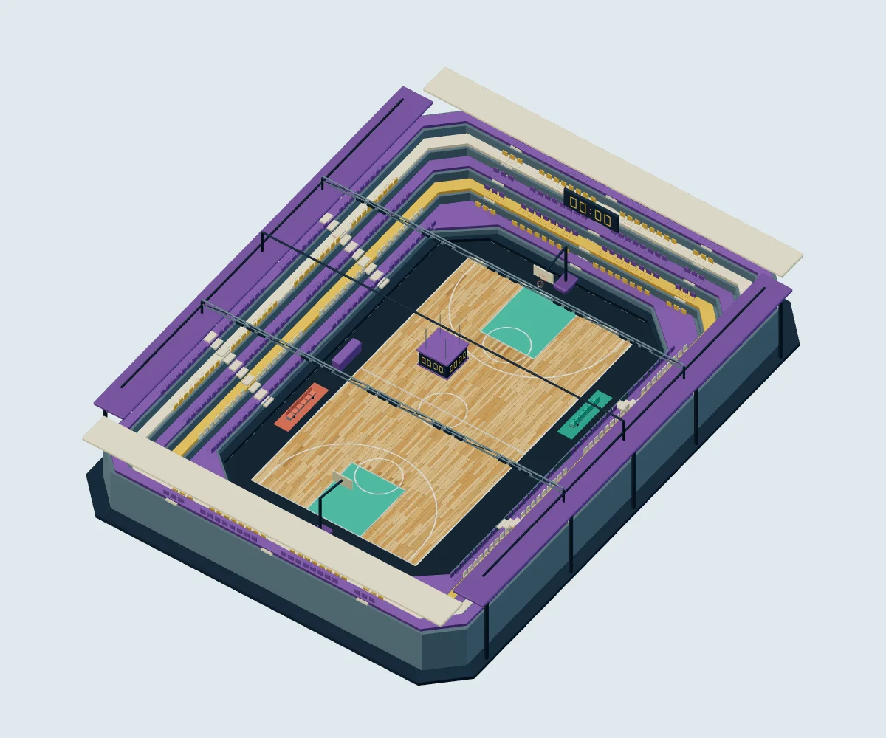

# האי שלי · מודלי סביבה 02

18 נכסי GLB עם Draco, על בסיס `main` בקומיט `3853d282b6dd7719db49a864fec4286dc7b63cb0` מ־31.10.2026, כולל `models/`,‏ `environment/` ו־`baked/`. החבילה מוסיפה פירוט לשלוש הסביבות ושומרת את חוזי הרכיבים והעוגנים של המודלים הקיימים. כל קובצי המסירה והכלים נמצאים בתיקייה זו.

[תצוגה אינטראקטיבית](preview.html) · [מדידות ובדיקות](VALIDATION.md) · [מקורות ורישיונות](LICENSES.md) · [תקציב כל התיקייה](package-budget.json)



## תכולה

| נכס | פירוט |
| --- | --- |
| [basketball-arena.glb](basketball-arena.glb) | אולם עם מושבים נפרדים, מדרגות יציע ומעקות, פרקט מלוחות בגוונים משתנים וסימונים גאומטריים שטוחים, אזורי קבוצות וספסלים, שולחן מזכירות, שוליים, סלים עם רשתות וקורות תאורה מחוברות. לוח תוצאה תלוי בעל ארבע פאות מעל המרכז, ועוד הלוח המקורי בקצה האולם. ספרות בלבד, ללא שמות או סמלים. |
| [soccer-stadium.glb](soccer-stadium.glb) | שתי קומות יציע, מושבים בקומה העליונה, מעברים ומדרגות, גג היקפי חלקי עם קורות תמיכה, תאורה, דשא בפסי כיסוח גאומטריים, סימוני מגרש, שני שערים ורשתות, ספסלי מחליפים מקורים, דגלוני קרן ולוחות פרסום עם בלוקים צבעוניים ללא טקסט. |
| [ski-slope.glb](ski-slope.glb) | שני מקטעי מסלול רציפים של 24 מ׳, שערי זינוק וסיום, שערי מסלול, שלטי חץ ללא טקסט, אשוחים, סלעים בשלושה גדלים, שולי שלג, גדרות, מגדל מעלית וכבלים. מרכז המסלול פנוי. |
| `fir-a.glb`, `fir-b.glb`, `fir-c.glb` | שלושת האשוחים התואמים לחוזי המקור: רחב, גבוה ומלא. |
| `fir-sparse.glb`, `fir-medium.glb`, `fir-dense.glb` | מקבצי 3, 7 ו־13 אשוחים באותו שטח הצבה, להגברת הצפיפות; כל מקבץ הוא רשת אחת לצמצום draw calls. |
| `rock-small.glb`, `rock.glb`, `rock-large.glb` | אותו סלע בשלושה גדלים: ×0.45, ×1 ו־×1.8; גרסת האמצע שומרת את חוזה המקור. |
| `fence.glb`, `slalom-gate.glb` | גדר בטיחות ושער סלאלום תואמים לשמות ולעוגנים הקיימים. |
| `start-gate.glb`, `finish-gate.glb`, `snow-sign.glb`, `lift-tower.glb` | אביזרי שלג נפרדים עם עוגני הצבה. שערים ללא מילים ומגדל עם סולם וגלגלות. |

לכל GLB יש `authoring.json` עם שמות הרכיבים, העוגנים במרחב glTF, משולשים ויחידות. [גיליון האביזרים](previews/props.webp) מציג את כל 15 האביזרים הנפרדים.

## תצוגה בטלפון

1. מגישים את המאגר בשרת סטטי מקומי. לדוגמה, משורש המאגר:

   ```sh
   python3 -m http.server 8765
   ```

2. פותחים את [דף התצוגה המקומי](http://localhost:8765/workout/island/design/models2/preview.html), בוחרים מודל ומסובבים לאורך ולרוחב. גרירה מסובבת; גלגלת או צביטה מקרבת; „איפוס מבט” מחזיר את כל הנכס למסגרת.
3. בודקים שהמגרש נשאר פתוח, שלוח התוצאה תלוי מעל מרכז האולם ושהפרקט, שתי קומות היציע והמסלול ברורים. כל המודולים ומפענח Draco מוגשים מהמאגר; אין בקשות ל־CDN.

| סביבה | אורך 390×844 | רוחב 844×390 | פירוט |
| --- | --- | --- | --- |
| כדורסל | [WebP](previews/basketball-arena-portrait.webp) | [WebP](previews/basketball-arena-landscape.webp) | [תצוגה גדולה](previews/basketball-arena-detail.webp) |
| כדורגל | [WebP](previews/soccer-stadium-portrait.webp) | [WebP](previews/soccer-stadium-landscape.webp) | [תצוגה גדולה](previews/soccer-stadium-detail.webp) |
| סקי | [WebP](previews/ski-slope-portrait.webp) | [WebP](previews/ski-slope-landscape.webp) | [תצוגה גדולה](previews/ski-slope-detail.webp) |

## חוזה החלפה

יחידה: מטר; מעלה `+Y`; קדימה `+Z`. השורש `asset_root` נשאר בראשית, בסיבוב אפס ובקנה מידה 1. שמות הקבצים של שלוש הסביבות זהים לשמות ב־`../models/`; כל שם רכיב וכל מיקום עוגן שקיימים במקבילה ב־v1 נשמרו ונבדקו מול נתוני המקור. בין השמות: `rim`,‏ `net`,‏ `goal_post`,‏ `crossbar`,‏ `backboard`,‏ `anchor_*`. אין תלות בסדר הרשתות.

המגרשים נשארים 15×28 מ׳ ו־68×105 מ׳. הטבעות בגובה 3.05 מ׳; שערי הכדורגל בעלי פתח פנימי 7.32×2.44 מ׳. הפרקט הגאומטרי נמצא 8 מ״מ מעל משטח הייחוס המקורי; העוגנים המקוריים נשארים במיקומם.

`anchor_scoreboard_center` מצביע ללוח הקצה המקורי כדי לשמור תאימות; `anchor_hanging_scoreboard_center` הוא מרכז הלוח החדש התלוי. `anchor_team_home/away` ו־`anchor_substitutes_home/away` מסמנים אזורי קבוצות.

בסקי המקטע המקורי נשאר בדיוק בין עוגני `anchor_route_start/end` המקוריים. המקטע השני מתווסף **במעלה** המסלול: `anchor_route_start_v2` נמצא ב־`[0,12.25,-36]`, המפגש `anchor_segment_join` ב־`[0,6.25,-12]`, ו־`anchor_route_end_v2` ב־`[0,0.25,12]`. אין שינוי במסלול הישן או בעוגניו. שערי הזינוק והסיום ומגדל המעלית מקבלים עוגנים חדשים.

כל צבעי המשטחים והצללת AO נמצאים ב־`COLOR_0`, עם חומר PBR מחוספס. **אין טקסטורות ב־GLB**, ולכן אין מרקמים החורגים מ־512px ואין קובצי תמונה חיצוניים שנדרשים לטעינה. ה־WebP בתיקיית `previews/` הם צילומי תצוגה בלבד, ולא מרקמי משחק. אין להחיל את מפות `../baked/` על הטופולוגיה החדשה; ההצללה נאפתה מחדש לצבעי הפאות. מפענח Draco כבר קיים ב־`../../vendor/draco/` ומשמש את התצוגה.

החבילה מוכנה להחלפת נכסים בעת שילוב, אך אינה מחוברת למשחקים ב־PR זה. אין שינויים בקבצים קיימים, בלוגיקת משחק או בתגי גרסה. [שחזור](source/README.md).
