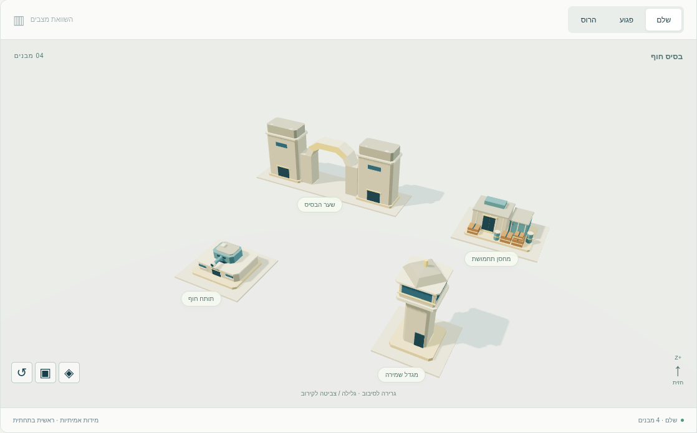
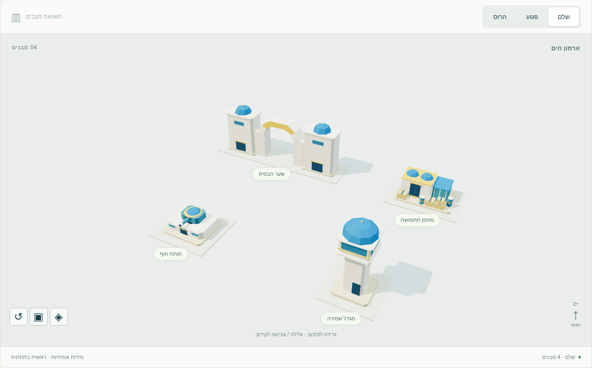
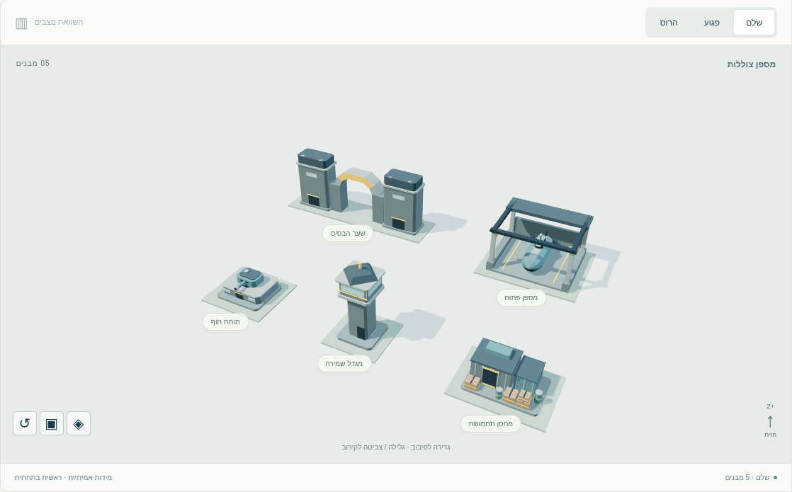
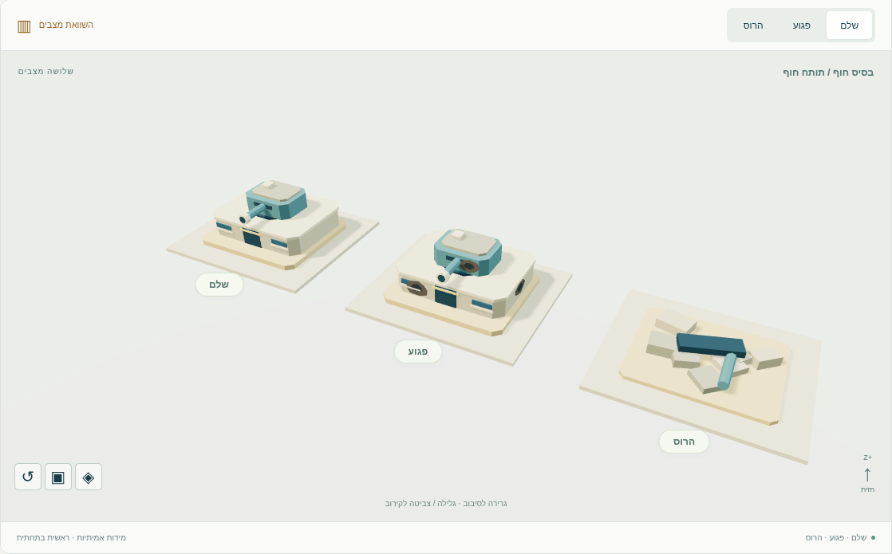
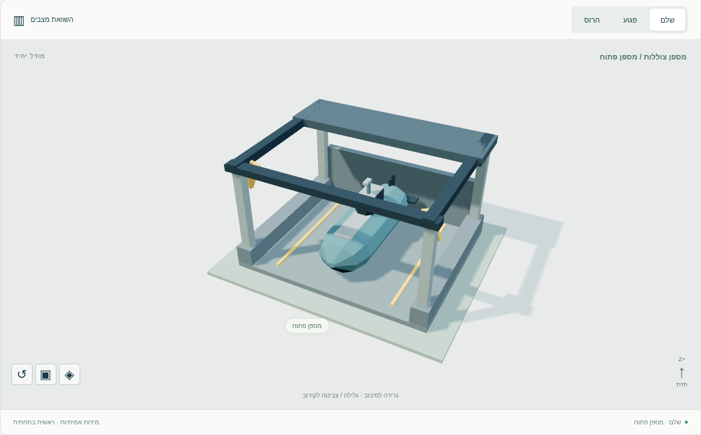

# מסירת ערכת בסיסי אויב V1

13 קובצי GLB מקוריים: ארבעה מבנים בכל אחד משלושת הסגנונות, ועוד מספן פתוח עם צוללת. לכל קובץ שלושה מצבים נפרדים: `intact`, `damaged`, `ruined`. נוצר בענף `codex/naval-base-models-v1` מ־`main` בקומיט `51f4faab518c695672efaf6323a8b72f239a2b84`.

כל הקבצים שנוספו נמצאים בתיקייה זו ובתיקיות הבת שלה. אין שינוי בקוד המשחק, בקובצי vendor קיימים, בבקרת הגרסאות של המשחק או בתשתית הפרסום.

## תוצאות

| בדיקה | תוצאה | ראיות |
|---|---|---|
| תקינות glTF 2.0 במאמת Khronos `2.0.0-dev.3.10` | 13/13; אפס שגיאות ואפס אזהרות | [דוח מלא](gltf-validation.json) |
| פענוח עצמאי של GLB, accessors וטרנספורמציות | 13/13; כל 39 המצבים תקינים | [דוח גאומטריה](asset-validation.json) |
| תקציב משולשים | 969–1,305 לכל קובץ, כולל סכום שלושת המצבים | [מניפסט](../manifest.json) |
| חומרים וטקסטורות | חומר PBR יחיד בכל GLB, צבעי קודקודים, אפס טקסטורות | דוח הגאומטריה |
| דחיסה ותלויות | ללא Draco, meshopt או קבצים חיצוניים ב־GLB | דוח הגאומטריה |
| מידות ומיקום | מידות השלם תואמות למניפסט; תחתית `Y=0`, מרכז ב־`X/Z`, חזית `+Z` | bounds מכל הגאומטריה הבינארית |
| שערים | 30 קרני מעבר לכל שער עוברות בפתח שבמרכז במצבים שלם ופגוע | דוח הגאומטריה |
| תותחים | `barrel` ילד של `turret`, pivots נפרדים, קנה במנוחה `+Z` | דוח הגאומטריה ובדיקת סיבוב בדפדפן |
| הריסות | ערימה נפרדת בגובה 1.07–1.20 יחידות | bounds של `ruined` |
| טעינה ורינדור ב־three.js המקומי | 39/39 שילובי מודל ומצב; אפס שגיאות JS/HTTP ובקשות חיצוניות | [דוח דפדפן](browser.json) |
| ממשק תצוגה | מעבר סגנון ומצב, השוואה, סיבוב צריח והגבהת קנה, מצלמה במקלדת, רשת ו־wireframe, קישור משחזר תצוגה | דוח הדפדפן |
| גדלי מסך | 1536×1100, 390×844, 844×390; ללא גלילה אופקית | דוח הדפדפן וצילומים |
| שחזור מקור | 13 GLB והמניפסט זהים בייט־לבייט לאחר בנייה לתיקייה זמנית | [בדיקת שחזור](rebuild.json) |

משקל כל 13 קובצי GLB יחד: **1,122,440 בתים**, ללא ספריות התצוגה. הנתונים מתייחסים לגרסה הסופית עם שני מכלים גליליים בכל מחסן, נוסף על המכולות והארגזים.

## צילומים אמיתיים

נשמרו 17 צילומים מתוך התצוגה ב־Chromium. [כל הצילומים](../screenshots/), כולל תשע תצוגות סגנון × מצב, שלוש השוואות תותח, שער חזיתי, מספן מקרוב, תותח מסובב, מחשב ונייד.

| חוף | ארמון | מספן |
|---|---|---|
|  |  |  |





הסקירה החזותית בדקה בנפרד את צבעי הסגנונות, הכיפות הכחולות, הפיח בחזית ובצד, סילואטת ההריסות, פתח השער, הצוללת והמסגור בנייד. הרינדור נעשה ב־Chromium עם SwiftShader; אלה בדיקות בדפדפן בסביבה זו, ולא מדידת ביצועים בטלפון פיזי או בדיקת חיבור למשחק.

## שחזור הבדיקות

משורש המאגר:

```sh
python3 workout/island/design/naval-base-models-v1/tools/build_models.py
python3 workout/island/design/naval-base-models-v1/tools/validate_models.py
```

המחולל דורש Python בלבד; הבודק העצמאי דורש NumPy. לאימות Khronos מתקינים את הכלי מחוץ למאגר:

```sh
npm install --prefix /tmp/naval-base-validator gltf-validator@2.0.0-dev.3.10
node workout/island/design/naval-base-models-v1/tools/validate_gltf.mjs /tmp/naval-base-validator/node_modules/gltf-validator
```

לבדיקת הדפדפן והצילומים, לאחר הפעלת שרת HTTP משורש המאגר לפי ה־README, עם Python Playwright ו־Chromium מותקנים:

```sh
python3 workout/island/design/naval-base-models-v1/tools/capture_preview.py --chromium /usr/bin/chromium
```

## בדיקות המאגר

`npm test` הסתיים עם **3,698 הצלחות, 0 כשלים ו־64 דילוגים** מתוך 3,762 בדיקות, ב־366.6 שניות. [סיכום מכונה](repository-tests.json).

בסביבה זו Playwright חיפש תחילה headless shell שלא מותקן. ההרצה הסופית השתמשה במתאם זמני מחוץ למאגר דרך `ISLAND_PLAYWRIGHT`, שמפנה את Playwright ל־`/usr/bin/chromium` המותקן ומוסיף דגלי סביבת הריצה. בדיקות המאגר עצמן לא שונו; בדיקת הדפדפן שנכשלה עקב ההתקנה החסרה עברה גם בנפרד וגם בהרצה המלאה לאחר בחירת Chromium המותקן.
