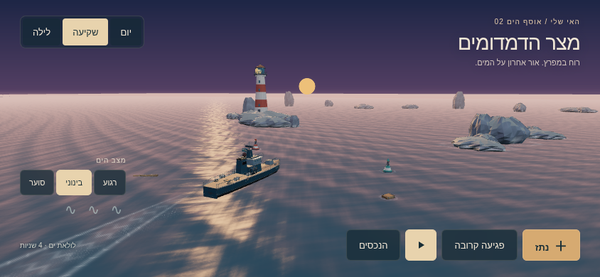
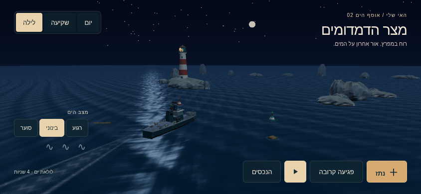
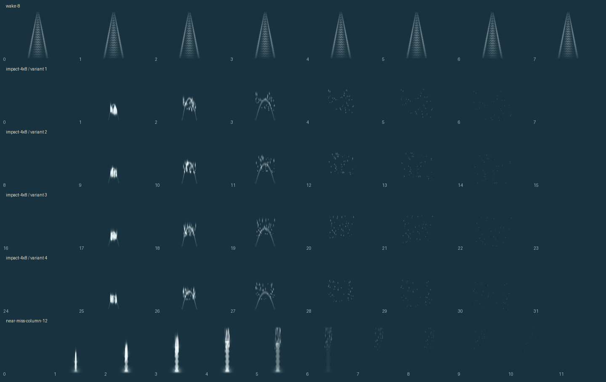
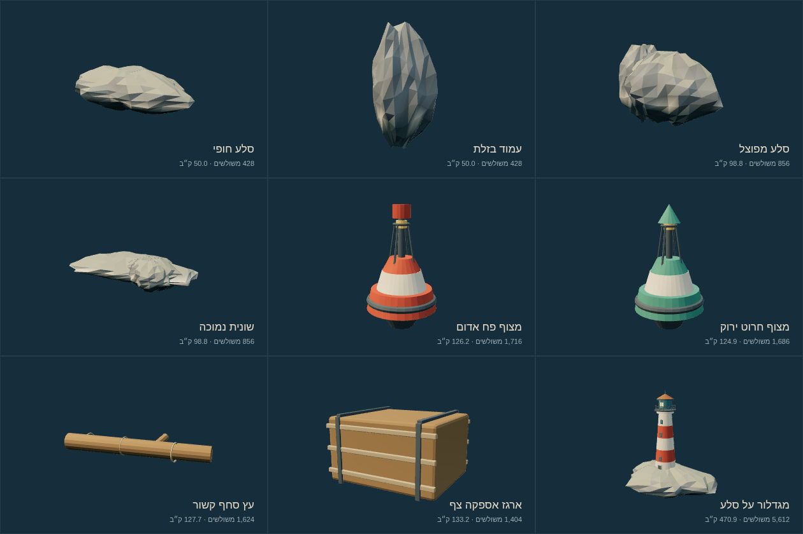

# ים וסביבה לספינות — מסירת גרסה 2

החבילה מוסיפה מים מחזוריים, שובל, קצף, נתזים, עמוד מים, אווירת אופק ותשעה דגמי סביבה. כל השינויים הם קבצים חדשים בתוך `workout/island/design/naval-sea-v2/` בלבד.

ענף המסירה: `codex/naval-sea-v2`. בסיס העבודה: `43b27dc235387e3cb737aee9558cdf9d5fd5a262` מתוך `main`. תאריך: 17 בנובמבר 2026.

קריטריון הסיום: כל הנכסים המבוקשים, אטלסים עד 800,000 בתים, דגמים נקיים במאמת Khronos, תצוגה בחלון 844×390, מניפסט ורישיונות, בדיקות ודחיפת הענף. רישום המסירה נמצא בדוח זה; בהתאם להוראת המשימה לא שונה `ops/CONTROL.md` או קובץ קיים אחר.

## צפייה

1. מתוך שורש המאגר, הפעילו את השרת המקומי:

   ```sh
   python3 -m http.server 8765 --bind 127.0.0.1 --directory workout/island/design/naval-sea-v2
   ```

2. פתחו את [התצוגה המקומית](http://127.0.0.1:8765/preview.html) בחלון **844×390**. התצוגה מתאימה את עצמה גם לחלון אחר. נדרש WebGL; אין התקנה או חיבור לאינטרנט לאחר שהקבצים נמצאים במחשב. יש להגיש דרך HTTP מקומי, משום שדפדפנים מגבילים טעינת מודולים ומניפסט בפתיחת `file://`.
3. החליפו בין יום, שקיעה ולילה ובין שלוש עוצמות הגלים. הכפתור **נתז** עובר בין ארבע הווריאציות; **פגיעה קרובה** מציג עמוד מים לצד הספינה. אפשר להשהות, לפתוח את קטלוג הטקסטורות ולהוריד אותן. רווח משהה; Escape סוגר את הקטלוג ומחזיר את המיקוד לכפתור. העדפת תנועה מופחתת מתחילה בתמונה מושהית.
4. לבדיקת פרטי הדגמים פתחו את [גיליון הדגמים](http://127.0.0.1:8765/source/model-contact.html). התוצאה הרצויה היא ארבע צלליות סלע שונות, שני מצופים, עץ סחף, ארגז ומגדלור, ללא שגיאות טעינה.





## תכולה

כל טקסטורה היא PNG אריחי או PNG בשקיפות אמיתית. אין תמונות JPEG עם רקע מדומה. כל אטלס כולל שוליים משוכפלים, ומסגרות ו־UV מדויקים רשומים ב־[manifest.json](manifest.json), לצד גודל, SHA-256, קצב ניגון, משך, ציר, קנה מידה ורישיון.

| נכס | קבצים | מפרט |
|---|---|---|
| ים רגוע, בינוני וסוער | `textures/water-{calm,breeze,rough}.png` ומקבילי `-normal.png` | 3 עוצמות × צבע ונורמל; 16 פריימים לכל עוצמה, 256×256 לפריים, 4 שניות, 4 פריימים לשנייה עם מיזוג לפריים הבא. אטלס 1040×1040, שוליים של 2 פיקסלים |
| מים ללא אנימציה | `textures/water-*-tile.png` | 3 אריחי צבע 256×256, חזרה בשני הצירים |
| שובל | `textures/wake.png`, `textures/wake-8.png` | טקסטורה 256×512 ואטלס בן 8 פריימים; לולאת שנייה, 8 פריימים לשנייה; אטלס 1056×1040, שוליים של 4 פיקסלים |
| קצף | `textures/foam-strip.png`, `foam-ring.png`, `foam-patch.png` | רצועה אריחית אופקית 512×128, טבעת וסבך בועות 256×256 |
| פגיעה במים | `textures/impact-4x8.png` | 4 וריאציות נפרדות, 8 פריימים בכל שורה, 192×192 לפריים; 0.8 שניות לכל וריאציה, 10 פריימים לשנייה; אטלס 1600×800 |
| פגיעה סמוך לספינה | `textures/near-miss-column-12.png` | עמוד מים עם רסס; 12 פריימים של 192×384, ‏1.2 שניות, 10 פריימים לשנייה; אטלס 800×1176 |
| ערפל אופק | `textures/horizon-fog.png` | 512×128, שקיפות מדורגת וחזרה אופקית; צבע ניתן להתאמה בזמן ריצה |
| שמי יום, שקיעה ולילה | `textures/sky-{day,sunset,night}.png` | גרדיאנטים 512×256, ניתנים לחזרה אופקית; שקיעה חמה ולילה בכחול עמוק |
| דיסקת אור | `textures/sun-disc.png` | 128×128 שקוף; משמש לשמש, לירח ולעדשת המגדלור בתצוגה |
| סביבה תלת ממדית | `models/*.glb` | ארבעה סלעים, ארבעה צפים ומגדלור, עם צבעי קודקודים וחומרי PBR מוטבעים; אין טקסטורות או קבצים חיצוניים לדגמים |

ספינת הקורבטה ב־`source/reference-corvette.glb` היא נכס קיים של המאגר שהועתק לצורך התצוגה וקנה המידה. תשעת דגמי הסביבה נוצרו בחבילה זו.



## משקלים ודגמים

התקרה מפורשת כ־**800,000 בתים**, שהיא מחמירה יותר מ־800KiB. האטלס הגדול ביותר: **531,679 בתים**, מפת הנורמל של הים הבינוני. כל הטקסטורות יחד: **3,427,575 בתים**. הנכסים לשילוב, ללא ספינת הרפרנס: **4,708,127 בתים**; כולל ספינת הרפרנס: **5,116,191 בתים**. ספריות תצוגה, מקורות וצילומי בדיקה מחושבים בנפרד ואינם נחוצים לשילוב הנכסים במשחק.

| דגם | משולשים | בתים |
|---|---:|---:|
| סלע חופי `rock-skerry` | 428 | 50,024 |
| עמוד בזלת `rock-stack` | 428 | 50,024 |
| סלע מפוצל `rock-split` | 856 | 98,816 |
| שונית `rock-reef` | 856 | 98,816 |
| מצוף פח אדום `float-can-buoy` | 1,716 | 126,196 |
| מצוף חרוט ירוק `float-cone-buoy` | 1,686 | 124,868 |
| עץ סחף `float-driftwood` | 1,624 | 127,700 |
| ארגז אספקה `float-supply-crate` | 1,404 | 133,220 |
| מגדלור `lighthouse` | 5,612 | 470,888 |



## הוראות שילוב

- קנה מידה במטרים; מישור הים XZ בגובה Y=0, ציר הגובה ‎+Y. נקודת המוצא של דגמי הסביבה היא קו המים; החלקים השקועים נשארים מתחתיו. כיוון ספינת הרפרנס הוא ‎+Z, והוא רשום בנפרד במניפסט.
- אטלסי צבע ושמים נטענים במרחב sRGB; מפות נורמל במרחב ליניארי ללא המרת צבע. הנורמלים לפי OpenGL ‏(‎+Y). מפות הנורמל כומתו ל־256 צבעים, ואטלסי צבע המים ל־128, ללא דיתור; כך נשמר תקציב PNG.
- עבור מים: `phase = (timeSeconds % 4) * 4`. דוגמים את `floor(phase)` ואת הפריים הבא מודולו 16, ומערבבים לפי החלק השברי. UV מקומי עובר `fract` לפני המיפוי למלבן הפריים; אין לחזור על כל האטלס עצמו. שמרו על חצי הפיקסל והשוליים שבמניפסט. דוגמת השיידר המלאה נמצאת ב־`preview.js`.
- השובל חוזר בכל שנייה, ב־8 פריימים לשנייה. קצה החרטום/תחילת השובל נמצא בראש התמונה; החלק הרחב מתמשך למטה. מצמידים את קצה תחילת השובל לעוגן הירכתיים ומסובבים לפי כיוון הספינה.
- לנתזים: בוחרים אחד מארבעת `clips`, עם `startFrame` של 0, 8, 16 או 24. מנגנים פעם אחת ומסירים בסיום. עמוד המים מנוגן פעם אחת ב־10 פריימים לשנייה. הפריים הראשון והאחרון שקופים, כדי למנוע הופעה או היעלמות פתאומית.
- ספרייטי הפגיעה הם לוחות אנכיים הפונים למצלמה, כשהבסיס בנקודת הפגיעה. השובל והקצף מונחים אופקית מעל קו המים. PNG בשקיפות ישרה; `transparent=true`, ‏`depthWrite=false`. אין צורך בחיבור חיבורי מסוג additive.
- לאטלסים משתמשים בסינון ליניארי, ללא mipmaps, וללא repeat של האטלס כולו. אריחי המים הבודדים והרצועה האופקית יכולים להשתמש בחזרה רגילה לפי הצירים שבמניפסט. בעת כיווץ אטלס יש ליצור את שוליו מחדש.
- המגדלור כולל חומר פליטה רגיל לעדשה. האור הזוהר והכוכבים בתצוגה הם תוספות הדגמה; הם אינם חלק מגאומטריית המגדלור או מגרדיאנט השמים.

## בדיקות ושחזור

תוצאות מפורטות נשמרות בקובצי JSON ב־`verification/`. המדידות הגרפיות נעשו ב־Chromium עם ANGLE/SwiftShader בתוכנה. לא בוצעה מדידת FPS בטלפון פיזי.

| בדיקה | תוצאה |
|---|---|
| נכסים, משקלים, מסגרות, שוליים, תפרים ושקיפות | **535 בדיקות עברו**; [asset-report.json](verification/asset-report.json) |
| Khronos glTF Validator 2.0.0-dev.3.10 | **10 קבצים, אפס שגיאות, אפס אזהרות, אפס הערות**; [gltf-report.json](verification/gltf-report.json) |
| דפדפן | **36 בדיקות עברו**; תוצאות סופיות ב־[browser-report.json](verification/browser-report.json); כל מצבי התאורה והגלים, ארבעת הנתזים, עמוד מים, לופ מצויר, ניגון והשהיה, מאגר אפקטים חסום, פינוי גאומטריה, קטלוג, מקלדת ותנועה מופחתת |
| מידות תצוגה | 844×390, ‏740×360, ‏390×844 ו־320×568; ללא גלישת הדף או בקרות מחוץ לחלון |
| תלות ברשת | כל משאבי התצוגה מקומיים; בקשות חיצוניות נחסמות בבדיקה |
| בדיקות המאגר | ריצה מלאה: **4,261 עברו, 64 דולגו, כשל סביבתי אחד** — חסר הדפדפן המצורף לכלי הבדיקה. בהרצה ממוקדת חוזרת עם Chromium המותקן: **5 מתוך 5 עברו**; [repository-tests.json](verification/repository-tests.json) |
| תחום שינוי | כל הקבצים חדשים ונמצאים תחת התיקייה היחידה שהתבקשה; [scope-report.json](verification/scope-report.json) |

בריצה המלאה, בדיקת `tests/workout-royiki.test.mjs:91` פתחה שרת ואז נכשלה בהפעלת דפדפן Playwright שאינו מותקן. השרת נשאר פתוח ולכן תהליך הבדיקה נסגר אחרי 668 שניות. הקובץ שנכשל הורץ מחדש עם Chromium 151 המותקן במערכת, דרך נתיב דפדפן זמני מחוץ למאגר, וכל חמש הבדיקות בו עברו. קוד היציאה של הריצה המלאה נשאר 1; ההרצה הממוקדת סיימה בקוד 0. לא הורצה שוב כל חבילת הבדיקות.

לולאת המים נבדקת בשתי דרכים: נוסחת משטח המים נותנת אותו ערך בתחילת המחזור ובסופו, והשוואת פיקסלים בים המרונדר ב־t=0 וב־t=4 נשמרת בדוח הדפדפן. אין הכפלה של הפריים הראשון בסוף האטלס: הפריים האחרון מתמזג לראשון. בדיקת מסגרות ה־PNG מאמתת גם רציפות מרחבית בכל פריים.

ליצירה מחדש, מתוך שורש המאגר:

```sh
python3 workout/island/design/naval-sea-v2/source/build-textures.py
blender -b --factory-startup --python-exit-code 1 --python workout/island/design/naval-sea-v2/source/build-models.py
node workout/island/design/naval-sea-v2/source/decode-reference.mjs
python3 workout/island/design/naval-sea-v2/source/build-manifest.py
python3 workout/island/design/naval-sea-v2/source/build-contact.py
python3 workout/island/design/naval-sea-v2/source/check-assets.py
node workout/island/design/naval-sea-v2/source/check-gltf.mjs
node workout/island/design/naval-sea-v2/source/check-browser.mjs
python3 workout/island/design/naval-sea-v2/source/check-scope.py
npm test
```

ליצירת המים נדרשים Python, ‏NumPy ו־Pillow. גרסת Blender היא 4.3.2. כלי Node משתמשים בחבילות המותקנות מחוץ למאגר: `gltf-validator@2.0.0-dev.3.10`, ‏`@gltf-transform/core@4.2.1`, ‏`@gltf-transform/extensions@4.2.1`, ‏`draco3dgltf@1.5.7`. אפשר להגדיר את הנתיב באמצעות `SEA_TOOLCHAIN`. לבדיקת הדפדפן אפשר להגדיר `PLAYWRIGHT_MODULE`, ‏`PNGJS_MODULE` ו־`CHROMIUM_PATH`. התלויות הללו נדרשות ליצירה ולאימות בלבד.

הרישיונות והמקורות מפורטים ב־[LICENSES.md](LICENSES.md).
