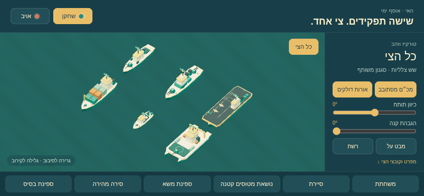
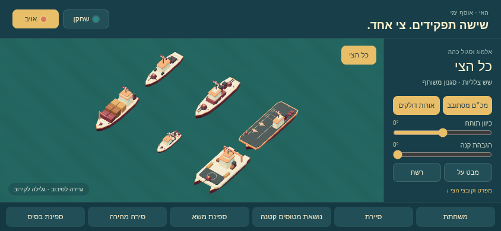

# ספינות דור 2 — דוח מסירה

הושלמו שש ספינות, כל אחת בגרסת שחקן ובגרסת אויב: **12 קובצי GLB עצמאיים**. כל קובץ מכיל 600–1,500 משולשים, צמתים נפרדים לתותח, לארובה, למכ״ם ולאורות, ואנימציית סיבוב מכ״ם. כל התוצרים נמצאים בתיקייה חדשה זו בלבד.

תאריך: 14/11/2026. מאגר: `roynaor-work/Bakasun`. ענף: `codex/naval-ships-v2`. בסיס: `main`, קומיט `11fef2fb98eec4173381346caee94f2930f9cffa`. רמת החשיבה המבוקשת: extra high.

## דגמים

התקציב נספר על **כל מופעי הגאומטריה בסצנה המלאה**, כולל תותחים, אורות, מכ״ם, מנועים ומטוסים על הסיפון. שתי גרסאות הצבע חולקות גאומטריה זהה.

| דגם | משולשים לגרסה | שחקן, בתים | אויב, בתים | קריאות ציור | מאפיין מזהה |
|---|---:|---:|---:|---:|---|
| משחתת | 1,106 | 83,020 | 83,024 | 9 | תותח קדמי, גשר מרכזי וסיפון ציוד אחורי |
| סיירת | 1,434 | 106,128 | 106,132 | 11 | שני תותחים כפולים, גשר מדורג ושתי ארובות |
| נושאת מטוסים קטנה | 1,258 | 92,916 | 92,916 | 9 | סיפון רחב, אי פיקוד צדדי ושני מטוסים בדיוניים |
| ספינת משא | 1,322 | 97,768 | 97,772 | 9 | שש מכולות בצבעים חמים, גשר אחורי ומנוף |
| סירה מהירה | 1,286 | 92,776 | 92,780 | 9 | גוף קצר, מושבים, שני מנועים ופליטה כפולה |
| ספינת בסיס | 1,324 | 96,444 | 96,448 | 9 | שני גופים, רחבת שירות, קורת הרמה ומכלי אספקה |

משקל כולל לדגמים: **1,138,124 בתים, כ־1.09MiB**. אין טקסטורות, קבצים בינאריים חיצוניים, Draco, Meshopt או הרחבות חובה. ניתן לטעון כל GLB בנפרד באמצעות GLTFLoader רגיל.

## סגנון ומקורות הייחוס

הדגמים משתמשים במשטחים מפוסלים פשוטים, נורמלים שטוחים, צבעי קרם, טורקיז וזהב לשחקן, ואלמוג וסגול כהה לאויב. צבעי הבסיס נלקחו במדויק מפלטת `torpedo-sub-v1`: שחקן `#258b8a`, `#e9be69`, `#fff0cc`, `#354c58`; אויב `#733e54`, `#dc7758`, `#ffe3b0`, `#354251`. צבעי הזכוכית והציוד תואמים את פלטת `naval-extras-v1`. ערכי sRGB הומרו לצבעי קודקודים ליניאריים כנדרש ב־glTF.

הייחוסים נקראו מענפי המקור:

- `codex/torpedo-sub-v1`, קומיט `aab3372c088b5bbf67d387ba4655c707b86e5196`.
- `codex/naval-extras-v1`, קומיט `bfc24132de75646f42e71512c9ff1fa7a906c6cd`.

אין כיתוב או מותגים על הדגמים. כותרות וכפתורים מופיעים רק בממשק התצוגה. כל קובצי המקור והרישיונות מפורטים ב־[LICENSES.md](LICENSES.md).

## חוזה חיבור

מערכת צירים ימנית, מטרים, מעלה `+Y`, קדימה `+Z`, צד ימין `+X`. מקור כל ספינה במרכז האורך, בגובה קו המים `Y=0`; הגוף ממשיך מעט מתחת למים. הגובה המדויק של הסיפון והממדים לכל דגם מופיעים ב־[manifest.json](manifest.json). הפרופורציות מסוגננות למשחק.

```text
ship
├── hull                     כל החלקים הקבועים
├── turret                   סיבוב תותח סביב +Y
│   └── barrel               הגבהת קנה סביב +X
│       └── muzzle           קצה הקנה, קדימה +Z
├── funnel                   ארובה / פליטה נפרדת
├── exhaust                  נקודת חיבור לעשן
├── radar                    ציר המכ״ם המקומי
├── lights
│   ├── port_light           אדום, צד -X
│   ├── starboard_light      ירוק, צד +X
│   ├── mast_light           אור חם על התורן
│   └── stern_light          אור חם בירכתיים
├── bow                      נקודת חיבור לרסס חרטום
└── wake                     נקודת חיבור לשובל
```

לסיירת יש גם `turret_aft`, `barrel_aft`, `muzzle_aft`. תותח זה פונה אחורה במצב מנוחה; יש לשמר את סיבוב המנוחה שלו (`π` סביב Y) בעת הוספת כיוון. `muzzle` בתותח כפול הוא נקודת הפליטה במרכז זוג הקנים.

- `turret`: סיבוב Y בטווח ‎−150° עד ‎+150°.
- `barrel`: סיבוב X שלילי מגביה את הקנה; טווח מתועד ‎−35° עד ‎+5°.
- `radar_spin`: קליפ מוטמע של 4 שניות, סיבוב מלא סביב Y; להפעיל באמצעות AnimationMixer בלולאה. הקליפ מניע את המכ״ם בלבד.
- `lights`: קבוצת רשתות עם חומרים פולטי אור. `visible=false` מכבה את כולם. אין אורות punctual שמוסיפים תאורה או עומס לסצנת המשחק.
- בעת שימוש חוזר ממאגר אובייקטים: לעצור את המיקסר, לשחזר את טרנספורמציות המנוחה ואת נראות האורות. הסרת ספינה דורשת ניקוי המיקסר ומשאבי הגאומטריה/החומרים בהתאם למדיניות השיתוף של הטוען.

## תצוגה

[preview.html](preview.html) נבדק ב־**844×390** וגם ב־390×844. הוא טוען רק קבצים מקומיים מהמאגר, ללא שירות חיצוני או שלב בנייה. נדרש שרת HTTP; פתיחה ישירה כ־`file://` אינה נתמכת.

התצוגה כוללת השוואת צי מלאה, בחירה בכל שש הספינות, החלפת קבוצה, סיבוב בגרירה, קירוב בגלילה, מבט על, רשת משולשים, כיוון תותח, הגבהת קנה, עצירת מכ״ם, כיבוי אורות והורדת הדגם הנבחר. במצב העדפת תנועה מופחתת המכ״ם מתחיל מושהה. המצלמה מתאימה את המרחק לגודל הספינה הנבחרת.

1. משורש המאגר להפעיל `python3 -m http.server 8765`.
2. לפתוח [תצוגה מקומית](http://localhost:8765/workout/island/design/naval-ships-v2/preview.html).
3. לבחור ספינה וקבוצה; לבדוק שהמכ״ם מסתובב, התותח מגיב לבקרים והאורות נכבים.





## אימות

| בדיקה | תוצאה | ראיה |
|---|---|---|
| Khronos glTF Validator `2.0.0-dev.3.10` | 12/12: אפס שגיאות, אזהרות, הערות מידע ורמזים | [validation.json](verification/validation.json), כולל דוחות Khronos מלאים |
| משולשים, נורמלים, כיוון פנים, שטח משולשים, גבולות הסצנה ומבנה צמתים | תקין בכל הקבצים; אין גאומטריה חבויה או משולשים מנוונים | אותו דוח; ספירה עצמאית מהנתונים הבינאריים |
| התאמת גאומטריה בין קבוצות | זהה בכל ששת הזוגות | hash גאומטריה נפרד מהצבעים |
| שחזור מהמקור | כל 12 הדגמים זהים ברמת הבתים וה־SHA-256 | [reproducibility.json](verification/reproducibility.json) |
| Chromium + SwiftShader, טעינה ואינטראקציה | 12/12 גרסאות; אין שגיאות דף, בקשות שנכשלו או בקשות חיצוניות | [browser.json](verification/browser.json) |
| מכ״ם | רבע סיבוב, חזרה חלקה לאחר 4 שניות, ציר קבוע וגוף שאינו זז | בדיקה באמצעות AnimationMixer על הקבצים שנטענו |
| בקרי התותח והאורות | כיוון, הגבהה וכיבוי נבדקו בדפדפן | אותו דוח |
| מסגור | כל קודקודי כל 12 הדגמים בתוך התמונה ב־844×390 | בדיקת הקרנה עצמאית בדפדפן |
| סקירה חזותית | נבדקו הצי ושש הספינות; 18 צילומי אימות כלולים | [תיקיית verification](verification/) |

בדיקות המאגר הכלליות: **`npm test` הסתיים בקוד 0 — 4,136 עברו, 64 דולגו, 0 נכשלו**, מתוך 4,200 בדיקות; משך ההרצה 193.1 שניות. [תוצאת ההרצה והגדרות הסביבה](verification/repo-tests.json).

בהרצה הראשונה נתיב Chromium של Playwright לא היה מותקן בסביבה. ההרצה המוצלחת השתמשה ב־`ISLAND_PLAYWRIGHT` שמפנה למתאם זמני הבוחר ב־`/usr/bin/chromium` המותקן. קוד המתאם שמור בתוצאת ההרצה; לא שונו בדיקות או קובצי מאגר קיימים. גם בדיקות התצוגה של החבילה השתמשו באותו Chromium.

בדיקת Git מאשרת שכל השינויים הם הוספות תחת `workout/island/design/naval-ships-v2/`, ללא שינוי או מחיקה של קבצים קיימים. בדיקת `git diff --cached --check` עברה.

## שחזור ובדיקות

ליצירת הנכסים דרושים Python 3 ו־NumPy. מקור הגאומטריה מלא ונמצא ב־`source/build.py`; הבנייה דטרמיניסטית ואינה מורידה נכסים.

```sh
python3 workout/island/design/naval-ships-v2/source/build.py
npm ci --prefix workout/island/design/naval-ships-v2/source
node workout/island/design/naval-ships-v2/source/validate.mjs
```

כאשר השרת המקומי פועל, ויש Chromium מותקן:

```sh
NAVAL_CHROMIUM=/usr/bin/chromium node workout/island/design/naval-ships-v2/source/check-preview.mjs
```

לכלים יש גם אפשרויות `NAVAL_VALIDATOR_PATH`, `NAVAL_PLAYWRIGHT_PATH`, `NAVAL_PREVIEW_ORIGIN` לשימוש בתלויות קיימות בסביבת הבדיקה. תלויות הפיתוח אינן נדרשות להצגת הדגמים.

## גבולות המסירה

החבילה מיועדת לחיבור הבא למשחק. לא שונו קובצי משחק, נכסים קיימים, ניהול גרסאות או `ops/CONTROL.md`, בהתאם לבקשה המפורשת להוסיף תיקייה חדשה בלבד. ביצועי מכשיר אמיתי ובדיקת המשחק לאחר חיבור הנכסים ייבדקו בשלב החיבור; בדיקות אלה נעשו בתצוגה המבודדת.
