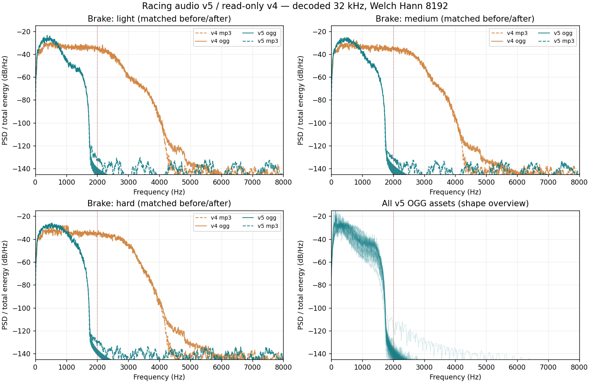

# מירוצים — ערכת צליל 5

הושלמו 23 צלילים מקוריים, 46 קובצי אודיו ודף האזנה מקומי. כל בדיקות העוצמה, הגודל, הספקטרום ותפרי הלולאות עוברות. הערכה מוכנה לסקירה וחיבור עתידי; קוד המשחק ונכסי v4 לא שונו.

תאריך: 17/11/2026. ענף המסירה: `codex/racing-audio-v5`. בסיס: `8ad88bada735ba9f50da6319ab708a4905bdc09c` מ־`origin/main`.

## היקף והאזנה

| תחום | תוצרים | אופי הצליל |
|---|---:|---|
| פיט | 4 לופים | מנוע איטי, מגביל מומנט רך, קרבת תא, צוות עמום |
| שוליים | 6 לופים | חצץ ועשב, 3 עוצמות לכל משטח, לפי מהירות |
| בלימה | 3 לופים | חיכוך צמיג רך, ללא תהודה מתכתית או חריקה חדה |
| האטה והורדת הילוך | 4 אירועים | מנוע יורד, הפסקת מומנט ופופ מפלט קטן |
| החלפת הילוך | 6 אירועים | 3 עליות עם ירידת סל״ד, 3 הורדות עם החזרת סל״ד קצרה |

1. מתוך תיקיית הריפו הריצו:

```sh
python3 -m http.server 8765 --bind 127.0.0.1
```

2. פתחו את [חדר ההאזנה המקומי](http://localhost:8765/workout/island/design/racing-audio-v5/listen.html). בחרו פורמט וכרטיס, או תרחיש פיט / שוליים / בלימה.
3. העבירו חצץ → עשב → אספלט ושנו מהירות; המעבר צריך להיות הדרגתי. השוו גם בקול המקורי המנורמל. כפתור העצירה והמקָש Esc עוצרים הכול.

אין הפעלה אוטומטית. כל הסקריפטים, האודיו והגופנים מקומיים; אין WASM, שירות סינתזה, דגימות חיצוניות, מודל דיבור או CDN. מגבלות אבטחה של דפדפנים עשויות לחסום פתיחה ישירה דרך `file://`; השרת המקומי הוא אופן ההפעלה שנבדק.

## עוצמה, נפח ומניפסט

| בדיקה | תוצאה סופית | דרישה |
|---|---:|---:|
| קובצי אודיו | 46 | OGG וגם MP3 לכל צליל |
| טווח עוצמה | -18.08 עד -17.97 LUFS-I | ‎−18 ±0.25 LU |
| שיא אמיתי מרבי | -4.76 dBTP | לכל היותר ‎−1 dBTP |
| קובץ מרבי | 23,616 בתים | עד 50,000 בתים |
| סך האודיו | 577,231 בתים | — |
| אנרגיה מרבית מעל 2 קה״ץ, יחסית לכל הספקטרום | -88.75 dB | לכל היותר ‎−45 dB |
| אותה מדידה בקצב הנגינה המרבי 1.08 | -73.86 dB | לכל היותר ‎−45 dB |
| קווים טונאליים משמעותיים מעל 2 קה״ץ | 0 בכל הקבצים ובקצב המרבי | 0 |

הקבצים במונו, 32 קה״ץ: OGG/Vorbis באיכות 3 ו־MP3/LAME ב־64 קילוביט לשנייה, עם מטא־נתוני Xing לחיתוך השהיית המקודד. הנרמול הוא הגבר ליניארי לכל קובץ, עם מדידה ותיקון אחרי הקידוד בנפרד בכל פורמט. אין נרמול דינמי המשנה את צורת הלולאה. העוצמה נמדדת על הקובץ המלא, ללא שכפול, הוספת שקט או דילוג על מעטפות.

עוצמות הערבוב נפרדות מהנרמול: מקור כל עוצמה קרוב ל־‎−18 LUFS, וההבדל במשחק מגיע גם מהגבר ההשמעה. כך אין סתירה בין נרמול אחיד לשלוש עוצמות. ב־`manifest.json` יש נתיב, גודל, SHA-256, עוצמה בפועל, שיא, seed, הגבר מומלץ, תחום מהירות ונקודות לולאה לכל תוצר.

| מזהה | סוג | משך מקור מתוכנן (שנ׳) | הגבר תמהיל (dB) | OGG / MP3 (בתים) |
|---|---|---:|---:|---:|
| `pit-engine-slow` | לולאה | 2.880 | -10 | 10,311 / 23,616 |
| `pit-limiter` | לולאה | 2.880 | -18 | 10,326 / 23,616 |
| `pit-bay-proximity` | לולאה | 2.880 | -24 | 10,097 / 23,616 |
| `pit-crew-background` | לולאה | 2.880 | -28 | 10,404 / 23,616 |
| `offtrack-gravel-low` | לולאה | 2.880 | -18 | 10,580 / 23,616 |
| `offtrack-gravel-medium` | לולאה | 2.880 | -14 | 10,607 / 23,616 |
| `offtrack-gravel-high` | לולאה | 2.880 | -10 | 10,396 / 23,616 |
| `offtrack-grass-low` | לולאה | 2.880 | -18 | 10,273 / 23,616 |
| `offtrack-grass-medium` | לולאה | 2.880 | -14 | 10,123 / 23,616 |
| `offtrack-grass-high` | לולאה | 2.880 | -10 | 10,397 / 23,616 |
| `brake-low` | לולאה | 2.880 | -18 | 10,190 / 23,616 |
| `brake-medium` | לולאה | 2.880 | -14 | 10,354 / 23,616 |
| `brake-high` | לולאה | 2.880 | -10 | 10,237 / 23,616 |
| `decel-downshift-01` | אירוע | 0.972 | -10 | 5,754 / 8,352 |
| `decel-downshift-02` | אירוע | 1.080 | -10 | 6,037 / 9,216 |
| `decel-downshift-03` | אירוע | 1.152 | -10 | 6,227 / 9,792 |
| `decel-downshift-04` | אירוע | 1.008 | -10 | 5,835 / 8,640 |
| `shift-up-01` | אירוע | 0.720 | -10 | 5,217 / 6,336 |
| `shift-up-02` | אירוע | 0.792 | -10 | 5,346 / 6,912 |
| `shift-up-03` | אירוע | 0.864 | -10 | 5,548 / 7,488 |
| `shift-down-01` | אירוע | 0.792 | -10 | 5,473 / 6,912 |
| `shift-down-02` | אירוע | 0.864 | -10 | 5,561 / 7,488 |
| `shift-down-03` | אירוע | 0.936 | -10 | 5,730 / 8,064 |

משכי האירועים בטבלה מתייחסים למקור לפני הדחיסה; זנבות Vorbis ומשך מפוענח עשויים להשתנות מעט בין מפענחים. המשכים שנמדדו בכל מפענח מתועדים בקובצי האימות. כל קובצי הלולאות מפוענחים ל־2.880 שניות, ונקודות החזרה נשארות בתוך הקובץ.

## לולאות ומעברים

כל לופ נוצר כמחזור מתמטי של 73,728 דגימות, 2.304 שניות. לפניו ואחריו 9,216 דגימות של אותו מחזור, 288 מ״ש מכל צד, כדי לתת הקשר למקודדים. משך הקובץ המלא 2.880 שניות; מנגנים רק את המקטע `[0.288, 2.592)` — דגימות `[9216, 82944)` ב־32 קה״ץ. נקודת הסיום אינה כלולה.

אין דעיכה לשקט בכל חזרה ואין צורך ב־crossfade בתוך המחזור. ההגבר עולה בתחילת ההשמעה ויורד בעצירה; דעיכה משולבת מתבצעת בהחלפת משטח או עוצמה. ללופ החצץ החלש הוחל היסט מחזורי של 4,096 דגימות כדי למקם את החיבור באזור יציב של חלונות Vorbis; המחזור לא קוצר ולא נערך עם שקט.

| בדיקת תפר אחרי פענוח | תוצאה |
|---|---:|
| OGG — ההפרש בין הדגימה שאליה חוזרים להמשך הצפוי, FFmpeg ב־32 קה״ץ | אפס מדויק בכל 13 הלופים |
| MP3 — שגיאת ההמשכיות המרבית | -83.69 dBFS |
| הפרש דגימות בתפר ביחס לאחוזון 99 של הפרשי הדגימות בתוך הלופ | עד 1.332 |
| שינוי שיפוע ביחס לאחוזון 99 | עד 0.978 |
| רינדור לולאות בדפדפן, שארית שינוי שיפוע מרבית | -65.65 dBFS |

הפרש בין שתי דגימות סמוכות יכול להיות שיפוע טבעי של המנוע; לכן הבדיקה מבחינה בינו לבין שגיאה מול ההמשך המחזורי הצפוי ובודקת גם נגזרת שנייה. סף שגיאת המשכיות הוא ‎−42 dBFS, ויחס השיפוע/העקמומיות לאחוזון 99 חייב להיות עד 6. ברינדור הדפדפן נבדקת שארית מקומית מתחת ל־‎−55 dBFS לאורך שני חיבורים רצופים. אלו ספי קבלה הנדסיים, ולא אישור תפיסתי של האזנה אנושית.

ערבוב מומלץ, וכך גם בדף ההאזנה: עוצמת־אב ‎−6 dB; בשוליים ובבלימה בלבד שקט מתחת ל־6 מ׳/ש׳, עלייה הדרגתית עד 12, מעבר עוצמה ב־18 וב־30; 450 מ״ש לכניסה וליציאה משוליים, 180 מ״ש לבלימה ו־650 מ״ש לפיט. שכבות הפיט יכולות להמשיך בעמידה. קצב ניגון הלופים מוגבל ל־0.82–1.08. במקור יש מעבר סינון ב־1,350–1,750 הרץ; גם בקצב המרבי תחום המקור מסתיים ב־1,890 הרץ.

## ספקטרום לפני ואחרי



נמדדו כל 12 קובצי האודיו הקיימים בתיקיית `workout/island/assets/racing-audio-v4` וכל 46 קובצי v5. קובצי v4 נקראו בלבד; SHA-256 לפני ואחרי המדידה זהים וגם תואמים לבסיס Git. רק לשלוש עוצמות הבלימה יש זוגות השוואה ישירים. חבטות ושפשוף צד נמדדו כהקשר בלבד; לפיט, חצץ, עשב והילוכים אין בתיקיית v4 דגימות תואמות. אין לייחס להן שיפור מדוד מול דגימה שאינה קיימת.

| בלימה / פורמט | אנרגיה מעל 2 קה״ץ לפני (%) | אחרי (dB יחסית לסך) | הפחתה (dB) | מרכז ספקטרלי לפני → אחרי (Hz) |
|---|---:|---:|---:|---:|
| `brake-low` / OGG | 10.9100% | -117.91 | 108.29 | 1119 → 444 |
| `brake-low` / MP3 | 10.8956% | -97.58 | 87.95 | 1119 → 444 |
| `brake-medium` / OGG | 14.4926% | -115.93 | 107.54 | 1160 → 507 |
| `brake-medium` / MP3 | 14.4856% | -97.64 | 89.25 | 1161 → 508 |
| `brake-high` / OGG | 17.3001% | -115.00 | 107.38 | 1234 → 577 |
| `brake-high` / MP3 | 17.4195% | -97.58 | 89.99 | 1236 → 578 |

ההשוואה נעשתה בפענוח מונו משותף ל־32 קה״ץ, בשיטת Welch חד־צדדית, חלון Hann של 8,192 דגימות וחפיפה של 50%; רזולוציית התדר 3.90625 הרץ. האנרגיה אינה משוקללת A או K; היא מנורמלת לכל הספקטרום כדי להשוות גוון בנפרד מהבדל ‎−16/−18 LUFS בין הגרסאות. ערכי v4 עשויים להיות שונים מעט מהדוח הישן שהשתמש ב־FFT של כל הקובץ.

קו חד נחשב משמעותי רק אם הוא מעל 2 קה״ץ, בולט ב־12 dB לפחות מעל חציון שכונה של ±80 הרץ ללא ±12 הרץ סביבו, ברוחב עד 30 הרץ וברמה של ‎−55 dB לפחות ביחס לשיא בתחום 40–2,000 הרץ. בנוסף לממוצע נבדקים חלונות של 256 מ״ש בצעד 64 מ״ש, כדי לזהות שריקה קצרה. בלופים חוזרות בדיקות הספקטרום והקווים גם בקצב המרבי 1.08; האירועים נבדקים בקצבם המוצהר 1.0. שאריות קידוד זעירות אינן מסווגות כשריקה.

חיכוך v4 רחב; אנרגיה גבוהה בתחום העליון לבדה אינה מוכיחה שריקה טונאלית. הערכה החדשה מקטינה את תחום החיכוך הגבוה ומוסיפה את התפקידים החסרים. לופי מנוע v2 עם שריקה שתועדה בקוד המשחק אינם דגימות v4 ואינם בסיס ההשוואה המספרית כאן.

## אימות ושחזור

דפדפן: Chromium 151.0.7922.173. כל 46 הקבצים פוענחו ונוגנו בפורמט מפורש; 104 רינדורי לולאה נבדקו ב־44.1 וב־48 קה״ץ, בקצבים 1 ו־1.08. עברו תרחישי פיט וקרבה לתא, חצץ/עשב/אספלט, שלוש בלימות וכל עשר וריאציות האירוע. נבדקו עצירה, Esc, ביטול כרטיס ממתין בזמן מעבר לתרחיש, החזרת קול מקורי לתמהיל, עוצמת־אב והיעדר ניגון אוטומטי. אין שגיאות JavaScript או בקשות חיצוניות. תצוגות 390×844 ו־1280×900 ללא גלילה אופקית.

בדיקה עצמאית בנתה מחדש את לופ החצץ המתוקן פעמיים בכל פורמט; ארבעת הפלטים תואמים בדיוק ל־SHA-256 במניפסט. הדגלים לשחזור של FFmpeg חלים גם על מעטפת OGG, כך שמספר הזרם קבוע. שחזור בבייטים מותנה באותן גרסאות כלי בנייה; גרסאות codec אחרות עשויות לשנות את הקידוד ולכן מחייבות הרצת מדידה מחדש.

כלים: Python 3, NumPy 2.3.5, SciPy 1.17.0, FFmpeg 7.1.5 עם libvorbis/libmp3lame; Matplotlib לתרשים. בדיקת הדפדפן משתמשת ב־Python Playwright וב־Chromium מקומי. אין התקנות או הורדות כחלק מהסינתזה. מתוך הריפו:

```sh
python -B workout/island/design/racing-audio-v5/synthesize.py
python -B workout/island/design/racing-audio-v5/analyze.py --validate
python -B workout/island/design/racing-audio-v5/verify-browser.py
npm test
```

תוצאות בדיקות הריפו: 4,270 עברו, 66 דולגו ו־3 נכשלו מתוך 4,339. שני כשלי המטמון קיימים כבר בבסיס: רשימת האופליין אינה ממוינת, ועשרה נתיבי סביבה קיימים אינם ברשימה שהבדיקה מצפה לה. הם שוחזרו בנפרד; המניפסט וקובצי הבדיקות זהים לבסיס. בדיקת רועיקי נכשלה כי חסר דפדפן ה־Playwright המוגדר; היא פתחה שרת לפני כשל ההפעלה, והתהליך נשאר פתוח. לאחר אימות התקלה הסתיים רק העובד התקוע והתקבל סיכום הריצה. בדיקת האודיו העצמאית משתמשת ב־Chromium המקומי וזכתה לכל האימותים לעיל. [תוצאות ותיעוד בסיס](repository-checks.json).

ראיות מלאות: [מדידות וקובצי בסיס](measurements.json), [אימות דפדפן](browser-verification.json), [המניפסט](manifest.json), [מקור הסינתזה](synthesize.py), [כלי המדידה](analyze.py), [בדיקת הדפדפן](verify-browser.py), [רישיון](LICENSE.txt). האודיו מוקדש ל־CC0-1.0; הקוד והתיעוד ברישיון MIT.

## מסירה וחיבור עתידי

שורת סשן מקומית: מירוצים / `codex/racing-audio-v5` / מוכן כשיש 23 צלילים בשני פורמטים, לולאות תקינות, מדידות, דף האזנה ודחיפה לענף. התוצרים נשמרים רק בתיקייה החדשה; קובצי הבקרה הקיימים לא נערכו בהתאם להגבלת המשימה.

בעת החיבור יש להעביר למערכת האודיו את מצב הפיט והקרבה לתא, להנמיך את המנוע הישן בנסיעה איטית ולהחליף בהדרגה את שכבת השוליים הפרוצדורלית ואת תגובות הבלימה וההילוכים. השארת המקורות הישנים יחד עם החדשים עלולה להשאיר את הרעש המקורי. מגביל המהירות הקולי אינו משנה את פיזיקת המהירות. וריאציות מאותה משפחה מופעלות אחת בכל פעם, בסבב ללא חזרה מיידית.

קוד המשחק, `release.json`, תגי גרסה וקבצים קיימים לא השתנו. לא בוצעו מיזוג, פריסה או האזנה אנושית בטלפון; בדיקות הקבלה כאן טכניות.
