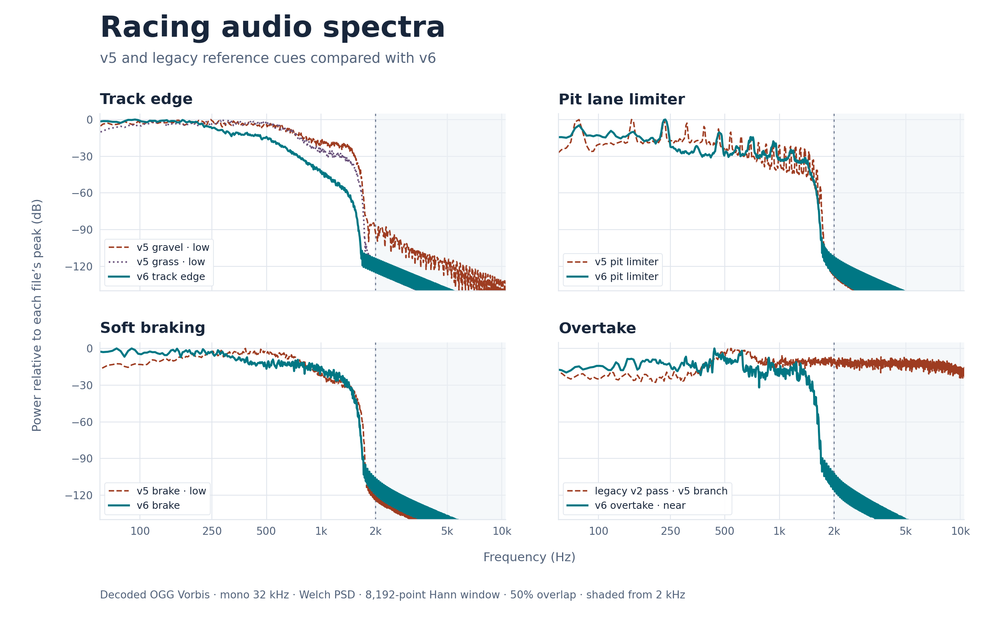

# צלילי המרוץ — v6

ערכת צליל מקורית ל־`workout/island` ובה 14 צלילים, 28 קבצים ושבע לולאות. קובצי האודיו נורמלו ליעד ‎−18 LUFS-I. המניפסט מגדיר הגבר ערבוב לכל תפקיד, כולל שלוש דרגות העומס של המנוע. הערכה נמצאת בענף `codex/racing-audio-v6`, שמבוסס על `main` בקומיט `f0a3b14e`. כל התוספות נמצאות בתיקייה זו. [מפרט ונכסים](manifest.json)

## האזנה מקומית

1. מתוך תיקיית הערכה הפעילו שרת מקומי.

   ```sh
   python3 -m http.server 8765 --bind 127.0.0.1
   ```

2. פתחו את [דף ההאזנה](http://127.0.0.1:8765/listen.html). בחרו פורמט וצליל. מצב ״מקור״ משמיע את הקובץ המנורמל. מצב ״מיקס משחק״ מחיל את העוצמה המומלצת ואת עוצמת האב ‎−6 dB.
3. השוו את שלושת עומסי המנוע במצב ״מיקס משחק״. תנו ללולאות השוליים והפיט לחזור פעמיים כדי לשמוע את החיבור. בפתיחה ישירה דרך `file://` דף ההאזנה משתמש בנגן המובנה. במצב שרת מקומי Web Audio מפענח את הקובץ מראש ומחבר את הלולאה ברמת הדגימה.

## עיצוב הצלילים

| מצב | תוצרים | אופי הצליל |
|---|---|---|
| זינוק | `launch-idle`, `start-lights`, `launch` | מנוע בעמידה סביב 3,350 סל״ד עם רטט שלדה. חמש פעימות וסימון כיבוי ברמזור מקוצר להדגמה. אירוע זינוק נפרד עם עליית סל״ד וקטיעת מומנט קצרה. |
| נהיגה | `engine-low`, `engine-medium`, `engine-high` | שלוש לולאות של 4.8 שניות. בכל אחת עליית סל״ד, צעד קצר בהעברת הילוך וירידה בשחרור מצערת. עומס גבוה מוסיף גוף מפלט ומשרעת הרמוניות. הגבר במיקס ‎−13, ‎−8 ו־‎−4 dB בהתאמה. |
| עקיפה | `overtake-near`, `overtake-wide`, `overtake-fast` | שלושה מעברים בסטריאו באורך 0.95–1.30 שניות. היסט הדופלר, העמימות, הצידוד ומשב הרוח משתנים עם גאומטריית המעבר. |
| חריגה קלה | `track-edge` | צמיג פוגש קצה אספלט. שכבת החיכוך מרוכזת בנמוכים ובאמצע, עם מגע רך ושינוי קרבה הדרגתי. הגבר במיקס ‎−22 dB. |
| נתיב פיט | `pit-limiter`, `pit-ambience` | לולאת מנוע נמוך עם ויסות מחזורי רך של המומנט, ולולאת אוויר ופעילות עמומה ברקע ב־‎−28 dB. |
| בלימה וצמיגים | `brake`, `tire-scrub` | מעבר חיכוך רחב שמתעגל ברגע הלחיצה, ושפשוף גומי קצר עם ירידת גובה ודעיכה רכה. |

הדגם מבוסס על מנוע ארבע פעימות V6, עם שלוש פעימות בעירה לסיבוב, סדרי הרמוניות ורטט שלדה. תבנית ההאצה וקטיעת המומנט נשענות על מאפייני הזינוק במירוץ והעקיפה בהקפה הראשונה באימולה. עיון התייחסות נערך בתיאור ה־onboard הרשמי ובמפרט יחידת הכוח. ההרמוניות, החיכוך והרוח נוצרו מספרית בשחזור מקומי. [פורמולה 1, מצלמות הזינוק באימולה 2025](https://www.formula1.com/en/video/2025-emilia-romagna-grand-prix-best-race-start-onboards.1832560145311132528) · [פורמולה 1, יחידת הכוח ומנוע V6](https://www.formula1.com/en/latest/article/explained-2026-power-unit-regulations-fia.68izKQ2tn1voQPWvgLVMXN) · [מקור הסינתזה](synthesize.py)

## מדידות ואימות

| מדד | תוצאה | סף |
|---|---:|---:|
| גודל מרבי לקובץ | 58,220 בתים | 60,000 בתים |
| עוצמה בכל 28 הקבצים | `−18.06 עד −17.95` LUFS-I | ‎−18 ±0.25 LU |
| שיא אמיתי מרבי | `−1.40` dBTP | ‎−1 dBTP |
| פער באורך מפוענח ביחס למניפסט | 0 דגימות ב־48 קה״ץ | עד דגימה אחת |
| יחס קפיצת הדגימה / שינוי השיפוע המרבי בתפר | `0.071 / 1.551` | `1.5 / 2.0` |
| קווים טונאליים חדים מעל 2 קה״ץ | 0 | 0 |
| אנרגיה מעל 2 קה״ץ ביחס לספקטרום המלא | `−111.10 עד −94.78` dB | — |

[מדידות לכל קובץ וחתימות SHA-256](measurements.json)

העוצמה המשולבת והשיא האמיתי נמדדו על כל קובץ מפוענח במלואו עם FFmpeg. בדיקת החיבור משווה את הפרש הדגימות ואת שינוי השיפוע על גבול הלולאה לאחוזון 99.9 של שתי שכונות בנות 100 מ״ש סביבו. >2 קה״ץ נמדד לאחר המרה למונו ל־32 קה״ץ, בחלון Hann של 8,192 דגימות ובחפיפה של 50% (`Welch`). קו נחשב חד כשהוא גבוה ב־12 dB מחציון שכונה של ±80 הרץ, אחרי הוצאת ±12 הרץ סביבו, רוחבו עד 30 הרץ ורמתו לפחות ‎−55 dB ביחס לשיא שבין 40 ל־2,000 הרץ. הבדיקה חלה גם בחלונות של 256 מ״ש בצעד 64 מ״ש ובערוצי הסטריאו בנפרד. [כלי המדידה](verify.py)

## ספקטרום מול v5

כל 46 הקבצים של ערכת v5 נקראו מקומיט `43975a996bff7baa4c1f90ede6b25d78e0fc7a66` ונמדדו באותה שיטה. השוואת השוליים משתמשת בשני משטחי החריגה החלשה של v5. מגביל הפיט משווה שכבת מגביל קיימת ללולאת מנוע ומגביל משולבת. מדידת הבלימה משווה לולאת חיכוך קיימת לאירוע קצר. נתוני התדר מתארים את הקבצים המנורמלים בטבלה, לפני הפחתות ההגבר במיקס. [ערכת v5 שנמדדה](https://github.com/roynaor-work/Bakasun/tree/43975a996bff7baa4c1f90ede6b25d78e0fc7a66/workout/island/design/racing-audio-v5)



בתרשים מופיעים קובצי OGG. כל עקומה מוצגת ב־dB ביחס לשיא של אותה עקומה. ההצללה מתחילה ב־2 קה״ץ. העקיפה המוקדמת בתרשים מגיעה מנכס v2 שקיים בקומיט של ענף v5.

| לפני | אחרי | מעל 2 קה״ץ OGG (dB) | מעל 2 קה״ץ MP3 (dB) | מרכז ספקטרלי OGG (Hz) |
|---|---|---:|---:|---:|
| `offtrack-gravel-low` | `track-edge` | `−88.75 → −111.10` | `−97.64 → −99.58` | `345 → 166` |
| `offtrack-grass-low` | `track-edge` | `−118.04 → −111.10` | `−97.62 → −99.58` | `357 → 166` |
| `pit-limiter` | `pit-limiter` | `−116.22 → −106.36` | `−97.80 → −98.49` | `265 → 265` |
| `pit-engine-slow` | `pit-limiter` | `−116.18 → −106.36` | `−97.95 → −98.49` | `244 → 265` |
| `pit-crew-background` | `pit-ambience` | `−114.38 → −110.40` | `−97.63 → −99.59` | `526 → 187` |
| `brake-low` | `brake` | `−117.91 → −107.35` | `−97.58 → −98.98` | `444 → 285` |

בקצה האספלט, ברקע הפיט ובבלימה ירד מרכז הספקטרום. אנרגיית ה־OGG מעל 2 קה״ץ עלתה לעומת כמה מקובצי v5 שכבר סוננו בחוזקה, ונשארה נמוכה מ־‎−100 dB בשורות ההשוואה האלה. בכל ששת זוגות ה־MP3 היתה ירידה באנרגיה מעל 2 קה״ץ. בשתי הערכות לא נמצאו קווים חדים בקבצים שבטבלה.

### נכסי משחק קודמים שנמצאים בענף v5

ערכת v5 לא כללה דגימות מקבילות של גריד, שלוש דרגות מנוע, עקיפה או חריקת צמיג. המדידה המשלימה משתמשת בנכסי v2 תחת `workout/island/assets/racing-audio-v2` בקומיט של v5. ברמזור ובזינוק עצמו אין זוג השוואה ישיר.

| לפני | אחרי | מעל 2 קה״ץ OGG (dB) | מעל 2 קה״ץ MP3 (dB) | מרכז ספקטרלי OGG (Hz) |
|---|---|---:|---:|---:|
| `engine-idle` | `launch-idle` | `−9.98 → −109.49` | `−9.97 → −98.72` | `783 → 196` |
| `engine-low` | `engine-low` | `−7.91 → −105.22` | `−7.80 → −98.60` | `1,026 → 398` |
| `engine-mid` | `engine-medium` | `−6.84 → −102.82` | `−6.78 → −98.15` | `1,378 → 512` |
| `engine-high` | `engine-high` | `−6.66 → −102.13` | `−6.60 → −97.63` | `1,655 → 585` |
| `pass-whoosh` | `overtake-near` | `−2.04 → −102.80` | `−1.97 → −95.81` | `3,842 → 546` |
| `tyre-squeal` | `tire-scrub` | `−5.77 → −100.19` | `−5.61 → −98.34` | `2,109 → 685` |

הבדיקה מצאה קווים צרים בדגימות המנוע המוקדמות בסביבות 2.10–2.40 קה״ץ. בגרסאות v6 החדשות הקריטריון זיהה אפס קווים, גם בחלונות הקצרים. [נכסי v2 בקומיט של v5](https://github.com/roynaor-work/Bakasun/tree/43975a996bff7baa4c1f90ede6b25d78e0fc7a66/workout/island/assets/racing-audio-v2)

## שחזור

הסינתזה והבדיקה משתמשות ב־Python 3, NumPy, SciPy וב־FFmpeg עם `libvorbis` ו־`libmp3lame`. המקורות והאודיו מקומיים והנגן מסתמך על מפענחי הדפדפן, ללא WASM. מתוך שורש הריפו אפשר לבנות לתיקיית עבודה נפרדת ולמדוד את החבילה שב־checkout. `git fetch` משמש רק להבאת אובייקטי הבסיס להשוואה, ו־`verify.py` קורא מהם ישירות.

```sh
kit=workout/island/design/racing-audio-v6
render_dir=$(mktemp -d)
python3 -B "$kit/synthesize.py" --output-dir "$render_dir"
git fetch --no-tags origin refs/heads/codex/racing-audio-v5
python3 -B "$kit/verify.py" --baseline-ref 43975a996bff7baa4c1f90ede6b25d78e0fc7a66
```

בנייה חוזרת הפיקה את אותן 28 חתימות SHA-256 ב־Python 3.12.14, NumPy 2.3.5, SciPy 1.17.0 ו־FFmpeg 7.1.5. הדחיסה משתמשת ב־Xing/LAME לסימון דגימות ההשהיה ב־MP3. הבנייה בודקת את התפר המפוענח ומיישמת מעבר מעוגל של 6–14 מ״ש בגבול הלולאה. לולאה משתמשת בכל הדגימות המפוענחות.

Chromium 151 פענח והשמיע את כל 28 הקבצים דרך שרת מקומי. שבע הלולאות נבדקו בשני הפורמטים, ב־44.1 וב־48 קה״ץ, בשתי חזרות לכל צירוף. השארית המרבית בשינוי השיפוע היתה ‎−60.06 dBFS. נבדקו גם עצירה, מעבר פורמט, גיבוי MP3 אחרי כשל OGG, מעבר למיקס והצגה ברוחבים 320–1280 פיקסלים. מדיניות הדפדפן בסביבת הבדיקה חסמה ניווט ישיר ל־`file://`. מסלול הנגן המובנה נבדק על שרת מקומי לכל 28 הקבצים. האימות בוצע במדידה ובדפדפן. הערכת שמיעה במכשיר עדיין פתוחה.

בדיקות המירוץ הקיימות הסתיימו עם 351 עוברות ודילוג אחד. הרצת `npm test` לכל המאגר נעצרה בתום 100 שניות לפני שהגיעה לסיכום.

בתוך המשחק מצבי הגריד, הנהיגה, העקיפה, השוליים והפיט יוכלו להפעיל את הקבצים לפי המיפוי במניפסט. בזמן פיט או חריגה קלה, ערבוב מדורג יחליף את שכבת הרעש הקיימת בהדרגה. לולאות המנוע כוללות שינוי סל״ד אפוי, ולכן נועדו להחלפה לפי דרגת עומס. `pit-limiter` מוסיף צליל של מגביל, והפיזיקה קובעת את המהירות. [מניפסט](manifest.json) · [רישיון](LICENSE.txt)
